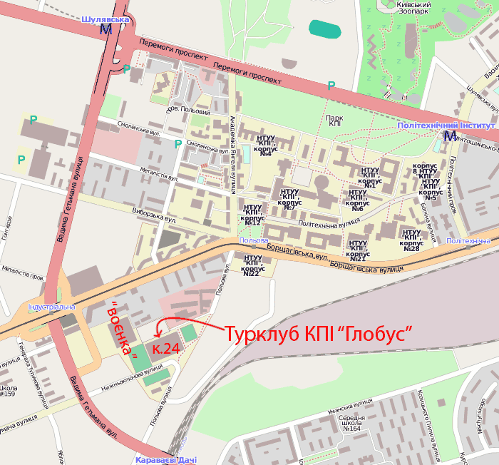

Турклуб КПІ "Глобус" існує (з перервами) з 1952 року. За цей час тисячі людей змогли побувати на Кавказі, Памірі, в Карпатах, Криму, отримати незабутні враження і повноцінно відпочити.

Досягнення членів клубу - першопроходження, експедиції у важкодоступні райони, високі місця на змаганнях говорять самі за себе. У 2000р. клуб відновив свою діяльність за підтримки і під керівництвом профкому студентів КПІ.

Докладніше про історію клубу можна прочитати в спогадах Боборикіна О. Г. ["Туризм в Київському Політехнічному Інституті"](https://www.tkg.org.ua/node/55) та послухати у лекції Танигіна Ю.І. [з історії туризму в Україні, Києві та КПІ](https://www.tkg.org.ua/node/24216).

Турклуб КПІ "Глобус" [запрошує початківців й досвічених туристів](https://www.tkg.org.ua/node/6326), всіх, для кого слово "гори" асоціюється не тільки з купами каміння, а слово "похід" - не тільки з ненависним тягарем наплічника, взяти участь в житті нашого турклубу. Ані вік, ані "вузівська приналежність" значення не мають - ми відкриті для всіх бажаючих.

## Напрями діяльності

-   [проводимо змагання](https://www.tkg.org.ua/competitions) з техніки туризму, орієнтування, виживання (а також беремо участь в загальнодержавних, обласних тощо);
-   організуємо й проводимо походи різних видів й категорій складності по Україні, Кавказу та іншим регіонам Європи і Азії;
-   [навчаємо і готуємо](https://www.tkg.org.ua/node/10295) бажаючих в секціях гірського і пішохідного туризму, а також в школі інструкторів [карпатського табору "Глобус"](/camp);
-   [проводимо вечори](https://www.tkg.org.ua/node/10294), зустрічі з цікавими людьми;

Зв'язатися з нами ви можете, поставивши запитання в [форумі](https://www.tkg.org.ua/forum "Форум"), написавши листа на адресу турклубу [info@tkg.org.ua](mailto:info@tkg.org.ua "Написати лист"). Перелік керівників груп, в які проводиться набір наведено [тут](https://www.tkg.org.ua/node/6326).

## Розташування клубу

  

Розташування клубу

Клубні заходи як правило відбуваються у **Спорткомлексі (24-й корпус)** НТУУ "КПІ" (див. [карту](https://www.tkg.org.ua/node/1965 "Розташування клубу"), за адресою вул. Польова, 38/1 вона ж вул. Верхньоключова, 1/26), ауд. 402 або 406 - при вході в корпус наліво, 4 поверх. Потрапити туди можна: - від ст. метро "Шулявська" (від метро їхати тролейбусом три зупинки до "Індустріального мосту" або чотири до "вул. Лебедєва-Кумача"), пройти біля 5 хв.; - від ст. метро "Політехнічний інститут", йти 25 хв. через територію НТУУ "КПІ" (перетнути лінію швидкісного трамваю на зуп. "Польова"); - від зупинки швидкісного трамваю "вул. Польова", пройти пішки по вул. Польовій 5 хв.; - від залізничної станції "Караваєві Дачі", пройти до зуп. тролейбуса "вул. Лебедєва-Кумача" і далі по вул. Нижньоключовій, загалом 15 хв.

## Сторінки розділу на старому сайті

-   [Набори в групи](https://www.tkg.org.ua/node/6326)
-   [Плани клубних заходів](https://www.tkg.org.ua/node/6325)
-   [Розташування турклубу](https://www.tkg.org.ua/node/1965)
-   [Табір "Глобус" у Карпатах](/camp)
-   [Про нас у пресі](https://www.tkg.org.ua/node/4697)
-   [Звіти про діяльність клубу](https://www.tkg.org.ua/node/17763)
-   [Положення про Турклуб КПІ Глобус](https://www.tkg.org.ua/node/31876)
