Оскільки нещодавно мав можливість безпосередньо ознайомитися з природою, системою її збереження і охорони, та рекреаційною діяльністю в США, вирішив поділитися своїми враженнями. Подальший текст абсолютно не має за мету агітувати за відпочинок в США, оскілки загальновідомо, що така можливість є занадто обмеженою для власників паспортів з тризубом, проте маю надію, що дещо з наведеної далі інформації може бути корисним для того, кого доля закине в цей далекий край, або наведе на роздуми, що нам робити далі з власною природою в Україні. Розповідь поділена на дві незалежні частини: загальну інформацію, щодо туризму в США та опис нашої нещодавньої мандрівки найвизначнішими природними об?єктами північноамериканського континенту.

Скорочення, що зустрічаються у тексті та їх пояснення:  
NP - National Park - Національний парк; виключення для Mojave NP - National Preserve - заказник державного значення  
SP - State Park - Регіональний парк  
NF - National Forest - Державне лісництво, ліс  
SB - State Beach - Державний пляж

* * *

  

**Частина 1.**

Досить поширеним стереотипом відносно стану збереження природи і доступності її для туристів на Заході є погляд, що там ніби давно усі природні комплекси трансформовані (знищені) цивілізацією, а з залишків зроблено Національні Парки, де свобода туриста сильно обмежується. Відповідно у нас, в Україні, просто рай для туристів - можна робити все що заманеться і де заманеться (зізнаюся, я теж колись був в цьому переконаний). Відносно першого твердження: можливо це є дуже близьким до правди для деяких Європейських країн, з великою щільністю населення, проте це ані в найменшому ступню не відповідає правді по відношенню до США, про що згодом трохи розповім.

Відносно другого речення: коли можна робити все що заманеться (а в Українських умовах це ще узалежнено від службового становища та розміру банківських рахунків), це в жодній мірі не є свободою, а бардаком. Такий стан речей призводить до повної неповаги до природоохоронного законодавства на всіх рівнях суспільства, непомірного засмічування природи, безконтрольного розкрадання території природно-заповідного фонду з подальшою приватизацією тощо. "Білим" дійсно дозволено все, натомість звичайні туристи формально навіть позбавлені можливості відвідувати деякі Національні Парки чи навіть державні ліси в Криму без супроводу спеціальних інструкторів (яких де-факто немає). Немає жодних ознак, що хтось, від кого залежить стан речей в галузі туризму в Україні, мають щонайменше бажання ознайомлюватися з досвідом цивілізованих країн чи, тим паче, переймати його. Тим не менш хочу коротко ознайомити з системою охорони природи та організацією рекреаційної діяльності в США. Немає мови, аби вести розмову про переймання американського досвіду в цілому - щільність населення в США і Україні значно відрізняється - натомість окремі елементи заслуговують на увагу.

Типове приватне ранчо в Південній Дакоті

Колись давно, у школі, мене вчили, що нібито Україна є унікальна в світовому масштабі своїми збереженими степами, переконували в унікальності збережених степів на острові Хортиця. Пізніше я багато подорожував півднем України, але кількістю збережених степів вражений не був - кілька жалюгідних клаптиків, як для масштабу такої великої країни. Натомість я був сильно вражений, коли летів літаком над американським штатом Південна Дакота. Фактично значна територія цього величезного штату (який дорівнює за розміром одній третині України) - це один безкрайній степ, що називається тут прерією. І нікому не спадає на думку все розорати та засіяти. І так тут не лише в Дакоті. Великі території знаходяться у приватному володінні, проте навіть вони не розорюються. Бо мешканцям великих ранчо приємніше мати хатиночку посеред степу, ніж посеред кукурудзи.

Інший приклад - морське узбережжя. Українська тенденція - виводити (викрадати) землі з ПЗФ на узбережжі та забудовувати приватними віллами. Американські реалії: Каліфорнійське узбережжя Тихого Океану - величезні площі належать до державних пляжів - приватизація земель та приватна забудова тут заборонені. Заборонені і крапка. Незважаючи на те, що охочих поставити собі хатиночку на березі океану знайшлося б багато, незважаючи на те, що земля та нерухомість в Каліфорнії коштують астрономічних грошей.

Тепер, щодо туризму в США. Головним питанням тут є питання землевласництва.

Перед тим, як відправитись кудись на прогулянку варто знати до кого належить земля. Якщо земля є приватною власністю, то гуляти там без запрошення власника не є добрим помислом, це поза етикою. Також не є доброю ідеєю відправитися у похід до Індіанської резервації, якщо індіанці вас не запрошували. Правда на території деяких індіанських племен розташовуються туристичні атракції, індіанці заробляють на цьому гроші і, відповідно, радіють туристам.

**Публічні території, які доступні для відвідування туристами.**

_Землі, що належать до Державних лісництв_ _(National forests, National grasslands)_.

> В США нараховується 155 Державних лісів, що займають 769 000 км2, або 8.5% загальної території країни. Оскільки площі Державних лісництв на сході країни складають лише 13% від загальної, Уряд скуповує приватні землі в східних штатах і організовує в них нові лісництва. На території Державних лісів розташовано багато гірськолижних курортів. На території Державних лісів, як правило, Ви маєте повну свободу пересування. Ви можете ходити (їздити), ночувати там де вам заманеться. Лише одне обмеження - ваш намет має стояти не ближче 200 футів від джерел, річок, стежок, доріг.
>
> У більшості (але не всюди) державних лісів та степів діє заборона на використання відкритого вогню поза визначеними місцями (fireplace). Користуватися газовими (чи іншими) пальниками можна без обмежень. Якщо Вам ліньки самому шукати собі місце для намету, хочеться мати столик, вогнище чи мати поблизу цивілізований туалет (іноді навіть і душ) - треба шукати Campsite, або Campground. Але за такий сервіс вже треба платити (15 USD плюс-мінус в сезон з авто). Для більшості Campground є можливість резервації місця через інтернет. Одним з найбільших централізованих сайтів для резервації місця на кемпінгах є: [http://www.reserveamerica.com/](http://www.reserveamerica.com/)
>
> Якщо Ви не хочете ночувати на кемпінгу, як я вже згадував, Ви можете заночувати у довільному місці у лісі - "dispersed camping". Правила відвідування та здійснення рекреаційної діяльності можуть відрізнятися в різних Державних лісах і степах, тому перед мандрівкою бажано ознайомитися з правилами відвідування обраного лісу на сайті Державної Лісової Служби США (USDA Forest Service): [http://www.fs.fed.us/](http://www.fs.fed.us/)
>
> Для полегшення вибору місця для прогулянок та походів державні ліси мають мережу промаркованих стежок - hiking trails. Турист не зобов?язаний ходити саме цими, визначеними стежками, проте такі стежки зазвичай організовуються в найбільш цікавих місцях. Єдине про що просять туриста - не натоптувати нових стежок. Маркування на стежках в Державних лісах може бути досить поганої якості - іноді це просто нерегулярно пришпилені до дерев пластикові трикутнички. Іншою проблемою є мапи. В це важко повірити, проте в США є проблема з якісними туристичними мапами. Для величезних територій їх просто не існує в природі. Візьмемо як приклад територію величезного Black Hills NF в Південній Дакоті. Цей ліс за розміром можна порівняти з Кримською гірсько-лісовою зоною. Туристичної мапи немає. Є видані на окремих аркушах (поширюються безкоштовно) схеми для усіх hiking trails. Проте навіть румуни роблять значно якісніші схеми. Ходити по таких схемах вкрай важко - поза власне переходами на цих схемах нічого немає. Залишаються топографічні мапи. Їх можна безкоштовно завантажити з інтернету. Єдиним плюсом цих мап є вбудована прив?язка до координатної сітки. Топооснова цих мап з 1970-х років, стежок на мапі немає взагалі. Є лише мережа доріг, абсолютно застаріла. Спочатку я думав, що для безкоштовного завантаження надаються якісь старі мапи, проте пізніше я мав нагоду тримати видану поліграфічним способом, нову мапу - вона майже не відрізнялася від тієї, що лежала у мене в комп?ютері.
>
> В структуру Державної Лісової Служби США входять також Державні степи - National Grasslands. На їх території туристи також мають волю пересування. Останніми роками в США активно діє Національна програма відновлення степів. Лише в одному штаті, Іллінойс, з 1997 року було відновлено віддано до публічного користування 61 км2 степу.

_Національні парки._

> Система Національних Парків (National Park System, NPS) нараховує 391 природний об?єкт, з яких 58 це власне Національні Парки. Загальна площа територій, що знаходяться в адмініструванні NPS - 338,000 км2. Перший у Світі НацПарк - Yellowstone NP - було зорганізовано в 1872 році саме в США. Основна роль НацПарків - це збереження природи, освітньо-виховна діяльність, рекреація і туризм. Організовуються НацПарки в найбільш цікавих та привабливих місцях. Концепція НацПарків в США відрізняється від загальноприйнятої в Європі. Основна різниця полягає на тому, що сервіс в НацПарках США орієнтований, в першу чергу, на автотуристів. Через НацПарки наскрізь проходять якісні дороги, до усіх найцікавіших місць можна під?їхати на авто впритул, вхідна плата стягується з авто, а не з особи. Відповідно вся інфраструктура розміщується вздовж доріг. Відвідування НацПарків завжди платне. В залежності від розміру та популярності парку розмір оплати коливається від 1 до 25 USD з авто на тиждень.
>
> Проте за 80 USD можна купити річний абонемент "Beautiful America" який дозволяє даному авто в?їжджати до усіх об?єктів, що належать до системи NPS на протязі року. На території НацПарків автотуристам (пішохідники - окрема тема) заборонено ночувати поза кемпінгами чи готелями. Зазвичай ціни на кемпінги і особливо готелі вищі, ніж поза межами НацПарків.
>
> Для територій НацПарків є окремо видані туристичні мапи, а якість розмітки стежок (hiking trails) є значно кращою, ніж в Державних лісах. На перехрестях стежок встановлені звичні для Європи дороговкази. Проте вказується не час переходу, а відстань у милях.
>
> Тепер щодо пішохідного/гірського туризму. Для "справжніх" туристів в НацПарках існують спеціально відведені території - Backcountry та Wilderness. Часто, для відвідування таких територій є необхідним отримання за окрему платню спеціальних дозволів (permits). До wilderness (заповідних) територій денна кількість дозволів може бути обмежена. Ще одна істотна різниця з Європою полягає на тому, що в Європейських НацПарках категорично забороняється (як правило) ночувати в наметах поза територією туристичних притулків, а притулки розташовано максимум на відстані денного переходу один від одного. Натомість в США уся інфраструктура знаходиться вздовж доріг, а в віддалених частинах парку жодних притулків може не бути взагалі - відповідно дозволяється бівакування в наметах вздовж туристичної стежки. І навіть більше - відкритий вогонь може бути дозволений! Правила відвідування та здійснення рекреаційної діяльності можуть істотно відрізнятися в різних НацПарках, тому перед мандрівкою бажано ознайомитися з правилами відвідування обраного НацПарку на сайті Служби НацПарків США (National Park Service): [http://www.nps.gov/](http://www.nps.gov/)
>
> [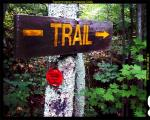](https://www.tkg.org.ua/node/7048)
>
> [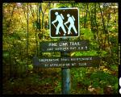](https://www.tkg.org.ua/node/7050)
>
> [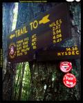](https://www.tkg.org.ua/node/7049)
>
> [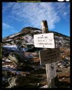](https://www.tkg.org.ua/node/7053)
>
> [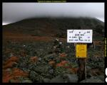](https://www.tkg.org.ua/node/7051)
>
> [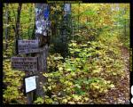](https://www.tkg.org.ua/node/7052)
>
> [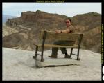](https://www.tkg.org.ua/node/7054)
>
> Елементи туристичної інфраструктури
>
> Крім того, для НацПарків першої десятки (Yellowstone NP, Yosemite NP, Grand Canyon NP тощо) видавництвами "Frommer?s" і "Lonely Planet" видані путівники. Мав можливість протестувати путівники "Frommer?s" для Yosemite NP та Grand Canyon NP. Не скажу, що був з них дуже задоволений, проте ліпше мати такі, ніж жодних.

_Регіональні парки - State parks._

> Це території подібні за призначенням до НацПарків. Відрізняються меншим розмахом рекреаційної діяльності, і на відміну від НацПарків, підпорядковуються не Федеральному Урядові, а урядові відповідного штату. Перший Регіональний парк було створено у Каліфорнії (зараз це Yosemite NP) у 1864 році, тобто фактично раніше, ніж було створено перший НацПарк! Деякі парки займають величезні території - площа Wood-Tikchik SP на Алясці складає 6500 км2. Відвідування Регіональних Парків зазвичай є платним у сезон, хоча поза сезоном може бути і безкоштовним. Дія абонементу "Beautiful America" на території регіональних парків не поширюється. Розмір оплати встановлюється кожним штатом.
>
> В Південній Дакоті, наприклад, відвідування всіх регіональних Парків коштує 20 USD з авто на рік.
>
> [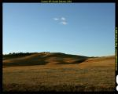](https://www.tkg.org.ua/node/7055)  
>
> Охорона степу в Custer SP
>
> Тобто 1 раз платиш і потім без перешкод можеш відвідувати усі парки штату. В деяких штатах мережа регіональних парків є дуже густою, а окремі регіональні парки є дуже цікавими, незважаючи на свій "нижчий" статус. Так, наприклад, у Custer SP в Південній Дакоті можна побачити найбільше у світі стадо бізонів. Крім того в парку живуть великі популяції антилоп, оленів та інших тварин, які відвідувачі дуже легко можуть побачити з авто. В окремі дні року за додаткову оплату можна проїхатися на джипах з рейнджерами посеред стада бізонів. Взагалі цей парк значною мірою нагадує острів Бірючий в Україні - теж степ і теж величезні стада диких копитних тварин. Проте між цими парками є одна суттєва різниця: насолоджуватися природою Бірючого (який має статус НацПарку!!!) донедавна доступно було лише для "білих", натомість Custer SP відкритий для кожного!
>
> Оскільки правила перебування в Регіональних Парках встановлюються окремо кожним штатом, необхідно ознайомлюватися з ними на відповідних сайтах в інтернеті. Загального сайту для них не існує.
>
> Невеликі за розміром парки можуть знаходитись в підпорядкуванні міст, біля яких вони знаходяться. В такому випадку місто регулює відвідування території. Для прикладу наведу правила відвідування правила відвідування "Lookout peak" парку, який видно з мого вікна: полювання заборонено, ночівля заборонена, відкритий вогонь заборонений, турист зобов?язаний забрати з собою абсолютно все, що він приніс.
>
> [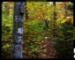](https://www.tkg.org.ua/node/7056)  
>
> Туалети не є несподіванкою в американських лісах, скоріше правилом.
>
> _Прокоментую останню позицію з цих правил. В США вона є однією з найважливіших. Всюди - чи то є чиясь приватна територія, чи державний ліс, чи то НацПарк панує абсолютна чистота! Цьому сприяє кілька чинників: виховання та ментальність, розвинена інфраструктура біля місць активного відпочинку, а також система штрафів... По черзі, по кожній позиції: Коли ми запитали наших американських колег, чи трапляється таке, що вони підуть великою компанією до лісу, а потім щось залишать у лісі (пляшки, папірці), американці нас не зрозуміли... По-перше, така поведінка не приймається суспільством, по-друге, за таке оштрафують рейнджери. Під час пікніків та кількаденних виходів однією з перших чинностей є організація великих пакетів для сміття._
>
> На абсолютно всіх picnic area, rest area, camping area встановлені ЧИСТІ туалети (не біо). Отже нікому не прийде в голову бігати до лісу.
>
> Штраф за викидання будь-якого сміття (папірець, пляшка) з вікна авто в Каліфорнії дорівнює 1000 USD. І будьте певні - якщо в США поліціянт чи рейнджер  
> має вас оштрафувати, він вас оштрафує.
>
> В Україні ж на сміттєзвалище перетворено навіть найсвятіше - Говерлу! Якщо є очевидна проблема з першими двома пунктами в Україні, то що заважає застосувати третій пункт!? Чи треба з кінцями втопити нашу природу в смітті, перш ми зрозуміємо, що з нами щось не те...

Далі, _Пам?ятки Природи Національного Значення - National Monument._

> Відрізняються від НацПарків меншими розмірами, створюються не для охорони цілісних природних комплексів, а окремих елементів природи. Адміністрування NM здійснює служба НацПарків, NPS. Відвідування платне, але поширюється дія абонементу "Beautiful America".

_Публічні землі, що знаходяться в адмініструванні BLM (Bureau of Land Management)._

> Землі BLM займають площу 1 060 000 км2, або 1/8 загальної території США. На територіях, що належать до BLM можуть розташовуватися заказники чи інші заповідні землі. В такому разі BLM регулює режим їх відвідування.

Території, основною метою яких є збереження окремих природних комплексів - _державні заказники (National Preserve) та заповідники (wilderness)_.

> Зазвичай вони не орієнтовані на рекреаційну діяльність, проте відкриті для відвідування, часто безкоштовного. Такі території не є формою земельної власності, і тому можуть розташовуватися на землях які належать НацПаркам, Державним лісництвам, BLM чи Індіанським резерваціям.
>
> Заповідники-wilderness організовуються для охорони природних комплексів, що ніколи не були трансформовані людиною.
>
> Загальна площа 680 wilderness територій, які знаходяться на федеральних землях - 430 000 км2, що складає 5% території країни. На територіях wilderness, як правило, заборонено пересування автотранспортом та взагалі будівництво доріг, проте дозволяється піший, кінний туризм, полювання, рибна ловля, наукові дослідження тощо.
>
> Найбільший заповідник-wilderness знаходиться на Алясці і займає площу 51 570 км2. Найбільшим wilderness поза Аляскою є Death Valley Wilderness на території Death Valley NP в Каліфорнії.
>
> Wilderness федерального підпорядкування можуть розташовуватися на землях НацПарків, Державних лісів, BLM. Крім того, уряди штатів чи індіанські резервації можуть організовувати wilderness на своїх землях і самостійно  
> регулювати правила перебування в них.
>
> Декілька найвідоміших прикладів wilderness: Paria Canyon-Vermilion Cliffs Wilderness - знаходиться в Північній Арізоні на землях BLM. Отже порядок відвідування регулює саме ця організація.
>
> До складу wilderness входять Койотові гори, Coyote Buttes, з надзвичайно цікавою і неймовірно мальовничою геологічною формацією - "The Wave". Це місце є унікальним у світовому масштабі і приваблює професійних фотографів з усього світу. Аби зберегти красу цього місця встановлено квоту на відвідування - 20 осіб на день! 10 осіб можуть зарезервувати день відвідування в інтернеті з 3-місячним упередженням, а решта 10 місць розігруються в процесі лотереї на місці, о 9 годині ранку.
>
> Antelope Canyon Navajo Tribal Park - природоохоронна територія, що зорганізована індіанцями племені Навахо в своїй резервації в Арізоні. Як і попереднє місце, Каньйон Антилопи є неймовірно фотогенічним і притягує тисячі професійних фотографів. Адміністрування території повністю здійснюється Індіанською резервацією (Navajo Parks and Recreation Department), причому індіанці відкрили каньйон для загального доступу лише в 1997 році. Перебування в каньйоні можливо лише у супроводі працівників, а фото сесії обмежені у часі  
> кількома годинами. Прикладом Державного заказнику є величезний Mojave NP розташований в мальовничій пустелі Мохаве. Територія знаходиться в адмініструванні NPS. Відвідування заказника є безкоштовним.

_Державні пляжі - State beach_.

> Фактично це дикі пляжі, на яких дозволена рекреаційна діяльність. Відвідування таких пляжів є безкоштовним, однак аби залишити десь авто (на пляж в?їжджати автотранспортом заборонено) скоріше за все прийдеться заплатити. При Державних пляжах завжди розташовані кемпінги, проте, то може бути не таким простим, потрапити на кемпінг. Аби гарантувати собі відпочинок на кемпінгу біля пляжу в Південній Каліфорнії, американці резервують собі місця кілька місяців наперед.

Отже мережа публічних територій, пристосованих для туризму і рекреації в США є дуже густою, і займають вони чималі площі. Американці змогли зберегти незміненими величезні простори своєї чудової природи. Природоохоронні традиції в США мають довгу історію - перші НацПарки тут почали організовувати ще у XIX ст.! Є території платні для туристів (але важко вважати суму в 80 USD з авто на рік непід?ємною), є безкоштовні. В обох випадках є чітко виписані і легкозрозумілі правила за якими грає турист та рейнджери. Немає мови, що ввечері прийде якийсь не дуже тверезий лісник, та буде намагатися вас вигнати з лісу (бо ви його відвідуєте у пожежонебезпечний період) чи стягнути з вас якусь платню за не відомо які послуги. Натомість, якщо Ви порушили правила перебування, насмітили і Вас "накрили" - штрафу не уникнути. Крім того, можете бути впевнені, що за свою оплату Ви отримаєте якісний сервіс (туалети, столи, мангали) і ідеальну чистоту. Скажіть будь-ласка, який сервіс Ви отримуєте на території Кримських лісництв коли оплачуєте стоянку у лісі (перебування в Кримських лісах є платним(!), якщо хтось не знає)...

**Популярність туризму в США**

На перший погляд може здаватися, що довгі походи з рюкзаками не є популярними в США, що американці надають перевагу лише коротким прогулянкам чи просто бівакуванню. Але таке враження скоріше пов?язано з тим, що короткі прогулянки, як зрештою і всі види активності на природі (велосипед, лижі, біг, полювання тощо) є надзвичайно популярними в США, і американці присвячують цьому дуже багато часу. Принаймні та частина суспільства, що має вищу освіту. Кількість часу, яку витрачають на таку активність американці та українці не до порівняння. Але короткі денні прогулянки не заважають американцям ходити в походи з інтенсивністю, цілком порівнювальною з нашою.

**Безпека на маршруті**

В США шанси зустріти злих бездомних собак дорівнюють нулю, проте не бракує інших тварин, що можуть становити потенційну загрозу. На більшості території США в лісах, степах і пустелях живуть гримучі змії. На півдні країни зустрічаються смертельно отруйні види гримучих змій, скорпіони та каракурти. Крім того, окремі штати населяють великі популяції пум та ведмедів. Відомі випадки нападу пум на людей, особливо в Каліфорнії. В тій же Каліфорнії щодня ведмеді охоче розбивають десятки автомобілів. Не треба забувати і про отруйні рослини - в лісах середньої смуги розповсюдженим видом є отруйний плющ, який може спричинити значні хімічні опіки.

І все ж таки, незважаючи на це все, американці ходять і в гори і в пустелі, а до цих небезпечних створінь ставляться абсолютно спокійно. З власного досвіду можу порадити вдягати під час мандрівок високе закрите взуття та довгі штани.

**Термінологія**

Американцям майже не знайоме європейське слово "trekking" - в США розповсюдженими є поняття "hiking" - короткі прогулянки з маленьким наплічником, "backpacking" або "backpack hiking" - походи з важкими наплічниками, "camping" - матрацництво з ночівлею. "hiking trails" - промарковані туристичні стежки, "trail heads" - початок промаркованої туристичної стежки, "fireplace" - визначене місце для вогнища, "campground" - кемпінг, "campsite" - спрощена версія кемпінгу.

* * *

  

**Частина 2.  
3000 кілометрів на Південному Заході, або в пошуках Чорного Ведмедя.**

В США є дуже багато місць де можна милуватися і дивуватися творіннями живої та неживої природи.

Однак часу в нашому житті завжди обмаль, і все подивитися мало реально. Тому ми вирішили знайти компроміс між наявним часом і нашими побажаннями і вирушили до регіону, де сукупність і різноманітність природних об'єктів є найвищою - до Південного Заходу (Southwest, регіон що охоплює території південної Юти, південної Каліфорнії, Невади та Арізони). Тут на відносно невеликій території можна знайти і спекотні пустелі, і засніжені вершини, і дикі океанські пляжі, і ще багато-багато чого.

[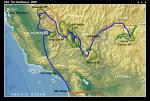](https://www.tkg.org.ua/node/7112)  

Загальна схема маршруту

Найбільш оптимальним варіантом є розпочати подорож з відомої столиці розваг - Лас-Вегасу. Справа в тому, що сюди є прямі авіарейси з майже усіх американських міст. Крім того ціни на квитки значно нижчі середніх - численним казино потрібні клієнти. Також з Лас-Вегасу досить близько до головних природних атракцій Юти, Арізони та Каліфорнії.

Отже **3 червня**: після 2 чудових днів в Лас-Вегасі ми вирушаємо до одного з найвідоміших природних об'єктів на Землі - Гранд Каньйону. Довжина його є неймовірною - 445 км, зрештою глибина теж (1600 м). Мостів через нього немає, отже принциповим є одразу вирішити з якого краю дивитися на каньйон - південного (South Rim) чи північного (North Rim). Безумовно хотілося б погледіти на це диво з усіх боків, але на жаль стільки часу ми не мали. Згідно рекомендації знайомих обрали північний край, як більш дикий та гарний. Пізніше моя колежанка, що вже була раніше з південного боку, підтвердила, що з півночі каньйон робить більше враження. Вирушивши з Вегасу о 6 ранку, опівдні ми вже стояли на краю гігантської прірви. Описати Гранд Каньйон словами, чи порівняти це з чимось в Європі неможливо. Жодна фотографія не в стані передати вражень від цього місця, його величі. Це щось неймовірно грандіозне, велике та глибоке. Це як величезне гірське пасмо "навпаки".

Безумовно "must see" місце на Землі.

Ще кілька практичних порад. Дорога, що провадить до північного краю каньйону взимку є зачинена. На територій Grand Canyon NP ночувати можна лише на платних кемпінгах або в готелях. Але з північного боку з НацПарком впритул межує Kaibab NF, де можна ночувати не лише на платних кемпінгах, але також і безкоштовно, якщо самі собі знайдете місце у лісі.

Актуальну інформацію щодо Гранд Каньйону, а також детальні схеми НацПарку можна отримати на офсайті: [http://www.nps.gov/grca/](http://www.nps.gov/grca/)

Правила ночівлі на території Kaibab NF можна почитати тут: [http://www.fs.fed.us/r3/kai/](http://www.fs.fed.us/r3/kai/)  
Навесні 2007 року в південно-західній частині каньйону, що не входить до території НацПарку відкрили оглядовий майданчик, що нависає над кілометровою прірвою каньйону і має прозору підлогу - "SkyWalk". Коштує таке задоволення 75 USD.

[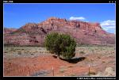](https://www.tkg.org.ua/node/7081)  

Типові крайобрази Південної Юти

[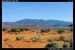](https://www.tkg.org.ua/node/7082)  

Sand Hollow SP

[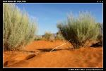](https://www.tkg.org.ua/node/7083)  

Sand Hollow SP

Часу на об'їзд каньйону у нас не було, тому поверталися назад тією ж самою дорогою. Частина дороги пролягає через територію Юти, яка відома своїми неймовірно гарними НацПарками і жовто-червоною палітрою, що домінує в крайобразі. Часу на відвідини НацПарків в Юті в нас теж не було, проте навіть те, що ми бачили з вікна машини викликало захоплення. Більше ніде нам такі жовто-червоні скелі не траплялися. Щоб нам не було занадто добре, нас оштрафували за невелике перебільшення швидкості - ми не помітили знаку... На 175 USD. На щастя вперше і востаннє. Тут маленька порада - навіть не намагайтеся заплатити поліціянту штраф готівкою, бо це може скінчитися арештом. Для ночівлі обрали кемпінг на нещодавно зорганізованому в Юті Sand Hollow SP. Коротенько парк можна описати так: червоний дрібний пісок, велике блакитне озеро посеред піску (є підозри, що штучне), трошки червоних скель, і все це з видом на височенні гори. Неймовірна і неповторна краса. З задоволенням залишився б ще на кілька днів... Кемпінг коштує 8 USD з машини.

Офсайт парку: [http://stateparks.utah.gov/parks/sand-hollow/](http://stateparks.utah.gov/parks/sand-hollow/)

**4 червня** вирушаємо на підкорення основних пустель Південного Заходу. О 10 ранку ми вже в Лас-Вегасі на сніданку в буфеті готелю "Freemont". Аж до самого Сан-Дієго ми будемо з ностальгією згадувати відмінні буфети Лас-Вегасу. Справа в тому, що в цьому місті буфети є одним з важливих елементів заманювання і утримування людей в казино. Отже в кожному готелі буфет намагаються робити краще ніж в інших, ціни утримувати нижче ніж в інших. В результаті цієї конкурентної боротьби турист має можливість скуштувати відмінну ресторанну кухню на високому рівні за відверто низькими цінами (6 доларів за сніданок, обід, 10 доларів за вечерю) та ще й в необмеженій кількості (в усіх буфетах діє принцип шведського столу). Раніше таке співвідношенням ціна/якість/кількість я ще не зустрічав в жодній країні. Після сніданку робимо закуп продуктів і води в супермаркеті і вирушаємо в напрямку пустелі Мохаве. Пару слів на тему води/напоїв. На Україні я волію втомлювати спрагу натуральними соками, в США це буде зробити дещо складніше - більшість їх соків містить занадто багато цукру. Натомість непогано зарекомендував себе зелений Ice-Tea в галонових каністрах. В США існує таке неписане правило для тих хто вибирається до пустелі - обов?язково мати з собою 1 галон (3,4 літри) води на особу.

[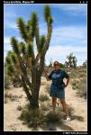](https://www.tkg.org.ua/node/7084)  

Деревоподібні юки в пустелі Мохаве

Десь після опівдня ми в'їжджаємо до Mojave NP. Це вже Каліфорнія. Крайобрази змінюються миттєво. Мертва кам'яна пустеля, що супроводжувала нас весь час в Неваді наче прокидається і заквітає. Навколо нас чисельні деревоподібні (Joshua tree) та звичайні юки, та кактуси.

[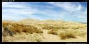](https://www.tkg.org.ua/node/7103)  

Величезні дюни Kelso; пустеля Мохаве

Раніше слово пустеля чітко асоціювалася в мене з піском, ну ще з камінням... Але як виявилось пустелі можуть бути не менш різноманітними ніж, наприклад, гори. Пустеля Невади, пустеля Мохаве, піщані дюни в Мохаве і Долині смерті - між ними стільки ж спільного, як між Карабі яйлою та Альпами. В пустелі Мохаве вперше побачив краєвид, про який мріяв - вузенька дорога посеред пустелі і нікого навколо. Але навіть тут, в пустелі ми бачили багато туристичних стежок (hike trails). В єдиній українській пустелі (Олешківські піски) я не бачив стежок взагалі, але то якраз мабуть і добре, бо ми ще не в стані розділити поняття стежки та сміття... Врешті ми дісталися до піщаних дюн Kelso. Спочатку я був сповнений рішучості забратися на вершину дюни, але коли ми підійшли впритул до неї, стало зрозуміло, що це приблизно рівнозначно прогулянці на Еклізі-Бурун з нижнього плато Чатирдагу (насправді висота дюн складає 160 метрів). Температура повітря (а була десь третя година) та запаси води, що ми взяли з собою з авто абсолютно не сприяли такій авантюрі, і ми ретирувалися.

[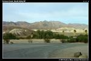](https://www.tkg.org.ua/node/7104)  

Типові краєвиди для Death Valley NP

Наступним етапом нашої подорожі була знана мені ще зі шкільного курсу географії (у мене була дуже добра вчителька географії) Долина Смерті яка входить до найбільшого в США (за виключенням Аляски) Death Valley NP. Особливістю цієї долини є те, що вона є щільно ізольована від зовнішніх кліматичних впливів 3-ма високими гірськими пасмами на заході (включно з 4-5 тисячною Sierra Nevada), та достатньо високим пасмом на сході. Крім того, висота долини над рівнем моря є від'ємною (-86 м н.р.м.), що водночас робить Долину Смерті найнижчим місцем на Західній півкулі. Завдяки всім цим чинникам Долина Смерті є найгарячішим місцем на Землі! Оскільки залишки романтизму та авантюризму ще десь жевріли в наших серцях, ми вирішили відвідати це славне місце влітку. Но бо що за інтерес відвідувати найгарячіше місце Планети взимку!? Тим більше, що там для нас, мешканців Південної України, та спека! Отже ми мали досить об'ємні плани щодо того, що ми маємо оглянути в Death Valley NP. На в'їзді до НацПарку отримали інформаційну газету, яка, між іншим, інформувала нас, що більшість кемпінгів на території Парку в літній період зачинено. Надвечір, десь коло сьомої години, ми прибули до величезного кемпінгу "Furnace Creek".

Крім нас на кемпінгу перебувала ще лише одна компанія.

Перші враження ми отримали, лише тільки вийшли з авто - віяв надзвичайно гарячий вітер. Відчуття приблизно ідентичні якби в обличчя скерували електрофен. Холодної води на кемпінгу не було, лише гаряча (так, саме гаряча, а не тепла). Після зімпровізованого душу та вечері, що головним чином полягала на вживанні величезної кількості води (в таких температурних умовах апетиту якось не було) ми розійшлися по наметах з надією, що ось зараз прийде ніч (но бо в пустелях ніби має бути прохолодно вночі), стане прохолодно і нам буде добре і свіжо. Як ми помилялися... Одинадцята година, північ, друга... Холодніше не ставало ані на пів градуси... Моментами було відчуття, що якщо я зараз не вискочу з намету та не обіллюся водою (хоч навіть і гарячою) то я просто спечуся як курка у власному наметі... І я вискакував і обливався... І так 3 рази на протязі ночі...

Вночі було особливо ідіотично некомфортно - на Україні в літню 40 градусну спеку ти рефлекторно шукаєш тінь, і там ховаєшся від палючого сонця. Ще й вітерець обвіває. Але ж де шукати тінь посеред нічної спеки??? Організм рефлекторно змушував мене бігати від деревця до деревця в надії, що під якимсь з них таки вдасться знайти жаданий затінок, натомість розум, що підказував, що посеред ночі шукати затінок, то трохи така безнадійна справа, не допомагав. Так само з надією я очікував на кожний подув вітру і сподівався, що цей, наступний вже обов'язково мені принесе омріяну свіжість... Але природа забула вимкнути підігрів вітру... Тої ночі мені вдалося закрити очі лише опісля 4 години... Я мріяв лише про одне - ось зараз настане ранок, ми швидко закинемо речі до авто і щосили тікатиме з цього страшного місця. В голові прокручував фрази, якими буду вмовляти своїх друзів залишити грандіозні плани з відвідування НацПарку та тікати звідси по скоріше. Я ще думав, що то лише мені так зле, а їм можливо свіжо і комфортно. Як потім виявилося, мої друзі теж не спали - їм було ще гірше - їх було двоє в наметі. Щиро співчуваю.

**5 червня**.

[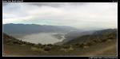](https://www.tkg.org.ua/node/7105)  

Внизу найгарячіше місце на нашій Планеті!

О 5 ранку ми синхронно повилазили з наметів та майже хором прокричали: "Давайте тікати звідси якнаймога швидше! Бо буде нам тут кепсько!" (насправді в оригіналі ця фраза складалася майже виключно з нецензурної лексики). Страшно навіть уявити які відчуття дарує Долина Смерті опівдні... Після невеликої наради вирішили ще швиденько прокотитися до оглядового майданчику Dantes View, який розташований на значній висоті в горах, а отже там мало бути прохолодно. З майданчика відкрився чудовий вид на всю долину, та на хребти, що оточують її. Віяв прохолодний вітер і було важко повірити в те, що діється там внизу в цей самий момент.

[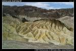](https://www.tkg.org.ua/node/7106)  

Zabriskie point

По дорозі ще зупинилися в прославленому на весь світ, завдяки фільму Мікеланджело Антоніоні, Zabriskie point. Нереально ульотні краєвиди.

В Death Valley NP також є чудові піщані дюни - мабуть найчастіше фотографовані дюни в США, але ми були далекі від бажання затримуватися біля них. Долина Смерті залишає по собі незабутні враження (так, тепер я знаю, що то є справжня спека!).

[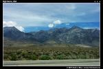](https://www.tkg.org.ua/node/7107)  

High Sierra. Найвище гірське пасмо США

А ми вирушаємо в напрямку одного з найвідоміших НацПарків світу - Yosemite NP. По черзі ми долаємо 2 гірські пасма, і опиняємося в вузькій долині Owens, західною стіною якої є пасмо High Sierra (частина величезного гірського масиву Кордельєрів Sierra Nevada). Це найвищий хребет США (за виключенням Аляски). Саме тут знаходиться Mt. Whitney (4418 м) - найвища вершина в США (за виключенням Аляски). Ця, а також інші сусідні вершини відмінно проглядаються з дороги, що прямує долиною, точніше вони майже нависають над нею. Трошки суб'єктиву відносно вражень від High Sierra з долини Owens. Візуально виникли досить чіткі аналогії з виглядом Карпатського пасма Munti Fagarasului з дороги, що з'єднує міста Brasov та Sibiu (незважаючи на 2-кратну різницю в висоті). Або інше порівняння - головний Кавказький хребет виглядає значно величніше і красивіше. Наразі не бачив нічого гарніше Ушби... Тим не менш я був достатньо щасливий лише від самого факту, що зміг на власні очі побачити High Sierra та Mt. Whitney.

По дорозі зупиняємося на обід в мексиканському "ресторанчику" в містечку Lone Pine, після чого остаточно вирішили для себе триматися здаля від мексиканських закладів харчування. Наступна зупинка в містечку Lee Vining, що лежить на березі мальовничого озера Mono. Завітали до чудового ресторанчика "Nicely's" на каву та морозиво та вирушили "підкорювати" Кордельєри. Варто зазначити, що Yosemite NP розташований зі східного боку пасма High Sierra, і з заходу до парку провадить лише одна єдина дорога.

Вона перетинає High Sierra на висоті понад 3000 метрів на перевалі Tioga (це найвищий в США перевал, що відкритий для автомобільного руху). Для порівняння перевал Хрестовий на Військово-Грузинській дорозі розташований на висоті 2395 метрів... Увага: дорога через перевал Tioga відкрита для руху лише влітку, в окремі роки проїзд можливий аж з кінця червня. Отже обов'язково необхідно перевіряти стан дороги на офсайті НацПарку [http://www.nps.gov/yose/](http://www.nps.gov/yose/) перед тим як вирішити в'їжджати до парку зі сходу. Підйом на перевал був не надто важким, але на перевалі на нас очікувала цікава несподіванка - сніг. Сніг не лише лежав на землі, а ще й падав з неба. Було темно, холодно і мокро - нарешті ми в справжніх горах. Через сніг і погану видимість останні сотні метрів перед перевалом були реально стрьомні. Не знаю чому, але на американських гірських серпантинах чомусь дуже рідко ставлять огорожу. Можливо у випадку аварії вона не особливо й допомагає, натомість психологічне значення має величезне. Не надто велике то задоволення їхати слизькою дорогою в сніг понад прірвою, коли твою машини від цієї прірви нічого не відокремлює...

[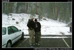](https://www.tkg.org.ua/node/7085)  

Сонячна Каліфорнія! або Гори вони і в Каліфорнії гори!

За вікном було реально прохолодно. Мої друзі, розбалувані теплом Арізони перебували в сильному шоці від вигляду снігу та відчуття температури. Ось вам і сонячна Каліфорнія! Хоча я, чесно кажучи, чогось суттєво іншого від перевалу на висоті 3000 метрів і не очікував... Можна по доброму радіти снігу, якщо любиш гори, але якщо ні, приводів до доброго настрою може і не бути...

В запасі у нас було декілька варіантів для ночівлі в цьому районі. По-перше безпосередньо перед перевалом на території Inyo NF знаходиться 5 недорогих кемпінгів. По-друге: за перевалом ми розраховували на величезний кемпінг "Tuolumne Meadows". Коли під'їхали до кемпінгу з'ясувалося, що він ще не працює - не сезон одначе. Було вже близько сьомої години вечора. До наступного кемпінгу на території НацПарку було їхати з годину, і не факт, що буде можливість там зупинитися. Вертатися назад, за перевал у нас взагалі не було бажання (погода не поліпшилася).

Розпитали у людей на можливість несанкціонованої ночівлі десь поблизу - нам сказали, що спробувати ми можемо, але якщо нас знайдуть рейнджери, то коштуватиме нам 75 USD штрафу. В принципі емоційний стан був такий, що ми вже були навіть і готові погодитися з такою перспективою.

Але залишалася ще одна можливість - поблизу знаходився притулок "Tuolumne Meadows Lodge". На щастя, там навіть знайшлися вільні місця. Ціна 90 USD за трьох. Ми вирішили, що ліпше віддати 90 за притулок, ніж 75 штрафу... Притулок являє собою містечко збудоване з брезентових наметів, натягнутих на металевий каркас. Кожен намет мав ліжка з постіллю, стіл та пічку "буржуйку". Попереднім моїм ціновим рекордом було 15 Євро за місце на нарах в багатоособовій залі в притулку в Юлійських Альпах в Словенії. Тепер думаю рекорд побито! 90 USD за великий брезентовий намет! Великим плюсом була наявність "буржуйки" - вночі було по-зимовому холодно і прийшлося активно топити. На щастя в'язанки дров надавалися безкоштовно. Приємна атмосфера на території притулку (більшість гостей становили гірські туристи, що розпочинали звідси свої мандрівки високогір'ями High Sierra, правда панянок на шпильках теж можна було побачити), а також надзвичайно гарна природа (що може бути приємніше ніж випити чаю на березі бурхливої гірської ріки з видом на водоспад!) дозволили досить швидку забути про ті 90 долярів... Є у цього кемпінгу ще одна особливість (це стосується усіх кемпінгів на території Yosemite NP, Sequoia NP, та Kings Canyon NP) - металеві сейфи для їжі. Справа в тому, що на території НацПарку мешкає численна популяція чорного ведмедя. І ведмідь дуже добре знає куди приходити по їжу. Через те категорично забороняється залишати будь яку їжу в авто, або залишати на ніч в наметах. Поняття "їжа" включає не лише чіпси, кока-колу, але й зубну пасту, дезодоранти, креми тощо. Це не жарт. Все це має замикатися в безкоштовних металевих сейфах, які знаходяться на всіх кемпінгах та паркінгах.

За порушення цих правил досить відчутний штраф. Але, навіть незважаючи на такі заходи, щорічно на території Yosemite NP ведмеді розбивають 1000 авто, іншими словами 3 машини щоденно. Як це не комічно звучить, але саме ця статистика стала суттєвим поштовхом для моїх друзів, аби включити Yosemite NP до плану нашої подорожі. Бог їх почув, але про це згодом.

**6 червня**

Холодно, не хочеться вилізати з теплих спальників. Ця лінь нам коштувала дуже дорого - ми втратили 2 години часу, і коли ми вже спустилися до долини Yosemite, кульмінаційного пункту дня, небо було густо вкрите хмарами. Зробити гарні фото водоспадів було неможливо.

Більше ми не дозволяли ліні перемогти нас, і в цілому поїздка пройшла під гаслом: "Раніше встанеш - більше побачиш!" - вставали о 5-6 годині ранку...

На протязі перших 40 хвилин ми їхали високогірною частиною парку. Крайобрази просто райські - альпійські луки, гірські озера, річки, засніжені гострі вершини - просто свято для очей! Особисто для мене, це мабуть були найкрасивіші миті всієї нашої подорожі. Ще одним позитивним моментом була невелика кількість людей - 90% відвідувачів парку далі долини Yosemite не забирається. Взагалі Yosemite NP є одним з найбільш популярних парків США (входить в трійку) - щорічно його відвідує 4 млн. туристів! Для порівняння Tatrzanski NP в Польщі, де реально важко зробити фото, аби на нього не потрапила пара-трійка чужих голів, відвідує 2 млн. осіб.

[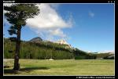](https://www.tkg.org.ua/node/7086)

[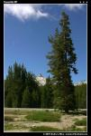](https://www.tkg.org.ua/node/7087)

[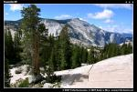](https://www.tkg.org.ua/node/7088)

[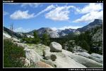](https://www.tkg.org.ua/node/7089)

[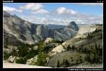](https://www.tkg.org.ua/node/7090)

Крайобрази в високогірській частині Yosemite NP

По дорозі ми кілька разів зупинялися на так званих Picnic area - місцях де можна посидіти за столиком, з'їсти щось зі своїх запасів. Навколо були такі види, що мені то коштувало неймовірних зусиль погодитися з тим, що треба їхати кудись далі...

Долаємо кілька кілометрів серпантинами і ми вже внизу, в відомій усьому світові з календарів, кліп-артів, скрін-сейверів Yosemite Valley! Це місце здобуло свою славу завдяки численним високим водоспадам (тут знаходяться найвищі в США, та одні з найвищих у світі водоспадів) та оригінально викарбуваним в льодовиковий період гігантським скелям, що мають тут назву "dome". Найвідоміші скелі - Half Dome та El Capitan неможливо переплутати з жодними іншими скелями у світі. Вони такі є лише тут. Ще перед поїздкою було зрозуміло, що оглянути всі цікаві місця в долині на протязі одного дня не є реальним, тому після перегляду сотні фотографій з інету, вирішив сконцентруватися на водоспадах Vernal та Yosemite. Перший вирізняється спосеред інших водоспадів долини своєю шириною, крім того до нього дуже легко підійти. Другий - найвищий водоспад долини (770 м). В реалі вистачило нормально часу лише на водоспад Vernal. Незважаючи на те, що водоспад знаходиться менше 3 км від паркінгу, прогулянка туди-назад забрала нам майже три годину часу, головним часом через фотографування та загравання з вивірками. Насправді навіть важко сказати хто до кого загравав - ми до вивірок, чи вони до нас. Причому в деяких місцях вони близько до себе не підпускали, а в інших мало не стрибали на нас.

[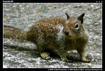](https://www.tkg.org.ua/node/7091)

[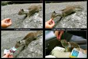](https://www.tkg.org.ua/node/7113)

Ось ти яка, американська вивірка!

Стежка, що провадить до водоспаду, постійно нагадувала нам, що ми знаходимось в одному з найвідвідуваніших НацПарків - маса людей, багато матусь з діточками у візочках, черги на місточку аби зробити фото з видом на водоспад. Останній раз матусь з візочками я бачив в Татранському НацПарку. Підійти впритул до водоспаду з фотоапаратом було нелегким завданням - апарат вмить вкривався краплями води. До речі, аби оцінити масштаб водоспаду на фотографіях погляньте на сосни, що ростуть навколо, і порівняйте. Або повірте на слово: це не Джур-Джур.

[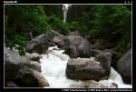](https://www.tkg.org.ua/node/7092)  

Дорогою до водоспаду

[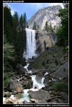](https://www.tkg.org.ua/node/7093)  

Водоспад Vernal, 73,15м

[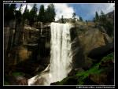](https://www.tkg.org.ua/node/7094)  

Водоспад Vernal, 73,15м

Наступним пунктом культурної програми було щось перекусити, що незважаючи на заявлені 3 заклади харчування, було дуже важким завданням. Усі заклади виявилися класичними фастфудами... Прийшлося йти до магазину (є в долині і таке) і купувати щось попоїсти там...

Кількість людей та авто в долині можна описати лише одним словом - тлуми! Знайти місце на паркуванні не є легким завданням... Адміністрація НацПарку намагається знизити потік авто і заохочує людей користуватися безкоштовними автобусами... Іноді це виглядає досить анекдотично - маршрут деяких автобусів складає петлю довжиною декількасот метрів - американські матрацники абсолютно не звикли ходити ногами, а ключові місця долини заповнені саме матрацниками. Ну ще й класика, як без цього - автобуси з японськими туристами.

Контраст в атмосфері між різними частинами того ж самого НацПарку - High Sierra та Yosemite Valley просто разючий! Я вже писав - 90% відвідувачів парку задовольняється лише долиною. Перебування в долині нагадує за відчуттями відвідування Центрального Парку Культури і Відпочинку у якомусь великому місті...

Далі згідно плану у нас було відвідування водоспаду Yosemite. Повторюся: це найвищий водоспад в Північній Америці та третій за висотою у Світі! Саме він фігурує на більшості поліграфічної продукції, його видно майже звідусіль в долині. Водоспад є каскадом, що складається з 2 частин - верхньої (Upper Yosemite Falls, 436 м) та нижньої (Lower Yosemite Falls, 98 м). Щоб добре розгледіти верхню частину, треба підійматися стежкою догори. Але у нас була одна серйозна проблема - час - було вже близько четвертої години вечора. З огляду на відсутність перспектив, що вигляне сонце, ми відмовилися від ідеї впритул підходити до водоспаду - гарного фото все одно без сонця не зробиш, (експерти правда, кажуть, що якраз саме за такої погоди і треба знімати водоспади, але тоді я про це не знав), а близько перед водоспадом ми нещодавно стояли.

Вирішили зробити репортажне фото, з місця де водоспад непогано проглядався, але навіть це виявилося непростим завданням - прийшлося чекати, аж перефотографується автобус японців... Носіям високої культури не прийшло в голову пропустити вперед 3 особи. Не буду цитувати, що я тоді про них казав...

[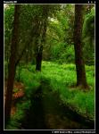](https://www.tkg.org.ua/node/7095)  

В Долині Yosemite

[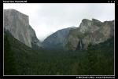](https://www.tkg.org.ua/node/7096)  

Долина Yosemite з оглядового майданчику Tunnel view

Врешті фото зроблено, сідаємо в авто і керуємося на виїзд з парку. Ще одна зупинка на оглядовому майданчику Tunnel view: тут робимо фото класичного вигляду долини і прощавай Yosemite! В підсумку, можу сказати, що Yosemite NP дійсно дуже гарний, але чи це є одне з найгарніших місць на землі, не знаю, не так багато я і відвідав цікавих місць, але бачив не гірші місця. До високогірської частини парку я б приїздив би ще, ще і ще, натомість до долини залюбки приїхав би ще раз раненько вранці, аби помилуватися водоспадами (вони дійсно гарні) та пофотографувати поки усі матрацники та японці сплять.

Нашим завданням на вечір було заїхати якнайдалі в напрямку Sequoia NP. У містечку Oakhurst завітали до місцевого ресторанчику на вечерю. Не знаю, в чому особливість цього ресторану, але це був перший ресторан за весь час мого перебування в США, де я трошки некомфортно почувався в звичайному одягу. Зазвичай американці не мають моди одягатися елегантно, проте публіка в цьому ресторані становила виключення. Не скажу, що там були пані у вечірніх сукнях, але щось близько до цього. Майже о восьмій вечора ми раптом усвідомили, що нам немає де ночувати - ми мали схеми розташування кемпінгів лише на територіях НацПарків. На щастя в цьому містечку був інформаційний центр, біля якого висіла схема Sierra NF, який був поблизу, і ми швиденько знайшли на ній кемпінги - в кількох кілометрах від міста було озеро.

За кемпінг ми заплатили 22 USD. Нам запропонували дрова - 7 USD за в'язанку! Оригінально: у лісі дрова коштують дорожче ніж у супермаркеті.

Запитали, чи можемо назбирати дрова власноруч - нема проблем якщо знайдете! Правильно - ліниві мають платити extra за свою лінь.

Швиденько назбирали дров, зробили вогнище та попили винця на честь дня народження одного з нас. Цікава особливість цього моменту - рівно рік тому, у Запоріжжі, ми сиділи біля вогнища і пили винце майже в тому самому складі. На завершення посумували про те, що так і не зустріли в Yosemite ведмедя. Нагадую, це теж було метою відвідування цього НацПарку...

**7 червня**

Сьогодні у нас згідно плану відвідування найбільшого дерева на планеті і, за сумісництвом найбільшої живої істоти (з тим другим в принципі можна і посперечатися, але то не принципове). Таку можливість надає Sequoia NP.

Sequoia NP є одним з найбільш "диких" НацПарків в регіоні - лише невеличка частина території парку доступна для автомобілістів. Східною межею парку є пасмо High Sierra включно з самою Mt. Whitney. Отже парк є відомий не лише гігантськими деревами, а й високогір'ям. Асфальт пролягає так, що туристи без жодних ускладнень можуть оглянути найбільші дерева Планети. До парку є декілька в'їздів зі сходу. Аби не їхати тією ж самою дорогою кілька разів і проїхати парк наскрізь, обрали в'їзд з північного заходу, через клаптик території сусіднього Kings Canyon NP та Giant Sequoia NM. На самому початку, недалеко до в'їзду до Sequoia NP з дороги відкривається вид на один з найбільших секвоєвих лісів у світі - Redwood Mountain Grove. Проте якогось надзвичайного враження цей ліс не зробив, через те, що з відстані неможливо оцінити масштаб дерев - ліс виглядає майже як сосновий, єдине, що маківки дерев виглядають  
трошки по-іншому.

Вперше з початку подорожі НацПарками у нас з'явився час завітати до інформаційного центру. Окрім іншого в центрі був великий вибір поліграфічної продукції досить пристойної якості. Ціни без жодних націнок, в порівнянні з цінами видавництв, і нижчі, ніж ціни на подібного роду продукцію на Україні. Була ще одна справа, яку ми мали залатвити в інфоцентрі. Як я вже згадував, у нас було велике бажання побачити ведмедя, побачити його в Sequoia NP було для нас останньою можливістю. Тому ми попросили консультації в працівників центру, що ми маємо зробити, аби врешті побачити тих ведмедів, яких тут ніби має бути повний ліс. Нам розповіли, що є певне місце, вологі луки, куди ніби після 18-ї години ведмеді виходять пожирувати.

Після інфоцентру ми відправилися оглянути то, задля чого ми прибули до НацПарку - найбільше дерево Планети (вага орієнтовно 1385 тонн, вік орієнтовно 2100 років, висота 84 метри). Дерево знаходиться в 5-10 хвилинах від паркінгу. Ці хвилини долаються асфальтованою, зі сходинками стежкою, як в доброму міському парку. Дерево має свою власну назву - Sherman Tree; власне усі найбільші секвої мають власні назви.

[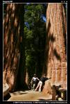](https://www.tkg.org.ua/node/7097)  

Ні, це не найбільше дерево Планети. Таких дерев там цілий ліс!

Найбільшою проблемою є сфотографувати дерево зблизька. Без панорамного об'єктиву майже безнадійна справа, деякі фотографи лягали на землю в намаганнях охопити все дерево на одній фотографії. Біля дерева зроблена цікава міні експозиція, де між іншим можна було спробувати обійняти зріз стовбуру секвої.

[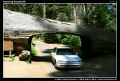](https://www.tkg.org.ua/node/7098)  

Tunnel log

Є в парку ще одна фішка - Tunnel log - в 1937 році одна з секвой завалилася просто на дорогу. Її не прибрали, а вирішили зробити з цього атракцію і пропилили в дереві тунель. Наша Honda Accord змістилася в тунелі без найменших проблем.

Пів на четверту вечора - згідно плану ми мали їхати на ночівлю в найкрасивішу і найвищу частину парку, але працівник інфоцентру казав нам, що там шанси зустріти ведмедя скоріше невеликі. Отже повстала дилема, або їхати глянути ще одну, окрему частину парку, або чекати на ведмедя там, де нам порадили (це якраз було в 5 хвилинах від поваленої секвої) і потім керуватися на виїзд з парку... Вирішили, що ведмідь таки цікавіший...

Мої друзі пішли обрати місце і зробити засідку на хижака, а я пішов прогулятися стежками, яких навколо було багато. Врешті отримав можливість зблизька роздивитися секвоєвий ліс, навіть більше - прогулятися в ньому.

Естетичні враження від такого лісу просто супер, візуальна різниця з сосновим лісом величезна - секвої вирізняються не лише гігантськими розмірами, але ще й гарним червоним кольором стовбуру. Бракувало лише однієї дрібнички в такому лісі - динозаврів... Але НацПарків з динозаврами немає...

[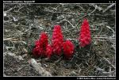](https://www.tkg.org.ua/node/7099)  

Квітка з Sequoia NP

[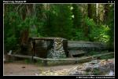](https://www.tkg.org.ua/node/7100)  

Tharp?s Log - найстаріший притулок на території парку, 1860 рік

Біля Crescent Meadow, луки, де сиділи в засідці мої друзі, розкинулася, ще одна, майже таких розмірів лука. Так ось, десь по шостій годині не було жодного куща, під яким би не сидів фотограф зі штативом та фотоапаратом з величезним телеоб'єктивом, або відеокамерою студійних розмірів. Коли я дійшов до своїх друзів, аналогічну картину я побачив і там... Я собі уявив, як вся ця армія фотографів має накинутися та того ведмедя... Бідний ведмідь... Вже майже сьома... Ведмедя немає... Натомість повиходили олені і нахабно почали підходити до тих фотографів, що сиділи ближче до центру луки. Вже за сьому, глухо... Треба збиратися, бо нам ще далеко їхати... Ми, засмучені, почали навіть жартувати про те, що мабуть сюди, на це місце хтось спеціально випускає тих ведмедиків, фотографам на втіху. Таку теорію підкріплювало, те, що неподалеку крутилися рейнджерські джипи з написом "Bear management" на дверях. Так чи інакше, але ми мусили піднятися і їхати на кемпінг, до якого було ще далеченько, та й невідомо було, чи є там вільні місця.

Ось ми й на кемпінгу, в нижній частині парку. Ліс дуже нагадує кримський, десь так з південних схилів Демерджі. Лише річка в каньйоні вирує зовсім так не по-кримські. Кемпінг обладнаний вже звичними для нас сейфами для їжі, вірніше того, що ведмідь вважає за їжу. Ми майже не вірили, в появу тут ведмедя, тим не менш, все ретельно сховали до сейфу. Бо крім ведмедя ще є рейнджери, які можуть оштрафувати за недотримання вимог НацПарку. Нагадування про ведмедя висіло навіть в туалетах. Особливо нас потішав нижній рядок інструкції поводження з цим хижаком: "якщо ведмідь щось у вас поцупив, не намагайтеся відібрати це в нього".

Взагалі ведмежа тема була ключовою цього сумного вечора, коли ми сиділи та розмовляли біля вогнища... Хтось з нас переконував в неможливості зустріти ведмедя тут, внизу, біля виїзду з парку, хтось пропонував розвісити смажені ковбаски (ми якраз смажили) у лісі і чекати у засідці (хто знає, можливо, якби не величезні штрафи за такі речі, так би і зробили...), хтось ображався, що чесно заплатив за відвідування парків, а парки не дотрималися "кошторису" і ведмедя йому не надали. На цій сумній ноті і розійшлися по наметах...

**8 червня**

П'ята година ранку. Колежанка мене будить криками (в задоволено-інформативному тоні): "Андрію, ведмідь!, Андрію, ведмідь!". Виглядаю з намету: навколо вогнища в 10 метрах від мого намету нишпорить невеликого розміру ведмідь. Колежанка стоїть метрах в 4 від нього і возиться з фотоапаратом. Ведмідь на нас нуль уваги... Нажаль фотоапарат був в автоматичному режимі і спрацював спалах - ведмедю то не сподобалося і він почав відходити до лісу. Колежанка зі сто метрів пробіглася за ведмедем, але той втік до лісу... Ми були в стані глибокого задоволення і ейфорії. Yes! Yes! Ми його побачили! Врешті програму виконано!

Проте та ейфорія недовго продовжувалася... Конкретніше, до того моменту, поки ми не глянули в бік нашого авто... Ведмідь вирішив додати її до статистики розбитих авто в парку... Він намагався виламати передні двері (сигналізації не було). Не виламав - покалічив, бокова шиба розлетілася вщент...

Задоволення побачити ведмедя коштувало моїм друзям 400 USD. Дешевше ходити до зоопарку, скажу я вам. Хочу попередити усіх ведмедів: якщо десь зустрінете моїх друзів, ліпше одразу тікайте якнайдалі! Вони то вам ще не скоро пробачать!

Думаю ведмідь вирішив обрати саме наше авто, через те, що ми стояли ближче усіх до лісу - спеціально обрали собі романтичне таке місце.

На виїзді ми запитали працівника парку, чи треба когось поінформувати про інцидент, на що отримали відповідь з посмішкою: "It's happens". На щастя, далі згідно плану у нас була лише по-справжньому сонячна Каліфорнія і відсутність бокової шиби не створювала якихось занадто серйозних проблем. Ймовірність того, що машину вкрадуть, в США "дещо нижча" ніж в Україні.

З гір ми з'їхали до широкої Центральної Долини і тут я, вперше за час свого перебування в США, побачив великі площі землі, що зайняті під сільське господарство: головним чином фруктові сади та виноградники - Каліфорнія є одним з найбільших у світі виробників вина. Далі ми прямуємо на узбережжя Тихого океану. До речі, узбережжя відділено від Центральної Долини пасмом гір (Coast Ranges), тому клімат в долині і на березі помітно відрізняється. Для нас це стало несподіванкою, хоча нас і попереджали - над вузькою смугою берегу майже на  
протязі усього літа висять хмари.

Ось ми переїхали через гори і в'їжджаємо до другого за розміром міста США - Лос-Анджелеса. Згідно плану ми мали лише проїхати через місто транзитом, але вирішили зробити півгодинну зупинку аби відпочити від шаленого потоку машин. Коли в'їжджаєш до L.A. автострадою (6 смуг в 1 бік), бачиш перед собою, навколо себе лише тисячі авто, які мчать зі швидкістю 120 км/год та інші автостради, що постійно з'єднуються-роз'єднуються між собою і якими теж мчать тисячі машин... Крім цього навколо себе не бачиш ні чого... І так триває 20-30-40 хвилин... Врешті ми усі втомилися від цього автомобільного кошмару і з'їхали на бокову вуличку, або сфотографуватися на тлі загальновідомого напису "HOLLYWOOD". Якщо я не маю жодних сентиментів до цієї столиці світової кіноіндустрії для широких мас, то деякі туристи, вірніше туристки, просто шаленіли від щастя стоячи під цим написом. Як мало декому потрібно для щастя... До речі, Hollywood, це не лише домівка для таких студій, як Universal, але і таких як Vivid Entertainment. Зручно: якщо якась молода особа не пройшла кастинг в Universal, вона може пройтися квартал далі і спробувати стати зіркою в Vivid. Перепрошую за сарказм, але це життя...

Крім шаленої кількості/швидкості автомобілів, L. A. нас ще вразив "чистотою" свого повітря. Останній раз я таке повітря відчував у рідному Запоріжжі: дихати так само немає чим. Одним словом, я щиро співчуваю тим всім американським зіркам що мають жити і працювати в L.A.

Після галасливого і брудного Лос-Анджелеса ми скерували наше авто далі на південь - на березі океану між L.A. і Сан-Дієго у нас було зарезервоване місце на кемпінгу "San Mateo Creek" біля державного пляжу San Onofre. Спочатку ми хотіли провести десь на прибережних кемпінгах 3 ночі, але дивом вдалося зарезервувати місце хоч на одну ніч. На відрізку між L.A. і Сан-Дієго є з десяток державних "диких" пляжів і відповідно кілька десятків кемпінгів, проте, аби отримати на них місце, особливо у вихідний день, необхідно виконати резервацію з кількамісячним упередженням. І це при тому що такі кемпінги біля океанських пляжів дешевими не назвеш - десь коло 30 USD з авто.

З кемпінгу на пляж провадила стежка, інформаційна таблиця остерігала, що зі стежки ліпше не сходити, оскільки є небезпека зустрічі з гримучими зміями (ці милі тваринки теоретично в США є майже всюди) та пумами.

Додавалася також інструкція поводження з пумою. Особливо нас втішив останній пункт: якщо пума напала на вас, бийтеся з нею. Готовий заплатити будь-які гроші аби побачити бійку неозброєної людини з пумою.

Пляж зустрів нас безлюдністю, окрім десятка "серфінгістів" (до речі, в гідрокостюмах) і десятка пеліканів навколо нікого не було. На Україні не так багато місць де влітку можна знайти такі пусті пляжі.

Вода в океані значно солоніша ніж в наших морях, а купання значно утруднюють хвилі. Точніше вони його роблять не зовсім безпечним. На вигляд це звичайні середньої висоти хвилі, проте вони здатні з великою силою затягувати людину в океан.

Місцеві вміють розрізняти різні типи хвиль і оцінювати чи безпечно сьогодні купатися чи ні.

**9 червня**

Сьогодні ми прибуваємо до кінцевого пункту нашого 3000-кілометрового маршруту - міста Сан-Дієго. Я планував не приділяти багато уваги в цьому звіті містам, але, оскільки Сан-Дієго є тісно пов'язаний з природою та її збереженням, зроблю виключення. Оселилися ми в недорогому готелі (72 USD/номер) у передмісті Chula Vista під мексиканським кордоном і інтенсивно на протязі двох днів відвідували головні атракції майже півтора-міліонного міста. Передусім Сан-Дієго відомий на весь Світ своїм зоопарком. Зоопарк в Сан-Дієго поділяє перше місце серед зоопарків США з Нью-Йоркським зоопарком та входить в п'ятірку найліпших зоопарків світу. Крім _senso stricte_ зоопарку тут знаходиться також величезний Парк Диких Тварин. 5-денний квиток до цих двох об'єктів коштує 59 USD. Можна придбати on-line в інтернеті. Купувати 2 окремі квитки виходить дорожче.

Отже в суботу ми вирішили відвідати зоопарк. Зоопарк бере не скільки кількістю тварин (деякі групи тварин не представлені взагалі), скільки якістю їх утримання та експозиції. Тварини не викликають почуттів співчуття, оскільки дійсно утримуються в чудових умовах. Крім того бар'єри між людиною та тваринами намагаються робити максимально непомітними. Щось подібне можна побачити в Будапештському зоопарку, проте масштаби цих зоопарків істотно відрізняються. До того ж клімат Каліфорнії дає можливість утримувати багато екзотичних тварин не в закритих павільйонах, а в вольєрах. Наприклад є вольєра з тропічними птахами, з колібрі включно, до середини якої можна війти. Птахів та Вас не відділятиме нічого. І таких вольєр десятки. Ще додам, що в Сан-Дієго колібрі можна побачити і на вулиці. На бегемота та білого ведмедя можна подивитися не лише з суші, але й з води - стінки басейнів зроблено прозорими. Є в зоопарку і великі панди - аби на них подивитися треба відстояти довгу чергу. Привертають на себе увагу сотні видів тропічних рослин, якими засаджена територія зоопарку - клімат дозволяє. Ще одна фішка зоопарку - сесії демонстративного годування або вигул тварин працівниками зоопарку. Такі сесії супроводжуються розповідями про тварин та відповідями на питання. В Сан-Дієго тваринами опікуються не "Васі з водокачки", а висококваліфікований персонал. Досить виразний показник - серед персоналу, що контактує з тваринами є лише представники білої раси. В США расизму немає, проте є посади, де білих зустріти майже нереально і навпаки, де представників інших рас зустріти неможливо. На відвідини зоопарку у нас пішло п'ять з половиною годин - ми встигли оглянути лише коло двох третин експозиції.

Після зоопарку ми відправилися на відвідини парку Balboa (фактично зоопарк теж знаходиться на території цього парку). Тут ми побачили те, чого зовсім не очікували побачити в США - цілі комплекси палаців та сакральних споруд в типово південно-європейському стилі.

Спробуйте собі уявити вулицю забудовану Лівадійськими палацами. Пояснюється це просто - Сан-Дієго має іспанські коріння, і ця іспанська спадщина непогано тут збереглася. В Сан-Дієго є три комплекси старої, в європейському стилі забудови - Парк Balboa, Портове містечко (Seaport village), та Старе місто (Old Town), що вирізняє це місто на тлі інших американських міст, причому в виключно позитивному плані. Взагалі Сан-Дієго вважається одним з найкрасивіших міст в США.

Після парку ми відправилися на прогулянку у Портове містечко, фактично набережну міста. Зараз Портове містечко - це комплекс хатинок, які є ресторанчиками та сувенірними крамничками. Для довідки: повечеряти в ресторанчику на набережній Тихого океану коштує 10-12 USD, повечеряти в крутому ресторанчику коштуватиме 30 USD. Можете порівняти з цінами на набережній в Ялті (можна також порівняти зарплати офіціантів та поварів і ціни на продукти).

**10 червня**

На черзі відвідини Парку Диких Тварин. Парк відрізняється від зоопарку значно меншим набором тварин але значно більшою площею. Грубо кажучи, парк намагається імітувати африканську савану - клімат дозволяє. Проте, на відміну від реальної савани, хижаки тут ізольовані від своїх жертв. Так само, як і в зоопарку, тут забезпечується максимально можливий контакт між тваринами та відвідувачами. В деяких місцях жодних бар'єрів немає взагалі - чаплі ходять під ногами та сидять над головами.

В парку є 3 опції відвідування: власними ногами, на "трамвайчиках", та на вантажівках а-ля сафарі. Причому в зони, де курсує трамвайчик, ногами не потрапиш, а вантажівки завозять туристів безпосередньо до тварин, тобто вони курсують всередині загонів. Якщо трамвайчик включений в вартість 5-денного квитка, то за фото-сафарі на вантажівці треба доплатити значну суму.

Як і зоопарк, так і Парк Диких Тварин - то безумовно об'єкти "must see". Ну якщо Ви вже були на сафарі десь в Кенії, можливо Парк Диких Тварин можна і оминути...

[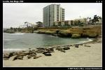](https://www.tkg.org.ua/node/7101)  

Гармонія

Далі, згідно плану, у нас відбулося відвідування передмістя La Jolla. Справа в тому, що тут, на звичайнісінькому пляжі полюбляють лежать справжні дикі тюлені. Досить цікава картина. В принципі, теоретично до тюленів можна і підійти, але висить інформаційний стенд, який просить цього не робити. Перед поїздкою я консультувався з колежанкою, що працювала з тюленями в Антарктиді, на предмет "підійти та погладити". Вона категорично не радила цього робити, оскільки тюлені то все ж таки хижаки, а їх укус цілком порівнювальний з укусом німецької вівчарки, тільки, що загоюється важко...

Останній вечір нашої мандрівки ми знову провели в Портовому містечку. Всім нас дуже сподобалося Сан-Дієго і повертатися назад якось не хотілося. І це при тому, що я до моря відношуся відверто байдужо...

**11 червня**

Я сідаю в літак до Лас-Вегасу, а мої друзі відправились на відвідини третьої бомбової атракції Сан-Дієго - Sea World! Якщо одним словом, то це зоопарк для морських тварин - тюленів, дельфінів, косаток, акул тощо. Сподобалося їм там страшенно, може навіть більше ніж в зоопарку.

[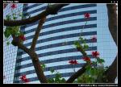](https://www.tkg.org.ua/node/7102)  

Гармонія

Таким чином разом ми проїхали біля 3000 км і відвідали абсолютно різні куточки США. Більшість з них (ну може за виключенням Mohave NP) вимагає багатоденного спокійного відвідування. Бо той спосіб в який ми відвідували Grand Canyon чи Yosemite можна порівняти з тим, якщо відвідування Карпат обмежити прогулянкою до Говерли з Заросляка, або піднятися канаткою на Kasprowy Wierch чи Lomnický štít.

Американці приписують собі багато досягнень у світі, проте, на мою думку, їх найбільшим і безсумнівним досягненням, є стан збереження природи на Північноамериканському континенті. Саме природа, чудово збережена природа - це те, що захоплює і справляє найбільше враження в США! Це чудовий приклад, який ілюструє можливість паралельного існування високорозвиненої, технологічної цивілізації та дикої природи.

© 2007, Андрій Май
