Цим літом ми вибрали гори Албанії!

В Інтернеті майже немає описів подорожі в горах Албанії, але так як туристичні тури розкручують по телебаченню, ми вирішили ризикнути! Роздрукувавши мапу Генштабу 1970 р. (500 метрівку) і спланувавши свій маршрут в горах, ми виїхали двома машинами зі Львова. Пригоди наші тривали з 18 червня 2017 року по 08 липня 2017 року.

Три тижні відпустки ми розбили приблизно таким чином: добирання до гір і назад – **4 дні**, гори – **12 днів**, море – **4 дні**.

Схематично наше пересування виглядало так:  
м. **Львів** — (через Румунію — через Сербію — через Македонію) — **Албанія**: село Боге — перевал Тесс — Єзерські озера — гора Єзерце — сідловина Вальбонес — село Вальбоне — перевал Тесс — село Боге — **море**: місто Велліпое — місто Дурес — (через Македонію — через Сербію — через Румунію) — м. **Львів**.  

Зі Львова ми  швидко опинились в Румунії. Проїзд по дорогах Румунії безкоштовний. В Сербії дороги платні, так само, як і в Македонії (від 0,5 $ до 1,5 $). GPS іноді підводив – просто збивався, але в загальному завдяки ньому ми добре орієнтувалися в містах, особливо в Румунії. Ночували ми в Сербії на узбіччі, розклавши намети в полі. Жодних проблем з цим не  було і на зворотній дорозі. На другий день нашої подорожі в шостій вечора ми були на кордон з Албанією. В Тірані нам навігатор  не допоміг, він постійно перезапускався і ми досить довго блудили, поки  виїхали на Шкодер. На заправках в Румунії, Сербії і Македонії ми розраховувалися карткою. В Албанії картка не працює (порозумівшись, все таки розрахуватись готівкою)! До речі, з мовою тут проблеми – англійську знають не всі албанці, навіть молодь, і не на такому рівні, щоб спілкуватися.

Далі в нас по маршруту - м. Коплик (18 км. від Шкодера) – маленьке містечко (до 4 тис.). Це останнє місце, де можна щось докупити і поміняти гроші перед виходом в гори. Міняємо гроші: 1 Євро = 132 леки. Купили буханку смачного хліба за 80 лек. і зробили велику помилку – не купили карту! – це нам вартувало 2 дня блукань в горах.  З Коплика ідемо 30 км. до с. Боге по мальовничій дорозі – це вже ми на місці. В центрі є щось типу туристичного притулку, де ми домовились за 3000 леків (25 Євро) залишити на території 2 машини на 10 днів.

[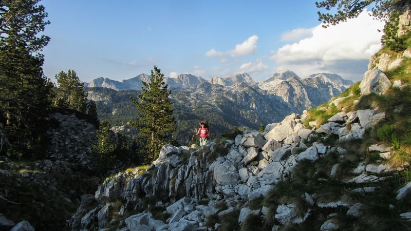Початок маршруту з м. Коплик](https://www.tkg.org.ua/files/styles/colorbox/public/story_img/35539/0alp17ov_1.jpg?itok=XRLQyrCm "Початок маршруту з м. Коплик")Т[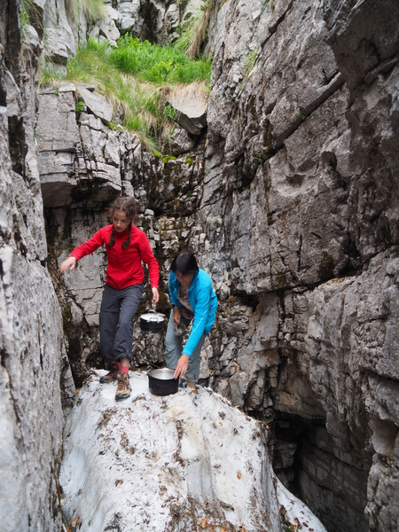Знайдений сніг, з якого брали воду](https://www.tkg.org.ua/files/styles/colorbox/public/story_img/35539/0alp17ov_3.jpg?itok=ACSbA02w "Знайдений сніг, з якого брали воду")[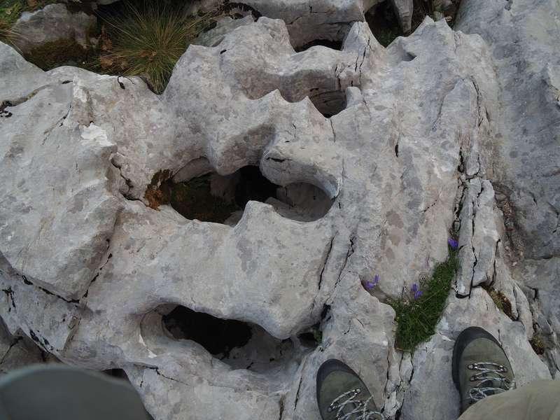](https://www.tkg.org.ua/files/styles/colorbox/public/story_img/35539/0alp17ov_2.jpg?itok=zLzFYi5B "Тріщини в камінні, з яких дме холод") почалася наша **гірська подорож**. Вийшли по маркованій стежці з Боге, яка швидко почала взагалі зникати. Мітки все таки зустрічались, але дуже давні, будь-яких слідів від перебування туристів (хоча би фантики від цукерок) ми не бачили. Дуже крутий підйом по камінням і слизькій траві, багато скель і обривів. Надзвичайно цікава місцевість – величезні вузькі тріщини в камінням, з яких дме холод. По дорозі дуже багато суниці, цілі поляни!  Під вечір, на висоті 1700 м. в досить екзотичній і дикій місцевості ми ледве знайшли місце для чотирьох палаток. Води тут немає. Топимо випадково знайдений в розщелині сніг. Зате можна палити багаття! По GPS визначаємо координати, звіряємо з картою, і остаточно розуміємо, що існуюча маркована стежка веде в протилежний нам напрямок. Без стежки іти складно: каміння, валуни, ялинки, воронки різних діаметрів і конструкцій, великі і малі прірви. Деякі прірви важко взагалі обійти з рюкзаками. Ми вирішили спуститися в село, і почати все спочатку.

Два дні блукань в горах завершені. Починаємо все спочатку! Принципово, не доходячи 20 метрів до стоянки наших машин, ми повертаємо в протилежну сторону! Ідемо по селу Боге. Страшенна спека, асфальт ідеальний. Наша мета - перевал Тесс, і він далеко. Нас спасли – підібрали у вантажівку з повним кузовом якоїсь арматури, щебню і пластикових вікон. Підвезли нас на оцій кучі барахла в кузові. Машина їхала 18-20 км/год. На перевалі асфальт закінчився і швидкість при спуску вниз по ґрунтовій дорозі впала  до 10  км/год. Їхали ми 1,5 год. Нас підвезли до першого кафе, яких тут багато (де продають тільки пиво і пепсі-колу). Тут же стікала зі схилу по трубам джерельна гірська вода. Албанці сказали, що далі нам немає сенсу їхати, звідси починаються всі маршрути. Грошей брати не хотіли, але ми дали водію на пиво 1000 лек (250 грн.). Це наша перша ніч біля води!

[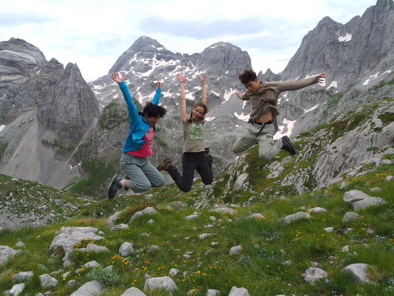Старт на перевал Тесс](https://www.tkg.org.ua/files/styles/colorbox/public/story_img/35539/0alp17ov_4.jpg?itok=MOa3SYNo "Старт на перевал Тесс") [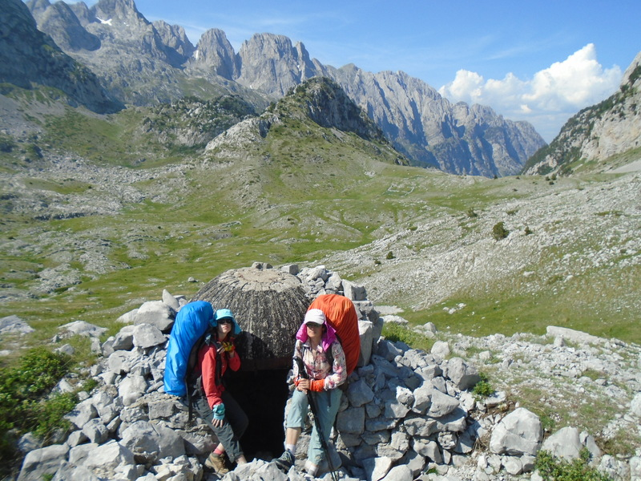Кавказькі пейзажі](https://www.tkg.org.ua/files/styles/colorbox/public/story_img/35539/0alp17ov_5.jpg?itok=2B_il-NJ "Кавказькі пейзажі") Зранку ми стартуємо по маркованому маршруту. Попри те, що ми йшли вздовж пересохлої річки, нам зустрічалися внизу невеличкі струмочки. В кінці села натрапляємо на  джерело, де є місце під намети. Біля джерела стоїть хрест (місцеві всюди, де є джерело, ставлять хрести).  Нам треба піднятися з 800 м. на перевал на 1700 м. Тягнеться вузенька стежка серпантином, кам’янисті осипи, круті обриви, скелі і неймовірні краєвиди!

На перевалі зустрічаємо місцевого з конем, навантаженим рюкзаками. Розмовляє виключно албанською, в карті не розбирається, дуже намагався нам допомогти. Албанець дуже доброзичливий і привітний, бачить в нас італійців, про Україну не чув. Згодом зустріли і німців, чиї рюкзаки їхали на коні. Спускаємося до джерела на хребті, позначеного на карті, яку ми сфотографували в німця. Вода ледве тече, навіть важко набирати, от-от пересохне. Плануємо дійти до місця п’яти озер (біля вершини гори Єзерце), але стежка починає зникати разом з маркерами. Ми знаходимось на 1500 м. Води тут немає, ледве серед каміння і схилів знаходимо місця для палаток. Ночуємо без води.

На наступний день через годину крутого підйому, ми - на перевалі. Куди не кинь оком – піки, сніжники під ними, гострі гребні - дивлячись на них не віриться, що ці гори всього на всього мають 2500 – 2700 м.! Такий собі міні-Кавказ зі сніжниками і сипухою! Часто у рельєфі видно печери і наскрізні діри. Накінець, ми дійшли до першого озера.[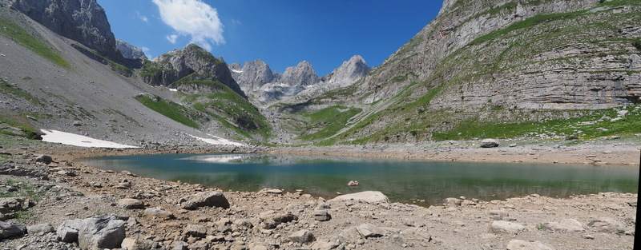](https://www.tkg.org.ua/files/styles/colorbox/public/story_img/35539/0alp17ov_6.jpg?itok=EcMMCEw2 "Перше озеро")

Яскраве, лазурного неймовірного кольору, величезне – воно затьмарило і приголомшило нас! Озеро ізнаходиться в ущелині між сніжниками, подібне на картинку з журналів про Рай. Тут є місця для палаток на галявині з травичкою, біля обладнаного місця для вогнища. За 10 ходу, в долині нижче, є ще 4 різнорівневих озера. Дров тут немає, але ми змогли знайти якісь гілки, а потім робили експедиції за дровами. Після заходу сонця повністю пересвідчуємося, що ми в раю, настільки тут гарно. В озері  відбиваються гори зі сніжниками, як в дзеркалі. Плануємо тут провести дві ночівлі.

[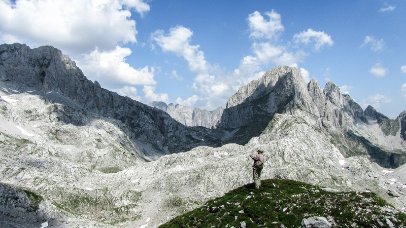Найивща гора Албанії - Єзерце](https://www.tkg.org.ua/files/styles/colorbox/public/story_img/35539/0alp17ov_7.jpg?itok=eG0nCvdR "Найивща гора Албанії - Єзерце") [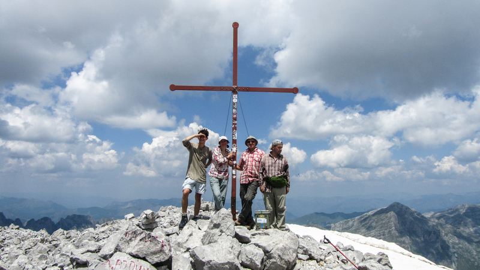Вершина Єзерця](https://www.tkg.org.ua/files/styles/colorbox/public/story_img/35539/0alp17ov_8.jpg?itok=wVenTRWi "Вершина Єзерця") На наступний день ми  ідем на найвищу гору Албанії – г. Єзерце (2690 м.).  Без рюкзаків підніматися досить легко і приємно! Спочатку декілька сніжників зі скелями. Коли вже г. Єзерце здається близько, почався досить стрімкий і затяжний підйом – сипуха і скелі. Більш менш всюди є маркер і багато турів – загалом заблукати важко. Хоча стежка доволі ходжена туристами, підніматися треба обережно, бо сиплеться каміння і багато крутих обривів. Це впевнений альпіністський маршрут категорії “1-Б”, і тут потрібно іти у зв’язці. Краєвиди не піддаються опису, це просто треба побачити – запам’ятається на все життя! Дикі, гострі, неходжені піки неземної краси, за ними ще хребти, а за ними ще… і тиша! - це все ніби неземне,  ми знаходимось в фантастичному фільмі! При спуску зустріли наших співвітчизників – хлопців з Херсону. Вони подорожували в горах Чорногорії, куди прилетіли літаком. Зараз підкорюючи г. Єзерце, вони вийшли з табору, який розбили на прикордонній заставі біля с. Гусинье в Чорногорії. Шкода, що почався дощ - херсонці повернули вниз, бо по слизьким скелям підніматися було небезпечно.

[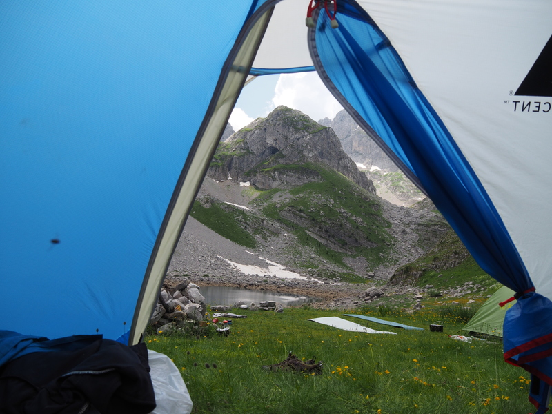Дньовка на озері](https://www.tkg.org.ua/files/styles/colorbox/public/story_img/35539/0alp17ov_9.jpg?itok=tc66jA0b "Дньовка на озері") [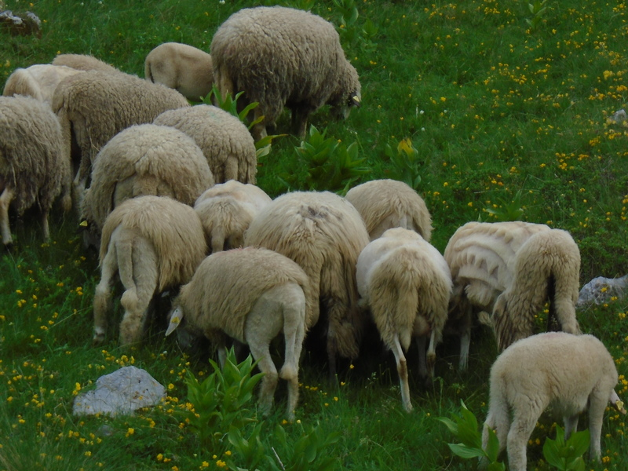Вівці з кошари](https://www.tkg.org.ua/files/styles/colorbox/public/story_img/35539/0alp17ov_10.jpg?itok=Btux7XzA "Вівці з кошари") Наступного дня в нас – дньовка! Можна плавати в озері, гуляти по околицям, фотографувати, відпочивати на карематі, збирати трави на чай, займатися йогою! Сергій, Саша і Андрій пішли гуляти до Чорногорії, в сторону бувшого кордону. Вони дійшли до кошари за 1,5 год. (нам це все херсонці підказали) і, поспілкувавшись з родиною пастухів, купили бринзи і домашній хліб. Бринза овеча, і коров’яча коштує однаково – 5 Євро за 1 кг. (Чорногорські пастухи признають тільки євро), 1 маленька булочка коштує 1 Євро. Пропонували ракію (1  л. = 15 Євро, 0,5 л. = 8 Євро). Підхід у них європейський – пробувати дають пів-крапельки! В колибі живе сім’я з 4 людей – батьки і два дорослих хлопця. Барани в них дуже доглянуті і чистенькі, вибриті хитромудрими візерунками (вибрита або тільки шия, або зад хвильками, або ноги, або голова, як в пуделя) і виглядають дуже кумедно.

[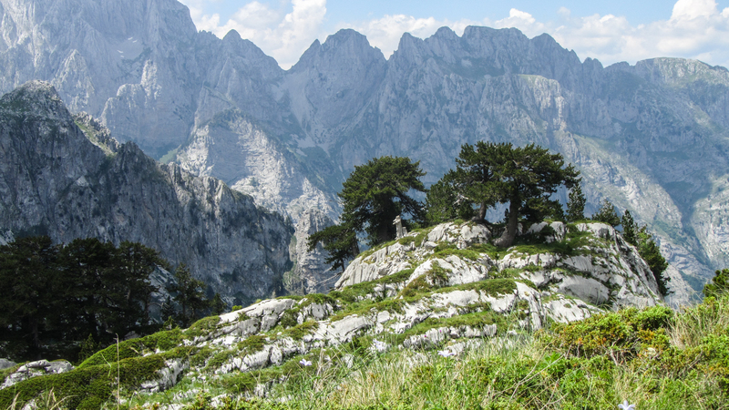Під г. Майа Рошит](https://www.tkg.org.ua/files/styles/colorbox/public/story_img/35539/0alp17ov_11.jpg?itok=cpv9aU-p "Під г. Майа Рошит") Ми восьмий день в горах. Після відпочинку ми рушаєм далі. Виходимо на ледве помітну стежку, яка тягнеться по кордону з Чорногорією. Незабаром стежка зникла, і ми просуваємось бездоріжжям по камінням і пересіченій місцевості. (Стежка на г.Майа Рошит, яку ми бачимо на карті, і по якій планували йди, виглядає величезною петлею, і їде по Чорногорії з великим перепадом висот). Вже багато раз нас виручає GPS - визначає наші координати. Отже, з верхнього озера до сідловини Вальбонес (1.900 м.) без стежки, з обідом по дорозі, ми дісталися за 3 години. Ця сідловина Вальбонос – надзвичайно гарне місце. Ми спускаємося по досить протоптаній стежці, що іде серпантином, навіть зустрічається декілька раз вказівники (дерев’яні, вигорівши, але читабельні!) По  ним ми орієнтуємось де с.Вальбона (Valbona) – 4,5 км., гора  Майа Рошит (Maia Rosit) – 3 км., і (Rrethi I Bardh) – 4 км. Після 40 хвилин серпантинного спуску - невеличке озерце. Це штучне каламутне болото, куди стікає чиста вода по шлангу з перевалу. Ночуємо тут, під г. Майа Рошит.

[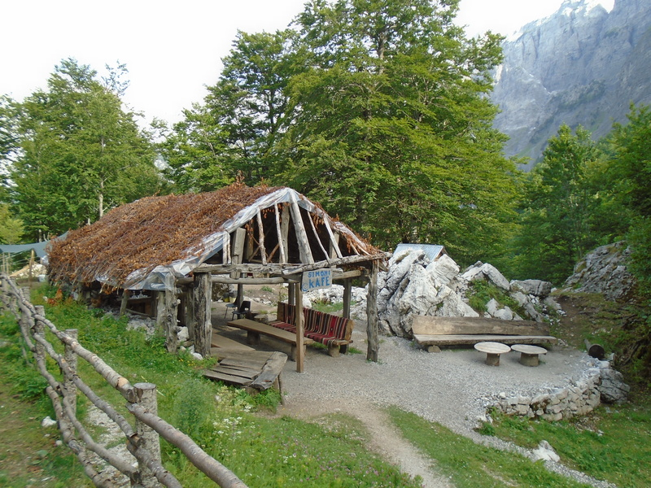Рештки села](https://www.tkg.org.ua/files/styles/colorbox/public/story_img/35539/0alp17ov_12.jpg?itok=P11GRkIh "Рештки села") Зранку досить швидко ми спустилися до села. По дорозі, крім безмежних полів полуниці, зустрічали струмочки. Села, як такого, ми і не побачили. Вздовж величезної висохлої річки Вальбона, пару хатинок. Є туристичні кемпінги та готелі. Дуже багато зустрічаємо німців будь-якого віку, майже всі з кишеньковими рюкзаками, багато тих, кому речі перевозили місцеві на конях. Дорога на перевал в с. Тесс – 9 км. іде вздовж висохлого русла річки. Асфальт закінчується біля якогось великого туристичного притулку. Там ще можна набрати воду. Далі стежка іде по кам’янистій дорозі з невеликим підйомом, пізніше - крутим. На карті позначено джерело. Це виявився  великий льодяний струмок з вируючою  водою! Біля нього – місцеве кафе для туристів (пиво і кока-кола  0,5 л. по 3 Євро), тут можна і поїсти. Недалеко від кафе ми на пласкому місці розбили палатки.

[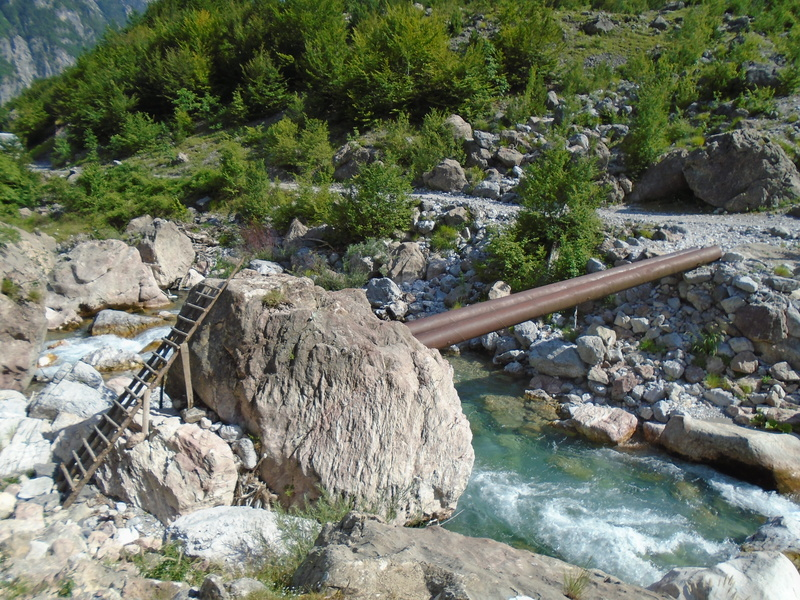Міст через річку](https://www.tkg.org.ua/files/styles/colorbox/public/story_img/35539/0alp17ov_13.jpg?itok=xy98Tnie "Міст через річку") Зранку в кафешці випили каву. Поруч нашого табору – стежка на перевал. По ній проходять групи, здебільшого німці, деякі зупиняються і нас фотографують! Від місця нашої стоянки (т.б. від кафе) до перевалу іти 1,5 години. Десь на середині підйому є вказівник на г. Єзерце (в правий бік). Дуже багато туристів ходять з маленькими рюкзаками на перевал і назад. Перевал красивий, але нічого надприродного немає. Ми почали спуск в Тесс, і тут вже людей зустрічали одиниці. Природа за перевалом різко змінилася, і дуже нагадує наші рідні Карпати.  Спуск крутий і трохи затяжний, але в нас з перекусом, збором м’яти і полуниці зайняв 2,5 год.

Тесс нас зустрів пекучим сонцем, дорогими машинами біля готелів і ледащими, сонними німцями… Ночуємо на нашому місці, де ночували перед виходом до перевалу Тесс.

[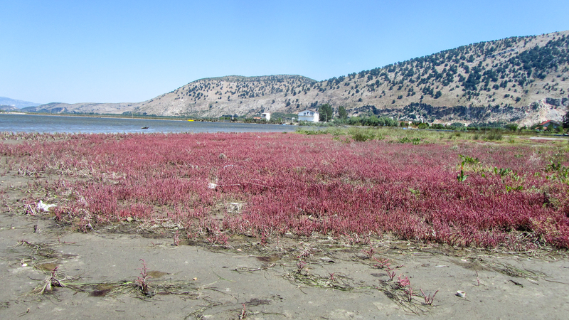Албанське узбережжя](https://www.tkg.org.ua/files/styles/colorbox/public/story_img/35539/0alp17ov_14.jpg?itok=UFL_0gKs "Албанське узбережжя") Наступного дня всі налаштувались на море. Зранку ми сидимо біля дороги на невеличкому перехресті і зупиняємо все, що їде. Через годину трьох з нас забрала пара швейцарців, які подорожували на місцевій Mitsubishi Pajero, і навіть не взяли з нас грошей. Хвилин за 20 решту з нашої групи підібрав місцевий бус, на якому їхали знову ж таки німці! Їхали ми 1 год. 40 хв. і дісталися майже до місця стоянки наших машин. Місцевий водій  (англійською не володів) зажадав з нас по 10 Євро з людини, але ми сторгувалися наполовину. Заплатили за стоянку двох машин: 3000  лек за 1 тиждень.

**Гірська подорож закінчена**. Ідемо в м. Шкодер. В Шкодере біля базару поїли смачний бюрек (поріжок з сиром – 30 лек, з м’ясом та зеленню – 50 лек). Їхали ми з Боге до Веліпої біля 3 годин. Велика спека! В Веліпої  знайшли за 2 Євро з машини кемпінг: палатки можна поставити в соснах, є душ, туалет, пральна машина, але далеко море. Шукаємо далі. Розпитувати місцевих велика проблема, так як англійською майже ніхто не володіє. Натрапили в готель: п’ятимістний номер на 3-му поверсі, 5 хв. від моря - 25 Євро за добу. Тут 2 кімнати, є стіл, шафи, кондиціонер, в кухні: холодильник, весь посуд (каструлі, пательня, тарілки, чашки, рюмки, турка, тощо…), газова плита. На балконі – великий стіл зі стільцями, де ми завжди їли, пили каву, грали в карти, відпочивали… Досить комфортно ми всі тут розмістилися.

[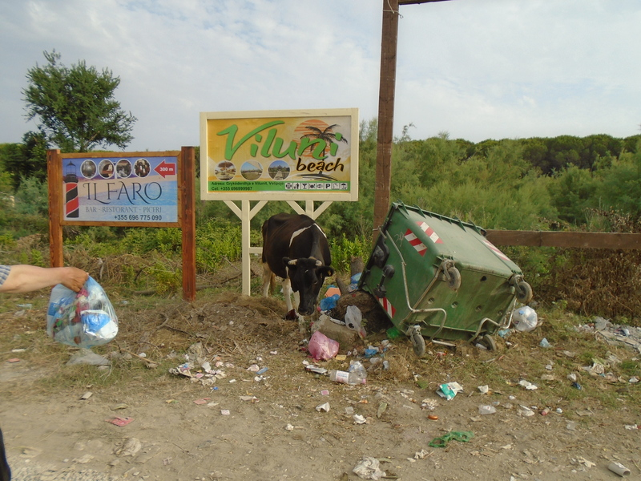Перекинуті смітники, в яких риються корови і бродячі собаки](https://www.tkg.org.ua/files/styles/colorbox/public/story_img/35539/0alp17ov_15.jpg?itok=FX34J-HG "Перекинуті смітники, в яких риються корови і бродячі собаки") Відпочиваємо на Адріатичному морі 5 днів! Вночі спекотно. Дуже тепле море і до нестями солене! Таке солене, що очі в воді відкрити неможливо. Пісок чорний, в обід по ньому до моря навіть добігти неможливо. Скоріше за все  Велліпої — це наше Коблево чи Рибаківка. Тут відпочивають місцеві або з Косова (видно по машинам). Є недобудовані будинки, багато циган. Пляж прибирають тільки на території платних лежаків. Перед пляжем — перекинуті смітники, в яких риються корови і бродячі собаки. В центі трохи веселіше і чистіше. Алея з китайськими сувенірами, морозиво, магазинчики, гумові качки, шлепки, купальники, фаст-фуди... - все як  на будь-якому курорті. За 5 днів на морі ми дуже заскучали за горами!

Ціни на продукти тут адекватні нашим, на овочі і фрукти навіть трохи дешевше, ніж в Україні. Коли бачать туристів, місцеві відразу говорять ціни в євро (зрозуміло, що в леках було б дешевше). Кава в ресторанчику біля моря — 80 лек (18 грн.). Кава міцна і подають її в маленьких горнятках зі стаканом води, бо смакувати її треба ковточками. Багато пилу, він носиться усюди. Але албанці води не шкодують — усюди зі шлангів поливають все підряд: дороги, машини, будинки. На загальному пляжу людей дуже багато. Якщо пройти годину на косу — там цікавіше, мало людей, можна назбирати цікавих ракушок, яких немає в Чорному морі. Досліджуємо життя крабів — їх теж багато!

[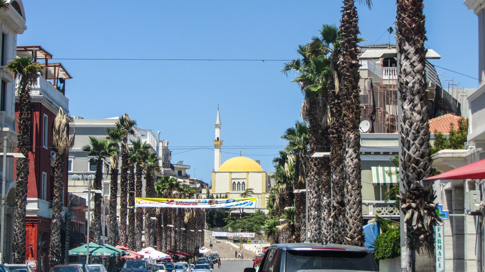Місто Дурес](https://www.tkg.org.ua/files/styles/colorbox/public/story_img/35539/0alp17ov_16.jpg?itok=mgA_LSYR "Місто Дурес") По дорозі додому проводимо пару годин в місті Дурес. Дурес — справжнє курортне місто: великі готелі, дорогі машини, туристичний центр, пальми, базари, магазини... Якщо є час, варто відвідати місцевий базар недалеко від центру. Овочі, фрукти, горіхи, оливкова олія, оливки з бочок, усілякі місцеві делікатеси — це все дуже дешево і смачно!

Додому! Той самий шлях — через Македонію, Словенію, Румунію. Вже по дорозі, ми стали сумувати за гірськими краєвидами Албанії! Беззаперечно вирішили, що обов’язково ще повернемось в цю країну!

Р.S. На бензин потрачено 6150 грн. (~200 Євро) на 1 машину в обидві сторони (вартість бензину станом на липень 2017 року). Харчі та бензин для подорожі по горам ми везли зі Львова, розрахувавши наш кожен день.

Склад групи: Вервега Андрій, Вервега Анастасія, Вервега Ольга, Капустяк Костянтин, Мотика Олена, Танцюра Сергій, Ярошенко Олександр.
