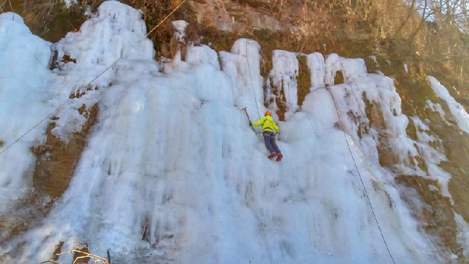
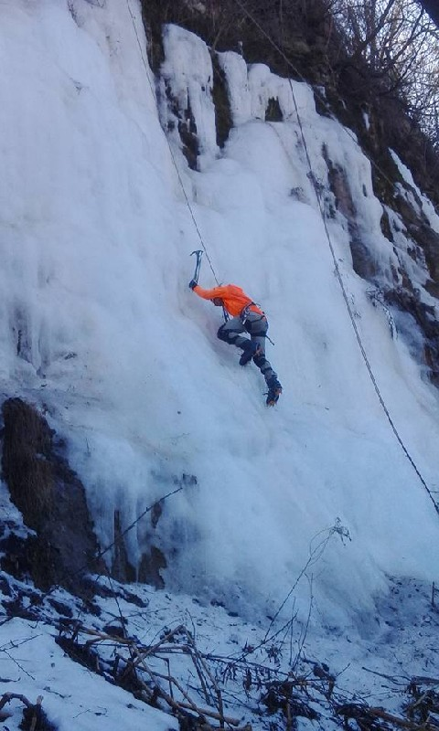
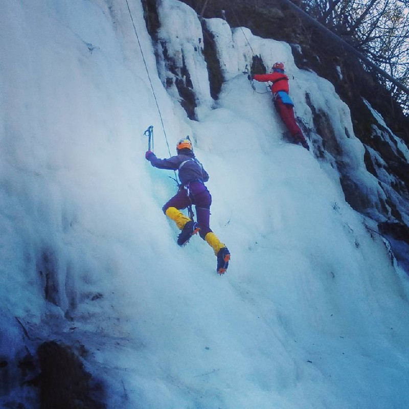
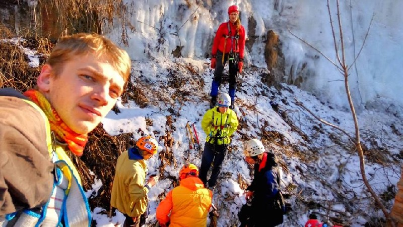

Усі кияни (й не тільки) давно звикли, що як тільки є три тижні морозу, час збиратися у Кам'янець-Подільський "на сосульку".  
Але глобальне потепління та велика кількість бажаючих гвалтувати лід у Кам'янці робили виїзди все менш привабливими. Остання крапля була в зміні розкладу в потягу Київ - Кам'янець-Подільський, який перестав ходити кожен день. Тому пошук часу для льодолазання став не привабливим. Треба було шукати щось нове.

Але під час постановки дистанції на Чемпіонат України з техніки пішохідного туризму 2013р, Олексій Новак показав де в Вінниці намерзає льод. Звучало привабливо, та у 2014 році не сталося туди потрапити. Й нарешті 2016:

Фото від 24 січня.  
Після того було потепління, але для такої бурульки - то ніщо. Й ми 30.01.16 з’їздили на розвідку.  
Знаходиться ця “мекка льодолазання” біля Скель Каспича. На 200-300м лівіше, якщо на них дивитися знизу.  
Ось вам посиланнячко, як добиратися з вокзалу в Вінниці: [https://goo.gl/maps/AQpb8RSq5M72](https://goo.gl/maps/AQpb8RSq5M72)  
**Координати:** 49.222948, 28.466404

**Що там є:**  
Скельний вихід за будівлею тиру (хе-хе) висотою до 15м. На ньому намерзає каскад льоду висотою 8-10м, та шириною від 10 до 30м. В різних погодних умовах буде по різному. Але головне те, що одночасно можуть лізти не менше 4х людей. В наших умовах могло лізти й 5-6.  
Верхню страховку можна вішати за дерева над скелями. Треба бути обережними, бо зверху хащи над скелями, та не чищено. Мотузки 40м вистачало з запасом.  
За наших умов ми змогли й з нижньою страховкою полазити.  
Бурулька має як вертикальні ділянки, так й пологі. Що добре для навчання.

[фото 2](https://www.tkg.org.ua/files/story_img/33305/0vin16ok_02.jpg "фото 2")[фото 3](https://www.tkg.org.ua/files/story_img/33305/0vin16ok_03.jpg "фото 3")[фото 4](https://www.tkg.org.ua/files/story_img/33305/0vin16ok_04.jpg "фото 4")

**Транспорт з Києва.**  
Найзручніше Інтерсіті о 6:50 виїзд туди, 9:30 в Вінниці. Й о десятій можна вже лазити. Назад: вечірній Інтерсіті 18:33 й о 21 ви в Києві. Але варіант найдорожчий, тому можете шукати варіанти з іншими потягами та ночівлею.

**Про заняття.**  
Їздили Марина Рубан, Саша Козлик, Валя Левчук, Ігор Д'яченко, Олег Малков, Артем Жердочкин, Олексій Келін.  
За лід потрималися. Дехто перший раз. Для них це було мегакорисно, бо ступінчастий лід новачкам - саме те. Наприкінці тренування вони вже бігали й по вертикалях.  
Ті хто не лазив давно, розігнали кров. Бігаючи по 4-5 підйомів за раз.  
Передивилися спорядження. Декілька пар взуття та кішок стали в чергу до смітника, або на переробку.  
Поробили самовикрути, та петлі в проушинах.  
Найбільш прошарені полазили з нижньою страховкою.  
Погрілися на сонечку. Та гарно поспілкувалися.

[фото 5](https://www.tkg.org.ua/files/story_img/33305/0vin16ok_05.jpg "фото 5")

**Висновок.**  
Гарне місце, щоб не стояти в черзі в Кам'янці-Подільському та не вигадувати як до нього доїхати. Бурулька не вище за Кам'янецьких, але суттєво ширша. Що дає шанс займатися великій кількості бажаючих. Є пологі ділянки, що дає можливість вчити новачків. Та розвантажити той же Кам'янець. Дуже зручна логістика для поїздки на один день.  
Ще там можна проводити змагання з техніки.
