Турклуб "МКС"

**ОТЧЕТ**

о пешеходном туристском

спортивном походе 4 категории сложности  
по Кузнецкому Алатау (Поднебесные Зубья)

совершенном с 7 по 22 июля 2009 г.

Маршрутная книжка - 31/09  
Руководитель группы ПАЛИЕНКО Сергей Владимирович

Адрес руководителя: adolfovich (at)bigmir.net

Маршрутно-квалификационная комиссия ФСТК рассмотрела отчет и считает, что поход может быть засчитан всем участникам и руководителю как поход IV категории сложности.

* * *

## Оглавление

1\. Справочные данные про туристский спортивный поход

> 1.1. Параметры похода  
> 1.2. Характеристика района  
> 1.3. Подробная нитка маршрута  
> 1.4. Данные про опыт участников

2\. Организация туристского спортивного похода

> 2.1. Общая идея похода  
> 2.2. Варианты подъезда и отъезда. Обоснование выбора точек начала и конца похода  
> 2.3. Аварийные выходы с маршрута и его запасные варианты  
> 2.4. Изменения маршрута и его причины  
> 2.5. Сведения про прохождение маршрута каждым участником

3\. График движения и технический отчет

> 3.1. График движения  
> 3.2. Высотный профиль похода  
> 3.3. Техническое описание прохождения маршрута  
> 3.4. Расчет категории сложности похода  
> 3.5. Картографический материал

4\. Выводы и рекомендации по прохождению маршрута  
5\. Приложения

> 5.1. Перечень личного, общественного снаряжения, состав аптечки и рем набора  
> 5.2. Перечень продуктов, рацион питания и их вес  
> 5.3. Смета затрат на поход  
> 5.4. Расписание движения транспорта, время работы отделений связи  
> 5.5. Список литературы, туристических отчетов и других источников информации

* * *

**1\. Справочные данные про туристский спортивный поход**

### 1.1. Параметры похода.

<table><tbody><tr><td rowspan="2">Вид туризма</td><td rowspan="2">Категория сложности</td><td rowspan="2">Протяженность активной части похода, км</td><td colspan="2">Продолжительность</td><td rowspan="2">Сроки проведения</td></tr><tr><td>Общая</td><td>Ходових дней</td></tr><tr><td>пешеходный</td><td>четвертая</td><td>217,9</td><td>16</td><td>15</td><td>07.07 - 22.07.2009</td></tr></tbody></table>

### 1.2. Характеристика районов проведения похода.

Кузнецкий Алатау - горный массив на юге Сибири в Кемеровской области и Красноярского края. Он расположен между Кузнецкой и Минусинской котловинами. Массив является водоразделом притоков реки Обь и рек Томь и Чулым. Длиной около 300 км и шириной 150 км.

Кузнецкий Алатау состоит из сильно расчлененных реками хребтов со средней высотой 1200м. Наивысшая точка района - г. Старая крепость (2217 м). Характер рельефа альпийский. Вершины и гребень имеют остроконечные формы, с крутыми склонами.

Особенно красивы в этом районе хребты Караташ, Кузнецкий Алатау, Тигиртыш со своими стенами. Западный склон хребта Кузнецкий Алатау имеет крутизну от 500 до 700, а восточный обрывается стенами от 200 до 500 метров.

Горы сложены известняками, кварцитами, кремнистыми и глинистыми сланцами. Современный рельеф создан в результате поднятия и расчленения разновозрастных поверхностей выравнивания.

У подножия стен расположено множество маленьких озер, из которых берут свое начало ручьи и речки. Русла речек в верховьях крутые, порожистые. Иногда встречаются и водопады высотой до 5 метров.

Долины узкие с крутыми склонами.

Климат теплый, влажный. На западном склоне выпадает 600 - 800 мм осадков в год (максимальное до 1500 м), на восточном склоне 40 - 500 мм. Более всего осадков выпадает в долинах рек Бель-су и Казыров. Пасмурная, дождливая погода может стоять продолжительное время.

В данном районе повсеместно преобладает горная тайга из пихты, ели и кедра. Нижний пояс восточного склона занят горными луговыми степями на черноземных почвах, а выше, на высоте 700 - 800 м на подзолистых дерново-подзолистых почвах господствуют хвойные леса. С высоты 1300 - 1500м - мохо-лишайниковые, кустарниковые, каменистые тундры.

В недрах Кузнецкого Алатау железные и марганцевые руды, уголь, золото, хромиты, бокситы, минеральные и строительные материалы.

Богат и разнообразен животный мир этого района. Из зверей здесь водятся лоси, медведи, белки, рассомахи, рыси, горностаи, барсуки, соболя. Из пернатых - глухари, рябчики, полярные куропатки, кедровки, кукушки и другие.

Коренное население - шорцы. Поэтому многие названия хребтов, речек имеют шорское происхождение. И только названия перевалов, некоторых вершин имеет русское происхождение, так как давались они туристами.

Некоторые объекты имеют по несколько названий. Например: перевал Караташ или перевал Карнизный, гора Старый город или гора Старая крепость и т.д.

При частой перерисовке карт на них произошли изменения некоторых географических названий.

### 1.3. Подробная нитка маршрута.

ст. Балыксу - дол. р. Теренсу - дол. р. Б. Каинзас - дол. р. М. Каинзас - пер. Геологов (н/к) - р. Переходный - р. Б. Казыр - п. Гайдара (н/к) - траверс хр. Кузнецкий Алатау (1Б) - пер. МКС (1А) - р. М. Хунулхузух - пер. Мария (1Б) - оз. Харатас - пер. Козьи Ворота (н/к) - г. Верхний Зуб (1А) (рад.) - г. Старая Крепость (н/к) (рад.) - дол. р. Туралыг - дол. Бельсу - дол. р. Амзс - тарверс хр. Тигиртыш (1А) - р. Высокогорный - дол. р. М. Казыр - пер. Алгуй (н/к) - ст. Лужба

### 1.4. Данные об участниках.

<table><tbody><tr><td>Ф.И.О.</td><td>Год рождения</td><td>Должность в походе</td><td>Туристский опыт</td><td>Контактная информация</td><td>Фото</td></tr><tr><td>Палиенко Сергей Владимирович</td><td>1983</td><td>руководитель</td><td>5У Хамар-Дабан, 3Р З. Кавказ (п.о.1Б - рук)</td><td>adolfovich (at)bigmir.net тел +38 (067) 978-83-75</td><td></td></tr><tr><td>Гудкова Дарья Олеговна</td><td>1986</td><td>завхоз</td><td>3У З. Кавказ (п.о.1Б - уч.)</td><td>тел. +38 (093) 762-50-09</td><td></td></tr><tr><td>Дергай Николай Васильевич</td><td>1984</td><td>ремонтник</td><td>3У З. Кавказ (п.о.1Б - уч.) 2 Р Крым</td><td>тел.425-01-63</td><td></td></tr><tr><td>Дергай Александр Васильевич</td><td>1984</td><td>санитар</td><td>2У Крым (п.о.1А - уч.)</td><td>тел.425-01-63</td><td></td></tr></tbody></table>

**2\. Организация туристского спортивного похода**.

### 2.1. Общая идея похода.

Ещё в 2007 году во время обсуждения районов, где возможно проведение пешеходного похода 4 к.с., с О.П. Нечипоренко, мне был рекомендован Кузнецкий Алатау. С одной стороны, район - довольно интересный и перспективный, ведь в наше время украинские группы туда не ходили, а с другой - приятный во многих отношениях: относительно недалеко (ближе только Полярный и Приполярный Урал и Кольский п-ов), и, в отличие от севера, лишен такого количества кровососущих насекомых. Поэтому я практически сразу начал разработку маршрута, планируя провести весной 2008 года 3-ку по Карпатам, а летом - 4-ку по Кузнецкому Алатау. Однако весной группу собрать не удалось, а летом я провел пешеходную 3-ку по Западному Кавказу.

К идее всё-таки провести 4-ку по Кузнецкому Алатау я вновь вернулся уже в январе 2009 года, во время обсуждения предстоящей 5-ки по Алтаю, куда собирался пойти участником. Поход планировался на конец июля - август, значит, в июле будет время на проведение 4-ки, а также можно значительно сэкономить средства на дорогу. Ведь оба района находятся относительно недалеко друг от друга, а дорога к ним включает перелёт в Новосибирск, который может использоваться как точка стыковки. Моя группа идею поддержала. Ведь в данный район полностью подходит для проведения классического таёжного пешеходного похода.

### 2.2. Варианты подъезда и отъезда. Обоснование выбора точек начала и конца похода.

За основу был взят эталонный российский маршрут пешеходной 4-ки. Существовавший в СССР эталон не подходит, так как включает сплав и проходит по территории, входящий сейчас в состав заповедника "Кузнецкий Алатау". Маршрут был переработан, что бы исключить кольца, которыми грешит современный российский эталон. Однако члены МКК настояли, что бы в маршрут были включены траверсы хребтов Кузнецкий Алатау (2 участка) и Тигиртыш. Маршрут начинался от ж/д станции Балыксу и заканчивался на станции Лужба, что весьма удобно для подъезда и отъезда.

Более проблематично добраться до самого района из Киева. Самый простой вариант - ехать до Москвы, а оттуда поездом - до Новокузнецка. Ещё варианты - прицепным вагоном Киев - Владивосток - до Новосибирска, а оттуда чем-то до Новокузнецка. Однако, посмотрев на стоимость ж/д билетов, и, учитывая что дорога до Новокузнецка поездом занимает около 3-х суток, решили лететь самолётом. Так как поход планировался заранее, мы дождались акционных скидок и взяли билеты на рейс Москва - Новосибирск авиакомпании "Уральские авиалинии" по довольно выгодной цене. (Ещё были рейсы S7 до Новосиба и даже до Новокузнецка на эти числа, но мы провтыкали.) Поэтому в выборе остального транспорта мы уже отталкивались от авиаперелёта.

До Москвы из Киева добирались поездом Жмеринка - Москва - 90, с отправлением из Киева в 20.15 и прибытием в конечный пункт в 9.31. Данный поезд удобный по времени и относительно недорогой. Также существуют и другие варианты, так как недостатка в поездах на Москву не наблюдается.

Вылетали мы из аэропорта Домодедово в 21.00, до аэропорта добрались обычной электричкой от Савеловского вокзала. (Там ходит и специальный экспресс, но он дороже в 2,5 раза, а идёт на 15 мин. быстрее. Правда, электричка ходит 3 раза в сутки, но нам было как раз.) В Новосибирск в аэропорт Толмачево прилетели в 3.50 местного времени. Подождав на улице до 6.00, когда начнет ходить рейсовый транспорт, мы добрались до автовокзала автобусом - 122. Ещё в Киеве, рассматривая варианты переезда Новосибирск - Новокузнецк, мы остановились на автобусе, так как подходящих поездов на этот день не было. (Потом узнали, что там ходит скоростная электричка. Она позволяет выиграть в деньгах, но проиграть во времени и комфорте.) Имеется несколько автобусных рейсов (автобус Neoplan), но наиболее подходящие - на 8.20 и 9.30 по Новосибирску с прибытием в 15.00 и 16.00 по Новокузнецку (разница во времени между городами - 1 час, с Киевом - 4 и 5 часов соответственно). Дело в том, что до станции Балыксу или Лужба можно добраться, либо поездом Новокузнецк - Абакан - 676 (отправление в 18.00 по Москве), либо двумя электричками с пересадкой в Междуреченске (отправление из Новокузнецка где-то утром). Поэтому нам надо было успеть к абаканскому поезду. Так как летели мы самолетом, где имеются ограничения по весу багажа, основную часть продуктов и бензин для мультитопливной горелки мы покупали в Новокузнецке, а также надо было отправить телеграмму в Киев (На огромный город - всего один почтамт - ехать от ж/д вокзала троллейбусом ?3 или другим транспортом до остановки "Кинотеатр Сибирь".). Билеты на поезд мы брали в Киеве - в общий вагон, который оказался купейным. (Можно было брать и на месте, билеты в кассе были, хотя выигрыш в деньгах и не такой значительный.) Заняв там верхние полки, мы по-барски добрались до ст. Балыксу, куда прибыли в 22.05 по Москве или 2.05 по местному времени  
Назад от станции Лужба до Новокузнецка добирались на поезде - 675 Абакан - Новокузнецк, отправляющимся в 0.54 (по Москве) и прибывающим в 4.14 в конечный пункт). Всё тот же общий купейный вагон, где, если повезёт, после Междуреченска можно занять верхнюю полку и поспать до Новокузнецка. Оттуда в Новосибирск ехали на поезде ?13 Новокузнецк - Санкт-Петербург с отправлением в 15.09 (по Москве) и прибытием в Новосиб в 22.08. (Наш самолёт вылетал из аэропорта Толмачево в 6.40 по местному времени и прилетал в Домодедово в 7.45 по Москве.) Следует сказать, что поезд этот - очень дорогой, поэтому чтобы сэкономить деньги лучше ехать на автобусе.

Другим минусом такого варианта является то, что до аэропорта с ж/д вокзала придётся добираться на такси, так как в 1.00 рейсовый транспорт не ходит.

Преимуществами этого поезда является возможность в течение целого дня посмотреть Новокузнецк (а там довольно много музеев и старая крепость в придачу) и чуть-чуть поспать в поезде в горизонтальном положении. Номер службы заказа такси узнали заранее через Интернет, что позволило доехать в аэропорт почти два раза дешевле, чем брать машину сразу на вокзале. (Такси "Дешевое" т. в Новосибирске 230-04-00, но лучше номер еще раз проверить, так как он может измениться.)  
Из Москвы в Киев ехали поездом - 41 Москва - Киев, отправление 16.46, прибытие 5.10. Хотя могут быть и другие варианты.

### 2.3. Аварийные выходы с маршрута и его запасные варианты.

**Заявленная нитка похода:**

ст. Балыксу - дол. р. Теренсу - дол. р. Б. Каинзас - пер. Геологов (н/к) - р. Переходный - р. Б. Казыр - п. Гайдара (н/к) - траверс хр. Кузнецкий Алатау до г. Верхний Зуб - пер. Козьи Ворота (н/к) - г. Старая Крепость (н/к) - дол. р. Туралыг - дол. р. Пихтерек - г.1547 - траверс хр. Кузнецкий Алатау до г. Двуглавая - р. Бельсу - дол. р. Нижний Тайжесу - пер.Озерный - тарверс хр. Тигиртыш от г. Малый Зуб до г. Запсиб - дол. р. М. Казыр - пер. Алгуй (н/к) - ст. Лужба  
**Запасные варианты:**

В случае непогоды во время первого траверса хр. Кузнецкий Алатау спуск и обход по Золотой Долине до пер. Козьи Ворота, оттуда - радиальное восхождение на г. Верхний Зуб. При отставания от графика полный или частичный отказ от траверса хр. Тигиртыш со спуском в дол. р. Высокогорный.

**Аварийные выходы из маршрута**:  
В случае возникновения аварийной ситуации выход с маршрута по долинам рек М. и Б. Каинзасы и Теренсу к ст. Балыксу, М. и Б. Казыр и Бельсу и далее по тропам к ст. Лужба. Начиная от места впадения р. В. Тайжесу в Бельсу и р. Высокогорный в М. Казыр до самой ст. Лужба территория массово посещается туристами, и там находятся многочисленные приюты, откуда возможен вызов спасателей.

### 2.4. Изменения маршрута и его причины.

Во время траверса хр. Кузнецкий Алатау от п. Гайдара, вынуждены были спуститься к озеру, немного не доходя г.2036. Так как из-за плохой проходимости потратили много времени и сил, дело было к вечеру, погода могла испортиться, а воды на хребте не было. У нас возникло отставание от графика из-за плохой проходимости подходов к пер. Геологов и дол. р. Переходный, предстоял отказ от полного прохождения траверса хр. Тигиртыш с прохождением ранее неизвестного участка. Поэтому решили совершить прохождение такого перевала на отроге хр. Кузнецкий Алатау из дол. р. М. Хунулхузух со спуском к оз. Харатас с последующим выходом на пер. Козьи Ворота и радиальным восхождением на г. Верхний Зуб.

Из-за ухудшения самочувствия участницы, у которой поднялась небольшая температура, чтобы сделать для заболевшей полудневку, на пер. Козьи Ворота решили сходить частью группы радиально на г. Старая Крепость, а не делать сквозное прохождение, как планировали в Киеве. В связи с еще большим ухудшением состояния участницы - температура поднялась более 38, мы начали спуск в дол. р.  
Туралык с последующим аварийным выходом в дол. р. Бельсу, но не доходя седловины хр. вынуждены были сделать полудневку из-за еще большего ухудшения состояния заболевшей. На следующий день аварийный выход был продолжен. Однако приём тетрациклина и йодантипирина дал необходимый результат - её состояние нормализовалось, а мы находились уже в сутках от выхода, в районе интенсивного движения туристских групп. Поэтому, максимально спасая поход, попытались пройти всё, что было возможно. Правда, выход в дол. р. Амзас из каньона р. Бельсу сделался невозможным: из-за начавшийся гроза, так как движение около 5 км по мокрым камням и скалам, нависающим над водой, стало не безопасным. Группа была вынуждена вернуться к р. Поднебесный и по тропе выйти в дол. р. Амзас, а оттуда начать запланированный траверс хр. Тигиртыш, но в обратном направлении, с последующим выходом в дол. р. Высокогорный. Хотя и здесь погода не дала до конца воплотить задуманное.

**Окончательный вариант маршрута:**

ст. Балыксу - дол. р. Теренсу - дол. р. Б. Каинзас - дол. р. М. Каинзас - пер. Геологов (н/к) - р. Переходный - р. Б. Казыр - п. Гайдара (н/к) - траверс хр. Кузнецкий Алатау (1Б) ?пер. МКС (1А) - р. М. Хунулхузух - пер. Мария (1Б) - оз. Харатас - пер. Козьи Ворота (н/к) - г. Верхний Зуб (1А) (рад.) - г. Старая Крепость (н/к) (рад.) - дол. р. Туралыг - дол. р. Бельсу - дол. р. Амзс - тарверс хр. Тигиртыш (1А) - р. Высокогорный - дол. р. М. Казыр - пер. Алагуй (н/к) - ст. Лужба

### 2.5. Сведения о прохождении маршрута каждым участником.

_Маршрут пройдем всеми участниками полностью_.

**3\. График движения и технический отчет**.

### 3.1. График движения

<table><tbody><tr><td>Дата</td><td>?</td><td>Участок пути</td><td>Время</td><td>км</td><td>Высота</td><td>комментарий</td><td>метеоусловия</td></tr><tr><td rowspan="4">07.07 1 день</td><td>1</td><td>станция Балыкса - устье р. Теренсу</td><td>02.05?03.10 12.10?13.00 (1.45)</td><td>8,1</td><td>0</td><td>Идем вдоль ж/д путей до моста, затем через мост и далее по дороге через деревню. Прошли вперед по дороге и возле развилки стали на ночевку.
Продолжили движение по дороге вдоль реки и ж/д путей на другом берегу.

Пройдя ответвление дороги идущей вброд, подошли к мостику.
</td><td>Ясно, луна затем солнце.</td></tr><tr><td>2</td><td>Крюк- верх по р. Шумному</td><td>13.00?15.00 (1.30)</td><td>5</td><td>+120 -120</td><td>Пошли по плохой дороге возле моста. Поняли, что не туда и вернулись</td><td>ясно</td></tr><tr><td rowspan="2">3</td><td>устье р. Теренсу - р. Нижний Березовый</td><td>15.15?21.25 (3.35)</td><td>13</td><td>+92</td><td>Идем по дороге вдоль реки, , иногда обходим прижимы. Дорога иногда отходит от берега, а затем возвращается. По мостикам переходим несколько притоков Теренсу.</td><td>Облачно, гроза, облачно.</td></tr><tr><td><b>Итого:</b></td><td><b>6 </b>.<b>5 0</b></td><td><b>2 6 ,1</b></td><td><b>+92</b></td><td></td><td></td></tr><tr><td rowspan="3">08.07 2 день</td><td>4</td><td>р. Нижний Березовый - устье р. Б. Каинзас</td><td>10.05?13.45 (3.00)</td><td>9,1</td><td>+73</td><td>Идем по дороге вдоль реки, иногда переходим вброд притоки, иногда обходим прижимы.</td><td>Солнечно.</td></tr><tr><td rowspan="2">5</td><td>устье р. Б.Каинзас - низовья р. М. Каинзас</td><td>16.20?20.25 (2.55)</td><td>7,2</td><td>+155</td><td>Идем по сильно размытой дороге, много раз переходим реку вброд, иногда идем прямо по воде. Немного не доходя устья р. М. Каинзас, срезаем по тропе, и выходим на дорогу в долине р. М. Каинзас, перейдя эту реку вброд.</td><td>Небольшие облака.</td></tr><tr><td><b>Итого</b></td><td><b>5.55</b></td><td><b>1 6 ,3</b></td><td><b>+228</b></td><td></td><td></td></tr><tr><td rowspan="4">9.07 3 день</td><td>6.</td><td>низовья р. М. Каинзас - водораздел р. М. и Б. Каинзас</td><td>9.00-11.50 (3.20)</td><td>6,3</td><td>+540</td><td>Идем по дороге, несколько раз переходя реку по бревну и вброд, дорога сильно размыта и заросла. Часто идем по руслу. Затем дорога идет серпантином по склону, а вскоре заканчивается под вершиной над перемычкой - водоразделом.
Идем по лесу в высокотравье и в завалах. Поднимаемся еще выше по склону идем траверсом.
</td><td>облачно</td></tr><tr><td>7.</td><td>водораздел М. и Б.
Каинзасов - исток р. Б. Каинзас
</td><td>12.00?19.10 (4.10)</td><td>4,0</td><td>-50</td><td>Идем по перемычке по зарослям. Выходим в зону редколесья на склоне хребта. Пережидаем грозу. Выходим в долину Б. Каинзаса. Продираемся сквозь заросли сланника, периодически переходя на каменные россыпи и снежники.
Сквозь заросли и высокотравье спускаемся к истоку Б. Каинзаса и переходим его по снежному мосту.
</td><td>Облачно, гроза.
Переменная облачность, а потом солнце.
</td></tr><tr><td rowspan="2">8</td><td>исток р. Б. Каинзас - перевал Геологов</td><td>19.30?20.20 (0.40)</td><td>0,9</td><td>+150</td><td>Поднимаемся по склону сквозь заросли сланника, идем по болоту, переходя через ручьи. Перед перевальным взлетом возле основания снежника стали на ночевку</td><td>солнечно</td></tr><tr><td><b>Итого</b></td><td><b>8 .1 0</b></td><td><b>1 1,2</b></td><td><b>+ 6 90</b>
<b>-50</b>
</td><td></td><td></td></tr><tr><td rowspan="4">10.07 4 день</td><td>8</td><td>исток р. Б. Каинзас - перевал Геологов</td><td>10.30?10.45 (0.15)</td><td>1,1</td><td>+117</td><td>Поднимаемся по осыпям вверх и выходим на перевал Геологов.</td><td>солнечно</td></tr><tr><td>9</td><td>перевал Геологов - долина р. Переходный</td><td>10.45?12.50 (1.45)</td><td>2,2</td><td>-457</td><td>Идем среди небольших кустов, сланника, иногда по козьей тропе, потом переходим на сыпуху средних размеров. Камни живые. Продолжаем по ним спуск, переходим в каньон правого притока р. Переходный. Движемся там, а затем и по лесу, преодолевая завалы.</td><td>солнечно</td></tr><tr><td rowspan="2">10</td><td>долина р. Переходный - долина р. Большой Казыр</td><td>13.00?20.00 (4.00)</td><td>5,0</td><td>-260</td><td>Идем по долине р. Переходный, по лесу, преодолевая завалы и заросли сланника, иногда попадается козья тропа. Периодически поднимаемся на прижимы, переходим вброд р. Переходный. Идем по левому берегу, выходим на берег притока, затем переходим назад на правый берег. Продираемся сквозь заросли и завалы в долине, выходим на крупную осыпь, продолжаем движение по зарослям, иногда идя по болоту.</td><td>солнечно</td></tr><tr><td><b>Итого</b></td><td><b>6 .00</b></td><td><b>8 ,3</b></td><td><b>+117</b>
<b>-717</b>
</td><td></td><td></td></tr><tr><td rowspan="4">11.07 5 день</td><td>11</td><td>дол р. Б. Казыр - пр.
приток р. Б. Казыр
</td><td>10.20?11.30 (1.00)</td><td>1.4</td><td></td><td>Идем по берегу р. Большой Казыр по слабопротоптаной козьей тропе, у впадения правого притока реки переходим реку вброд.</td><td>солнечно</td></tr><tr><td>12</td><td>пр. приток Б. Казыра - пик Гайдара</td><td>11.45?20.30 (5.00)</td><td>5,6</td><td>+1036</td><td>Пробираемся по левому берегу притока, затем вброд переходим на правый, идем по козьей тропе вверх, тропа теряется. Пробираемся сквозь заросли, завалы, высокотравье, выходим на крупную осыпь, затем траверсом идем по зарослям и высокой траве. Преодолевая заросли кустарников и россыпи средних размеров, выходим на перевальную седловину. Поднимаемся, слегка траверсируя склон по осыпи средних размеров, затем по ребру выходим на вершину к туру.</td><td>Солнце, переменная облачность</td></tr><tr><td rowspan="2">13</td><td>пик Гайдара - перевал Караташ</td><td>20.50 - 21.40 (0.50)</td><td>1,8</td><td>-257</td><td>По осыпи спускаемся на перевал.</td><td>Ясно</td></tr><tr><td><b>Итого:</b></td><td><b>6.5 0</b></td><td><b>8 ,8</b></td><td><b>+1036</b>
<b>-257</b>
</td><td></td><td></td></tr><tr><td rowspan="3">12.07 6 день</td><td>14</td><td>перевал Караташ - перевал МКС</td><td>10.20-15.50 (4.10)</td><td>5,2</td><td>+341</td><td>Идем по высокотравью, пересекая седловину перевала, и выходим на осыпь. Продолжаем движение по осыпи средних размеров, траверсируя склон, скоро начинается крупная, много живых камней. Затем по мелкой живой сыпухе и траве, набирая высоту, подходим к седловине перевала.</td><td>Солнце, переменная облачность.</td></tr><tr><td rowspan="2">15</td><td>перевал МКС - второе озеро в цирке</td><td>18.20-19.50 (1.20)</td><td>1,5</td><td>-440</td><td>Спускаемся с перевала по осыпи средних размеров, внизу - по мелкой и траве, выходим на снег возле озера, идем по сыпухе и траве вдоль ручья до второго озера.</td><td>Переменная облачность.</td></tr><tr><td><b>Итого:</b></td><td><b>5.30</b></td><td><b>6, 7</b></td><td><b>+341</b>
<b>-440</b>
</td><td></td><td></td></tr><tr><td rowspan="3">13.07 7 день</td><td>16</td><td>второе озеро в цирке - перевал Мария</td><td>11.20 - 14.40 (2.50)</td><td>2,4</td><td>+400</td><td>Пытаемся по склону обойти озеро, но выходим на мокрый склон и сбрасываем вниз к зарослям. Поднимаемся по склону по крупной осыпи, иногда пробираясь сквозь заросли.</td><td>Пасмурно, мелкий дождь.</td></tr><tr><td rowspan="2">17</td><td>Перевал Мария - озеро Харатас</td><td>15.00 - 22.30 (4.10)</td><td>2,5</td><td>-486</td><td>Спускаемся по сыпухе слева от кулуара, затем обходим слева скалки, по одному преодолеваем камнеопасный кулуар, а потом по мелкой сыпухе обходим бараньи лбы и спускаем к выполаживанию, затем по снежнику к воде. Обедаем. Обходим озеро по сыпухе, Идем вдоль обрыва к водопаду. Начинаем спуск, обойдя бараньи лбы по заросшим полочкам левее, по сыпухе и зарослям спускаемся ниже, по осыпям еще сбрасываем высоту и по задернованному склону выходим на снежник, а с него на крупную сыпуху. У места впадения ручья в оз. Харатас в болотце становимся на ночевку</td><td>Пасмурно.</td></tr><tr><td><b>Итого:</b></td><td><b>7.00</b></td><td><b>4 , 9</b></td><td><b>+400</b>
<b>-486</b>
</td><td></td><td></td></tr><tr><td rowspan="7">14.07 8 день</td><td>18</td><td>озеро Харатас - пер. Козьи ворота</td><td>11.30?13.20 (1.30)</td><td>2,1</td><td>+412</td><td>Обходим оз. Харатас слева, доходим до впадения ручья и переходим его вброд. Поднимаемся по снежнику и сыпухе на выполаживание. Продолжаем подъем, выходим на пологую часть. Далее по травянистому склону поднимаемся на перевал, местами по высокотравью и болотцу</td><td>солнечно</td></tr><tr><td>19</td><td>пер. Козьи ворота - г. В.
Зуб
</td><td>13.30 - 15.15 (1.35)</td><td>1,9</td><td>+372</td><td>С привала поднялись на хребет, обходя вершину справа, по сыпухе поднимаемся к перемычке, но упираемся в скалы и берем наверх, проходим перемычку по крутой сыпухе, поднимаемся по ребру, выходим на хребет и вдоль до вершины с хребтом</td><td>Переменная облачность</td></tr><tr><td>20</td><td>г. Б.Зуб - пер. Козьи Ворота</td><td>15.35?16.55 (1.20)</td><td>1,8</td><td>-372</td><td>Спускаемся до конца перемычки по пути подъема, а затем обходим вершину справа, траверсируя склон, спускаемся на террасу, а затем на перевал</td><td>Переменная облачность</td></tr><tr><td>21</td><td>пер. Козьи Ворота - Старая крепость</td><td>17.50-19.15 (1.20)</td><td>3,7</td><td>+405</td><td>Обходим скалу справа, слегка спускаясь в понижение, идем по травянистому склону, пересекая ручьи и каменные осыпи. Набрав высоту, выходим на сыпуху и выбираемся на плато, пересекаем плато и подходим к скале-останцу</td><td>Переменная облачность</td></tr><tr><td>22</td><td>г. Старая крепость - пер.
Козьи ворота
</td><td>19.30 - 20.35 (1.00)</td><td>3,8</td><td>-405</td><td>Выходим на край плато и двигаемся вдоль него до начала спуска, спуск до перевала по пути подъема</td><td>Переменная облачность</td></tr><tr><td rowspan="2">23</td><td>пер. Козьи ворота дол. р. Туралыг</td><td>20.50 - 21.50 (1.00)</td><td>2,0</td><td>-206</td><td>Идем по травянистому склону попадаем в высокотравье и заросли кустов, иногда на каменные россыпи. Стали на ночевку в болоте на камне из-за плохого самочувствия участницы.</td><td>Ясно</td></tr><tr><td><b>Итого:</b></td><td><b>7 .4 5</b></td><td><b>1 5 ,3</b></td><td><b>+1189</b>
<b>-983</b>
</td><td></td><td></td></tr><tr><td rowspan="4">15.07 9 день</td><td>23</td><td>пер. Козьи ворота дол. р. Туралыг</td><td>11.00 - 14.25 (2.40)</td><td>4,0</td><td>-500</td><td>Идем по заросшему кустарником болоту, периодически выходя на каменные россыпи, спускаемся с плато по руслу ручья, выходим на берег р. Туралыг, нашли тропу. Идём по тропе, спускаясь мимо водопада. Тропа, то поднимается, то спускается, теряясь иногда в зарослях на болоте. Переходим вброд приток. Продолжаем идти по тропе вдоль реки по густым зарослям, болоту, прижимам, а потом спускаемся к реке.</td><td>Облачно</td></tr><tr><td>24</td><td>дол. р. Туралыг - дол. р. Бельсу</td><td>14.25-14.40 (0.15)</td><td>0,3</td><td>0</td><td>Переходим вброд р. Туралыг, немного проходим вдоль берега по зарослям и переходим вброд ещё один ручей. На его берегу стали на обед, перешедшей в полудневку из-за плохого самочувствия участницы.</td><td>Облачно</td></tr><tr><td rowspan="2"></td><td>Полудневка</td><td></td><td></td><td></td><td></td><td></td></tr><tr><td><b>Итого</b></td><td><b>2 .55</b></td><td><b>4 ,3</b></td><td><b>-500</b></td><td></td><td></td></tr><tr><td rowspan="3">16.07 10 день</td><td>24</td><td>дол. р. Туралыг - дол. р. Бельсу</td><td>10.35-14.10 (3.00)</td><td>7,3</td><td>+60 -400</td><td>Идем по компасу на запад-северо-запад, немного поднимаясь по склону.
Вокруг лес с подлеском, местами высокотравье и заболоченные участки. Переходим вброд ручей, проходим вверх по склону и выходим на болото. Пройдя по нему и редколесью вышли на тропу. Идем по тропе вдоль склона, иногда попадаются заболоченные участки, высокотравье и редколесье. Выходим к притоку Бельсу.
</td><td>Солнце</td></tr><tr><td rowspan="2">25</td><td>верховья р. Бельсу - впадение р. Поднебесный</td><td>16.00 - 21.00 (4.10)</td><td>10,1</td><td>-60</td><td>По тропе, пройдя по редколесью и высокотравью, иногда болоту, выходим к р. Бельсу. Идем вдоль берега, обходя прижимы, по лесу и в высокотравью.
Переходим вброд р. В. Тайжасу возле приюта, затем, пройдя по берегу - Н. Тайжасу и ещё два ручья. Тропа сильно размыта и разбита.
</td><td>Облачно, гроза, переменная облачность.</td></tr><tr><td><b>Итого:</b></td><td><b>7.30</b></td><td><b>1 7 ,4</b></td><td><b>+60</b>
<b>-460</b>
</td><td></td><td></td></tr><tr><td rowspan="5">17.07 11 день</td><td>25</td><td>верховья р. Бельсу - впадение р. Поднебесный</td><td>10.20-13.35 (2.40)</td><td>7,0</td><td>-50</td><td>Идем по дороге вдоль берега, обходим прижимы.
Вышли к р. Поднебесный и перешли его вброд.
</td><td>Солнце.</td></tr><tr><td>26</td><td>р. Поднебесный - каньон р. Бельсу</td><td>13.45-14.20 (0.35)</td><td>1,8</td><td>-50</td><td>Идем по тропе вдоль берега, спускаемся и идем в высокотравье. Выходим на берег и идем по камням.</td><td>Переменная облачность, гроза.</td></tr><tr><td>27</td><td>каньон р. Бельсу - р. Поднебесный</td><td>15.40-16.35 (0.55)</td><td>1,8</td><td>+50</td><td>Дождь намочил камни и скалы - движение по ним невозможно. Вернулись назад тем же путем.</td><td>Дождь, облачно.</td></tr><tr><td>28</td><td>дол. р. Бельсу - дол.
р. Амзас
</td><td>19.00-19.40 (0.40)</td><td>2,2</td><td>+50</td><td>Перебрели ручей Поднебесный и по тропе поднялись вверх до приюта. Перейдя ручей, прошли по тропе вверх и стали на ночевку.</td><td>Ясно.</td></tr><tr><td></td><td><b>Итого:</b></td><td><b>5.40</b></td><td><b>12, 8</b></td><td><b>-100</b>
<b>+100</b>
</td><td></td><td></td></tr><tr><td rowspan="3">18.07 12 день</td><td>28</td><td>дол. р. Бельсу - дол.
р. Амзас
</td><td>10.30-14.00 (3.00)</td><td>9,0</td><td>+300 -340</td><td>По тропе поднимаемся на хребет и идём по нему, обходя вершины, затем начинаем спускаться по ущелью вдоль ручья, пересекая отроги и ручьи. Выходим к р. Амзас.</td><td>Переменная облачность</td></tr><tr><td rowspan="2">29</td><td>дол. р. Амзас - отрог хр. Тигиртыш</td><td>16.00 - 18.50 (2.00)</td><td>3,8</td><td>+600</td><td>Поднявшись немного назад по тропе, поворачиваем направо и идем по тропе через лес, набирая высоту.
Выходим в зону редколесья и на курумник средних размеров, поднимаемся по осыпи до границы леса.

Поднявшись еще немного по осыпи, выходим на травянистое плато, идем вдоль реки Амзас до начала осыпей на склоне.
</td><td>Переменная облачность.</td></tr><tr><td><b>Итого:</b></td><td><b>5.00</b></td><td><b>1 2 ,8</b></td><td><b>+900</b>
<b>-340</b>
</td><td></td><td></td></tr><tr><td rowspan="3">19.07 13 день</td><td>30</td><td>плато на отроге хр.
Тигиртыш - склон под г. ХВИ
</td><td>9.35-13.10 (3.05)</td><td>2,5</td><td>+450</td><td>По курумнику выходим на гребень, идем траверсом по небольшим скалкам и травянистым полочкам, выходим на сыпуху Траверсируем склону в направлении перевала Алкис. Остановились переждать грозу. Обедаем и вновь пережидаем вторую грозу.</td><td>Солнце, гроза, переменная облачность, гроза.</td></tr><tr><td rowspan="2"></td><td>Разведка перемычки ХВИ-Б.Зуб</td><td>17.30-20.00 (2.00)</td><td>2,0</td><td></td><td>Поднимаемся на вершину ХВИ, на перемычку, вешаем дюльфер. Спускаемся к жандарму, по полкам обходим два останца и выходим на гребень. По гребню подходим к ребру г. Б. Зуб. и возвращаемся по пути спуска.. Жумарим по перилам.</td><td>Ясно.</td></tr><tr><td><b>Итого:</b></td><td><b>5 .05</b></td><td><b>4 , 5</b></td><td><b>+ 450</b></td><td></td><td></td></tr><tr><td>20.07 14 день</td><td></td><td>Вынужденная дневка</td><td></td><td></td><td></td><td>Все заволокло облаками - туман. Пережидаем.</td><td></td></tr><tr><td rowspan="5">21.07 15 день</td><td>31</td><td>склон под г. ХВИ - г. Запсиб</td><td>9.10-10.10 (1.00)</td><td>1,3</td><td>+175</td><td>Поднимаемся через перевал Алкис на вершину Запсиб по крутой, мокрой сыпухе.</td><td>Туман, разволакивает</td></tr><tr><td>32</td><td>г. Запсиб - р. Высокогорный</td><td>10.20-14.30 (3.50)</td><td>3,0</td><td>-785</td><td>Пройдя по хребту вдоль снежника до следующей вершины, спускаемся по средней сыпухе и леднику до края цирка. Продолжаем спуск по травянистым полкам, обходя скалки, выходим на заболоченный участок, пересекаем его и выходим на сыпуху средних размеров. По ней сбрасываем еще вниз, появляются заросли кустарников, крутизна склона увеличивается.
Продираемся по заросшим камням и зарослям, упираемся в бараньи лбы. Берем левее, подходим к деревьям, с березы спускаемся 20 м дюльфером. по скалам к подножью бараньих лбов. Затем по травянистому склону переходим на сыпуху. Спускаемся по сыпухе к зарослям сланника и продираемся сквозь них. Выходим по высокотравью на берег ручья.
</td><td>Переменная облачность.</td></tr><tr><td>33</td><td>среднее течение р. Высокогорный - дол. р. М. Казыр</td><td>17.00-19.50 (2.30)</td><td>4,6</td><td>-400</td><td>Выходим на слабо протоптанную тропу, которая то и время теряется на камнях и высокотравье, часто идет по руслам ручья и зарослям сланника. Переходим вброд рукава притока р. Высокогорный. Идем по тропе, петляя по болоту и зарослям, а потом обходя прижим, выходим в устье.
По хорошей тропе обходим прижимы и выходим в долину р. М. Казыра возле приюта Высокогорный.
</td><td>Ясно.</td></tr><tr><td>34</td><td>р. Высокогорный - р. Алагуй</td><td>20.00-20.30 (0.25)</td><td>2,2</td><td>-40</td><td>Идем по тропе вдоль р. М. Казыр, переходим ручей и становимся на ночевку.</td><td>Ясно</td></tr><tr><td></td><td><b>Итого</b></td><td><b>7 .45</b></td><td><b>1 1,1</b></td><td><b>+175</b>
<b>-1225</b>
</td><td></td><td></td></tr><tr><td rowspan="6">22.07 16 день</td><td>34</td><td>р. Высокогорный - р. Алагуй</td><td>9.00-12.00 (2.30)</td><td>6,4</td><td>-120</td><td>Идем по тропе, пересекая заболоченные участки и перейдя несколько ручьев. Тропа сильно размыта. Несколько раз обходим прижимы и выходим к приюту "Куприяновская поляна".</td><td>Пасмурно, дождь.</td></tr><tr><td>35.</td><td>Дол. р. М. Казыр. - пер. Алагуйский</td><td>12.10-15.50 (1.40)</td><td>3,2</td><td>+260</td><td>Идем по скользкой тропе вдоль ручья.. В месте слияния двух ручьев - налево, по краю каменных россыпей выходим на сильно заболоченное плато, там - развалины.</td><td>Пасмурно, дождь.</td></tr><tr><td>36</td><td>пер. Алагуйский - дол.
р. Амзас
</td><td>16.00-18.00 (1.40)</td><td>6,2</td><td>-400</td><td>Идем вначале по тропе, а потом по грунтовой дороге. Пройдя мимо студенческого лагеря, выходим на хорошую дорогу, пересекаем дорогу идущую от талькового карьера, движемся вдоль ручья, периодически переходя с берега на берег по мостам.</td><td>Переменная облачность, ясно.</td></tr><tr><td>37</td><td>дол. р. Амзас - дол. р. Томь.</td><td>18.00-18.50 (0.50)</td><td>4,0</td><td>-40</td><td>Идём по дороге, проходим несколько приютов, выходим к домам.</td><td>Ясно.</td></tr><tr><td rowspan="2">38</td><td>паромная переправа - ст. Лужба</td><td>19.00-19.20 (0.20)</td><td>1,3</td><td>0</td><td>Переправившись через р. Томь на лодке, идем вниз по течению по грунтовке, выходим к станции.</td><td>Ясно.</td></tr><tr><td><b>Итого:</b></td><td><b>7.40</b></td><td><b>2 1 ,1</b></td><td><b>+260</b>
<b>-560</b>
</td><td></td><td></td></tr><tr><td colspan="3"><b>ВСЕГО ЗА ПОХОД</b>:</td><td><b>96.35</b></td><td><b>1 81 , 6</b></td><td><b>+6 038</b>
<b>-6118</b>
</td><td></td><td></td></tr></tbody></table>

### 3.2. Высотный профиль похода.

[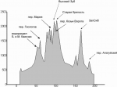](https://www.tkg.org.ua/node/17716)

### 3.3 Техническое описание прохождения маршрута

**07.07 1 день**

**станция Балыксу - устье р. Теренсу**

Наш поезд прибыл на станцию Балыксу примерно в 2 часа ночи. Выйдя из вагона, мы перешли железнодорожные пути по мостику и стали искать дорогу, ведущую к мосту через Томь. Хоть ночь была звёздная, и ярко светила луна, однако впотьмах мы ничего не могли разглядеть. Невдалеке у костра развлекалась компания местной молодёжи, которая и указала нам нужное направление - идти вдоль путей по ходу поезда пока не упремся в мост.

Последовав совету, мы, перейдя мост, пошли по хорошей дороге, которая вывела нас за деревню. Пройдя примерно час, мы пересекли ручей и стали искать подходящие место, чтобы провести остаток ночи. Впереди была небольшая развилка - к дороге примыкал участок, идущий к реке. Недалеко от него в кустах возле ручейка мы и поставили палатку. При этом участники были шокированы огромным количеством гнуса, вылетевшего из травы.

Проснувшись часов в 10 от яркого солнца, превратившего нашу палатку в подобие сауны, мы приготовили завтрак и вырубили альпенштоки. Оказалось, что мы стоим на берегу р. Томь (Рис.1), а на противоположенном берегу проходит железка - в точности как на карте. (Ночью этого не было видно, и некоторые даже засомневались в правильности нашего пути, но утро вечера - мудренее). Группа продолжила движение по грунтовой дороге, идущей вдоль реки (Рис.2). Примерно через час, мы подошли к небольшому мостику через бурный поток, перед ним было ответвление дороги ведущее вверх. По карте должна была быть развилка - один участок дороги пересекает р. Теренсу, а второй - нужный нам идет вверх. Поэтому, решив, что пришли к этому месту, мы повернули налево. Дорога была значительно хуже, более размытая (Рис.3). Приблизительно через полчаса начался резкий набор высоты, а сама дорога закончилась - пошли густые заросли. Стало понятно, что мы зашли куда-то не туда. При этом нас поразило обилие клещей, снимаемых с одежды - за 10 мин. штук по пять.

**устье р. Теренсу - р. Нижний Березовый**

Вернувшись назад к мостику, поняли, что давно уже шли не по берегу р. Томь, а вдоль Теренсу. А нужной развилкой было, пройденное ранее, ответвление дороги, ведущее вброд через реку. В том месте основная дорога немного отходила от берега, поворачивая в долину Теренсу, поэтому мы и не увидели место впадения этой реки в Томь. А нынешний мостик был через ручей Шумный, вверх по которому мы и сходили. Пройдя переход уже в правильном направлении, мы перешли по мостику еще один приток Теренсу и стали там на обед.

Пообедав, отправились дальше по дороге, встретив колонну внедорожников, едущую нам на встречу (до этого мимо проезжал уазик с геологами). Неплохая дорога, хотя и размытая местами, с мостиками через ручьи, почти все время шла вдоль Теренсу, но иногда и отходила в сторону. Вскоре появились прижимы. Примерно через два часа после обеда началась гроза с проливным дождем.

Мы, одев на себя и рюкзаки дождезащиту, продолжили движение и вскоре вышли на развилку. Пойдя по левой дороге в глубь берега, вскоре вновь оказались на дороге, идущей вдоль реки - более короткой, но более размытой. Зайдя за поворот реки, мы подошли к полуразрушенному мостику через ручей Нижний Березовый (Рис.4), где и стали на ночевку в начале десятого вечера. Следует сразу сказать, что в июле на Кузнецком Алатау темнеет поздно, сумерки начинаются в начале одиннадцатого, поэтому есть возможность идти допоздна, что мы не раз в походе и делали.

[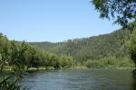](https://www.tkg.org.ua/node/20369)  

Рис. 1. Река Томь

[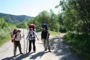](https://www.tkg.org.ua/node/20370)  

Рис. 2. Дорога в долине р. Томь

[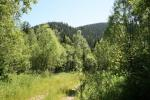](https://www.tkg.org.ua/node/20371)  

Рис. 3. Дорога вдоль ручья Шумный

[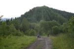](https://www.tkg.org.ua/node/20372)  

Рис. 4. Дорога у р. Нижний Березовый

**08.07 2 день**

**р. Нижний Березовый - устье р. Б. Каинзас**

Так как на Кузнецком Алатау до восхода солнца очень холодно и сыро, то поднимались мы обычно по походным меркам довольно поздно - в 8.00, а выходили к 10.00. Не смотря на это, затемно мы ужинали всего один раз - длина светового дня достаточная. Перейдя по ветхому мостику через р.  
Нижний Березовый, мы отправились по дороге дальше и, примерно, через переход вышли к еще одному притоку Теренсу - р. Верхний Березовый. Моста через него уже не было, а дорога разветвлялась: одна шла вброд, другая вверх вдоль берега. Сходив на разведку по второй, обнаружили, что там тоже брод, но через ручей переброшено несколько брёвен, по которым можно переправиться, что мы и сделали (Рис.5). На другом берегу выяснилось, что эта дорога вела к небольшому домику (туда как раз подъехал бортовой "Урал"). Там нам сообщили, что в устье Большого Каинзаса можно попасть только по первой дороге. Попытавшись пролезть напрямик вдоль берега, мы от этой идеи быстро отказались из-за непроходимости зарослей. Чтобы не терять время, мы вброд перешли назад, вернулись на развилку и вновь вброд форсировали Верхний Березовый (Рис.6).

Наш путь лежал дальше по дороге, которая стала значительно хуже. Мы некоторое время шли вдоль Теренсу, периодически обходя по верху прижимы, но где-то через полтора перехода вышли на развилку. Слева отходила тропа, поднимающаяся на прижим, справа дорога спускалась к Теренсу и, очевидно, шла прямо по реке. Идя по тропе, увидели, что часть старой дороги основательно залита рекой. Поэтому мы почти переход обходили по верху реку, выйдя через некоторое время опять на дорогу. Причем, почти все это время, нам не попадалась вода. Наконец-то подойдя к небольшому ручейку, мы набрали воды и отправились по сильно разбитой и пересохшей дороге дальше. Наш путь отклонялся от реки вглубь берега, и, где-то через полчаса, мы вышли к устью р. Большой Каинзас. Внимательно изучив место, мы аккуратно перешли её вброд, что было довольно не просто из-за высокого уровня воды, течения и каменистого дна (Рис.7). Тут на берегу мы стали на обед.

[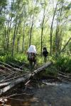](https://www.tkg.org.ua/node/20373)  

Рис. 5. Переправа по бревну через р. В. Березовый

[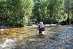](https://www.tkg.org.ua/node/20374)  

Рис. 6. Переправа вброд через р. В. Березовый

[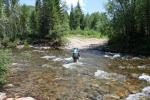](https://www.tkg.org.ua/node/20375)  

Рис. 7. Переправа вброд через р. Б. Каинзас

**устье р. Б. Каинзас - низовья р. М. Каинзас**

В этом месте дорога раздваивалась: главная шла в том же направлении, а второстепенная - вверх вдоль Б. Каинзаса. Пообедав, мы отправились по второй дороге. Её качество заметно ухудшилось - сильно заросла и размыта, а через некоторое время прямо по дороге стал протекать один из рукавов реки. Попытавшись было обойти по заросшей кустарником обочине (Рис.11), мы убедились в бессмысленности наших потуг не замочить ноги. В этом месте в Б. Каинзас впадал ещё один приток - Сартамак, поэтому река очень сильно разливалась и текла прямо между деревьями (Рис.12). Заросли же настолько густы, что продираться сквозь них - дурная трата сил и времени. Поэтому мы пошли по залитой дороге, два раза перебредая реку (Рис.8). Следует иметь в виду, что из-за малой ширины русла, течение довольно сильное, а глубина довольно значительная. Здесь дорога вообще пошла прямо по реке, время от времени выходя на гальку. Нам пришлось перейти Большой Каинзас вброд ещё три раза (Рис.9), один раз даже выставив ниже по течению страхующего (Рис.10).

Недалеко от места впадения Малого Каинзаса в Большой, русло проходит по каньону, а дорога теряется на гальке. Здесь на правом орографическом берегу от реки отходит небольшая тропинка, обходящая по верху прижимы. По ней мы и отправились. Пройдя по лесу, вышли к зимнику, затем с плато спустились к реке, на этот раз уже к Малому Каинзасу. Перейдя её вброд, (тоже весьма не простой) (Рис.13) опять оказались на дороге, по которой шли ещё полтора перехода слегка в стороне от русла. Далее дорога вышла в заболоченную низину, поэтому мы остановились на ночевку в 20.25, немного не дойдя этого места. Следует ещё раз отметить, что здесь очень много клещей. Мы регулярно после каждого перехода осматривали друг друга, периодически снимая с одежды паразитов, которые, благодаря нашей внимательности, никого так и не укусили. (А район этот энцефалитоопасный, ходить сюда, как и всюду в Сибири, без прививок вообще не рекомендуют. Но так как в Киеве вакцинироваться проблематично, остается только запастись в Новокузнецке йодантипирином и быть очень внимательными.)

[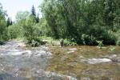](https://www.tkg.org.ua/node/20376)  

Рис. 8. Дорога идет прямо по реке

[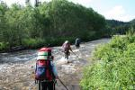](https://www.tkg.org.ua/node/20377)  

Рис. 9. Очередная переправа через Б. Каинзас

[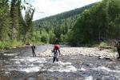](https://www.tkg.org.ua/node/20378)  

Рис. 10. Переправа через Б. Каинзас (страхующий ниже по течению)

[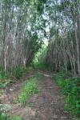](https://www.tkg.org.ua/node/20379)  

Рис. 11. Дорога в зарослях

[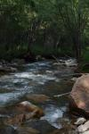](https://www.tkg.org.ua/node/20380)  

Рис. 12. Местами река и дорога совпадают

[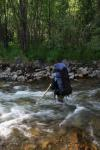](https://www.tkg.org.ua/node/20381)  

Рис. 13. Переправа вброд через М. Каинзас

**09.07 3 день**

**низовья р. М. Каинзас - водораздел р. М. и Б. Каинзас**

В 9.00 мы продолжили наш путь по размытой и сильно заросшей дороге. Местами встречались завалы из бревен (Рис.15), причем было видно, что прошедший совсем недавно грузовик очень часто ехал прямо по руслу, иногда выезжая на берега. Пройдя таким образом полчаса, мы по поваленному дереву перебрались на другой берег, куда перешла дорога. А ещё минут через двадцать тоже по бревну переправились обратно. Дальше дорога пошла по сильно заболоченному участку, поэтому шара с сухими ногами закончилась. Мы ещё раз перешли реку, но теперь уже вброд. Через некоторое время дорога вообще пошла вверх по руслу (Рис.14). Под конец перехода она вышла на склон и пошла по нему серпантином, постепенно отдаляясь от одного из ручьев - истоков Малого Каинзаса. Вскоре дорога вышла на редколесье (Рис.17) и закончилась - на траве было видно следы от разворота машины. Поиски продолжения пути особого результата не принесли - начавшаяся было тропа, вскоре потерялась в высокотравье. Дальше мы пошли напрямик, постепенно набирая высоту. Нам было необходимо подняться к вершине, расположенной над водоразделом Большого и Малого Каинзасов, чтобы с неё спустится уже на саму залеснённую перемычку.

Высокотравье закончилось, начался лес средней проходимости (Рис.19).

**водораздел М. и Б. Каинзасов - исток р. Б. Каинзас**

По изменению направления склона мы поняли, что выскочили уже на другую сторону вершины. Мы взяли азимут, и пошли по компасу, следя за направлением склона. Примерно через переход после окончания дороги, наши старания увенчались успехом - вышли на пологую седловину водораздела. Тут лес стал чуть-чуть почище, но все равно оставалось много зарослей и завалов.

Идя по компасу и рельефу, мы через двадцать минут уперлись в скалу-останец, возвышающуюся над перемычкой. Слазив на её вершину для осмотра местности, мы продолжили путь в направлении истока Большого Каинзаса, начав постепенно набирать высоту. К концу перехода мы вышли в зону редколесья, но здесь нас ожидал неприятный сюрприз - полосы березового сланника, как потом оказалось, весьма распространенные в этом районе.

[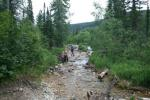](https://www.tkg.org.ua/node/20382)  

Рис. 14. Дорога в верховьях М. Каинзаса

[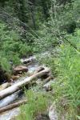](https://www.tkg.org.ua/node/20383)  

Рис. 15. Заросли и завалы

[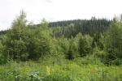](https://www.tkg.org.ua/node/20384)  

Рис. 16. Дорога закончилась

[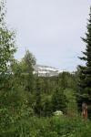](https://www.tkg.org.ua/node/20385)  

Рис. 17. Заросли на водоразделе Б. и М. Каинзасов

[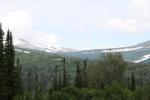](https://www.tkg.org.ua/node/20386)  

Рис. 18. Вид на перевал Геологов

[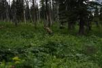](https://www.tkg.org.ua/node/20387)  

Рис. 19. Высокотравье

Выйдя на склон хребта к снежнику, мы остановились, подумывая об обеде. Но без того облачная погода испортилась окончательно.

Началась гроза. Вернувшись немного назад в лес, и натянув плащ-накидку между деревьями, мы уселись пережидать ненастье, так как движение по открытому склону небезопасно в такую погоду. Примерно, через два с половиной часа - в начале пятого, катаклизм закончился, и группа продолжила движение, надеясь побыстрее достичь перевал Геологов, уже видимый отсюда (Рис.18). Да не тут-то было!  
Здесь нам пришлось преодолевать полосы того самого березового сланника. Незабываемые ощущения - продираться сквозь переплетения мокрых деревьев на довольно крутом склоне, цепляясь за них рюкзаком! А так как только что прошла гроза (Рис.21), нашу одежду можно было почти сразу выкручивать - будто в реке искупались. Траверсируя таким образом склон, мы в промежутках между зарослями сланника (Рис.20), гигантских лопухов и прочей флоры выходили на снежники и каменные россыпи. По такой прелести мы передвигались примерно два с половиной перехода, пока, наконец, не вышли на склон ущелья, в котором протекал исток Большого Каинзаса. Теперь оставалось перейти на противоположный склон и подняться вверх к перевалу.

[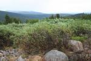](https://www.tkg.org.ua/node/20388)  

Рис. 20. Сланник - крупным планом

[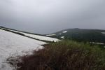](https://www.tkg.org.ua/node/20389)  

Рис. 21. Плохая погода

**исток р. Б. Каинзас - перевал Геологов**

Спустившись к реке, мы перешли её по снежному мосту, но здесь наши мучения продолжились. Весь противоположный склон представлял собой гигантское болото, густо заросшее почти до самого верха мокрым после дождя кустарником. Бредя по кочкам, перепрыгивая через ручьи, обильно стекающие по склону, по грудь в кустарнике, мы только к концу перехода вышли на чистое место - выполаживание у основания небольшого снежника. Так как время было уже позднее, а один из участников сильно переохладился во время болотного вояжа, мы решили стать здесь на ночевку (Рис.22). Место походило для этого как нельзя лучше - относительно полого, у снежника можно набрать воды, а в зарослях - насобирать сухих дров, их особенно много чуть выше по склону. Пока готовился ужин, я даже успел сбегать на разведку на перевал и полюбоваться панорамой Поднебесных Зубьев в лучах заходящего солнца - благо распогодилось.

**10.07 4 день**

Хорошо отдохнув ночью, в 10.30 мы отправились дальше (Рис.23). Набирая по россыпям камней средних размеров высоту, мы через 15 минут вышли на широкую, покрытую травой, седловину перевала Геологов (Рис.24) и, немного пройдя вдоль неё, подошли к туру у большого камня с табличкой погибшим туристам-лыжникам (Рис.25). Сняв записку от 6 августа 2008 группы из Омска, проходившей перевал траверсом, мы сфотографировались, съели нашу перевальную шоколадку и начали спуск (Рис.26).

[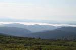](https://www.tkg.org.ua/node/20390)  

Рис. 22. Долина Б. Каинзаса утром

[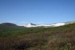](https://www.tkg.org.ua/node/20391)  

Рис. 23. Подъем на перевал

[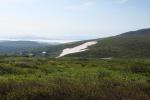](https://www.tkg.org.ua/node/20392)  

Рис. 24. Седловина перевала Геологов

[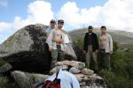](https://www.tkg.org.ua/node/20393)  

Рис. 25. Группа на перевале Геологов

[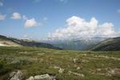](https://www.tkg.org.ua/node/20394)  

Рис. 26. Вид на хр. Тигиртыш с перевала Геологов

**перевал Геологов - долина р. Переходный**

Вначале группа спускалась по травянистому склону, пробираясь сквозь небольшие заросли кустарника. Потом пошла очень слабая козья тропа, которая потерялась на каменных россыпях (Рис.27). Крутизна склона увеличилась. Мы продолжили спуск по камням средних, а потом и крупных размеров, среди которых было много живых (Рис.28). После час спуска, поперек склона начались заросли кустарника и сланника, поэтому мы взяли немного правее и вышли в каньон ручья, вытекавшего из-под перевала. Далее минут 30 очень осторожно спускались вдоль воды по небольшим скалкам и камням (Рис.29), часто мокрым, пока не зашли в густой лес.

Тут склон начал постепенно выполаживаться, поэтому мы вышли из каньона и пошли по лесу, преодолевая завалы из бревен, заросли папоротника, а ещё ниже - и заболоченные участки. В 13.50 мы достигли ручья Переходный (Рис.30). Не знаем, кто додумался его так назвать, так как переходить по его долине довольно проблематично: густые заросли, завалы, много заболоченных участков и полное отсутствие троп (Рис.31). По непрходимости, из тех районов, где я бывал раньше, страшнее этих мест только таежные болота Северного Урала.

[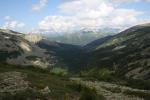](https://www.tkg.org.ua/node/20395)  

Рис. 27. Долина р. Переходный

[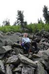](https://www.tkg.org.ua/node/20396)  

Рис. 28. Спуск по крупной осыпи

[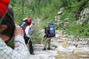](https://www.tkg.org.ua/node/20397)  

Рис. 29. Движение группы по каньону

**долина р**. **Переходный - долина р. Большой Казыр**

Далее мы двигались вдоль ручья Переходный, перейдя вброд его правый приток. Шли по лесу, преодолевая завалы из бревен и заросли кустарника. Изредка нам попадалась козья тропа, которая довольно скоро терялась. Заболоченную пойму в начале пытались обходить по склону, но так как это отбирало много сил и времени, мы пошли прямо по болоту. Пройдя переход, мы остановились на обед.

Пообедав, группа отправилась дальше. Так как дальше по берегу начинались довольно крутые прижимы, мы перебрели на другой берег р. Переходный и продолжили пробираться сквозь заросли. Вскоре уперлись в левый приток, дальше прижимы начинались уже по левому берегу. Поэтому мы вброд вернулись на прежний правый берег р. Переходный и двинулись по нему. Впереди нас ждали заросли уже знакомого березового сланника, а ещё дальше альтернативой им были россыпи крупных камней (Рис.32). По ним мы шли, примерно, переход, самострахуясь альпенштоками, а потом опять вернулись в лесные заросли, которые стали немного более проходимыми. Последние перед ночевкой 50 минут мы двигались уже недалеко от устья р. Переходный, по широкой заболоченной пойме, покрытой высокотравьем. А вскоре вышли на берег одного из рукавов Большого Казыра, чуть дальше за которым было основное русло (Рис.33). На этом островке мы и остановились на ночь в 20.00.

[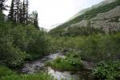](https://www.tkg.org.ua/node/20398)  

Рис. 30. Долина р. Переходный

[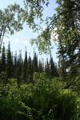](https://www.tkg.org.ua/node/20399)  

Рис. 31. Заросли в долине

[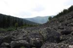](https://www.tkg.org.ua/node/20400)  

Рис. 32. Крупная осыпь на пути движения

[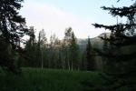](https://www.tkg.org.ua/node/20401)  

Рис. 33. Долина р. Большой Казыр

**11.07 5 день**

**дол р.  
Б. Казыр - пр. приток р. Б. Казыр**

По островку, вдоль рукава Большого Казыра идет слабая козья тропа, двигаемся по ней 10 минут, затем переходим на основной левый берег и идем вдоль основного русла около получаса. Тропа теряется в высокотравье и завалах, продолжаем двигаться, присматривая место для брода.

Однако долго не можем найти ничего подходящего - слишком сильное течение. Была даже мысль тянуть навесную переправу, но всё равно оставалась проблема перехода первого участника. Зайдя чуть выше места впадения притока на противоположном берегу, мы нашли подходящий участок для брода стенкой. Здесь довольно широкое русло, примерно метров 30, хотя дно - каменистое (Рис.34). Построившись вчетвером, мы двинулись немного наискось, сильно упираясь на середине, где скорость течения и глубина максимальные. Пришлось сильно маневрировать между камнями, пару раз мы даже были близки к смыванию, но с большим трудом устояли.

Если бы количество участников было больше четырёх, то однозначно необходимо навешивание перил.

[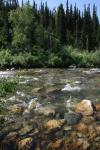](https://www.tkg.org.ua/node/20402)  

Рис. 34. Место брода через Б. Казыр

**пр. приток Б. Казыра - пик Гайдара**

Выйдя на противоположный берег, мы быстро выкрутились и просушились, благо солнышко позволяло. После короткой разведки группа двинулись по левому берегу вверх по притоку Большого Казыра, пройдя 5 минут, переправилась на правый и по козьей тропе начала подъём по склону. Тропа часто терялась в зарослях, мы, набирали высоту, слегка траверсируя склон в северном направлении. Шли по лесу средней проходимости, иногда продираемся сквозь высокотравье и преодолеваем завалы (Рис.35). Затем более интенсивно начали подниматься вдоль ручья, пока через 50 минут после брода не вышли на каменную россыпь средних размеров (Рис.36). Далее полчаса по ней поднимаемся прямо вверх. Опасаясь, что ручей скоро может закончиться и воды дальше не будет долгое время, мы остановились на обед прямо на камнях.

Через 2 часа, пообедав, мы продолжили подъем по осыпи. Выше размеры камней увеличились. Дойдя до конца россыпи, мы начали траверсировать склон, идя в высокотравье и, время от времени, преодолевая заросли.

Постепенно набрав высоту, два перехода двигались в высокотравье, периодически переходя через россыпи камней средних размеров, а также заросли кустарников (Рис.37,38,39). Ещё через некоторое время мы вышли на широкую седловину перевала, и, набрав воду, начали подъём на пик Гайдара по ребру (Рис.40). За полтора часа, сделав один раз небольшой привал, по камням средней величины, часто живым, в 20.30 мы достигли вершины. Записки в туре не оказалось (Рис.41).

[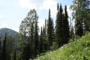](https://www.tkg.org.ua/node/20403)  

Рис. 35. Заросли на склоне

[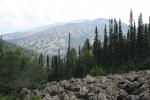](https://www.tkg.org.ua/node/20404)  

Рис. 36. Крупная каменная осыпь

[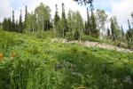](https://www.tkg.org.ua/node/20405)  

Рис. 37. Высокотравье и каменные осыпи

[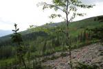](https://www.tkg.org.ua/node/20406)  

Рис. 38. Пройденный путь

[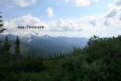](https://www.tkg.org.ua/node/20407)  

Рис. 39. Вид на перевал Геологов

[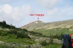](https://www.tkg.org.ua/node/20408)  

Рис. 40. Пик Гайдара

[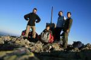](https://www.tkg.org.ua/node/20409)  

Рис. 41. Группа на вершине п. Гайдара

[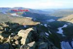](https://www.tkg.org.ua/node/20410)  

Рис. 42. Путь спуска на пер. Караташский

**пик Гайдара - перевал Караташ**

Сфотографировавшись, мы начали спуск в сторону перевала Караташ по сыпухе средних размеров (Рис.42,43). Через 40 минут вышли на перевал к большому камню с табличкой погибшему туристу-лыжнику, записки там также не было (Рис.45). Сделав фото группы, мы немного прошли на север, где у небольшого снежника на траве нашли ровное пологое место (Рис.44). Обеспеченные водой, стали на ночевку, но ужин и завтрак готовили на горелке. Следует сказать, что здесь нам повезло с погодой - было ясно и относительно безветренно, хотя и довольно прохладно.

[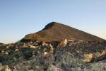](https://www.tkg.org.ua/node/20411)  

Рис. 43. Путь спуска

[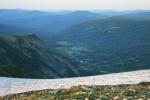](https://www.tkg.org.ua/node/20412)  

Рис. 44. Вид на Золотую долину

[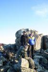](https://www.tkg.org.ua/node/20413)  

Рис. 45. Группа на пер. Караташ

**12.07 6 день**

**траверс хр. Кузнецкий Алатау (пер. Караташ - пер. МКС)**

В течение 50-ти минут пересекаем заросшую травой (Рис.47,48), слегка заболоченную седловину перевала и выходим на осыпь средних размеров. Траверсируем склон по камням, среди которых много живых, еще три перехода (Рис.46). За пиком 40-лет ВЛКСМ размеры камней увеличиваются.

Двигаемся очень осторожно с самостраховкой альпенштоками, так как множество плит шатается. Если после седловины мы набирали высоту, то теперь слегка сбрасываем, для того, чтобы выйти в самую низшую седловину между пиками (Рис.49,50). Судя по описаниям - это перевал Тронова (2А). На нем сделали привал. Впереди хребет поворачивает на запад, его высота возрастает, а крутизна увеличивается.

Продолжаем движение, еще через переход по мелкой сыпухе и травянистым полочкам выходим на седловину, за которой хребет значительно набирает высоту. Там у снежника стали на обед (Рис.51).

Это седловина перевала, через который можно попасть из долины реки М. Казыр в Золотую Долину (Рис.52). Его сложность мы оценили как 1А: экспозиция север - юг, южный склон - травянисто-осыпной, крутизной 25°, северный - снежно осыпной, крутизной до 35°.

В просмотренных отчетах мы не встречали описания прохождения этого перевала, поэтому, возможно, нами сделано первопрохождение северного склона (Рис.53).

Предлагаем назвать его перевал МКС.

[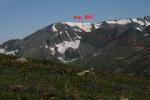](https://www.tkg.org.ua/node/20414)  

Рис. 46. Дальнейший путь группы

[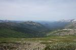](https://www.tkg.org.ua/node/20415)  

Рис. 47. Вид на долину р. Малый Казыр

[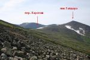](https://www.tkg.org.ua/node/20416)  

Рис. 48. Перевал Караташ

[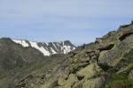](https://www.tkg.org.ua/node/20417)  

Рис. 49. Крупная осыпь на пути движения

  

Рис. 50. Вид на пер. МКС

  

Рис. 51. Перевал МКС

  

Рис. 52. Пройденный путь

  

Рис. 53. Спуск с перевала МКС

**перевал МКС - второе озеро в цирке**

Обед мы приготовили на бензине, натопив воду из снега. Уже вечерело, на небе пробегали тучки (во второй половине дня, бывало, шел дождь, иногда с грозой), до запланированного окончания траверса было еще очень далеко, а перспектива ночевки на хребте без воды нас не очень прельщала. Поэтому в 18.20 мы приняли решение начать спуск. Двигаясь справа от снежника по осыпи средних размеров (Рис.54,55)с самостраховкой альпенштоками, через 40 минут достигли берега озера (Рис.75). Далее пошли на восток к выходу из цирка по осыпям и высокотравью (Рис.56,57), и через полчаса подошли ко второму озеру (Рис.58). На его берегу группа стала на ночевку. Нам удалось даже собрать сланник для костра.

  

Рис. 54. Путь спуска группы к Озеру

  

Рис. 55. Спуск с пер. МКС

  

Рис. 56. Вид на пер. МКС

  

Рис. 57. Цирк над озером

  

Рис. 58. Спуск в Золотую Долину

**13.07 7 день**

**второе озеро в цирке - перевал Мария**

Учитывая темп нашего движения, стало очевидно, что запланированный третий траверс мы вряд ли успеем пройти, а поэтому прохождение неизвестного ранее перевала, о котором говорили в Киеве, не состоится. Так как группа уже спустилась с хребта, мы решаем пойти к перевалу Козьи ворота не по низу, а перевалив через отрог хребта, совершив, таким образом, прохождение аналогичного участка в этом районе. Поэтому двинулись вдоль склона, по левой стороне, постепенно набирая высоту. Обходя очередное озеро по верху, мы через 40 минут вышли на мокрые от ручьев скалы, что и вынудило нас начать спуск к подножью.

Начавшийся мелкий дождь добавил нам приятных ощущений, так как спускаться пришлось по крутому (местами до 40°) склону, сплошь заросшему кустарником. Через полчаса мы достигли берега (Рис.59).

Немного пройдя по низу, начинаем набор высоты по осыпи средних и крупных размеров, ориентируясь на небольшой распадок (Рис.60?62). Чуть больше, чем через час, мы выходим к выполаживанию, а, преодолев небольшой перевальный взлет, попадаем на седловину возле кулуара со снежником (Рис.63).

  

Рис. 59. Озера в Золотой долине

  

Рис. 60. Пройденный путь

  

Рис. 61. Общий вид на озера

  

Рис. 62. Набор высоты по склону

  

Рис. 63. Перевал Мария

  

Рис. 64. Вид на пер. Козьи ворота

  

Рис. 65. Вид на хр. Кузнецкий Алатау

  

Рис. 66. Группа перед спуском

**перевал Мария - озеро Харатас**

Так как спуск по кулуары очень крут и камнеопасен, мы решаем обойти его по осыпи слева (Рис.64 - 66). Надев каски и положив, на всякий пожарный, системы поближе, начинаем спуск (Рис.67). Вначале двигаемся по относительно пологой осыпи средних размеров, но затем крутизна возрастает, а мы выходим в широкий кулуар, засыпанный камнями средних и мелких размеров.

Начинаем двигаться по-одному, преодолевая кулуар по диагонали от одного защищенного от камней места к следующему. Выходим к бараньим лбам, которые обходим по мелкой сыпухе (Рис.68,69). Достигнув выполаживания, выходим по осыпи средних размеров на берег озера (Рис.70). Всего на этот участок спуска мы затратили два часа.

Пообедав на берегу, ниже озера переправляемся по камням на противоположный берег ручья и подходим к краю склона (Рис.71?74).

Перед нами открывается вид на перевал Козьи ворота и озеро Харатас. Спуск здесь сильно затруднен бараньими лбами. Идем на разведку. В конце-концов, найден приемлемый маршрут. Бараньи лбы обходятся по скальным полкам слева от водопада, вытекающего из второго озера (Рис.75). Траверсируем склон в северо-западном направлении по скальным и травянистым полкам, а местами и по осыпям средних размеров, постепенно сбрасывая высоту. Пару раз пробираемся сквозь заросли кустарника и сланника. Пересекаем почти пересохшее русло еще одного ручья и выходим на задернованный склон, крутизной 30°. Пересекаем снежник и по крупной осыпи выходим к ручью, протекающему внизу (Рис.76). Как раз после спуска, начало уже смеркаться, поэтому становимся на ночевку в небольшом болотце на относительно ровном и сухом участке, недалеко от впадения ручья в озеро. На спуск из цирка у нас ушло около двух с половиной часов, с учетом разведки пути. На противоположном берегу заметили большую детскую группу, ставшую на ночевку в довольно живописном бору.

Ночью разразилась ужасная гроза.

  

Рис. 67. Начало спуска по осыпи

  

Рис. 68. Скалы и осыпи на спуске

  

Рис. 69. Спуск участницы

  

Рис. 70. Движение по каменисто-травяному склону

  

Рис. 71. Общий вид на цирк с озером

  

Рис. 72. Общий вид перевала Мария

  

Рис. 73. Второе озеро перед бараньими лбами

  

Рис. 74. Общий вид на хребет с перевалом

  

Рис. 75. Место спуска

  

Рис. 76. Путь спуска по склону

**14.07 8 день**

**озеро Харатас - пер. Козьи ворота**

Хорошо отдохнув, мы в 11.30 продолжили путь (Рис.79).

По сыпухе спустились вдоль ручья к озеру, где вышли на тропу (Рис.78). Затем по ней обошли озеро слева, перейдя в брод ещё один ручей. Тропа теряется. Начали подъем на перевал по осыпи средних размеров, периодически двигаясь по снежникам (Рис.77). Через 1.10 ходового времени вышли на выполаживание. Далее шли по высокотравью, пересекая слегка заболоченные участки. В 13.20 вышли к туру по среди широкой перевальной седловины (Рис.80). Там встретили детскую группу в составе 16 человек из Новокараканской и Моховской школ, которую видели вечером.

Сняли их записку.

Так как за два дня до этого у нашей участницы незначительно поднялась температура (37,2 - 37,4), мы решили дать ей сегодня отдых и совершить два радиальных восхождения на г. Верхний Зуб и Старая крепость с перевала Козьи ворота.

  

Рис. 77. Вид на перевал Козьи ворота

  

Рис. 78. Вид на озеро Харатас

  

Рис. 79. Пройденный группой путь

  

Рис. 80. Плато перевала Козьи ворота

**Радиальный выход пер. Козьи ворота - г. В. Зуб (2178 м. )**

Начали движение на запад обходя небольшую вершинку справа. Шли по сыпухе средних размеров, но, немного не доходя перемычки, уперлись в небольшие скалки. Поднялись наверх, и уже оттуда вышли на скальную перемычку, соединяющую перевал с хребтом. Пройдя по гребню, обходя скалки по осыпным полкам, начали подъем по камням средних размеров (Рис.81,82). Через 1.30 ходового времени от перевала вышли на хребет (Рис.83). Вершина находится немного справа. Пройдя в северном направлении минут 5, мы подошли к кресту, который возвышается прямо на г.  
Верхний зуб. Сфотографировались, полюбовались видами и в одном из туриков нашли записку от 11.07.09 группы студентов и выпускников Новокузнецкого экономико-отраслевого колледжа (Рис.85).

До конца перемычки мы спустились по путь подъема, но дальше пошли прямо через вершину, что оказалось гораздо быстрее и удобнее (Рис.88). Спуск на перевал Козьи ворота у нас занял 1.20.

  

Рис. 81. Скальные выходы на пути движения

  

Рис. 82. Путь подъема

  

Рис. 83. Вид на г. Старая крепость

  

Рис. 84. Долина р. Туралыг

  

Рис. 85. Участники на вершине Верхний Зуб

**Радиальный выход пер. Козьи ворота - г. Старая Крепость (2217 м)**

Пообедав, отправились на следующую вершину - наивысшую точку хребта Кузнецкий Алатау - гору Старая Крепость. Справа обошли возвышающиеся скалы, слега спустившись в небольшой распадок (Рис.86,87).

Двигались по высокотравью, где часто встречались камни. Пересекли множество ручьев и по осыпям средних размеров начали подъем на плат, периодически выходя на травянистые участки. В результате минут через 50 от перевала мы вышли на каменистое плато (Рис.89). Это, наверное, одно из самых захватывающих мест района, непохожее на предыдущие! Мы попали в настоящую каменную пустыню. Тут почти нет россыпей, только каменные плиты. Далее двигались немного направо, ориентируясь на каменный останец на краю плато, который и есть вершина. Её мы достигли минут через 30 (Рис.90,91). Мне без особого труда удалось забраться на самый верх, откуда открывался прекрасный вид, особенно на соседнюю скальную стену. По дороге в Новокузнецк в автобусе местные туристы рассказали ребятам, что как-то зимой здесь тренировались альпинисты, совершившие восхождение на Эверест (может байка?). Но стена впечатляет! Тура у останца не нашли.

Сфотографировавшись, двинулись в обратно, но не напрямик, а по краю плато. От места спуска шли уже по пути подъема до самого перевала, куда пришли в 20.35.

Тут нас ожидал очень неприятный сюрприз.

Выяснилось, что у нашей участницы температура не понизилась, а поднялась до 38, при этом никаких других симптомов не наблюдалось. Дав жаропонижающее, решили спускаться вниз в долину р. Туралыг (Рис.84), откуда, в случае необходимости без особого набора высоты можно выйти к туристскому приюту на р. Верхний Тайжесу.

  

Рис. 86. Путь подъема на г. Старая крепость

  

Рис. 87. Путь движения

  

Рис. 88. Вид на г. Верхний зуб

  

Рис. 89. Вершина Старая крепость издалека

  

Рис. 90. Участники на фоне Старой крепости

  

Рис. 91. Участник на вершине

**пер. Козьи ворота - дол. р. Туралыг**

Двигались на север по козьей тропе, потом она потерялась, и мы идем в высокотравье. Начались густые заросли кустарника, мы взяли правее, надеясь выйти на тропинку, но безрезультатно. Зашли на заболоченный участок. Так как через час состояние участницы не улучшилось, начали искать место для ночевки. В результате поставили палатку на большом камне посреди болота. Вода была, но с нормальными дровами проблемы, ужин приготовили на горелке.

**15.07 9 день**

Утром, позавтракав, продолжили движение. Состояние участницы не улучшилось. Дали ей жаропонижающие, а также антибиотики - тетрациклин и противоэнцефалитный йодантипирин. Приняли решение начать аварийный выход из долины р. Туралыг в долину р. Бельсу.

Вначале один переход шли в высокотравье и зарослях кустарника по относительно пологому склону, потом крутизна увеличилась (Рис.92).

Двигались по каменным осыпям среднего размера, выйдя на берег р. Туралыг (Рис.93,94). Здесь идет довольно не плохая тропа. По ней вскоре подошли к живописному водопаду, где сфотографировались (Рис.95). Тропа некоторое время шла вдоль берега, поднимаясь на прижимах, а потом повернула вглубь (Рис.96). В зарослях она несколько раз терялась, но, в конце концов, мы опять оказались на берегу недалеко от впадения в Туралыг левого притока (Рис.97). Переправились вброд (1А) (Рис.98), затем по зарослям и завалам пересекли небольшой перешеек и вышли на берег притока, через который также переправились. Тут, чуть выше на берегу и остановились, так как температура у участницы поднялась до 39. Мы ей дали перечисленные выше лекарства и были вынуждены сделать полудневку.

  

Рис. 92. Спуск в долину р. Туралыг

  

Рис. 93. Спуск по каменной осыпи

  

Рис. 94. Река Туралыг

  

Рис. 95. Водопад на р. Туралыг

  

Рис. 96. Заросли на пути движения

  

Рис. 97. Река Туралыг

  

Рис. 98. Брод реки Туралыг

**16.07 10 день**

**дол. р. Туралыг - дол. р. Бельсу**

На утро температура участницы была уже почти в норме - 36,9, но опасаясь рецидива, мы продолжили аварийный выход. Вначале шли по россыпям камней средних размеров, пересекли полувысохшее русло ручья. Затем шли по компасу строго на юго-запад, понемногу набирая высоту. Продвигались по лесу с подлеском, попадалось много заболоченных участков, где-то через час, вышли на берег еще одного притока Туралыга, который перешли вброд. Прошли еще немного вверх по склону и вышли на болото (Рис.99,100). Когда мы его пересекли, то обнаружили тропу, по которой вскоре начали спуск в долину р.  
Бельсу. Правда, тропа была очень размыта, вела по заболоченным участкам и высокотравью (Рис.101). Около час мы траверсировали склон, затем постепенно начали сбрасывать высоту и чуть больше чем через час вышли к ручью - притоку Бельсу, напротив г. Двуглавая. Возле которого стали на обед, так как погода постепенно начала портиться.

  

Рис. 99. Группа на болоте

  

Рис. 100. Редколесье на седловине

  

Рис. 101. Высокотравье на пути группы

**верховья р. Бельсу - устье р. Поднебесный**

Продолжили движение по тропе, пробираясь сквозь высокотравье и болотца (Рис.102). Началась гроза, что особенно добавило нам приятных ощущений. За один переход мы вышли на берег р. Бельсу, затем двигались уже вдоль берега, периодически обходя прижимы. Чуть больше чем через час подошли к р. В. Тайжасу, которую перешли вброд напротив приюта (Рис.103,104).

В прочитанных нами отчетах говориться, что отсюда, если нужно, можно вызвать спасателей. С этого места тропа стала гораздо шире, и нам постоянно начали попадаться люди - группы туристов и отдельные рыбаки. Пройдя еще немного вдоль берега р. Бельсу, вышли к р. Н. Тайжасу. Здесь даже была тросовая переправа, но воспользоваться ею нам не пришлось, так как река абсолютно нормально переходится вброд (Рис.105). Далее тропа обходила прижимы и часто шла по лесу.

Мы перешли вброд еще два притока р. Бельсу и на берегу за вторым из них стали на ночевку.

  

Рис. 102. Тропа в высокотравье

  

Рис. 103. Брод р. Верхний Тайжасу

  

Рис. 104. Приют Тайжасу

  

Рис. 105. Брод р. Нижний Тайжасу

  

Рис. 106. Прижимы на р. Бельсу

  

Рис. 107. Заросли в долине р. Бельсу

**17.07 11 день**

Утром продолжили двигаться по тропе вдоль р.  
Бельсу. Примерно, через три с половиной перехода, несколько раз обходя по верху прижимы, мы вышли к р. Поднебесный (Рис.106,). В этих местах тропа уже стала достаточно широкой, а на нашем пути встречалось всё больше и больше народу.

Немного не доходя ручья, тропа раздваивается - левая ведет к приюту "Поднебесный", а правая на берег. Самочувствие нашей участницы стабилизировалось окончательно. Поэтому мы приняли решение продолжить поход и попытаться пройти запланированную категорию сложности. Поэтому попасть в долину р. Амзас не по кротчайшему пути, перейдя водораздел по тропе, а поднявшись вверх по притоку р. Бельсу - Марухе, пройдя по каньону. Мы вышли на берег р.  
Поднебесный и перешли его вброд, что не составило особого труда, хотя течение местами сильное.

**р. Поднебесный - каньон р. Бельсу - р. Поднебесный**

Поднявшись на высокий левый берег, мы двинулись дальше по тропе. Пройдя немного по верху, она начала спускаться по склону.45 минут мы шли по болоту и высокотравью, а затем вышли на берег. Далее двигались по узкой полосе гальки (Рис.107). Тут нам в очередной раз не повезло с погодой - ясная с утра к 14.00 она испортилась. Началась гроза. Пришлось остановиться, чтобы её переждать. Сходив на разведку в это время, мы убедились, что впереди нас ждут скалы, изрядно намокшие под дождем. Расстояние до устья р. Маруха - порядка 5 км по камням и скалам, двигаться по которым после дождя - не безопасно, а идти такое расстояние по воде - тоже проблематично. Поэтому мы были вынуждены повернуть назад. К р. Поднебесный возвращались по тому же пути, правда, особое удовольствие нам доставило идти по мокрому высокотравью. На берегу ручья мы остановились, чтобы пообедать и немного просушиться.

**р. Поднебесный - дол. Р. Амзас**

Пообедав, мы двинулись вверх полевому берегу р.  
Поднебесный, но вскоре тропка закончилась, и начались густые заросли. Чтобы не тратить время на их преодоление, перешли вброд ручей и вскоре вышли на основную тропу, идущую по правому берегу. Через полчаса подошли к приюту. Нам сообщили, что дальше воды не будет, как минимум несколько переходов. Поэтому мы немного поднялись вверх по тропе и, найдя пологое место, стали на ночевку. За водой сбегали назад к ручью.

**18.07 12 день**

На следующие утром мы отправились дальше по тропе.

Примерно, час набирали высоту, затем тропа пошла по водораздельному хребту, огибая вершины (Рис.108,109). На встречу нам шли толпы, в буквальном смысле - как в Крыму на майские. Через час мы начали спускаться вдоль ручья, затем пересекли несколько отрогов, а между ними - ручьев (Рис.110). И через 3.20 ходового времени от места ночевки - вышли на берег р. Амзас, где и стали на обед. Далее тропа переходит через реку и идет по её левому берегу. Как нам рассказал мужчина из Междуреченска, тропа затем переходит на правый берег и тянется почти до самой ст. Лужба.

  

Рис. 108. Движение по отрогам хребта

  

Рис. 109. Тропа в высокотравье

**дол. р. Амзас - склон под г. ХВИ**

Наш дальнейший путь лежал к истокам р. Амзас. Поэтому мы метров 50 вернулись назад по тропе, где в лесу перед самым спуском к реке была развилка тропы. По левому ответвлению углубились в лес и двигались по нему около полутора часов, причем далее тропа была заваленная и заросшая, а через час начался довольно резкий набор высоты (Рис.

151). Вскоре начались россыпи курумника средних размеров, а лес плавно перешел в криволесье (Рис.111,112). Мы продолжили подъем по камнями примерно через 40 мин. Вышли на травянистое плато (Рис.113). Подойдя поближе к началу каменистого склона, стали на ночевку. Нам удалось набрать дров в криволесье, но за водой пришлось спускаться вниз к р. Амзас, а это около 30 мин. хода. Поздно вечером наблюдали, как мимо нас вдоль соседних долин проносились грозовые тучи с молниями.

**19.07 13 день**

Начали подъем прямо по склону, двигались по курумнику средних и больших размеров. Через полтора часа ходового времени вышли на гребень (Рис.114,115). Далее начали траверсировать склон, огибая истоки р.  
Амзас с севера. Двигались по скальным и травянистым полкам, то сбрасывая, то набирая высоту (Рис.116?118). Через час мы вышли на сыпуху средних и крупных размеров. Справа было видно понижение перевала Алкис, прямо над нами - вершина ХВИ (Рис.119). Нам оставалось только набрать высоту, чтобы на нее выйти, но тут в очередной раз испортилась погода - началась гроза.

Приятного было мало - мокро, а вокруг бьют молнии.

Через час стихия угомонилась, но ненадолго. Камни на Кузнецком Алатау имеют малоприятную особенность - намокнув, они, как и на Северном Урале, становятся жутко скользкими. Поэтому мы начали обед, ожидая пока они немного подсохнут.

Сразу после обеда началась вторая гроза, но нам удалось найти ровное, хоть и под наклоном место и поставить палатку.

  

Рис. 110. За отрогами - долина р. Бельсу

  

Рис. 111. Подъем по осыпи среди деревьев

  

Рис. 112. вид на долину р. Амзас

  

Рис. 113. Хребет Тигиртыш

  

Рис. 114. Путь подъема

  

Рис. 115. Дальнейший путь

  

Рис. 116. Скально-травянистый склон

  

Рис. 117. Траверс склона

  

Рис. 118. Пройденный путь

  

Рис. 119. Вид на перевал АЛКИС

  

Рис. 120. Непогода

  

Рис. 121. Хребет Тигиртыш от ХВИ до Б. Зуб

**склон под г. ХВИ - ребро г. Большой Зуб (рад.)**

Гроза закончилась полшестого вечера. Камни были еще мокрыми. Для того, чтобы не терять время, мы решили налегке вдвоем сходить на разведку перемычки между ХВИ и Большим Зубом, навесить перила, а потом вернуться за рюкзаками и остальными.

Поднявшись по сыпухе средних размеров, вышли на вершину ХВИ (Рис.121). Тут сняли записку безымянной группы из Новокузнецка от 15.08.08. Справа от тура - на краю скалы имелось несколько крючьев, на которые мы навесили 40 м перил. Дюльфером спустились по левой стороне к подножью каменного жандарма, затем по скальным полочкам перешли верховья небольшого кулуара и поднялись на гребень. Здесь для безопасности при движении с рюкзаками можно навесить метра 3 перил, налегке мы и так перелезли. Далее немного спустились справа и обошли небольшие скалки по травянистым полкам, затем снова поднялись на гребень, по которому, как по Бродвею подошли к ребру, спускающемуся в долину р. Высокогорный. До вершины осталось метров 200, но мы повернули назад, так как уже вечерело. Решили, что завтра туда отправимся все вместе, так как спуститься с хребта до темноты сегодня явно не успеем. Наверх зажумарили по завешенным перилам, хотя можно залезть и по скальным полкам, двигаясь в промежутке между ребром скалы со стороны ХВИ и каменным жандармом. За метр до вершины необходимо повесить на каменный уступ оттяжку и переместиться правее - на соседнюю грань за ребро, уже с той стороны преодолеть оставшееся расстояние. Напрасно мы не пошли на вершину и не взяли на разведку фотоаппарат! Облом подкрался незаметно.

**20.07 14 день**

На утро результат превзошел все ожидания - высунувшись из палатки, мы обнаружили, что все заволокло облаками, моросит мелкий дождь, а видимость метров 20. Надежде на улучшение погоды не суждено было сбыться в этот день. Пару раз растягивало долину Амзаса, но с вершины ХВИ туча слазить упорно не хотела (Рис.120). По крайней мере, это дало нам возможность сходить к снежнику за водой и наломать кустов на дрова. Горят они паршиво, но обед приготовить можно. До поезда у нас оставалось двое суток...  
**21.07 15 день**

**склон под г. ХВИ - г. Запсиб**

Следующее утро нам тоже не принесло ничего позитивного - вокруг по-прежнему были облака. Но времени у нас на ожидание не осталось. Послезавтра рано утром - поезд. Подождав до 9.00, приняли решение идти не на ХВИ, где в тумане навешивать перила, а затем двигаться по мокрым скальным и травянистым полкам попросту опасно, а на соседнюю вершину Запсиб, а уже с нее спускаться в долину р. Высокогорный. Видя в разрывах тумана очертания скал, мы очень аккуратно двигались по курумнику огромных размеров, постепенно набирая высоту. Было невероятно скользко, но нас выручали альпенштоки. Через час ходового времени поднялись на вершину. Тут облака начало растягивать ветром и, пока мы ели перевальную шоколадку и писали записку, погода окончательно нормализовалась. Все увидели перемычку, на которую полгруппы так и не дошло и вершину Большой Зуб (Рис.121). Было дико обидно, но времени чтобы вернуться уже не было. На вершине Запсиб сняли записку группы туристов из новокузнецкой гимназии - 59 от 25.06.08, в которой вершина была названа НГПИ (Рис.122).

  

Рис. 122. Группа на г. Запсиб

  

Рис. 123. Путь спуска

**г. Запсиб - долина р.  
Высокогорный**

С вершины мы перешли по хребту на противоположную сторону цирка, затем по мелкой сыпухе спустились вдоль края снежника на небольшой ледник (Рис.123?125). По нему через час после начала спуска подошли к краю склона, затем спустились по травянистым и скальным полкам. Здесь было небольшое болотце, которое мы пересекли и вышли на каменные россыпи средних размеров (Рис.126). По ним начали сбрасывать высоту, взяв левее от ручья. Крутизна склона увеличилась, начались травянистые и кустарниковые заросли (Рис.127). Продираясь сквозь них, вышли на бараньи лбы, взяв еще левее, подошли к деревьям. С березы повесили дюльфер 20 м.  
и спустились к основанию скал (Рис.129). По высокотравью перешли на среднюю сыпуху, а по ней вышли к зарослям кустарника и березового сланника (Рис.130).

Далее продирались сквозь них и 1.40 ходового времени от края цирка вышли на камни на берегу ручья Высокогорный, где стали на обед. По камням и зарослям вверх по ручью вела тропа, очевидно, к вершине Большой Зуб (Рис.131). Была идея сходить на него радиально, но участники уже подустали и от этой затеи отказались.

  

Рис. 124. Спуск по леднику

  

Рис. 125. Путь спуска с хребта

  

Рис. 126. Осыпи на пути спуска

  

Рис. 127. Путь спуска

  

Рис. 128. Долина р. Высокогорный

  

Рис. 129. Спуск последнего по сдвоенной веревке

  

Рис. 130. Путь группы

  

Рис. 131. Отроги горы Большой Зуб

**долина р. Высокогорный - долина р. Малый Казыр**

Попетляв в высокотравье по пересохшему и не очень руслу ручья, мы вышли на тропу и двинулись по ней вниз по правому берегу р.  
Высокогорный (Рис.128). Тропа была сильно размыта, местами шла по заболоченным участкам (Рис.132). В одном месте - пересекала ручей, который разливался на несколько русел. Как нам до этого сообщили шахтеры из Междуреченска, шедшие разведывать путь на Большой зуб для торжественного восхождения в честь 70-летия шахты, вверх по ручью будут очень живописные водопады. Но наш путь лежал дальше. Чуть больше, чем через час тропа стала лучше, а нам открылись прекрасные виды на низовья р. Высокогорный. Тут пошли прижимы, а тропа начала сильно петлять. Через переход мы вышли в долину р. Малый Казыр недалеко от приюта Высокогорный (рис.133). Далее тропа пошла вниз по реке.

  

Рис. 132. Ручей Высокогорный

  

Рис. 133. Долина р. Малый Казыр

  

Рис. 134. Малый Казыр

**долина р. Малый Казыр - перевал Алагуй**

Пройдя один переход по тропе, мы перешли по бревну небольшой ручей - приток р. Малый Казыр. На его высоком берегу было оборудованное для стоянки место. Тут мы и стали на ночевку.

**22.07 16 день**

На следующее утро погода нас опять не порадовала - шел мелкий противный дождь (Рис.134). У нас до поезда осталось меньше суток, а топать оставалось порядочно. Три перехода шли по тропе вдоль берега, несколько раз переходили по бревнам ручьи, периодически обходя по верху прижимы, часто преодолевая участки грязи и болота. Вскоре вышли к очередному приюту - "Куприяновской поляне". Тут у нашего фотоаппарата окончательно сел аккумулятор, так что фотографии делать дальше возможности уже не было.

От Куприяновской поляны тропа вела на перевал вдоль ручья. Пройдя переход, мы остановились на обед, а затем продолжили движение. Тут тропа оказалась очень сильно размыта, пару раз мы съезжали на заднице по глинистому склону, вылезли оттуда - грязные как черти. Вскоре наш путь пересекал ручей, за ним тропа терялась и начинался крутой подъем и сыпуха средних размеров. Далее мы двигались вдоль её левого края, набирая высоту, пока не вышли на заболоченное выполаживание. Чуть дальше виднелись какие-то руины, как объяснили - детского лагеря, а за ними стоял небольшой домик. Это и был Алагуйский перевал.

**пер. Алагуйский - дол. р. Амзас**

Пройдя дальше, мы вышли на болото, по которому вело множество троп. По левой начали сбрасывать высоту. Вскоре тропа вывела нас к студенческому лагерю, от которого начиналась грунтовая дорога, тоже правда размытая. Нам также сообщили, что сюда в 11.00 приходит автобус от паромной переправы, привозя людей с утреней электрички. Немного дальше справа от грунтовки виден тальковый карьер. Сейчас он не работал, так как выкупившая его фирма обанкротилась. От карьера идет хорошая дорога, но её нужно пересечь - пройдя немного направо. Откуда начинается путь вдоль алагуйского ручья в долину р. Амзас. Карьерная же дорога через 30 км приводит в поселок Балыксу, из которого мы начали свой путь.

Мы вышли на нужную дорогу и продолжили движения. Двигались по ущелью, переходя по мостикам с одного берега ручья на другой. По дороге нам попался очередной приют, а к началу третьего перехода после перевала мы вышли на дорогу, ведущую по долине р. Амзас к паромной переправе.

**дол. р. Амзас - ст. Лужба**

Далее по дороге мы двигались еще переход, пройдя два приюта и слияние Амзаса с Малым Амзасом. Практически за ним начинаются домики - очередные приюты для туристов. Дорога вывела прямо на берег р. Томь, где располагается лодочная переправа. Лодка стоит 100 р. с группы. Если лодочника нет на месте, за переправу можно договориться в приюте, который находится чуть ниже по течению. Томь в этом месте не глубокая, хоть и очень широкая. Любители острых ощущений или те, кому жалко 100 рублей, могут переправиться вброд.

Весь путь участники мечтали о магазине на ст.

Лужба, даже очень волновались, чтобы он не закрылся, предвкушая, что же они там купят. Результат и тут превзошел все ожидания. Пройдя по берегу вверх по реке, мы минут через 15 вышли на станцию. Лужба оказалась редкой дырой. Тут даже не было помещения для пассажиров, здание станции - чисто техническое. Видно, что половину путей на разъездах - уже разобрали, от поселка осталось четыре избы, в которых продавали нехитрую снедь - консервы, хлеб, пиво и сигареты, правда, раза в два дороже. За баню нам договориться так и не удалось. Поселок вымирал, нам рассказали, что в этих местах находились лагеря ГУЛАГа, на которых велась добыча полезных ископаемых. С прекращением добычи необходимость в станции отпала, а часть путей разобрали.

Наш поезд ожидался около 5 утра. Поэтому, выйдя за поселок на берег Томи, мы прошли немного вниз по течению и возле полуразрушенного здания в кустах обнаружили неплохую площадку. Здесь поставили палатку и развели костер, нагрели воды и привели себя в более-менее человеческий вид, а я даже постирался, высушив вещи на костре, так как впереди был еще один поход - пешеходная пятерка на Алтае.

Дождавшись поезда, залезли в вагон (общий, но купейный), а, когда в Междуреченске часть народу вышла, мы по-барски на верхних полках проспали до самого Новокузнецка, где нас ждали все блага цивилизации.

**3.4 Расчет категории сложности похода**

<table><tbody><tr><td>? раздела</td><td colspan="9">Показатель маршрута</td><td>Балы</td></tr><tr><td>1</td><td colspan="9">Продолжительность маршрута (t), дней</td><td>16</td></tr><tr><td>2</td><td colspan="9">Протяженность маршрута (l), км</td><td>217,9</td></tr><tr><td>3</td><td colspan="9">Максимальное количество баллов за локальные препятствия (ЛПmax)</td><td>75</td></tr><tr><td>4</td><td colspan="9">Баллы за локальные препятствия (ЛП), идущие в зачет</td><td>35</td></tr><tr><td>5</td><td colspan="9">Баллы за протяженные препятствия (ПП), идущие в зачет</td><td>60</td></tr><tr><td>6</td><td colspan="9">Географический показатель (Г)</td><td>7</td></tr><tr><td>7</td><td colspan="9">Автономность (А)</td><td>1</td></tr><tr><td>8</td><td colspan="9">Коэффициент перепада высот (К)</td><td>2</td></tr><tr><td>9</td><td colspan="9">Общее количество баллов, набранных категорируемым маршрутом (КС)</td><td>109</td></tr><tr><td colspan="11"><b>Локальные препятствия</b></td></tr><tr><td colspan="11"><i>Переправы</i></td></tr><tr><td colspan="2">н/к</td><td colspan="2">4/2</td><td colspan="3">М. Каинзас, Переходный, пр. р. Туралыг, пр. р. Бельсу (2), пр. М. Казыра (2)</td><td colspan="4">2 (4)</td></tr><tr><td colspan="2">1А</td><td colspan="2">3/3</td><td colspan="3">В. Березовый, Б. Каинзас, М. Каинзас, Поднебесный, Н. Тайжесу, Туралыг,</td><td colspan="4">3 (6)</td></tr><tr><td colspan="2">1Б</td><td colspan="2">2/6</td><td colspan="3">Б. Каинзас, В.
Тайжесу
</td><td colspan="4">6</td></tr><tr><td colspan="2">2А</td><td colspan="2">1/6</td><td colspan="3">Б. Казыр</td><td colspan="4">6</td></tr><tr><td colspan="4"><b><i>Мах 17</i></b></td><td colspan="3"><b><i>Всего 22</i></b></td><td colspan="4"><b><i>В зачет17</i></b></td></tr><tr><td colspan="11"><i>Перевалы</i></td></tr><tr><td colspan="2">н/к</td><td colspan="2">1/2</td><td colspan="3">Геологов, Козьи Ворота, Алагуй</td><td colspan="4">2 (6)</td></tr><tr><td colspan="2">1А</td><td colspan="2">1/4</td><td colspan="3">пер. западнее в.
Запсиб, пер. МКС
</td><td colspan="4">4 (8)</td></tr><tr><td colspan="2">1Б</td><td colspan="2">1/6</td><td colspan="3">Мария</td><td colspan="4">6</td></tr><tr><td colspan="4"><b><i>Мах 20</i></b></td><td colspan="3"><b><i>Всего 20</i></b></td><td colspan="4"><b><i>В зачет 12</i></b></td></tr><tr><td colspan="11"><i>Вершины</i></td></tr><tr><td colspan="2">н/к</td><td colspan="2">1/4</td><td colspan="3">Гайдара, Старая Крепость</td><td colspan="4">4 (8)</td></tr><tr><td colspan="2">1А</td><td colspan="2">1/5</td><td colspan="3">В. Зуб</td><td colspan="4">5</td></tr><tr><td colspan="4"><b><i>Мах 16</i></b></td><td colspan="3"><b><i>Всего13</i></b></td><td colspan="4"><b><i>В зачет 9</i></b></td></tr><tr><td colspan="11"><i>Траверсы</i></td></tr><tr><td colspan="2">н/к</td><td colspan="2">1/4</td><td colspan="3">Вододел М. и Б.
Каинзасов
</td><td colspan="4">4</td></tr><tr><td colspan="2">1А</td><td colspan="2">1/5</td><td colspan="3">хр. Тигиртыш</td><td colspan="4">5</td></tr><tr><td colspan="2">1Б</td><td colspan="2">1/7</td><td colspan="3">хр. Кузнецкий Алатау</td><td colspan="4">7</td></tr><tr><td colspan="4"><b><i>Мах 16</i></b></td><td colspan="3"><b><i>Всего 16</i></b></td><td colspan="4"><b><i>В зачет 16</i></b></td></tr><tr><td colspan="11"><i>Каньоны</i></td></tr><tr><td colspan="2">1А</td><td colspan="2">2/2</td><td colspan="3">Приток. р. Переходный, р. Бельсу</td><td colspan="4">2</td></tr><tr><td colspan="4"><b><i>Мах20</i></b></td><td colspan="3"><b><i>Всего 2</i></b></td><td colspan="4"><b><i>В зачет 2</i></b></td></tr><tr><td colspan="4"><b><i>Мах (75) 35</i></b></td><td colspan="3"><b><i>Всего 73</i></b></td><td colspan="4"><b><i>В зачет (56) 35</i></b></td></tr><tr><td colspan="11"></td></tr><tr><td colspan="11"><b>Протяженные препятствия</b></td></tr><tr><td colspan="11"><i>Растительность</i></td></tr><tr><td colspan="3">н/к</td><td colspan="2">25/10</td><td colspan="4">дол. р. Теренсу, Бельсу, М. Казыр, Амзас</td><td colspan="2">10</td></tr><tr><td colspan="3">1А</td><td colspan="2">20/8</td><td colspan="4">дол. р. М. Каинзас, водоразделы. Б. и М. Каинзасов, р. Туралык и Бельсу, дол. р. Бельсу, дол. р. Амзас</td><td colspan="2">8</td></tr><tr><td colspan="3">1Б</td><td colspan="2">20/8</td><td colspan="4">верховья р. Б.
Каинзас, склоны. хр. Терень-Казырский, Кузнецкий Алатау, спуск с пер. Козьи Ворота, дол. р. Бельсу
</td><td colspan="2">8</td></tr><tr><td colspan="3">2А</td><td colspan="2">15/9</td><td colspan="4">дол. М. Каинзас, верховья р. Б. Каинзас, дол. р. Переходный, дол. р. Туралык, р. Высокогорный</td><td colspan="2">9</td></tr><tr><td colspan="3">2Б</td><td colspan="2">5/14</td><td colspan="4">верховья р. Б.
Каинзас, дол. р. Переходный, р. Высокогорный
</td><td colspan="2">14</td></tr><tr><td colspan="5"><b><i>Мах 44</i></b></td><td colspan="3"><b><i>Всего 49</i></b></td><td colspan="3"><b><i>В зачет 44</i></b></td></tr><tr><td colspan="11"><i>Болота</i></td></tr><tr><td colspan="3">н/к</td><td colspan="2">20/10</td><td colspan="3">верховья р. Б.
Каинзас, дол. р. Б. Казыр, склоны. хр. Кузнецкий Алатау, спуск с пер. Козьи Ворота, дол. р. Туралык, водораздел р. Туралык и Бельсу, дол. р. Бельсу, дол.

р. Высокогорный, спуск с пер. Алагуй
</td><td colspan="3">10</td></tr><tr><td colspan="5"><b><i>Мах 48</i></b></td><td colspan="3"><b><i>Всего 10</i></b></td><td colspan="3"><b><i>В зачет 10</i></b></td></tr><tr><td colspan="11"><i>Осыпи, морены</i></td></tr><tr><td colspan="3">н/к</td><td colspan="2">10/5</td><td colspan="4">склоны хр.
Терень-Казырский, Кузнецкий Алатау, Тигиртыш, пер. Козьи ворота
</td><td colspan="2">5</td></tr><tr><td colspan="3">1А</td><td colspan="2">10/15</td><td colspan="4">склоны хр. Кузнецкий Алатау, Тигиртыш, подъем на г. Гайдара и В. Зуб</td><td colspan="2">15</td></tr><tr><td colspan="3">1Б</td><td colspan="2">5/10</td><td colspan="4">Пер. Мария, склоны хр. Кузнецкий Алатау и Тигиртыш</td><td colspan="2">10</td></tr><tr><td colspan="3">2А</td><td colspan="2">2/10</td><td colspan="4">склоны хр. Кузнецкий Алатау, Тигиртыш</td><td colspan="2">10</td></tr><tr><td colspan="3">2Б</td><td colspan="2">1/7</td><td colspan="4">спуск с пер. Геологов, склоны хр. Кузнецкий Алатау, Тигиртыш</td><td colspan="2">7</td></tr><tr><td colspan="5"><b><i>Мах 47</i></b></td><td colspan="3"><b><i>Всего 57</i></b></td><td colspan="3"><b><i>В зачет 47</i></b></td></tr><tr><td colspan="5"><b><i>Мах 60</i></b></td><td colspan="3"><b><i>Всего 116</i></b></td><td colspan="3"><b><i>В зачет 60</i></b></td></tr><tr><td colspan="6"><b><i>Всего 189 (172)</i></b></td><td colspan="5"><b><i>В зачет 95</i></b></td></tr><tr><td></td><td></td><td></td><td></td><td></td><td></td><td></td><td></td><td></td><td></td><td></td></tr></tbody></table>

### 3.5. Картографический материал

[Лист 1](https://www.tkg.org.ua/files/4kuz09sp_map1.jpg)  
[Лист 2](https://www.tkg.org.ua/files/4kuz09sp_map2.jpg)  
[Лист 3](https://www.tkg.org.ua/files/4kuz09sp_map3.jpg)

**4**.**Выводы и рекомендации по прохождению маршрута**

Мы ни разу не пожалели, что выбрали для похода район Кузнецкий Алатау. Неповторимое сочетание тайги и альпийских форм рельефа - просто завораживает. Из густых таежных зарослей попадаешь прямо на "Кавказ".

А если добавить сюда относительную близость и отсутствие комаров, характерных для "бюджетных" районов - Хибин и Уралов, то район поистине уникальный.

Также следует сказать и о дикости отдельных мест, что мы на себе ощутили в первой половине похода. Люди появляются только в Золотой долине, в долинах Бельсу, Малого Казыра и Амзаса. Там хорошие тропы (превращающиеся в глиняные горки при дожде) и сеть приютов. Поэтому для пешеходных походов 3 - 4 категорий сложности, на наш взгляд, включение в маршрут долин р. Теренсу и р. Переходный - обязательно, ибо именно там содержится весь набор таежных протяженных препятствий. Также интересной и перспективной являются долины р. Туралыг и Пихтерек, куда мы не попали из-за ухудшения самочувствия участницы. (Горы еще пару тысяч лет постоят, а вот со здоровьем можно не успеть!)

Нужно помнить, что в долинах р. Теренсу, Б. и М. Каинзасы полно клещей. Поэтому необходимо принимать все меры: закрытая одежда, регулярные осмотры друг друга, наличие в аптечке йодантипирина. За перевалом Геологов клещи больше не встречались. Второй особенность Кузнецкого Алатау являются камни, которые в отличие от некоторых других районов при намокании становятся очень скользкими.

Мы остались довольны раскладкой, она прекрасно себя зарекомендовала еще на Кавказе, а теперь была дополнена. При незначительном весе, мы всегда были сыты и имели разнообразный набор блюд.

Единственное нарекание участникам - отсутствие второго фотоаппарата (хотя было сказано его взять). Зеркалка - это очень хорошо, она дает качественные снимки, но из-за габаритов и хрупкости приходилось носить ее в рюкзаке. Поэтому возникли проблемы с техническими снимками, а в последний день похода "сдох" аккумулятор. Наличие хотя бы одной "мыльницы" в группе просто обязательно.

Порадовались мы и тому, что взяли билеты на самолет. Купленные в апреле, они оказались не намного дороже железнодорожных, при этом нам не пришлось "колбасится" трое суток в одну сторону в поезде. Правда, можно была сэкономить гривен 200 - 300, если бы мы брали билеты на поезд на месте, туда ехали на электричке, а обратно - на автобусе. Однако в этом случае, мы бы рисковали остаться без билетов и проигрывали в комфорте (по дороге в Новосиб на обратном пути), а также не имели бы времени на осмотр Новокузнецка, а в нем есть на что посмотреть.

Рекомендуем данный район для всех желающих пройти пешеходный поход 3 ?4-ой категорий сложности с полным набором таежных протяженных и локальных препятствий, а также перевалов и вершин 1А?1Б категорий сложности. И все это при относительной дешевизне, близости и отсутствии комаров.

5\. Приложения.

### 5.1. Перечень личного, общественного снаряжения, состав аптечки и ремнабора.

**Личное снаряжение:**

_Одежда:_

1\. Куртка мембранная 0.700 кг  
2\. Штаны ходовые 0.250 кг  
3\. Полар 0.550 кг  
4\. Ветровка (или анорак) - 300 кг  
5\. Термобелье 0.200 кг  
6\. Белье - 200 кг  
7\. Футболки (2 шт.) 0.300 кг  
8\. Носки 0.300 кг  
9\. Носки х/б 0.250 кг  
10\. Ботинки "Вибрам" 2.000 кг  
11\. Шапка от солнца 0.100 к г  
12\. Очки солнцезащитные 0.05 кг  
15\. Тапки - 250 кг  
16\. Пуховка - 1000 кг

_Специальное снаряжение:_

1\. Страховочная система + усы 1.000 кг  
2\. Прусик 0.100 кг  
3\. Карабины (3 шт) 0.240 кг  
4\. Каска 0.400 кг  
5\. Жюмар - 0.224 кг  
6\. Стремя - 0.85 кг  
7\. Верхонки - 0.120 кг

_Прочее снаряжение:_

1\. Рюкзак 2.300 кг  
2\. "Сидушка" 0.100 кг  
3\. Чехол для рюкзака 0.200 кг  
4\. КЛМН 0.250 кг  
5\. Личные принадлежности 0.200 кг  
6\. Документы и проч. в п/э 0.200 кг  
7\. Фонарь 0.100 кг

**_Общий вес:11.769_**

**Общественное снаряжение:**

_Прочее снаряжение_:

1\. Палатка 3.600 кг  
2\. Котлы (4 и 2,5 л) - 1308 кг

3.Костровые принадлежности 0.100 кг  
4\. Топор 0.800 кг  
5\. Пила цепная 0.300 кг  
6\. Горелка мультитопливная с баками  
(2 шт. - 1,5 и 1 л) - 815 г + 800 г = 1615 кг

8\. Спальник 3 шт.5.000 кг  
9\. Коврик 3 шт.1.500 кг

10\. Компас 0.050 кг  
11\. Карты, схемы, документы 0.300 кг  
12\. Аптека 2.000 кг  
13\. Ремнабор 1.000 кг  
14\. Фотоаппарат - 1.500 кг  

_Специальное снаряжение_:  
1\. Веревка основная 2\*40 м 4.500 кг  
2\. Расходные петли 0.350 кг  
3\. Крючья 0.200 кг  
6\. Репшнур (44 м) - 1.190 кг  
7\. Петли (малые - 2 шт., большие - 3 шт.) - 0.790 кг

**_Общий вес:26.103_**

**Ремнабор:**

1\. Мультитулз  
2\. Проволока медная  
3\. Шило  
4\. Иголка цыганская  
5\. Наперсток  
6\. Иголки разные  
7\. Булавки  
8\. Нитка капроновая тонкая  
9\. Нитка капроновая толстая  
10\. Набор гвоздей  
11\. Набор шурупов с гайками  
12\. Скотч  
13\. Клей "Момент"  
14\. Тонкая веревка  
15\. Шнурки  
16\. Фурнитура трехщелевка (4 шт)  
17\. Лямка (2 м)

18\. Кусок брезента (30\*30 см)  
19\. Планка под кошки  
20\. Запасная ложка  
21\. Свечка, зажигалка.

**Распределение веса между участниками**

<table><tbody><tr><td rowspan="2"><b>? п/п</b></td><td rowspan="2"><b>Наименование</b></td><td rowspan="2"><b>На 1 человека, кг</b></td><td rowspan="2"><b>На группу в 4 человек, кг</b></td><td colspan="2"><b>Распределение веса, кг</b></td></tr><tr><td><b>муж</b>.</td><td><b>жен</b>.</td></tr><tr><td><b>1</b>.</td><td>Личное снаряжение</td><td>11.769</td><td>47.076</td><td>11.769</td><td>11.769</td></tr><tr><td><b>2</b>.</td><td>Групповое снаряжение +бензин</td><td>6.526</td><td>26.103</td><td>8.034</td><td>2.000</td></tr><tr><td><b>3</b>.</td><td>Продукты питания</td><td>9.143</td><td>36.570</td><td>9.143</td><td>9.143</td></tr><tr><td></td><td><b>Итого</b></td><td>27.438</td><td>109.752</td><td>28.946</td><td>22.912</td></tr></tbody></table>

**Состав аптечки:**

<table><tbody><tr><td>медикаменты</td><td>Кол-во</td><td>медикаменты</td><td>Кол-во</td></tr><tr><td></td><td>Перевязочный материал</td><td></td><td>Обеззараживающие и жаропонижающие средства</td></tr><tr><td><u>Бинты стерильные Бинты нестерильные широкие (14см.) Вата медицинская Эластичный бинт Лейкопластырь Пластырь Бактерицидный Английская булавка</u></td><td>5шт.
1шт.

40г.

2шт.

2 моток.

Много 2
</td><td><u>Парацетамол</u>
<u>Анальгин</u>

<u>Эффералган</u>

<u>Колдрекс</u>

<u>Димедрол</u>

<u>Мукалтин</u>

<u>Леденцы от кашля</u>

Магнезия

.
</td><td>10 табл.
10табл.+ 5 ампул 5шт 3шт 5 ампул 10табл 15шт 1 шт. ампулы 5 мл.
</td></tr><tr><td></td><td>Обеззараживающие средства</td><td></td><td>Другие средства</td></tr><tr><td><u>Настойка йода 3-5%*</u>
<u>Раствор бриллиантовой зелени*</u>

<u>Марганцевокислый калий в порошке</u>

<u>Пантенол</u>

<u>Ингалипт</u>
</td><td>1флакон
1флакон

25 гр.

1 шт.

1 шт.
</td><td rowspan="7"><u>Спирт</u>
<u>Нашатырный спирт</u>

<u>Кислота борная*</u>

<u>Капли в нос</u>

<u>Апизартрон, финалгон, индовазин</u> ** <u>Стрептоцид</u>

<u>Тетрациклин</u>

<u>Йодантипирин</u>

<u>Дексаметазон</u>

<u>Темпалгин</u>

<u>Кетанов</u>

<u>Сульфацил натрий</u>

<u>Перекись водорода</u>

<u>"Спасатель" мазь</u>

<u>Термометр</u>

<u>Витамин С (стирол)</u>

<u>Эхинацея Аспаркам</u>

<u>Диазолин, тавегил, лоратидин или др. **</u>

Резиновая груша на 200мл.*** * флаконы по 25 мл.

**одно или два из перечисленных ***это шутка:)
</td><td rowspan="7">0,3 л.
5 амп.

0,25 2 шт.

1 тюбик

25 табл.

10 табл.

10 упаковок.

10 табл.

10 табл 10 табл+5амп.

Капли 2 шт 1 тюбик 1 шт.

20 шт.

5 табл

15 табл.
</td></tr><tr><td></td><td>Сердечно-сосудистые средства</td></tr><tr><td><u>Валидол</u>
<u>Нитроглицерин</u>

<u>Кофеин</u>
</td><td>10 табл.
10 табл.

10 табл.
</td></tr><tr><td></td><td>Средства при желудочно-кишечных заболеваниях</td></tr><tr><td><u>Фталазол</u>
<u>Левомицетин</u>

<u>Но-шпа форте</u>

<u>Уголь активированный (карболен)</u>

<u>Сенадексин</u>

<u>Смекта</u>

<u>Ренни или "таблетки от изжоги"</u>

<u>Мезим форте</u>

<u>Иммодиум</u>
</td><td>20 табл.
20 табл.

10 табл.

Много.

10 4 пакетика

1 уп.

20
</td></tr><tr><td></td><td>Противовоспалительные средства</td></tr><tr><td><u>Эритромицин</u>
<u>Бисептол 480</u>

<u>Ципрофлоксацин</u>
</td><td>10 табл.
10табл 10табл
</td></tr></tbody></table>

### 5.2. Перечень продуктов, рацион питания и их вес

<table><tbody><tr><td></td><td><b>Продукты</b></td><td><b>1</b></td><td><b>2</b></td><td><b>3</b></td><td><b>4</b></td><td><b>5</b></td><td><b>6</b></td><td><b>7</b></td><td><b>8</b></td><td><b>9</b></td><td><b>10</b></td><td><b>11</b></td><td><b>12</b></td><td><b>13</b></td><td><b>14</b></td><td><b>15</b></td><td><b>16</b></td><td><b>всего</b></td></tr><tr><td></td><td>гречка</td><td>200</td><td>-</td><td>-</td><td>-</td><td>-</td><td>200</td><td>-</td><td></td><td>-</td><td>200</td><td>-</td><td></td><td>-</td><td>200</td><td>-</td><td>-</td><td>800</td></tr><tr><td><b>З</b></td><td>рис</td><td>-</td><td>200</td><td>-</td><td>-</td><td>-</td><td>-</td><td>200</td><td>-</td><td>-</td><td>-</td><td>200</td><td>-</td><td>-</td><td>-</td><td>200</td><td>-</td><td>800</td></tr><tr><td><b>А</b></td><td>макароны</td><td>-</td><td>-</td><td>200</td><td>-</td><td>-</td><td>-</td><td>-</td><td>200</td><td>-</td><td>-</td><td>-</td><td>200</td><td>-</td><td>-</td><td>-</td><td>200</td><td>800</td></tr><tr><td><b>В</b></td><td>пшено</td><td>-</td><td>-</td><td>-</td><td>200</td><td>-</td><td>-</td><td>-</td><td>-</td><td>-</td><td>-</td><td></td><td>-</td><td>200</td><td>-</td><td>-</td><td>-</td><td>400</td></tr><tr><td><b>Т</b></td><td>ячка</td><td>-</td><td>-</td><td>-</td><td>-</td><td>200</td><td>-</td><td>-</td><td>-</td><td>200</td><td>-</td><td>-</td><td>-</td><td>-</td><td>-</td><td>-</td><td>-</td><td>400</td></tr><tr><td><b>Р</b></td><td>сухое молоко</td><td>60</td><td>60</td><td>60</td><td>60</td><td>60</td><td>60</td><td>60</td><td>60</td><td>60</td><td>60</td><td>60</td><td>60</td><td>60</td><td>60</td><td>60</td><td>60</td><td>960</td></tr><tr><td><b>А</b></td><td>сахар (в сутки)</td><td>300</td><td>300</td><td>300</td><td>300</td><td>300</td><td>300</td><td>300</td><td>300</td><td>300</td><td>300</td><td>300</td><td>300</td><td>300</td><td>300</td><td>300</td><td>300</td><td>4800</td></tr><tr><td><b>К</b></td><td>изюм</td><td>80</td><td>80</td><td>80</td><td>80</td><td>80</td><td>80</td><td>80</td><td>80</td><td>80</td><td>80</td><td>80</td><td>80</td><td>80</td><td>80</td><td>80</td><td>80</td><td>1280</td></tr><tr><td></td><td>халва</td><td>120</td><td>120</td><td>120</td><td>120</td><td>120</td><td>120</td><td>120</td><td>120</td><td>120</td><td>120</td><td>120</td><td>120</td><td>120</td><td>120</td><td>120</td><td>120</td><td>1920</td></tr><tr><td></td><td>чай (в сутки)</td><td>24</td><td>24</td><td>24</td><td>24</td><td>24</td><td>24</td><td>24</td><td>24</td><td>24</td><td>24</td><td>24</td><td>24</td><td>24</td><td>24</td><td>24</td><td>24</td><td>384</td></tr><tr><td></td><td>гречка</td><td>-</td><td><b>б</b></td><td>-</td><td>-</td><td>80</td><td></td><td>-</td><td></td><td>80</td><td></td><td>-</td><td>80</td><td>-</td><td>-</td><td>-</td><td>-</td><td>240</td></tr><tr><td></td><td>рис</td><td>-</td><td><b>о</b></td><td>-</td><td>80</td><td>-</td><td>-</td><td></td><td>80</td><td>-</td><td>-</td><td>-</td><td></td><td>80</td><td></td><td></td><td>80</td><td>320</td></tr><tr><td></td><td>макароны</td><td>-</td><td><b>р</b></td><td>-</td><td></td><td>-</td><td>-</td><td>80</td><td>-</td><td>-</td><td>-</td><td>80</td><td>-</td><td></td><td>-</td><td>80</td><td>-</td><td>240</td></tr><tr><td></td><td>пшено</td><td>80</td><td><b>щ</b></td><td></td><td></td><td></td><td></td><td></td><td></td><td></td><td></td><td></td><td></td><td></td><td></td><td></td><td></td><td>80</td></tr><tr><td><b>О</b></td><td>ячка</td><td>-</td><td></td><td>80</td><td></td><td>-</td><td>80</td><td>-</td><td>-</td><td>-</td><td>80</td><td></td><td>-</td><td>-</td><td>80</td><td>-</td><td></td><td>320</td></tr><tr><td><b>Б</b></td><td>морковь</td><td>10</td><td>10</td><td>10</td><td>10</td><td>10</td><td>10</td><td>10</td><td>10</td><td>10</td><td>10</td><td>10</td><td>10</td><td>10</td><td>10</td><td>10</td><td>10</td><td>160</td></tr><tr><td><b>Е</b></td><td>картошка</td><td>26</td><td>26</td><td>26</td><td>26</td><td>26</td><td>26</td><td>26</td><td>26</td><td>26</td><td>26</td><td>26</td><td>26</td><td>26</td><td>26</td><td>26</td><td>26</td><td>416</td></tr><tr><td><b>Д</b></td><td>леденцы</td><td>60</td><td>60</td><td>60</td><td>60</td><td>60</td><td>60</td><td>60</td><td>60</td><td>60</td><td>60</td><td>60</td><td>60</td><td>60</td><td>60</td><td>60</td><td>60</td><td>960</td></tr><tr><td></td><td>сухари</td><td>120</td><td>120</td><td>120</td><td>120</td><td>120</td><td>120</td><td>120</td><td>120</td><td>120</td><td>120</td><td>120</td><td>120</td><td>120</td><td>120</td><td>120</td><td>120</td><td>1920</td></tr><tr><td><b>В.1</b></td><td></td><td></td><td></td><td></td><td></td><td></td><td></td><td></td><td></td><td></td><td></td><td></td><td></td><td></td><td></td><td></td><td></td><td>0</td></tr><tr><td></td><td>курага</td><td>60</td><td>60</td><td>60</td><td>60</td><td>60</td><td>60</td><td>60</td><td>60</td><td>60</td><td>60</td><td>60</td><td>60</td><td>60</td><td>60</td><td>60</td><td>60</td><td>960</td></tr><tr><td></td><td>чеснок</td><td>40</td><td>-</td><td>40</td><td>-</td><td>40</td><td>-</td><td>40</td><td>-</td><td>40</td><td>-</td><td>40</td><td>-</td><td>40</td><td>-</td><td>40</td><td>-</td><td>320</td></tr><tr><td><b>В.2</b></td><td>колбаса</td><td>160</td><td>160</td><td>160</td><td>160</td><td>160</td><td>160</td><td>160</td><td>160</td><td>160</td><td>160</td><td>160</td><td>160</td><td>160</td><td>160</td><td>160</td><td>160</td><td>2560</td></tr><tr><td></td><td>лук</td><td>-</td><td>120</td><td>-</td><td>120</td><td>-</td><td>120</td><td>-</td><td>120</td><td>-</td><td>120</td><td>-</td><td>120</td><td>-</td><td>120</td><td></td><td>120</td><td>960</td></tr><tr><td></td><td>арахис</td><td>60</td><td>60</td><td>60</td><td>60</td><td>60</td><td>60</td><td>60</td><td>60</td><td>60</td><td>60</td><td>60</td><td>60</td><td>60</td><td>60</td><td>60</td><td>60</td><td>960</td></tr><tr><td></td><td>орехи</td><td>40</td><td>40</td><td>40</td><td>40</td><td>40</td><td>40</td><td>40</td><td>40</td><td>40</td><td>40</td><td>40</td><td>40</td><td>40</td><td>40</td><td>40</td><td>40</td><td>640</td></tr><tr><td></td><td>гречка</td><td></td><td>320</td><td>-</td><td></td><td></td><td><b>б</b></td><td>320</td><td></td><td></td><td></td><td><b>б</b></td><td></td><td></td><td></td><td>320</td><td></td><td>960</td></tr><tr><td></td><td>рис</td><td></td><td></td><td>320</td><td></td><td></td><td><b>о</b></td><td></td><td></td><td></td><td></td><td><b>о</b></td><td>320</td><td></td><td></td><td></td><td></td><td>640</td></tr><tr><td><b>У</b></td><td>макароны</td><td>320</td><td></td><td></td><td>320</td><td></td><td><b>р</b></td><td></td><td></td><td>320</td><td></td><td><b>р</b></td><td></td><td></td><td>320</td><td></td><td></td><td>1280</td></tr><tr><td><b>Ж</b></td><td>пшено</td><td>-</td><td></td><td></td><td></td><td>320</td><td><b>щ</b></td><td></td><td>320</td><td></td><td>320</td><td><b>щ</b></td><td></td><td>320</td><td></td><td></td><td>320</td><td>1600</td></tr><tr><td><b>И</b></td><td>мясо</td><td>60</td><td>60</td><td>60</td><td>60</td><td>60</td><td>60</td><td>60</td><td>60</td><td>60</td><td>60</td><td>60</td><td>60</td><td>60</td><td>60</td><td>60</td><td>60</td><td>960</td></tr><tr><td><b>Н</b></td><td>сухари</td><td>60</td><td>60</td><td>60</td><td>60</td><td>60</td><td>60</td><td>60</td><td>60</td><td>60</td><td>60</td><td>60</td><td>60</td><td>60</td><td>60</td><td>60</td><td>60</td><td>960</td></tr><tr><td></td><td>сушки</td><td>120</td><td></td><td>120</td><td></td><td>120</td><td></td><td>120</td><td></td><td>120</td><td></td><td>120</td><td></td><td>120</td><td></td><td>120</td><td></td><td>960</td></tr><tr><td></td><td>печенье</td><td></td><td>120</td><td></td><td>120</td><td></td><td>120</td><td></td><td>120</td><td></td><td>120</td><td></td><td>120</td><td></td><td>120</td><td></td><td>120</td><td>960</td></tr><tr><td></td><td><b>ИТОГО</b></td><td><b>2000</b></td><td><b>2000</b></td><td><b>2000</b></td><td><b>2080</b></td><td><b>2000</b></td><td><b>1760</b></td><td><b>2000</b></td><td><b>2080</b></td><td><b>2000</b></td><td><b>2080</b></td><td><b>1680</b></td><td><b>2080</b></td><td><b>2000</b></td><td><b>2080</b></td><td><b>2000</b></td><td><b>2080</b></td><td><b>31920</b></td></tr></tbody></table>

<table><tbody><tr><td>соль</td><td>1000</td><td>1,5</td></tr><tr><td>масло</td><td>700</td><td>7</td></tr><tr><td>сушеная зелень</td><td>200</td><td>20</td></tr><tr><td>шоколад</td><td>800</td><td>5,6</td></tr><tr><td>специи</td><td>500</td><td>12,5</td></tr><tr><td>свекла</td><td>150</td><td>2,25</td></tr><tr><td>капуста</td><td>200</td><td>4</td></tr><tr><td>томат</td><td>100</td><td>15</td></tr><tr><td>перец</td><td>100</td><td>15</td></tr><tr><td></td><td></td><td></td></tr><tr><td>грибы</td><td>250</td><td>25</td></tr><tr><td>рыба</td><td>250</td><td>62,5</td></tr><tr><td>яичный порошок</td><td>400</td><td>15</td></tr><tr><td></td><td></td><td></td></tr><tr><td></td><td>4650</td><td>185,35</td></tr></tbody></table>

<table><tbody><tr><td><b>г/чел.сут</b>.</td><td><b>Продукт</b></td><td></td><td colspan="3"><b>общий вес продуктов</b></td><td>total price</td></tr><tr><td>50</td><td>гречка</td><td></td><td>2000</td><td></td><td></td><td>14</td></tr><tr><td>50</td><td>рис</td><td><b>З</b></td><td>1760</td><td></td><td></td><td>17,6</td></tr><tr><td>50</td><td>макароны</td><td><b>А</b></td><td>2320</td><td></td><td></td><td>9,28</td></tr><tr><td>50</td><td>пшено</td><td><b>В</b></td><td>2080</td><td></td><td></td><td>4,16</td></tr><tr><td>50</td><td>ячка</td><td><b>Т</b></td><td>720</td><td></td><td></td><td>1,44</td></tr><tr><td>15</td><td>сухое молоко</td><td><b>Р</b></td><td>960</td><td></td><td></td><td>3,84</td></tr><tr><td>75</td><td>сахар (в сутки)</td><td><b>А</b></td><td>4800</td><td></td><td></td><td>24</td></tr><tr><td>20</td><td>изюм</td><td><b>К</b></td><td>1280</td><td></td><td>14920</td><td>25,6</td></tr><tr><td>30</td><td>халва</td><td></td><td>1920</td><td></td><td>3730</td><td>28,8</td></tr><tr><td>6</td><td>чай (в сутки)</td><td></td><td>384</td><td></td><td></td><td>38,4</td></tr><tr><td>20</td><td>гречка</td><td></td><td></td><td></td><td></td><td></td></tr><tr><td>20</td><td>рис</td><td></td><td></td><td></td><td></td><td></td></tr><tr><td>20</td><td>макароны</td><td></td><td></td><td></td><td></td><td></td></tr><tr><td>20</td><td>пшено</td><td></td><td></td><td></td><td></td><td></td></tr><tr><td>20</td><td>ячка</td><td><b>О</b></td><td></td><td></td><td></td><td></td></tr><tr><td>2,5</td><td>морковь</td><td><b>Б</b></td><td></td><td></td><td></td><td></td></tr><tr><td>6,5</td><td>картошка</td><td><b>Е</b></td><td></td><td></td><td></td><td></td></tr><tr><td>15</td><td>леденцы (шт.)</td><td><b>Д</b></td><td>960</td><td></td><td></td><td>16,32</td></tr><tr><td>30</td><td>сухари</td><td></td><td>2880</td><td>8640</td><td></td><td>34,56</td></tr><tr><td></td><td></td><td><b>В.1</b></td><td></td><td></td><td></td><td></td></tr><tr><td>20</td><td>курага</td><td></td><td>960</td><td></td><td></td><td>28,8</td></tr><tr><td>10</td><td>чеснок</td><td></td><td>320</td><td></td><td></td><td>0,64</td></tr><tr><td>40</td><td>колбаса</td><td><b>В.2</b></td><td>2560</td><td></td><td></td><td>153,6</td></tr><tr><td>30</td><td>лук</td><td></td><td>960</td><td></td><td></td><td>3,84</td></tr><tr><td>15</td><td>арахис</td><td></td><td>960</td><td></td><td></td><td>19,2</td></tr><tr><td>10</td><td>орехи</td><td></td><td>640</td><td></td><td></td><td></td></tr><tr><td>80</td><td>гречка</td><td></td><td></td><td></td><td></td><td></td></tr><tr><td>80</td><td>рис</td><td></td><td></td><td></td><td></td><td></td></tr><tr><td>80</td><td>макароны</td><td><b>У</b></td><td></td><td></td><td></td><td></td></tr><tr><td>80</td><td>пшено</td><td><b>Ж</b></td><td></td><td></td><td></td><td></td></tr><tr><td>20</td><td>мясо</td><td><b>И</b></td><td>50г сырого</td><td>5000</td><td><b>3</b></td><td>168</td></tr><tr><td>15</td><td>сухари</td><td><b>Н</b></td><td></td><td></td><td></td><td></td></tr><tr><td>30</td><td>сушки</td><td></td><td>960</td><td></td><td></td><td>19,2</td></tr><tr><td>30</td><td>печенье</td><td></td><td>960</td><td></td><td></td><td>19,2</td></tr><tr><td>555</td><td></td><td></td><td></td><td></td><td></td><td>630,48</td></tr></tbody></table>

### 5.3. Смета затрат на поход

<table><tbody><tr><td></td><td><b>на группу</b>
<b>(4 человека)</b>
</td><td><b>на 1 человека</b></td></tr><tr><td>лекарства</td><td>324 грн.
685 р.
</td><td>81 гр 171 р.</td></tr><tr><td>еда в поход</td><td>1 393 грн.
984 р.
</td><td>348 грн.
246 р.
</td></tr><tr><td>бензин</td><td>30 р.</td><td>7,25 р.</td></tr><tr><td>Поезд Киев - Москва и Москва - Киев</td><td>1306 грн.
1400 грн.
</td><td>326,50 грн.
350 грн
</td></tr><tr><td>Электричка Москва - Домодедово и Домодедово - Москва</td><td>688 р.</td><td>172 р.</td></tr><tr><td>Самолет Москва - Новосибирск и Новосибирск - Москва</td><td>8400 грн.</td><td>2100 грн.</td></tr><tr><td>Автобус Толмачево - Новосибирск</td><td>100 р.</td><td>25р.</td></tr><tr><td>Такси Новосибирск - Толмачево</td><td>450 р.</td><td>112,5 р.</td></tr><tr><td>Автобус Новосибирск - Новокузнецк + багаж</td><td>2476 р.</td><td>619 р.</td></tr><tr><td>Поезд Новокузнецк - Новосибирск</td><td>1225,64 грн.</td><td>306,41 грн.</td></tr><tr><td>Поезд Новокузнецк - Балыксу</td><td>266,16 грн.</td><td>66,54 грн.</td></tr><tr><td>Поезд Лужба - Новокузнецк</td><td>250,04 грн.</td><td>62,51 грн.</td></tr><tr><td>Телеграмма</td><td>277,5 р</td><td>69,38 р.</td></tr><tr><td>Проезд по городу, музеи и прочее</td><td>2000 р.</td><td>500 р.</td></tr><tr><td><b>ИТОГО:</b></td><td></td><td></td></tr><tr><td>в гривнах</td><td>14564,84</td><td>3641,21</td></tr><tr><td>в рублях</td><td>7690,50</td><td>1922,63</td></tr><tr><td>при курсе 1 р. = 0,25 грн.</td><td>1922,64</td><td>480,66</td></tr><tr><td><b>ВСЕГО (грн):</b></td><td><b>16487,48</b></td><td><b>4121,87</b></td></tr></tbody></table>

### 5.4 Расписание движения транспорта, время работы отделений связи и др.

[http://tutu.ru/](http://tutu.ru/) - ж/д. расписания  
[http://pilot.ua/](http://pilot.ua/) - авиабилеты  
[http://pch9.narod.ru/autovokzal.html](http://pch9.narod.ru/autovokzal.html) -расписание автобусов и электричек по Новосибирску  
[http://www.nvkz.net/extreme/trans/avtobus.htm](http://www.nvkz.net/extreme/trans/avtobus.htm) - расписание автобусов по Новокузнецку

### 5.5 Список литературы, туристических отчетов и других источников информации:

[http://www.mountain.ru/world\_mounts/siberia/2000/nemchinov99/k\_alatau\_mn.shtml](http://www.mountain.ru/world_mounts/siberia/2000/nemchinov99/k_alatau_mn.shtml)

[http://www.sportturizm.narod.ru/Alatau05/Alatau.htm](http://www.sportturizm.narod.ru/Alatau05/Alatau.htm)

[http://topmap.narod.ru/](http://topmap.narod.ru/)

[http://www.grusha.ru/turizm/kuznetsky09/](http://www.grusha.ru/turizm/kuznetsky09/)

[http://omac.ru/lib-alatau.htm](http://omac.ru/lib-alatau.htm)

[http://www.skitalets.ru/foot/2007/alatau\_ulyanov04/](http://www.skitalets.ru/foot/2007/alatau_ulyanov04/)

[http://www.nvkz.kuzbass.net/tur/rus/ka/ogx.htm](http://www.nvkz.kuzbass.net/tur/rus/ka/ogx.htm)
