**ОТЧЕТ**

о пешеходном туристском

спортивном походе III (третьей) категории сложности

по ПРИПОЛЯРНОМУ УРАЛУ

совершенном с 12 по 25 августа 2013 г.

Маршрутная книжка - 58-13

Руководитель группы Шестак Дмитрий Викторович

Адрес руководителя: dmt.shestak \[AT\] google.com

Маршрутно-квалификационная комиссия ФСТ Запорожской обл. рассмотрела отчет и считает, что поход может быть засчитан всем участникам и руководителю как поход ТРЕТЬЕЙ категории сложности.

Киев 2013

**1\. Справочные данные про туристский спортивный поход.**

**1.1. Организация, которая проводит поход**  
Поход организован и пройден участниками киевского спортивного туристского клуба ?Гряда?

**1.2. Параметры похода**

<table><tbody><tr><td rowspan="2">
Вид туризма
</td><td rowspan="2">
Категория сложности
</td><td rowspan="2">
Протяженность активной части похода, км
</td><td colspan="2">
Продолжительность
</td><td rowspan="2">
Сроки проведения
</td></tr><tr><td>
Общая
</td><td>
Ходовых дней
</td></tr><tr><td>
пешеходный
</td><td>
третья
</td><td>
198
</td><td>
14
</td><td>
13*
</td><td>
12.08.13 - 25.08.13
</td></tr></tbody></table>

\*- первый ходовой день = 1:30 чхв + одна полу днёвка, в сумме равняются одному дню.

**1.3. Место проведение спортивного похода**Российская Федерация. Республика Коми. Географический р-н: Приполярный Урал

**1.4. Нитка маршрута**

**Заявленная:** _Прииск ?Желанный? - р. Балабан-Ты - пер. Голубые Озёра (1А, 1260) - плато Руин - г. Народа (рад., н\\к, 1895) - р. Мансишор - пер. Хобе Вост. (1Б, 1487) - ур. Долина Смерти - пер. Тендер (н\\к, 1240) - р. Маньхобе-Ю - пер. Плато Парнук (1А, 1500) - пер. Сюрприз (1А, 1360) - р. Малый Вангыр - р. Вангыр - пер. Барсукова (Медвежий) (н\\к, 858) - р. Манарага - пер. Олений (н\\к, 1023) - оз. Падежаты - р. Лимбеко-Ю - устье Лимбеко-Ю - кордон ?Таврота? (переправа через р. Кожим)_

**Пройденная:** _Прииск ?Желанный? - р. Балабан-Ты - пер. Голубые Озёра (1А, 1260) - плато Руин - г. Народа (рад., н\\к, 1895) - р. Мансишор - пер. Хобе Вост. (1Б, 1487) - ур. Долина Смерти - пер. Тендер (н\\к, 1240) - р. Маньхобе-Ю - пер. Конгломерат (н\\к, 1430) - г. Конгломератная (н\\к, 1570) - Плато Парнук - р. Парнук - пер. Санный (н\\к, 880) - р. Вангыр - пер. Барсукова (н\\к, 858) - р. Манарага - пер. Олений (н\\к, 1023) - оз. Падежа-Ты - р. Лимбеко-Ю - кордон ?Таврота? (переправа через р. Кожим)_

**1.5. Данные об участниках**

<table><tbody><tr><td>
Ф.И.О.
</td><td>
Год рождения
</td><td>
Должность в походе
</td><td>
Туристский опыт
</td><td>
Фото
</td></tr><tr><td>
Шестак Дмитрий Викторович
</td><td>
1984
</td><td>
Руководитель
</td><td>
4ПУ Северные Курилы, 2ГУ Ц.Тянь-Шань, 2ПР Камчатка
</td><td></td></tr><tr><td>
Безвербный Дмитрий Николаевич
</td><td>
1981
</td><td>
Зав. пит.
</td><td>
2ПУ Камчатка
</td><td></td></tr><tr><td>
Дмитруха Александр Викторович
</td><td>
1987
</td><td>
Костровой
</td><td>
2ПУ Камчатка
</td><td></td></tr><tr><td>
Ищенко Александр Андреевич
</td><td>
1987
</td><td>
Фотограф
</td><td>
2ПУ Камчатка, 1ГУ Кавказ
</td><td></td></tr><tr><td>
Вронская Юлия Алексеевна
</td><td>
1985
</td><td>
Финансист
</td><td>
2ПУ Камчатка
</td><td></td></tr><tr><td>
Шакурова Ангелина Дмитриевна
</td><td>
1987
</td><td>
Медик
</td><td>
2ПУ Крым
</td><td></td></tr><tr><td>
Савицкий Виктор Григориевич
</td><td>
1989
</td><td>
Зав. снар
</td><td>
1ГУ Крым
</td><td></td></tr><tr><td>
Пашкур Анатолий Анатолиевич
</td><td>
1983
</td><td>
Ремонтник
</td><td>
1ГУ Крым
</td><td></td></tr></tbody></table>

**2\. Организация туристского спортивного похода**

**2.1 Общая идея похода**

Пройти интересный поход третьей к.с. в условиях межсезонья. Исторически сложилось, что часть нашей команды ?больна Севером?, вторая половина на последней стадии перед этим диагнозом. Район путешествия был определен сам по себе, исходя из короткого отпуска, сравнительно быстрого подъезда, и огромного желания увидеть данный район, которое зрело давно.

**2.2 Подъезды и подходы на начало маршрута**

От г. Москва до ст. Инта 1 можно доехать любым поездом следующим в г. Воркута или г. Лабытнанги. Группа ехала на поезде ?042ВА ?Москва - Воркута?. Из сложностей можно сделать акцент на практически полном отсутствии плацкартных билетов на июль-август из Москвы в северном направлении. Из возможных причин  - начало строительства газопровода, многие билеты бронируются под рабочих.  
Купив через интернет чуть ли не последние 8 билетов из доступных за 34 дня до отправления, группа ехала до Инты в большинстве на верхних боковушках. Сотрудники РЖД от комментариев по причине отсутствия билетов неоднозначно воздержались.

Покупка билетов через Интернет на сайте rzd.ru так же имеет свои нюансы. Купить их можно только с помощью карточек банков РФ (которых у нас не было). Единственный банк Украины, который имеет функцию 3D Secure состоянием на август 2013 года - это ПриватБанк.

Учитывая, что обычно классический сезон к этому времени заканчивается, и пешие группы стараются выйти из р-на, было принято решение начать маршрут с технической части на ?больших? высотах, чтобы во второй половине похода, ближе к сентябрю, выходить с района долинами, тем самым сократив потенциальные отсидки и слабую скорость передвижения при возможной непогоде.

Чтобы не терять драгоценное время на пеший заход в сердце к Главному Уральскому Хребту, что составило бы до трёх дней, заранее была заказана машина большой проходимости УРАЛ у местной компании ?Севертур?. От ж.д. станции Инта до базы ?Желанная? около 130 км, это 7 часов езды по разбитому тракту. В назначенное время эта же машина нас забрала кордоне ?Таврота? (переправа через р. Кожим на стыке интинского и кожимского трактов). Отдельно хотим отметить пунктуальность, надёжность и тёплый прием Татьяны и Владислава из ?Севертур?. Через них же были организованы пропуска на посещение природного парка ?Югыд Ва?, который занимает львиную долю территории европейской части Приполярного Урала, и регистрация в МЧС. Территория имеет статус территории с регламентированным посещением и просто так там находится незаконно. Рекомендуем решить этот вопрос заранее, тем более стоит копейки.

**2.3. Запасные варианты маршрута**

при спуске с плато Парнук выходить на р. Вангыр не через пер. Сюрприз (1А, 1360) с последующим движением по  р. Малый Вангыр, а через пер. Санный (н\\к, 899) непосредственно в верховья Вангыра.

в случае успевания по графику и не потраченного резервного дня - радиальное восхождение на г. Манарага (первый зуб, 1Б) с долины р. Манарага через пер. Студенческий (1А)

**2.4. Аварийные выходы с маршрута**

Единственным логичным аварийным выходом с данного маршрута есть база на прииске ?Желанный?, где есть люди и спутниковая связь. В отличие от азиатской части, которая является более дикой, на европейской вдоль р. Косью и р. Манарага идёт хорошая  тропа, с которой через пер. Кар Кар (1А\*) можно перейти в долину р. Балабан-Ю, где расположен прииск. Азиатская и Европейская части ГУХ соединены рядом несложных перевалов (от н\\к до 1Б)  в разных своих частях, изучить эти пути необходимо заранее.

Кроме этого люди есть на кордоне ?Таврота? (переправа через р. Кожим на пересечении интинского и кожимского трактов). При движении с юга на север, к переправе на кордоне ?Таврота? следует выходить правым орографическим берегом р. Лимбеко-Ю по тракторной дороге, так как в своём устье река полноводная и бурная, что делает её непроходимой с ор. левого берега на правый.

Наша группа была оснащена спутниковым телефоном Thuraya.

**2.5. Изменение маршрута и его причины  
Заявленная нитка похода:** Прииск ?Желанный? - р. Балабан-Ты - пер. Голубые Озёра (1А, 1260) - плато Руин - г. Народа (рад., н\\к, 1895) - р.Мансишор - пер. Хобе Вост. (1Б, 1487) - ур. Долина Смерти - пер. Тендер (н\\к,1240) - р. Маньхобе-Ю - пер. Плато Парнук (1А, 1500) - пер. Сюрприз (1А, 1360) - р. Малый Вангыр - р. Вангыр - пер. Барсукова (Медвежий) (н\\к, 858) - р.Манарага - пер. Олений (н\\к, 1023) - оз. Падежаты - р. Лимбеко-Ю - кордон ?Таврота? (переправа через р. Кожим)

**Пройденная нитка похода:** Прииск ?Желанный? - р. Балабан-Ты - пер. Голубые Озёра (1А, 1260) - плато Руин - г. Народа (рад., 1А, 1895) - р.Мансишор - пер. Хобе Зап. (1Б, 1487) - ур. Долина Смерти - пер. Тендер (н\\к, 1240) - р. Маньхобе-Ю - г. Конгломератная (1А, 1580) - Плато Парнук - пер. Санный (н\\к, 899) - р. Вангыр - пер. Барсукова (Медвежий) (н\\к, 858) - р. Манарага - пер. Олений (н\\к, 1023) - оз. Падежаты - р. Лимбеко-Ю - кордон ?Таврота? (переправа через р. Кожим)

**Изменения маршрута и его причины:**

1\. Не найден тур пер. Хобе Восточный (1Б). Учитывая вынужденную полуднёвку на пер. Кварцитовый и нестабильные погодные условия, было решено не терять времени  спускаться с пер. Хобе Западный (1Б), который просматривался до конца. По классификатору оба варианта одинаковы по трудности, спуски с которых находятся рядом и выводят в одну и ту же долину.

2\. Изменён вариант подъема на Плато Парнук. Изначально планировалось подняться на плато непосредственно с р. Маньхобею по варианту 1А. Учитывая боевой настрой группы, было решено выйти на плато поднявшись на пер. Конгломерат (1А-1Б) и совершить с рюкзаками траверс г. Конгломератная через её вершину. Данный вариант позволил лишь удлинить ЛП без превышения категории сложности подъема на плато.

3\. Был использован заявленный запасной вариант выхода из долины р. Парнук в долину р. Вангыр вместо пер. Сюрприз (1А, 1360), через пер. Санный (н\\к, 899). Причина: недооценённый по проходимости лес в долинах р. Маньхобею и руч. Ошкавож, что вызвало некоторое отставание от графика. Для движения через пер. Сюрприз времени уже оставалось мало, но достаточно для восхождения на г. Манарага, при условии хорошей скорости по долине р. Вангыр.

**2.6. Сведения о прохождении маршрута участниками**

Маршрут пройден полностью всей группой. Все участники показали себя готовыми к походу как в моральном плане, так физически и технически.

**3\. Краткая характеристика района путешествия**

**3.1. Географический очерк**

С географической точки зрения Урал делится на пять районов - Южный, Средний, Северный, Приполярный и Полярный. Они и образовали так называемый Каменный Пояс, растянувшийся от Казахстана до Северного Ледовитого океана.

Приполярный Урал наиболее высокая часть всего хребта, имеет ярко выраженные альпийские формы рельефа, в долинах располагается горная тундра, а в низовьях  стоит северная тайга.

Климат субарктический. Дождливо, количество осадков превышает испаряемость. Даже летом нередки суточные колебания температуры вплоть до заморозков. Зима продолжительная, лето короткое.

Температура и погодные условия на протяжении ходового дня могут очень сильно меняться. Солнечная погода через час может смениться проливным дождём, что и преследовало группу весь маршрут.

**3.2. Туристские возможности района**

На Приполярном Урале возможно проводить походы 1 - 5 к.с. С поправкой на то, что в пеших походах 1 - 2 к.с. трудно построить логичные нити маршрутов чтобы не выйти за рамки ЛП и ПП согласно выпускаемой категории. В связи с труднодоступностью р-на и затратами сил на подготовку, рекомендуется ходить маршруты не ниже 3 к.с.

**4\. График движения**

<table><tbody><tr><td>
День
</td><td>
#
</td><td>
Участок пути
</td><td>
Км
</td><td>
Пер.

высот
</td><td>
Ч.х.в
</td><td>
Метеоусловия
</td><td>
Характер пути
</td></tr><tr><td>
День 01

12.08.13
</td><td>
1.1
</td><td>
пр. "Желанный" - оз. М. Балабан-Ты
</td><td>
7,8
</td><td>
+20
</td><td>
1:30
</td><td>
Ясно, +18°
</td><td>
Движение грунтовой дорогой
</td></tr><tr><td colspan="3">
<b>ИТОГО</b>
</td><td>
<b>7,8</b>
</td><td>
<b>20</b>
</td><td>
<b>1:30</b>
</td><td colspan="2"></td></tr><tr><td>
День 02 13.08.13
</td><td>
2.1
</td><td>
м.н. - слияние притоков р. Балабан-Ю
</td><td>
9,2
</td><td>
+122
</td><td>
1:50
</td><td>
Перем.облачн.морось. t +12°
</td><td>
Заболоченые участки дорог (н\к), брод узких притоков р. Балабан-Ю (н\к)
</td></tr><tr><td></td><td>
2.2
</td><td>
слияние притоков - оз. Верх. Балабан-Ты
</td><td>
2,7
</td><td>
+160
</td><td>
2:10
</td><td>
дождь. t +11°.. +14°
</td><td>
Движение по мокрому курумнику вне троп
</td></tr><tr><td colspan="3">
<b>ИТОГО</b>
</td><td>
<b>12,2</b>
</td><td>
<b>282</b>
</td><td>
<b>4</b>
</td><td colspan="2"></td></tr><tr><td>
День 03 14.08.13
</td><td>
3.1
</td><td>
м.н. - пер. Голубые Озера
</td><td>
2,2
</td><td>
+333
</td><td>
2:10
</td><td>
Ясно, +13°
</td><td>
траверс склонов&nbsp; 25°-30° до перевала, подъем на пер. Голубые Озера (1А) 30°-35° по осыпи
</td></tr><tr><td></td><td>
3.2
</td><td>
пер. Голубые Озера ? истоки руч. Карпин-Шор
</td><td>
2,1
</td><td>
- 121
</td><td>
1
</td><td>
Ясно, +16°
</td><td>
Спуск по осыпному склону 20°-25°, далее движение по пологим россыпям курумника вдоль озера
</td></tr><tr><td></td><td>
3.3
</td><td>
истоки руч. Карпин-Шор - плато Руин - м.н.
</td><td>
5,5
</td><td>
+82

-60
</td><td>
2:30
</td><td>
Ясно, +10°
</td><td>
Подьем на плато 25° по каменным слежавшимся россыпям первые два километра, дальше - ровное болото с островками россыпей.
</td></tr><tr><td colspan="3">
<b>ИТОГО</b>
</td><td>
<b>9,8</b>
</td><td>
<b>596</b>
</td><td>
<b>5:40</b>
</td><td colspan="2"></td></tr><tr><td>
День 04 15.08.13
</td><td>
4.1
</td><td>
м.н. - г. Народа (рад)
</td><td>
9,2

<b>. в зач4,6</b>
</td><td>
+715

- 715
</td><td>
5:10
</td><td>
Ясно, +8°.. +12°
</td><td>
Россыпи курума и травяные участки. Подъем на южное ребро г. Народа 30°, участками до 40° на предвершинном взлёте.
</td></tr><tr><td></td><td>
4.2
</td><td>
м.н. - р. Народа
</td><td>
3
</td><td>
- 424
</td><td>
2:10
</td><td>
Перем.облачн.+17°
</td><td>
На плато - болото. Спуск 1Б по живой осыпи 30°, местами до 40°. Брод н\к
</td></tr><tr><td></td><td>
4.3
</td><td>
р. Народа - м.н.
</td><td>
3
</td><td>
+ 55
</td><td>
1:00
</td><td>
Сильн.

дождь, +14°.. +16°
</td><td>
Склоны 20°-25°, лёгкие заросли, под ногами - камни и мох.
</td></tr><tr><td colspan="3">
<b>ИТОГО</b>
</td><td>
<b>10,6</b>
</td><td>
<b>1909</b>
</td><td>
<b>8:20</b>
</td><td colspan="2"></td></tr><tr><td>
День 05 16.08.13
</td><td>
5.1
</td><td>
м.н. - истоки р.Мансишор
</td><td>
9,1
</td><td>
+220
</td><td>
2:30
</td><td>
Дождь

+15°
</td><td>
Движение теряющейся в россыпях тропой. Брод верховьев Мансишор - н\к
</td></tr><tr><td></td><td>
5.2
</td><td>
ист. руч. Мансишор ? пер. Хобе
</td><td>
1,9
</td><td>
+310
</td><td>
1:30
</td><td>
Дождь

+12°
</td><td>
Движение осыпным склоном 30°. Последний взлёт травяной до 40°
</td></tr><tr><td colspan="3">
<b>ИТОГО</b>
</td><td>
<b>11</b>
</td><td>
<b>530</b>
</td><td>
<b>4 ч</b>
</td><td colspan="2"></td></tr><tr><td>
День 06 17.08.13
</td><td>
6.1
</td><td>
м.н. - слияние притоков р. Хобею
</td><td>
5,1
</td><td>
- 720
</td><td>
2:10
</td><td>
Перем. дождь, +15°.. 21°
</td><td>
Склону до 30°, со средины спуска травян. террасы. Движение вдоль ручья, затем по травян. отрогу между р. Хобею и её правым притоком
</td></tr><tr><td></td><td>
6.2
</td><td>
слияние притоков - ур. Пирамида
</td><td>
3,7
</td><td>
- 160
</td><td>
1:30
</td><td>
Ясно, +22° .. +26°
</td><td>
До зоны леса ? заболоченные участки. Затем кустарники, без троп
</td></tr><tr><td></td><td>
6.3
</td><td>
ур. Пирамида - руч. Сев. Перевальный
</td><td>
3,6
</td><td>
+260
</td><td>
3:30
</td><td>
Дождь

+12°
</td><td>
лес средней проходимости, без троп
</td></tr><tr><td colspan="3">
<b>ИТОГО</b>
</td><td>
<b>12,4</b>
</td><td>
<b>1140</b>
</td><td>
<b>7:10</b>
</td><td colspan="2"></td></tr><tr><td>
День 07 18.08.13
</td><td>
7.1
</td><td>
м.н - пер. Тендер
</td><td>
2,2
</td><td>
+300
</td><td>
1:20
</td><td>
Дождь

+14°
</td><td>
Травянистые склоны
</td></tr><tr><td></td><td>
7.2
</td><td>
пер. Тендер - ур. Кедрынырд
</td><td>
4
</td><td>
- 486
</td><td>
1:20
</td><td>
Дождь

+12°
</td><td>
Травянистые склоны, внизу кустарник
</td></tr><tr><td></td><td>
7.3
</td><td>
ур. Кедрынырд ? слияние истоков р. Маньхобею
</td><td>
7
</td><td>
+210
</td><td>
4:40
</td><td>
Перем. Облачн

+19°
</td><td>
Труднопроходимый лес, дальше горная тундра
</td></tr><tr><td colspan="3">
<b>ИТОГО</b>
</td><td>
<b>15,2</b>
</td><td>
<b>996</b>
</td><td>
<b>7:20</b>
</td><td colspan="2"></td></tr><tr><td>
День 08 19.08.13
</td><td>
8.1
</td><td>
м.н. - пер. Конгломерат
</td><td>
8,3
</td><td>
+646
</td><td>
2:20
</td><td>
Перем. Облачн

+18°
</td><td>
До пер. россыпи курума. Подъем на пер. 25°-30° травянистые склоны с участк. осыпи
</td></tr><tr><td></td><td>
8.2
</td><td>
пер. Конгломерат - г. Конгломератная - плато Руин
</td><td>
0,8
</td><td>
+140

-70
</td><td>
1:40
</td><td>
Ясно, +20°
</td><td>
Нагромождение глыб разных размеров до 30°. Спуск короткий 25°, осыпь.
</td></tr><tr><td></td><td>
8.3
</td><td>
Плато Руин - верховья р. Парнук
</td><td>
2,9
</td><td>
-650
</td><td>
1:30
</td><td>
Ясно, +15°
</td><td>
Тропа
</td></tr><tr><td colspan="3">
<b>ИТОГО</b>
</td><td>
<b>12</b>
</td><td>
<b>1506</b>
</td><td>
<b>5:30</b>
</td><td colspan="2"></td></tr><tr><td>
День 09 20.08.13
</td><td>
9.1
</td><td>
м.н. - слияние р. Парнук и М. Парнук
</td><td>
3,6
</td><td>
-233
</td><td>
1:10
</td><td>
Перем. Облачн

+12°
</td><td>
Тропа, теряющаяся в кустарнике
</td></tr><tr><td></td><td>
9.2
</td><td>
слияние рек - пер. Санный
</td><td>
4,1
</td><td>
+253
</td><td>
1:40
</td><td>
морось+15°
</td><td>
Травяные склоны, тропа. Подъем на перевал по куруму 20°-25°
</td></tr><tr><td></td><td>
9.3
</td><td>
Пер. Санный - долина р. Вангыр
</td><td>
13,3
</td><td>
-396
</td><td>
4:30
</td><td>
Ясно +20°
</td><td>
Заболоченные участки, затем лес средней проходимости 1А. Броды - н\к
</td></tr><tr><td colspan="3">
<b>ИТОГО</b>
</td><td>
<b>21</b>
</td><td>
<b>882</b>
</td><td>
<b>7:20</b>
</td><td colspan="2"></td></tr><tr><td>
День 10 21.08.13
</td><td>
10.1
</td><td>
м.н. - пер. Барсукова
</td><td>
6,7
</td><td>
-60

+430
</td><td>
3:30
</td><td>
Дождь

+15°
</td><td>
Лес средней проходимости 1А. Каньон, живые осыпи. Ключевой участок - травян. склон с участками курума до 40°
</td></tr><tr><td></td><td>
10.1
</td><td>
Пер. Барсукова - балок Юнко-Вож
</td><td>
8,4
</td><td>
-380
</td><td>
3:40
</td><td>
Дождь

+12°
</td><td>
Тропа, затем лес средней проходимости с участками болот
</td></tr><tr><td colspan="3">
<b>ИТОГО</b>
</td><td>
<b>15,1</b>
</td><td>
<b>870</b>
</td><td>
<b>7:10</b>
</td><td colspan="2"></td></tr><tr><td>
День 11 22.08.13
</td><td>
11.1
</td><td>
м.н. - долина р. Косью - долина р. Манараги - устье руч. Олений (в 2 км)
</td><td>
23
</td><td>
-20

+141
</td><td>
6:50
</td><td>
Ясно +22°
</td><td>
Легкий лес, затем тропа. Небольшой участок болот.
</td></tr><tr><td colspan="3">
<b>ИТОГО</b>
</td><td>
<b>23</b>
</td><td>
<b>161</b>
</td><td>
<b>6:50</b>
</td><td colspan="2"></td></tr><tr><td>
День 12 23.08.13
</td><td>
12.1
</td><td>
м.н - пер. Олений
</td><td>
9,5
</td><td>
+439
</td><td>
5:35
</td><td>
Лёгкий дождь,

+14°
</td><td>
Заросли, кустарник, затем тропа. Подъем на перевал пологий до 25°, но проходит по выматывающим полям курумника.
</td></tr><tr><td></td><td>
12.2
</td><td>
Пер. Олений - долина руч. Падежа-Вож
</td><td>
10,5
</td><td>
-305
</td><td>
3:20
</td><td>
Облачн

+15°
</td><td>
Травянистый склон, затем болото.
</td></tr><tr><td colspan="3">
<b>ИТОГО</b>
</td><td>
<b>20</b>
</td><td>
<b>744</b>
</td><td>
<b>7:55</b>
</td><td></td><td></td></tr><tr><td>
День 13 24.08.13
</td><td>
13.1
</td><td>
м.н. - брод Лимбеко-Ю
</td><td>
12
</td><td>
-180
</td><td>
3:40
</td><td>
Лёгкая морось,

+16°
</td><td>
Болото. Начиная с оз. Падежа-Ты - тракторная дорога
</td></tr><tr><td></td><td>
13.2
</td><td>
Брод Лимбеко-Ю - руч ? тракторная дорога
</td><td>
15
</td><td>
-141
</td><td>
4
</td><td>
Лёгкая морось,

+16°
</td><td>
Тракторная дорога, местами заболочена
</td></tr><tr><td colspan="3">
<b>ИТОГО</b>
</td><td>
<b>27</b>
</td><td>
<b>321</b>
</td><td>
<b>7:40</b>
</td><td colspan="2"></td></tr><tr><td>
День 14 25.08.13
</td><td>
14.1
</td><td>
м.н. - тракторная дорога - брод через р. Кожим (кордон ?Таврота?) Финиш.
</td><td>
28
</td><td>
-163
</td><td>
7:35
</td><td>
Ясно +20°
</td><td>
Тракторная дорога, местами заболочена
</td></tr><tr><td colspan="3">
<b>ИТОГО</b>
</td><td>
<b>28</b>
</td><td>
<b>163</b>
</td><td>
<b>7:35</b>
</td><td colspan="2"></td></tr></tbody></table>

**Пройдено** 198,1 км.  
Суммарный перепад высот составляет 9799 м. (9,7 км)  
Расчёт перепада высот произведён по относительным высотам руководствуясь картой генштаба. Если учитывать холмы, овраги и т.д. с помощью GPS, перепад будет несколько больше**.**

**5\. Техническое описание**

**День 01 \[12.08.13\]**

Прибыли в Инту в 08:58, тут же у вагона нас встретила Татьяна из ?Севертур? и проводила к вахтовке.

14-00 брод через р. Кожим. Вода низкая, водников, которые забрасывались вместе с нами вверх по Кожиму, было по-настоящему жаль, в обычное время стремительный поток прячет колёса УРАЛа. У нас же перед глазами предстал невесёлый шкуродёр.

Из приключений этого дня можно выделить такой неожиданный конфуз как поломка GPS Garmin 60 cX. По непонятной причине за три дня пути от Киева отказала вся правая половина кнопок и джойстика. Всё на что он дальше был годен, это страничка с учётом километража, альтиметр и определение координат. Эти данные, в режиме реального времени заносились на привалах и ключевых моментах в блокнот. Ориентирование от старта до финиша по карте генштаб и бесподобной хребтовке составленной Н. Рундквистом

В 16-15 приехали на прииск ?Желанный?. У оз. Балабан-Ты стоит несколько палаток, решаем пройти в этот день несколько километров до оз. Малое Балабан-Ты, где по отчётам из года в год расположено летнее стойбище оленеводов у подножья г. Старуха-Из. Все согласны с тем, что разбить палатки на фоне чумов будет всяко более аутентично, чем на фоне цветастых Brand\_name.

От прииска ?Желанный? до оз. Малое Балабан-Ты идёт очень хорошая грунтовая вездеходная дорога орографически правым берегом р. Балабан-Ю (рис. 01.02). К сожалению, оленеводов мы не обнаружили, как узнали позже, тройку лет назад, после смерти хозяйки они спились и больше сюда не приходят. Так что через 1,5 часа мы стали разбивать палатки на фоне пары других пернатых палаток. Имеются несколько полуразрушенных и загаженных балков, плохо пригодных для жизни. Стоим на озере (рис. 01.03), рядом с нами расположились палатками Александр с десятилетним сыном Славиком, идущим двухнедельный маршрут по европейской части. Правильное детство!

[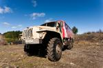](https://www.tkg.org.ua/node/30157)

Рис. 01.01 - УРАЛ

[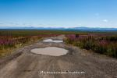](https://www.tkg.org.ua/node/30158)

Рис. 01.02 - Интинский тракт

[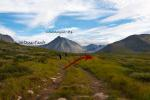](https://www.tkg.org.ua/node/30159)

Рис. 01.03 - Дорога к озеру Малое Балабан-Ты

[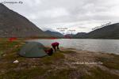](https://www.tkg.org.ua/node/30160)

Рис. 01.04 - оз. Малое Балабан-Ты

**День 02 \[13.08.13\]**

Собираем лагерь и продолжаем движение вдоль оз. М. Балабан-Ты огибая его слева по ходу движения. Через 15 минут бродим три рукава притоков р. Балабань-Ю, течение слабое, брод 0,4 м. Основная дорога возле озера резко повернула на восток в сторону ур. Деля-Гладь, где расположен еще один заброшенный прииск. Наш же путь скорее проходит по болоту, по которому изредка кто-то проезжает. Ориентация движения - на юг. В целом дорога хорошо читаема, идти можно в любую погоду и туман, свернуть ?не туда? совершенно невозможно (рис. 02.01).

Ещё избалованные сухими ботинками, на заболоченных низинных участках переобуваемся в резиновые сапоги.

За 2 перехода от места ночёвки переходим р. Балабан-Ю возле отметки 771 м. (рис. 02.02). Брод отсутствует, широкое русло реки переходится по камням, сказывается аномально жаркое лето. Перейдя русло, поднимаемся на пологий холм, где продолжаем движение заболоченной тракторной дорогой. В какой-то момент становится видно, что дорога поворачивает к перевалу Валдик, куда нам не нужно. Резко с неё сходим и берём азимут к слиянию истоков р. Балабан-Ю.

В истоках переходим три узких ручья, самый глубокий из которых - по колено. От места ночёвки до слияния истоков дошли за три перехода и две технические остановки на смену обуви.

Не обнаружив тропы, поднимаемся россыпями курумника по направлению к перевалу. Идём орографически правым берегом вдоль ручья (рис. 02.03).

Должен заметить, что аномально жаркое лето с неадекватной температурой до +35 и сухой погодой закончилось с нашим приездом. Теперь дождь поливал каждый день за исключением двух. Курумник в этих местах плотно покрыт лишайником, который в мокрую погоду довольно скользкий, потому здесь и далее идём в касках, особенно после героического полёта на ровном месте одного из участников.

К 16-30 выходим к оз. Верхнее Балабан-Ты (второе название - оз. Восьмёрка, из-за его кольцеобразного вида) (рис. 03.01). Погода окончательно начинает портиться, разбиваем лагерь.

[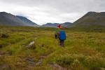](https://www.tkg.org.ua/node/30161)

Рис. 02.01 - Долина р. Балабан-Ю

[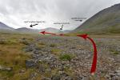](https://www.tkg.org.ua/node/30162)

Рис. 02.02 - Пересохшее русло р. Балабан-Ю

[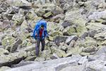](https://www.tkg.org.ua/node/30163)

Рис. 02.03 - Россыпи на подходах к оз. Верхнее Балабан-Ты

**День 03 \[14.08.13\]**

Проходим два каскадных взлёта, траверсируя по курумнику склон 25 град. Практически до самого перевала внизу у озёр есть отличные места под палатки с поправкой на камнеопасные склоны. До начала подъема на перевал доходим за 70 минут ЧХВ (рис. 03.02).

Перевал имеет несколько названий: пер. Голубые Озёра, пер. Надежды и пер. Кар Карпинского. Он карового происхождения, отсюда и альтернативное название - пер. Кар Карпинского. Подъем по плотно слежавшейся осыпи среднего и крупного размера до 35 град. На перевал заходим за один продолжительный переход (1 час чхв) с небольшой передышкой (рис. 03.03, рис 03.04). Сказываются в первые дни тяжёлые рюкзаки и ещё не разогретые боем организмы. Солнечно, ветрено, сказка. Снимаем записку харьковчан из т.к. ?КИВИ? от 07.08.2013 (рук. С. Третьяк), на обратной стороне дописана весточка от сыктывкарской группы из 5 чел. от 12.08.2013.

Определяющая сторона перевала со стороны р. Балабан-Ю, в сторону оз. Голубое Озеро сброс по высоте около 100 метров. Берём направление на восточный край озера, к которому выходим, начиная плавно траверсировать склон г. Карпинского со сбросом высоты по живой осыпи. Через 2 перехода курумником входим к основательно заболоченным истокам руч. Карпиншор (рис 03.05). Обедаем и поднимаемся по крупной осыпи на Плато Руин. Вопреки ожиданиям осыпь длилась только первые 1,5 перехода, до большого пруда (рис 03.06). Львиная доля остальной пройденной части плато - болото, откуда взялось географическое название для нас осталось загадкой. На ночёвку становимся в запланированном месте на краю распадка возле чистой воды. Утром запланировано восхождение на г. Народа, палатки можно поставить и ближе к подножию горы, но болотная вода доверия не внушает. Возможно в иные года ситуация с ручейками обстоит иначе.

[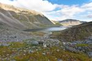](https://www.tkg.org.ua/node/30164)

Рис. 03.01 - оз. Верхнее Балабан-Ты

[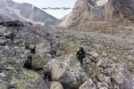](https://www.tkg.org.ua/node/30165)

Рис. 03.02 - пер. Голубые Озёра (1А, 1260 м)

[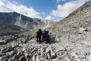](https://www.tkg.org.ua/node/30166)

Рис. 03.03 - пер. Голубые Озёра (Вид в сторону г. Народа)

[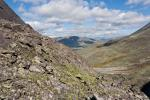](https://www.tkg.org.ua/node/30167)

Рис. 03.04 - пер. Голубые Озёра (Вид в сторону р. Балабан-Ю)

[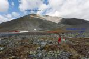](https://www.tkg.org.ua/node/30168)

Рис. 03.05 - Истоки руч. Карпин-Шор

[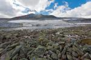](https://www.tkg.org.ua/node/30169)

Рис. 03.06 - Озеро на плато Руин

[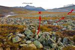](https://www.tkg.org.ua/node/30170)

Рис. 03.07 - Путь спуска с плато Руин на р. Народа

**День 04 \[15.08.13\]**

Лагерь не собираем, вариантов спуска к р. Народа два, по распадку притока или непосредственно с южного склона плато Руин чтобы выйти между первым и вторым озером на р. Народа (рис. 03.07). Выбор будет сделан в зависимости от того сколько времени мы потратим на гору.

Движемся по плато, участки курумника вперемешку с травянистым покровом (рис. 04.01). Путь постепенно становится круче, живая осыпь уклоном до 30-35 град. Эти участки преодолеваем короткими траверсами с набором высоты, пока не выходим на ребро, по другую сторону которого каровый сброс (рис. 04.02). Через сто метров движения ребром начинаются участки несложных скал до 45 град, которые преодолеваем свободным лазаньем (рис. 04.03). На вершину выходим в 07-45. Поднялись за 2 ч 45 минут почти чистого ходового времени, т.к. шли фактически без привалов, восстанавливая силы во время осторожного движения по крутым участкам живой осыпи (рис. 04.04).

Снимаем записку из будущего, от 15.08.2013 группы из 4-х человек поднявшихся на вершину через 3 часа после нас J. Погода отличная, на небе ни облачка, долго фотографируем и наслаждаемся видами. Спуск начинаем в 09-00 и приходим к палаткам в 12-20.

Плато выглядит фантастически с его белыми пятками горного льна. Потрясающий вид на г. Мансинер заставляет очень пожалеть, что прохождение маршрута ограничено по дням и гора не включена в нитку. Безусловно, одна из самых красивых вершин Урала, если смотреть на неё с этого ракурса.

Собираем лагерь, обедаем, выходим в 14-00, что на два часа позже запланированного времени по графику. Потому спуск на р. Народа падает на второй вариант, непосредственно с плато на реку между первым и вторым озером.

Спуск с плато проходит по склону 1Б к.с. Следует его начинать немножко ближе к вершине с высотой 1249,1, и, забирая немножко влево, сразу настраиваться на разведку, путь спуска просматривается плохо. Уже снизу было видно, что вариант был выбран не идеально, но почти оптимально, в верхней части удалось немножко проскочить по травяным полочкам. Это позволило проливному ливню застать нас на последних метрах, а не где-то посредине спуска.

Брод р. Народа в низкую воду ?н\\к. Не теряя высоты движемся траверсом холма, который плотно порос карликовой ивкой и мхом поверх камней. Притоки ручья Мансишор очень быстры и полноводны, возле небольших водопадов переходим по двум рукавам и, заметив ровную площадку, становимся на бивак (рис. 04.07).

Со времени спуска с плато идёт сильный дождь, который закончился стандартно с призывами дежурных к столу.

[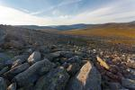](https://www.tkg.org.ua/node/30171)

Рис. 04.01 - Плато Руин

[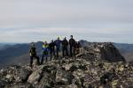](https://www.tkg.org.ua/node/30172)

Рис. 04.02 - Выход на Южное ребро г. Народа

[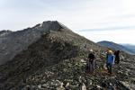](https://www.tkg.org.ua/node/30173)

Рис. 04.03 - Предвершинный взлёт

[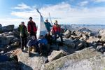](https://www.tkg.org.ua/node/30174)

Рис. 04.04 - Группа на вершине г. Народа

[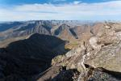](https://www.tkg.org.ua/node/30175)

Рис. 04.05 - Вид с вершины

[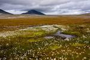](https://www.tkg.org.ua/node/30176)

Рис. 04.06 - Плато Руин. Поляны горного льна

[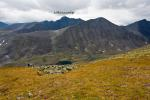](https://www.tkg.org.ua/node/30177)

Рис. 04.07 - Спуск с плато Руин в долину р. Народа

[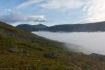](https://www.tkg.org.ua/node/30178)

Рис. 04.08 - Вид на плато Руин с долины руч. Манси-Шор

**День 05 \[16.08.13\]**

Первые полтора перехода идём по тропе, которая затем всё же теряется в россыпях (рис. 05.01). Брод в верховьях р. Мансишор оценен как н\\к и в 11-00 группа была под перевалом. Путь подъема на него начал просматриваться задолго (рис. 05.02). Сначала в лоб несколько десятков метров, затем траверсом забирая влево по явно просматривающейся полке около 30 град, после чего идёт участок травянистого склона 25-35 град. Всё утро и подъём на перевал идёт дождь, поднялись на широкую седловину в 13:00 и упёрлись в плотную завесу тумана. Сама седловина относится к пер. Кварцитовый (2А, в туре записка не обнаружена). Чтобы выйти на пер. Хобе, необходимо двигаться от пер. Кварцитовый вдоль карового сброса вправо 100-150 метров с набором высоты 70 метров до тура. Разведка результата не принесла, тур пер. Хобе нашли, куда же спускаться неясно, плотный туман. Возвращаемся назад, ставим палатки на обед в надежде переждать непогоду и при прояснении в штатном режиме продолжить маршрут.

16:00 дождь прекратился (рис. 05.03). Повторная разведка на пер. Хобе остается безрезультатной, если долина р. Мансишор полностью открылась, то Долина Смерти затянута плотным туманом и с перевала Хобе видно только молоко. Делаем вынужденную полуднёвку.

Отдельно хочется заметить, что седловина Кварцитового вполне удобна для ночёвок, есть ручьи, и, судя по руслам, они носят постоянный характер. На Хобе поставить палатки для нормального существования практически невозможно, вся территория представляет собой обломки плит, которые торчат рёбрами вверх и отсутствуют ручьи.

[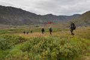](https://www.tkg.org.ua/node/30179)

Рис. 05.01 - Долина руч. Манси-Шор

[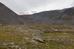](https://www.tkg.org.ua/node/30180)

Рис. 05.02 - пер. Хобе (1Б, 1480)

[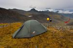](https://www.tkg.org.ua/node/30181)

Рис. 05.03 - Отсидка на седловине пер. Кварцитовый. Распогодилось

**День 06 \[17.08.13\]**

Подъем в 03-30. Выход в 05-00.  
Подходим к знакомой седловине. В туре ещё вчера была снята записка ?Хобе?. Изначально планировалось идти Хобе Восточный. По карте видно, что тур относится к Хобе Западный, но в условиях опять начавшей портиться погоды и образовавшегося фронта на горизонте, тратить время на очередную разведку непозволительная роскошь. Спускаемся с Хобе Западного, оба перевала по классификатору имеют одинаковую трудность 1Б и выходят в одну долину. Это делает его равноценной заменой своему восточному брату (рис. 06.01).  
Спуск практически в лоб по мелкой сыпухе. Просматривается тропа. Со средины перевала забираем немножко правее и выходим по травяным участкам. В условиях начавшегося дождя пожалели, что не выходили по осыпям (рис. 06.03).  
Спустившись вдоль ручья в удобном месте следует перейти на водораздельный отрог между р. Хобею и её правым притоком. По водоразделу плавный удобный спуск в Долину Смерти, усеянный труднопроходимыми мимо кустами сочной черники (рис. 06.04).  
В 9:00 бродим Хобею в точке, где на карте начинается тракт. По факту он отсутствует, есть лишь чередующиеся участки болот и притоков (все н\\к), до самого руч. Ошкавож идём в сапогах. Не доходя урочища Пирамида становимся на обед (рис. 06.05)  
Тракта указанного на карте снова не обнаружено. Если там кто-то и ездил, то исключительно по руслу реки. Продираемся через густой лес, высокие заросли ?шкуродера?, изредка выходим на звериные тропы, но они, как правило, скоро теряются. Через два длинных перехода выходим к слиянию руч. Северный Перевальный и р. Ошкавож, вытекающего с долины хр. Алешкова (рис. 06.06). Брод обоих ручьев н\\к, на ночёвку становимся не доходя 3 км до пер. Тендер на ?относительно? высоком берегу.

[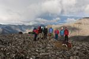](https://www.tkg.org.ua/node/30182)

Рис. 06.01 - пер. Хобе Зап. (1Б, 1480)

[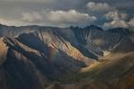](https://www.tkg.org.ua/node/30183)

Рис. 06.02 - Долина Смерти

[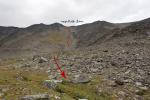](https://www.tkg.org.ua/node/30184)

Рис. 06.03 - Спуск с пер. Хобе Зап. на р. Хобею

[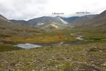](https://www.tkg.org.ua/node/30185)

Рис. 06.04 - Долина р. Хобею

[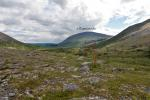](https://www.tkg.org.ua/node/30186)

Рис. 06.05 - ур. Пирамида

[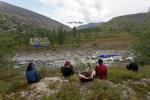](https://www.tkg.org.ua/node/30187)

Рис. 06.06 - Граница леса на руч. Ошкавож

**День 07 \[18.08.13\]**

Весь путь на перевал проходит по орографически правой стороне руч. Северный Перевальный. Подход долгий и пологий, склон травянистый. За два перехода от м.н. выходим на пер. Тендер (н\\к), седловина которого больше походит на взлётную полосу (рис. 07.01). Идёт проливной дождь, фотографируемся возле тура, который находится с южной стороны перевала и бежим вниз в сторону ур. Кедрынырд (рис. 07.02). В туре записка не обнаружена, оставили его так же пустым из-за отсутствия герметичной тары. Спустившись с перевала ближе к ур. Кедрынырд, начинаем забирать правее. Постепенно начинается трудно проходимый лес, который вырос на месте полей курумника, под ногами то и дело встречаются пустоты, скорость движения сходит на нет. Передвигаться необходимо осторожно, нередко ноги проваливались в щели, тут уж нужно быть готовым падать назад на рюкзак и никак иначе. Через 7 км лес заканчивается (рис. 07.03) и начинается горная тундра, по которой и выходим до места ночёвки (рис. 07.04). По дороге собираем грибы, стараемся брать только белые, их тьма. Начиная с Долины Смерти, не было ни дня, чтобы вечер закончился без нескольких пожаренных сковородок этого счастья.  
Русла притоков, которые стекают с хребта Алешкова, оказались полностью пересохшие.

[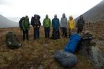](https://www.tkg.org.ua/node/30188)

Рис. 07.01 - пер. Тендер (нк, 1240 м)

[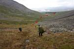](https://www.tkg.org.ua/node/30189)

Рис. 07.02 - Долина р. Маньхобею (ур. Кедрынырд)

[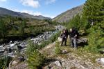](https://www.tkg.org.ua/node/30190)

Рис. 07.03 - Граница леса на р. Маньхобею

[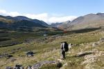](https://www.tkg.org.ua/node/30191)

Рис. 07.04 - Долина р. Маньхобею

**День 08 \[19.08.13\]**

Характер пути прежний, каменные россыпи, чередующиеся простыми травяными участками. К перевалу доходим за 3 перехода (рис. 08.01).  
Самочувствие и бодрость группы на высоте, день обещает быть несложным. Принимаю решение на плато выходить не через пер. Геологов (1А), а через пер. Конгломерат (1А-1Б) с полным траверсом вершины г. Конгломератная в сторону плато. Сложность остается в тех же рамках, но так выходит технически интереснее в виду увеличенной линейной продолжительности препятствий.  
Перевал Конгломерат (1А-1Б) - ярко выраженная седловина левее г. Конгломератная. Со стороны Маньхобею травяной склон 25-35 град, местами слежавшаяся осыпь. Определяющая сторона на спуск в сторону р. Парнук, где просматривается склон 35-45 град мелкой осыпи. Выходим на перевал за один переход, в туре записка не обнаружена (рис. 08.02, рис. 08.03). Перевал не популярен из-за рядом располагающегося пер. Геологов, через который без лишнего крюка можно выйти на плато и сходить радиальный выход на г. Конгломератная без рюкзаков.  
Обедаем и за один длинный переход поднимаемся на г. Конгломератная (рис. 08.04). Характер пути разный, вначале просматривается тропа, далее слежавшаяся осыпь среднего размера в его нижней части, до лабиринта огромных глыб вверху (рис. 08.05).  
Ещё через 15-20 минут спускаемся на плато, спуск намного легче. Бросив рюкзаки, идем смотреть карьеры горного хрусталя, который добывали здесь в советские времена. Вопреки ожиданиям купаться в россыпях как Скрудж МакДак в детском мультике, хрусталя очень мало, пираты поджали хвосты и поникли. Попутно заходим к туру на пер. Геологов, куда изначально должны были подняться. Снимаем записку группы из Запорожья от 29.07.2012 под рук. Товстопятко Ф.Ф. (турклуб ?Олимп?, пешеходный поход 5 к.с.). Если с плато смотреть на север, в истоки р. Маньхобею, тур находится левее жандарма.  
В первом же удобном распадке от г. Конгломератная выходим на тропу (рис. 08.06), которая сначала траверсирует склон в северном направлении вдоль отвесных стенок, затем зигзагами выходит в истоки р. Парнук, недалеко от начала подъема на пер. Конгломерат. Через 1 час ч.х.в. выходим на ровные площадки, располагающиеся немножко ниже указанной на карте базы Верхний Парнук (рис. 08.07). От самой базы остался лишь фундамент в несколько кв. метров и ржавый чайник.

[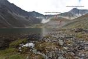](https://www.tkg.org.ua/node/30192)

Рис. 08.01 - Пер. Конгломерат. Исток р. Маньхобею

[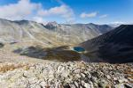](https://www.tkg.org.ua/node/30193)

Рис. 08.02 - пер. Конгломерат. В сторону истоков р. Маньхобею

[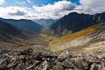](https://www.tkg.org.ua/node/30194)

Рис. 08.03 - пер. Конгломерат. В сторону истоков р. Парнук

[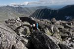](https://www.tkg.org.ua/node/30195)

Рис. 08.04 - Последние метры на вершину г. Конгломератная (1570 м)

[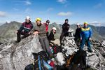](https://www.tkg.org.ua/node/30196)

Рис. 08.05 - Группа на вершине г. Конгломератная

[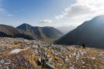](https://www.tkg.org.ua/node/30197)

Рис. 08.06 - Начало спуска с плато Парнук

[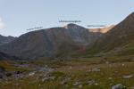](https://www.tkg.org.ua/node/30198)

Рис. 08.07 - Тропа с плато Парнук

[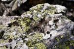](https://www.tkg.org.ua/node/30199)

Рис. 08.08 - Горный хрусталь

**День 09 \[20.08.13\]**

Беря во внимание медленное передвижение в долинах рек Ошкавож и Маньхобею, полуднёвку на пер. Кварцитовый, вышло не то чтобы отставание от графика, но намёк на него. Оставался один запасной день и практически половина пути до финиша. Одним из заявленных запасных вариантов является пер. Санный, через который можно выйти в верховья р. Вангыр. Этим вариантом мы воспользовались, и как показало будущее, не напрасно.

Продолжаем движение тропой вдоль левого берега р. Парнук, постепенно тропа начинает теряться в карликовой полярной ивке (рис. 09.01). Берём азимут в долину р. Малый Парнук, минуем волшебное по красоте озеро (рис. 09.02) и через 40 минут переходим на правый берег р. Малый Парнук. Чуть выше опять бродим на левый берег и выходим на тропу, которая подводит нас под небольшой водопад, с которого удобно подниматься на перевал. От места ночёвки на перевал поднялись за три перехода (рис. 09.03).

Подъем на перевал пологий, по курумнику. Тур находится между большим и малый озером, у края большого (рис. 09.05). Снимаем записку Козлова В.П. (1951 г.р.) от 26.07.2013, идущего соло с Саранпауля на Вангыр. Спуск в верховья Вангыра по слежавшейся осыпи и травянистым террасам (рис. 09.06).

Пообедав, начинаем движение долиной. Всё верховье - сплошное болото, которое по возможности обходится невысокими возвышенностями. Граница леса начинается в месте, где долина делает резкий поворот влево. Здесь бродим р. Вангыр и ныряем в лес, в надежде найти указанный на хребтовке Н. Рундквиста тракт, что означает сэкономить драгоценное время на г. Манарага. Тракта не обнаружили, движемся лесом. Сначала легкопроходимый, чем ниже по течению, тем чаще блуждаем лабиринтами проток и кустарников. Ночуем в долине (рис. 09.07), не доходя два км до отметки 482,2 м. С перевала до места ночёвки дошли за четыре продолжительных перехода.

[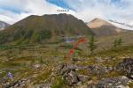](https://www.tkg.org.ua/node/30200)

Рис. 09.01 - Долина р. Парнук

[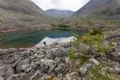](https://www.tkg.org.ua/node/30201)

Рис. 09.02 - Озеро у слияния р. Парнук и р. Малый Парнук

[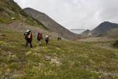](https://www.tkg.org.ua/node/30202)

Рис. 09.03 - пер. Санный. Долина р. Малый Парнук

[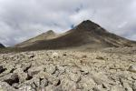](https://www.tkg.org.ua/node/30203)

Рис. 09.04 - Россыпи на пер. Санный (нк, 880 м.)

[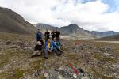](https://www.tkg.org.ua/node/30204)

Рис. 09.05 - У тура на пер. Санный

[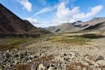](https://www.tkg.org.ua/node/30205)

Рис. 09.06 - Истоки р. Вангыр

[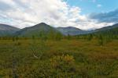](https://www.tkg.org.ua/node/30206)

Рис. 09.07 - Долина р. Вангыр

**День 10 \[21.08.13\]**

Выходим в 09:00. Продолжаем движение лесом средней проходимости вдоль заболоченных берегов р. Вангыр постоянно маневрируя завалами и протоками в поисках оптимального пути. Бродим р. Ваныр в километре от впадающего в него ручья Медвежий и продолжаем движение вниз по реке, слегка забирая вправо. Поломка GPS не позволяет в лесу отходить далеко от р. Вангыр, чтобы не пропустить нужный нам приток (руч. Медвежий) и распадок, ориентироваться в густом лесу очень трудно. Лес средней проходимости, до ручья Медвежий от места ночёвки возле отметки 482,2 м дошли за 2 неполных перехода.

Поднимаемся по ор. правой стороне ручья (рис. 10.01). Тропы нет, постепенно русло переходит в узкий каньон. Движемся осторожно, склоны из живого курумника. Возможности подняться непосредственно руслом ручья нет, путь постоянно перегораживают каскады в виде небольших водопадов и полок. Движение в основном проходит по ор. правую сторону ручья. Постепенно выходим к тупику, каньон становится уже и переходит в скальные выступы и водопад, примерно на 600 метрах над у.м.. От этого места резко поворачиваем направо и поднимаемся по склону 35-40 град в лоб на высоту перевала (рис. 10.02). Характер пути - травянистые террасы с участками осыпи.

Сам перевал платообразный (рис. 10.03). До тура шли травяными, местами заболоченными участками добрых 2 км. Тур находится в западной части перевала, там же памятная табличка (рис. 10.04). Сняли записку группы из г. Ульяновск от 13.03.13, совершающих лыжный поход 3 к.с. (ФИО руководителя нечитабельно)

Спуск с перевала пологий, травянистый. Первую половину спуска идёт хорошая тропа, потерять её очень трудно. Постепенно появляются поросшие высокой травой заболоченные участки, сбиваемся с тропы, но несколько раз выходим на звериные (рис. 10.05). Практически весь день идёт дождь, сменяющийся моросью. Ставим за цель дойти до балка Юнко-Вож и немного просушиться, практически с начала похода все вещи перманентно мокрые. Если в первую половину дня погода была, как правило, замечательная, то во вторую постоянно поливало, времени на генеральную сушку не было. Балок находится слева от первого большого холма в долине Юнко-Вож (рис. 10.06) примерно в 7-8 км. от перевального тура пер. Барсукова. До холма нужно бродить одноименную реку. Ширина реки в месте брода 5м глубина 0,5 м (н\\к).

Рис. 10.01 - руч. Медвежий

Рис. 10.02 - Подъем на пер. Барсукова с р. Вангыр

Рис. 10.03 - Платообразная седловина пер. Барсукова

Рис. 10.04 - пер. Барсукова (нк, 870 м.)

Рис. 10.05 - Лес в долине руч. Юнко-Вож

Рис. 10.06 - Балок ?Юнко-Вож?

**День 11 \[22.08.13\]**

Обходим холм с западной стороны, движение заболоченными участками и мелким кустарником (рис. 11.01). Бродим р. Юнко-Вож и выходим на хорошую тропу, которую ещё вчера потеряли в зарослях несколько километров назад. Судя по всему, основная тропа проходит полностью правим берегом р. Юнко-Вож, из чего следует, что балок стоит от неё обособлено в стороне, южнее пару километров.

Весь день движемся тропой, погода шепчет (рис. 11.02). В конце тропа выводит на галечный берег, бродим р. Косью и выходим аккурат на балок Манарага (рис. 11.03). Балок находится в плачевном состоянии и годится разве что в особенно сильную непогоду.

Продолжаем движение тропой, но в какой-то момент уходим по неправильному ответвлению и попадаем в густой заболоченный лес, которым движемся 3 км, пока вновь не упираемся в перпендикулярную тропу относительно р. Манарага. Разведка доносит, что тропа идёт на перевал Студенческий. К сожалению, от факультативного восхождения на г. Манарага приходится отказаться, так как через 3 дня поезд на 80 км. пути.

Еще через 2 перехода становимся на ночёвку не доходя 2 км. до балка Олений, стоящий на впадении руч. Олений в р. Манарага.

Рис. 11.01 - Долина руч. Юнко-Вож

Рис. 11.02 - Долина р. Косью

Рис. 11.03 - Начало брода р. Косью

**День 12 \[23.08.13\]**

За 35 минут доходим до балка Олений, он полностью уничтожен, с обвалившейся крышей.

Первые 2 км. движемся ор. правым берегом руч. Олений по камням с участками болот (рис. 12.01), в одном месте преследуя цель обойти его по возвышенности, выходим на теряющуюся тропу, которая на границе леса становится более явной и выводит нас к широкому броду. Переходим его по камням.  
Сам подъем на перевал пологий, но изматывающий. Проходит по лабиринту курумника разных размеров (рис.12.03). Через два перехода выходим к озеру, обходим его по полкам справа, затем до тура ещё один переход по полям каменной россыпи. Тур находится на большом камне, на краю первого озера, если считать от долины Падежа-Вож (рис. 12.04)  
Спуск в долину р. Падежа-Вож следует начинать забирая от камня правее, чтобы обойти живой осыпной склон до 35 град (рис. 12.05).  
Еще через 2 часа чхв болотом выходим на небольшой пятачок сухой земли, где ставим лагерь (рис. 12.07).

Рис. 12.01 - Устье руч. Олений

Рис. 12.02 - Верховья руч. Олений

Рис. 12.03 - Поле курумника на перевале Олений

Рис. 12.04 - у тура на пер. Олений (нк, 1040 м.)

Рис. 12.05 - Спуск с пер. Олений в истоки руч. Падежа-Вож

Рис. 12.06

Рис. 12.07 - Долина руч. Падежа-Вож

Рис. 12.08 - Стадо оленей

**День 13 \[24.08.13\]**

За два перехода спускаемся болотом к оз. Падежа-Ты, обходим его справа, появляется тропа, которая постоянно теряется в вязком болоте.

Через 2 км от северной конечности озера выходим на тракт (рис. 13.01), по которому через 4 часа чхв становимся лагерем. Дорога явная, потерять её трудно, изредка уходили не на ту развилку, но со временем выходили на основной тракт. За время движения этого дня прошли три брода (Лимбеко-Ю = 1А, два притока Лимбеко-Ю = н\\к). Если финиш маршрута приходится на кордон Таврота (брод на стыке Интинского и Кожимского трактов), бродить в верховьях Лимбеко-Ю на ор. правый берег обязательно. Во-первых, по этой стороне реки идёт тракт, во вторых брод устья Лимбеко-Ю пешком невозможен, река глубокая, широкая и бурная.

Рис. 13.01 - Тракторная дорога вдоль р. Лимбеко-Ю

Рис. 13.02 - Верховья р. Лимбеко-Ю

**День 14 \[25.08.13\]**

Несмотря на то что тракт идёт в сами верховья р. Лимбеко-Ю, рассматривать как вариант заброски или выброски не приходится. Судя по деревцам посреди колеи, по нему давно никто не ездил, хотя есть неразведанные развилки. В последний день похода мы наткнулись на грузовую машину, застрявшую на заболоченных участках тракта по самые борта (рис. 14.01).  
Продолжаем движения трактом. К 16:00 выходим к р. Кожим (рис. 14.02), где нас ожидал УРАЛ от ?Севертур?. Переночевав в устье р. Лимбеко-Ю, утром выехали в Инту. Должен заметить, что Интинский тракт в сухую солнечную и плохую погоду (которая была во время выброски) - это две большие разницы.

Рис.14.01 - Жертва тракта

Рис.14.02 - Финиш. Переправа через р. Кожим

**6\. Расчёт категории сложности похода:**

Локальные препятствия:

<table><tbody><tr><td colspan="2">
<b>Перевалы</b>
</td><td>
<b>Балы</b>
</td></tr><tr><td rowspan="4">
н\к
</td><td>
Тендер
</td><td>
2
</td></tr><tr><td>
Санный
</td><td>
2
</td></tr><tr><td>
Барсукова
</td><td>
2
</td></tr><tr><td>
Олений
</td><td>
2
</td></tr><tr><td>
1А
</td><td>
Голубые Озёра
</td><td>
4
</td></tr><tr><td>
1Б
</td><td>
Хобе Зап.
</td><td>
6
</td></tr><tr><td colspan="2">
ИТОГО
</td><td>
18 (В зачёт 12)
</td></tr><tr><td colspan="3">
<b>Вершины</b>
</td></tr><tr><td rowspan="2">
н\к
</td><td>
Народа
</td><td>
4
</td></tr><tr><td>
Конгломератная
</td><td>
4
</td></tr><tr><td colspan="2">
ИТОГО
</td><td>
8 (В зачёт 4)
</td></tr><tr><td colspan="3">
<b>Переправы</b>
</td></tr><tr><td></td><td>
Народа
</td><td></td></tr><tr><td></td><td>
Ошкавож
</td><td></td></tr><tr><td></td><td>
Северный Перевальный
</td><td></td></tr><tr><td></td><td>
Р. Вангыр (х2)
</td><td></td></tr><tr><td></td><td>
р. Юнко-Вож (х2)
</td><td></td></tr><tr><td></td><td>
Р. Косью
</td><td></td></tr><tr><td colspan="2">
ИТОГО
</td><td>
4,5
</td></tr><tr><td colspan="3">
<b>ИТОГО 34,5 балла. В зачёт 20</b>
</td></tr></tbody></table>

Протяженные препятствия:

<table><tbody><tr><td colspan="2">
<b>Лес</b>
</td><td>
<b>км</b>
</td><td>
<b>Балы</b>
</td></tr><tr><td>
н\к
</td><td>
Ор. левый берег р. Вангыр
</td><td>
6
</td><td>
1,2
</td></tr><tr><td></td><td>
Долина р. Косью-Манарага
</td><td>
17
</td><td>
3,4
</td></tr><tr><td></td><td>
Долина р. Юнковож
</td><td>
7
</td><td>
1,4
</td></tr><tr><td></td><td>
Участки вдоль р. Лимбеко-Ю
</td><td>
11
</td><td>
2,2
</td></tr><tr><td>
1А
</td><td>
Подход под перю Барсукова
</td><td>
4
</td><td>
1,6
</td></tr><tr><td></td><td>
Долина руч. Ошкавож
</td><td>
6
</td><td>
2,4
</td></tr><tr><td>
1Б
</td><td>
Долина р. Маньхобею
</td><td>
4
</td><td>
1,6
</td></tr><tr><td colspan="2">
ИТОГО
</td><td></td><td>
13,8
</td></tr><tr><td colspan="4">
<b>Болота</b>
</td></tr><tr><td>
н\к
</td><td>
Долина р. Балабан-Ю
</td><td>
3
</td><td></td></tr><tr><td></td><td>
Плато Руин
</td><td>
2
</td><td></td></tr><tr><td></td><td>
Долина р. Падежа-Вож
</td><td>
14
</td><td></td></tr><tr><td></td><td>
Долина р. Манарага
</td><td>
2
</td><td></td></tr><tr><td></td><td>
Долина Смерти
</td><td>
1
</td><td></td></tr><tr><td></td><td>
Участки вдоль Лимбеко-Ю
</td><td>
3
</td><td></td></tr><tr><td></td><td>
Верховья Вангыра
</td><td>
3
</td><td></td></tr><tr><td colspan="2">
ИТОГО
</td><td>
28
</td><td>
14
</td></tr><tr><td colspan="4">
<b>Осыпи, Морены</b>
</td></tr><tr><td>
н\к
</td><td>
Р. Балабан-Ю ? под пер. Голубые Озера
</td><td>
3,5
</td><td>
1,75
</td></tr><tr><td></td><td>
Пер. Голубое Озеро - руч. Карпин-Шор
</td><td>
1
</td><td>
0,5
</td></tr><tr><td></td><td>
Плато Руин со стороны оз. Голубое Озеро
</td><td>
3
</td><td>
1,5
</td></tr><tr><td>
1Б
</td><td>
Плато Руин - р. Народа
</td><td>
0,8
</td><td>
1,6
</td></tr><tr><td colspan="2">
ИТОГО
</td><td></td><td>
5,35
</td></tr></tbody></table>

1.Определение коэффициента перепада высот:

K = 1 + DH\\12

Где DH \- суммарный перепад высот (включая подъемы и спуски) в километрах

К = 1 + 9,79\\12 = 1,8

2.Подсчёт общего количества набранных балов :

КС = ЛП + ПП + (Г \* А \* К)

Где ЛП и ПП - баллы за локальные и  
протяженные препятствия, Г - географический показатель района похода, К ?  
коэффициент перепада высот.

КС = 20 + 33,15 + (12 \* 1 \* 1,8) = 74,75

3.Сравнение полученного результата с нормативом пешеходного похода третьей категории сложности:

<table><tbody><tr><td>
Показатель маршрута
</td><td>
Норматив
</td><td>
Результат
</td></tr><tr><td>
Продолжительность маршрута (t), дней (не менее)
</td><td>
10
</td><td>
13
</td></tr><tr><td>
Протяженность маршрута (l) км (не менее)
</td><td>
190
</td><td>
198,1
</td></tr><tr><td>
Макс. допустимое колличество балов за локальные препятствия (ЛПmax)
</td><td>
50
</td><td>
34,5
</td></tr><tr><td>
Баллы за локальные препятствия (ЛП), идущие в зачет (не более)
</td><td>
20
</td><td>
34,5 (20)
</td></tr><tr><td>
Баллы за протяженные препятствия (ПП), идущие в зачет (не более)
</td><td>
40
</td><td>
33,15
</td></tr><tr><td>
Географический показатель (Г)
</td><td></td><td>
12
</td></tr><tr><td>
Автономность (А)
</td><td></td><td>
1
</td></tr><tr><td>
Коэффициент перепада высот (К)
</td><td></td><td>
1,8
</td></tr><tr><td>
Общее количество баллов, набранных категорируемым маршрутом (КС)
</td><td>
60 - 94
</td><td>
74,75
</td></tr></tbody></table>

**Выводы и рекомендации по прохождению маршрута.**

1.Выбранные сроки похода попадали на начало межсезонья. Несмотря на часто дождливую погоду, было более-менее комфортно благодаря отголоскам аномально жаркого лета в высоких северных широтах. Это позволило насладиться видами, тумана практически не было. В другие года я бы на такой подарок не рассчитывал.

2.Район проведения похода очень богат вариантами маршрутов. Долина р. Косью и р. Манарага имеет хоженые тропы. Чисто субъективно, это время было бы интересно потратить на что-то дикое и редко хоженое в азиатской части. Движение трактом вдоль Лимбеко-Ю так же монотонно и однообразно. Не смотря на это, равнодушных к северным красотам не осталось.

3.Практически весь поход был пройден на бензине Калоша, брали мы его 10 литров по нескольким причинам. Во-первых, экологическая составляющая, достаточное количество топлива позволило не уничтожать лес. Во вторых выше уровня леса дров нет, кроме карликовых корешков, а именно там планировалось устраивать биваки. В-третьих, мобильно быстро, некоторыми участниками приобретён опыт безкостровых продолжительных походов.

4.Популярный спор, следует ли брать в спортивные походы на север сапоги. По данному маршруту можно было обойтись без них, так как ноги промокли во второй же день, и играться с переобуванием было бессмысленно.

5.Группа была оснащена спутниковым телефоном Турайа. К сожалению, мы не могли проверять связь в каждой долине, батарея садилась быстро, её необходимо было беречь. Например, в долине р. Парнук и возле оз. Верхнее Балабанты (оз. Восьмёрка) связь отсутствовала. Холодный старт аппарата был произведён на старте маршрута заранее. В виду малого количества геостационарных спутников оператора и возможному времени на их определение, техническому состоянию батареи при использовании в высоких широтах необходимо уделить особое внимание.

6.Не рассчитывать на подножный корм. В этот раз было много грибов, но совершенно отсутствовала рыба.

7.Попавшиеся по дороге балки были в плачевном состоянии, кроме Юнко-Вож который находится вдали от тропы, и возможно только по этой причине ещё функционирует. С такой тенденцией я бы не рассчитывал на них в будущем. Например, балок Олений полностью разрушен, зимой совершенно бесполезен в критической ситуации.

8.До Желанной с нами забрасывались бывалые водники, на наши репелленты смотрели скептически. Отсыпали своего снадобья - ванили. Её необходимо размешать с водой или подсолнечным маслом, натереть кожу, убеждали, что очень действенно. У нас кровососущих было мало, потому толком проверить не смогли.

9.По возвращению в Инту с трудом нашли место, где можно привести себя в порядок перед тремя сутками в поездах. На вокзале гостиница давно не функционирует, в ?Северянке? нам было отказано, как иностранным гражданам и нежелании долго оформлять пребывание. Трехчасовой вояж Интой закончился баней за 3000 руб на 8 человек, где функционировал только душ.

**7\. Перевальные и вершинные записки**

01\. пер. Голубые озёра \[1\]

02\. пер. Голубые озёра \[2\]

03\. г. Народа

04\. пер. Хобе Зап.

05\. г. Конгломератная

06\. пер. Парнук (Геологов)

07\. пер. Санный

08\. пер. Барсукова

09\. пер. Олений

**8\. Картографический материал**

01\. map

02\. map

03\. map

04\. map

05\. map

06\. map

**9\. Дополнения:**

9.1. Групповое и личное снаряжение:

<table><tbody><tr><td></td><td></td><td>
Количество
</td><td>
Вес (грамм)
</td></tr><tr><td>
01
</td><td>
Палатка Hannah Serak (2+1)
</td><td>
1
</td><td>
3010
</td></tr><tr><td>
02
</td><td>
Палатка Hannah Covert S (2+1)
</td><td>
1
</td><td>
3490
</td></tr><tr><td>
03
</td><td>
Палатка Hannah Covert S (2+1)
</td><td>
1
</td><td>
3400
</td></tr><tr><td>
04
</td><td>
Аптечка
</td><td>
1
</td><td>
1500
</td></tr><tr><td>
05
</td><td>
Тент
</td><td>
1
</td><td>
1100
</td></tr><tr><td>
06
</td><td>
Пила
</td><td>
2
</td><td>
440
</td></tr><tr><td>
07
</td><td>
Верёвка 50 м d.10
</td><td>
2
</td><td>
6070
</td></tr><tr><td>
08
</td><td>
Cистема
</td><td>
2
</td><td>
1070
</td></tr><tr><td>
09
</td><td>
Карабины, петли, репшнур
</td><td>
комплект
</td><td>
620
</td></tr><tr><td>
10
</td><td>
Котлы (2) (+ сковородка (1), черпак (1)
</td><td>
2
</td><td>
1700
</td></tr><tr><td>
11
</td><td>
Мочалочно-моечный набор
</td><td>
комплект
</td><td>
150
</td></tr><tr><td>
12
</td><td>
Мультитопливная горелка Kovea
</td><td>
1
</td><td>
550
</td></tr><tr><td>
13
</td><td>
Мультитопливная горелка Primus
</td><td>
1
</td><td>
420
</td></tr><tr><td>
14
</td><td>
Ветрозащита
</td><td>
1
</td><td>
360
</td></tr><tr><td>
15
</td><td>
Ремнабор
</td><td>
комплект
</td><td>
1100
</td></tr><tr><td>
16
</td><td>
Фотоаппаратура (+ объективы)
</td><td>
2
</td><td>
4000
</td></tr><tr><td>
17
</td><td>
Рыболовные снасти
</td><td>
комплект
</td><td>
370
</td></tr><tr><td>
18
</td><td>
Батарейки
</td><td>
26 шт
</td><td>
770
</td></tr><tr><td>
19
</td><td>
GPS Garmin
</td><td>
1
</td><td>
220
</td></tr><tr><td>
20
</td><td>
Спутниковый телефон Thuraya
</td><td>
1
</td><td>
270
</td></tr><tr><td>
21
</td><td>
Очищенный бензин Калоша
</td><td>
10 л
</td><td>
8400
</td></tr><tr><td></td><td colspan="3">
<b>ИТОГО&nbsp;&nbsp;&nbsp;&nbsp;&nbsp;&nbsp;&nbsp;&nbsp;&nbsp;&nbsp;&nbsp;&nbsp;&nbsp;&nbsp;&nbsp;&nbsp;&nbsp;&nbsp;&nbsp;&nbsp;&nbsp;&nbsp;&nbsp;&nbsp;&nbsp;&nbsp;&nbsp;&nbsp;&nbsp;&nbsp;&nbsp;&nbsp;&nbsp;&nbsp;&nbsp;&nbsp;&nbsp;&nbsp;&nbsp;&nbsp;&nbsp;&nbsp;&nbsp;&nbsp;&nbsp;&nbsp;&nbsp;&nbsp;&nbsp;&nbsp;&nbsp;&nbsp;&nbsp;&nbsp;&nbsp;&nbsp;&nbsp;&nbsp;&nbsp;&nbsp;&nbsp;&nbsp;&nbsp;&nbsp;&nbsp;&nbsp;&nbsp;&nbsp;&nbsp;&nbsp;&nbsp;&nbsp;&nbsp;&nbsp;&nbsp;&nbsp;&nbsp;&nbsp;&nbsp;&nbsp;&nbsp;&nbsp;&nbsp;&nbsp;&nbsp;&nbsp;&nbsp;&nbsp;&nbsp;&nbsp;&nbsp;&nbsp;&nbsp;&nbsp;&nbsp;&nbsp;&nbsp; 39014 грамм</b>
</td></tr></tbody></table>

Личное снаряжение:

Список личного снаряжения был практически одинаков у каждого участника. Использование разных брендов не позволяет всё свести в одну таблицу. Тем не менее, была поставлена верхняя планка по весу, брать не более 13 кг на участника, что было выполнено путём предварительного взвешивания.

**9.2. Состав аптечки**

<table><tbody><tr><td>
<b>Класс</b>
</td><td>
<b>Название препарата</b>
</td><td>
<b>Коллич.</b>
</td><td>
<b>Показания</b>
</td><td>
<b>Примечание</b>
</td></tr><tr><td rowspan="3">
Болеутоля-ющее&nbsp;
</td><td>
Кетанов
</td><td>
20 таб
</td><td>
Болеутол. широкого спектра действия.
</td><td>
10 мг каждые 4-6 ч. При сильных болях дозу можно увелич. до 20 мг 3-4 раза/сут
</td></tr><tr><td>
Целексиб
</td><td>
20 таб
</td><td>
Растяжение, вывихи, боль в суставах
</td><td>
2 капли в сутки
</td></tr><tr><td>
Диклофенак
</td><td>
4 амп.
</td><td>
При растяжении <b>(в особых случаях!)</b> Побочные действия, слабость, тошнота
</td><td>
Укол в зад на ночь глядя
</td></tr><tr><td>
Жаропо-нижающее
</td><td>
Парацетамол
</td><td>
48 таб
</td><td>
Головн. боль, зубная, болевой синдром (слабой и умеренной выраженности), высокая температура
</td><td>
0,35-0,5 г 3-4 раза в сутки. максимальная разовая доза для взрослых 1,5 г, максимальная суточная доза 3-4 г. После приема пищи, запивая большим колич. воды.
</td></tr><tr><td rowspan="2">
Простуда
</td><td>
Амизон
</td><td>
40 таб
</td><td>
анальгетик с противовоспалительными, жаропонижающими, интерфероногенными и иммуномодулирующими свойствами
</td><td>
Макс. разовая доза - 1 г, суточная - 2 г. Если нет других рекомендаций, с лечебной целью взрослым обычно назначают по 0,25?0,5 г (1-2 таблетки) 2-4 раза в день, до 2 г в сутки в течение 5-7 дней
</td></tr><tr><td>
Септефрил
</td><td>
12 таб
</td><td></td><td>
12 таб. хватит на 1 человека. Иметь в личной аптечке.
</td></tr><tr><td rowspan="3">
Антибиотики
</td><td>
Азитромицин
</td><td>
18 таб
</td><td>
Интокс. оргамизма с подозр. на пневмонию. Заболевание дыхат. путей
</td><td>
1 таб. в день, но не больше 5ти дней.
</td></tr><tr><td>
Цыпро-

флоксацин
</td><td>
40 таб
</td><td>
Кишечная инфекция, почки, при бронхо лёгочных заболеваниях (если законч. Азитромицин)
</td><td>
1 таб. два раза в день
</td></tr><tr><td>
Агуметин
</td><td>
8 шт
</td><td>
Посыпать рану, которая за 2-3 дня не заживает и гноится
</td><td></td></tr><tr><td rowspan="4">
Желудоч-

ное
</td><td>
Ношпа
</td><td>
20 таб
</td><td>
Кишечная, почечная боли
</td><td>
120 -240 мг в сутки за 2-3 приёма
</td></tr><tr><td>
Сенадекс
</td><td>
12 таб
</td><td>
Запор
</td><td>
по 1 таблетці на ніч або вранці натще. При необхідності дозу можна збільшити до 2?3 таблеток на один прийом.
</td></tr><tr><td>
Лоперамид
</td><td>
24 кап.
</td><td>
Диарея. <b>(НИ в коем случае не давать при кишечной инфекции!!!)</b>
</td><td>
при острой диарее первая доза - 4 мг, затем - по 2 мг после каждого акта дефекации в случае жидкого стула
</td></tr><tr><td>
Панкреатин
</td><td>
50 таб.
</td><td>
Диарея, <b>Кишечная инфекция: (Диарея + одновременно сильная интоксикация организма с ознобом, температурой и т.д.)</b>
</td><td>
Препарат застос. дорослим у дозі 1- 4 таблетки (що відповідає 8000 - 32000 ОД F.I.P. за ліпазою) з кожним прийомом їжі. Призначають таблетки внутрішньо перед або під час їди, не розжовуючи, запиваючи великою кількістю рідини. Добова доза для дорослих становить 48000 - 150000 ОД F.I.P. (6 -18 таблеток)
</td></tr><tr><td>
Аллергия
</td><td>
Лоратадин
</td><td>
10 таб.
</td><td>
Аллергия на укусы насекомых
</td><td>
1 таб в сутки. Курс 10 дней\10 табл. Аллергикам иметь в личной аптечке.
</td></tr><tr><td>
Разное:
</td><td colspan="4">
Электронный градусник (1 шт); Шприц 2 куб. (6 шт); Салфетка проспиртованная (26 шт); Зажим (1 шт); Резиновые рукавицы (2 пары); Спирт (0,7 л)
</td></tr></tbody></table>

**9.3. Сведения о продуктовой раскладке**

За основу была взята раскладка, хорошо зарекомендовавшая себя в прошлом году на Камчатке. Раскладка готовилась без расчёта на подножный корм.

На маршрут с собой брали рыболовные снасти (не пригодились). Для грибов захватили на всякий случай 0,5 литра подсолнечного масла и сковородку, это себя оправдало, грибов была тьма. В некоторых долинах вдоволь черники.

Общий вес продуктовой раскладки составил 75050 грамм, что в среднем 625,5 грамм еды на человека в день. Продукты предварительно сушились и фасовались по приемам пищи на стадии подготовки к походу. Что касается мяса - делали домашнюю тушенку. Тяжелее сушеного, но по вкусовым качествам не сравнить

<table><tbody><tr><td></td><td>
<b>Завтраки</b>
</td><td>
<b>Обеды</b>
</td><td>
<b>Ужины</b>
</td></tr><tr><td>
1
</td><td>
Консервы (поезд)
</td><td>
колбаса+сыр+сухари / ирис
</td><td>
мясное рагу
</td></tr><tr><td>
2
</td><td>
рис с овощами и мясом
</td><td>
сыр+колбаса+сухари
</td><td>
борщ , сало / печенье
</td></tr><tr><td>
3
</td><td>
макароны по флотски
</td><td>
колбаса+сыр+сухари / ирис
</td><td>
гречка с грибами и мясом / халва
</td></tr><tr><td>
4
</td><td>
ячневая с мясом / &nbsp;сушки сладкие
</td><td>
лагман,
</td><td>
банош &nbsp;
</td></tr><tr><td>
5
</td><td>
мясное рагу / казинаки
</td><td>
борщ , сало, сухари / печенье
</td><td>
кулеш
</td></tr><tr><td>
6
</td><td>
макароны с сыром / вафли
</td><td>
колбаса+сыр+сухари / ирис
</td><td>
харчо
</td></tr><tr><td>
7
</td><td>
гречка с грибами и мясом / халва
</td><td>
сало+сыр+колбаса+сухари / казинаки
</td><td>
плов
</td></tr><tr><td>
8
</td><td>
банош / печенье
</td><td>
Харчо / пряники
</td><td>
макароны по флотски
</td></tr><tr><td>
9
</td><td>
ячневая с мясом &nbsp;
</td><td>
сало+сыр+сухари / шоколад
</td><td>
лагман
</td></tr><tr><td>
10
</td><td>
чанахи (баклажановый суп с гречневой крупой, томатами и картофелем) с мясом
</td><td>
колбаса+сыр+сухари / казинаки
</td><td>
мясное рагу &nbsp;
</td></tr><tr><td>
11
</td><td>
рис с овощами и мясом
</td><td>
сало+сыр+колбаса+сухари / ирис
</td><td>
чанахи (баклажановый суп с гречневой крупой, томатами и картофелем) с мясом
</td></tr><tr><td>
12
</td><td>
банош / печенье
</td><td>
лагман,
</td><td>
кулеш&nbsp; / сушки сладкие
</td></tr><tr><td>
13
</td><td>
гречка с грибами и мясом / халва
</td><td>
колбаса+сыр+сухари / казинаки
</td><td>
борщ , сало, сухари / печенье
</td></tr><tr><td>
14
</td><td>
ячневая с мясом
</td><td>
сало+сыр+колбаса+сухари / ирис
</td><td>
мясное рагу / казинаки
</td></tr><tr><td>
15
</td><td>
ячневая с мясом &nbsp;
</td><td>
сало+сыр+сухари / шоколад
</td><td>
лагман
</td></tr></tbody></table>

**9.4. Расчет стоимости похода**

<table><tbody><tr><td>
Наименование затраты
</td><td colspan="2">
Сумма на одного участника
</td><td colspan="2">
Сумма на группу
</td></tr><tr><td></td><td>
UAH
</td><td>
RUB
</td><td>
UAH
</td><td>
RUB
</td></tr><tr><td>
Поезд ?Киев - Москва?
</td><td>
510
</td><td></td><td>
4080
</td><td></td></tr><tr><td>
Поезд ?Москва - Инта 1?
</td><td></td><td>
2997
</td><td></td><td>
23976
</td></tr><tr><td>
Заброска ?Инта - Желанная?*
</td><td></td><td>
2000
</td><td></td><td>
16000
</td></tr><tr><td>
Выброска ?переправа Кожим - Инта?
</td><td></td><td>
2000
</td><td></td><td>
16000
</td></tr><tr><td>
Поезд ?Инта 1 - Москва?
</td><td></td><td>
2997
</td><td></td><td>
23976
</td></tr><tr><td>
Поезд ?Москва - Киев?
</td><td>
520
</td><td></td><td>
4160
</td><td></td></tr><tr><td>
Рекреационный сбор парка ?Югыд Ва?**
</td><td></td><td>
287,5
</td><td></td><td>
2300
</td></tr><tr><td>
Баня в Инте
</td><td></td><td>
375
</td><td></td><td>
3000
</td></tr><tr><td>
Доукомплектация аптечки
</td><td>
25
</td><td></td><td>
200
</td><td></td></tr><tr><td>
Продуктовая раскладка
</td><td>
420
</td><td></td><td>
3360
</td><td></td></tr><tr><td>
Страховка
</td><td>
122
</td><td></td><td>
976
</td><td></td></tr><tr><td>
Бензин, батарейки, иные расходники
</td><td>
60
</td><td></td><td>
480
</td><td></td></tr><tr><td>
Другое
</td><td>
60
</td><td></td><td>
480
</td><td></td></tr><tr><td></td><td></td><td></td><td></td><td></td></tr><tr><td>
<b>ИТОГО</b>
</td><td>
1717
</td><td>
10656,5
</td><td>
13736
</td><td>
85252
</td></tr></tbody></table>

Итоговая стоимость путешествия составила 4384 грн на человека, 35072 грн на группу. По курсу 10 RUB = 2,5 UAH на момент расчета. Расчет проводился без учёта необязательных трат участников на личные нужды, сувениры и т.п.  
Примечания к таблице:  
\* - Машина до ?Желанной? стоила 20000 RUB, удешевление за счет попутчиков.  
\*\* - Стоимость путёвки в парк зависит от того, сколько дней группа будет находиться в пределах границ парка, исходя из заранее предъявленного маршрута при получении разрешения.

**9.5. Таблица GPS координат ключевых точек маршрута**

<table><tbody><tr><td>
<b>Географическое название</b>
</td><td>
<b>N (Северная широта)</b>
</td><td>
<b>E (Восточная долгота)</b>
</td></tr><tr><td>
База ?Желанная?
</td><td>
65°12?38,1?N
</td><td>
060°15?17,0?E
</td></tr><tr><td>
Оз. Малое Балабанты
</td><td>
65°09?23,4?N
</td><td>
060°13?47,2?E
</td></tr><tr><td>
Оз. Верхнее Балабанты (восточный край)
</td><td>
65°04?17,1?N
</td><td>
060°09?11,2?E
</td></tr><tr><td>
Пер. Голубые Озёра (Кар Карпинского)
</td><td>
65°03?09,9?N
</td><td>
060°09?19,6?E
</td></tr><tr><td>
Пруд на плато Руин
</td><td>
65°01?51,4?N
</td><td>
060°10?00,6?E
</td></tr><tr><td>
Лагерь на плато Руин
</td><td>
65°01?03,8?N
</td><td>
060°09?09,7?E
</td></tr><tr><td>
Вершина г. Народа
</td><td>
65°02?06,0?N
</td><td>
060°06?51,3?E
</td></tr><tr><td>
Начало спуска с плато Руин в долину Народы
</td><td>
65°00?32,4?N
</td><td>
060°07?20,2?E
</td></tr><tr><td>
Лагерь в 3 км выше устья руч. Мансишор
</td><td>
64°59?20,5?N
</td><td>
060°07?19,1?E
</td></tr><tr><td>
Лагерь на седловине пер. Кварцитовый
</td><td>
64°56?49,9?N
</td><td>
060°03?23,8?E
</td></tr><tr><td>
Пер. Хобе Западный
</td><td>
64°56?44,1?N
</td><td>
060°02?48,7?E
</td></tr><tr><td>
Лагерь под пер. Тендер (руч. Северный перевальный)
</td><td>
64°52?14,6?N
</td><td>
060°03?33,7?E
</td></tr><tr><td>
Пер. Тендер (тур)
</td><td>
64°51?00,3?N
</td><td>
060°03?16,4?E
</td></tr><tr><td>
Лагерь в долине р. Маньхобею
</td><td>
64°51?22,1?N
</td><td>
059°57?31,8?E
</td></tr><tr><td>
Вершина г. Конгломератная
</td><td>
64°53?22,2?N
</td><td>
059°51?57,8?E
</td></tr><tr><td>
Пер. Плато Парнук (он же пер. Геологов) тур
</td><td>
64°53?35,8?N
</td><td>
059°51?46,9?E
</td></tr><tr><td>
Лагерь в верховьях р. Парнук (у базы Верхний Парнук)
</td><td>
64°52?10,0?N
</td><td>
059°50?39,0?E
</td></tr><tr><td>
Пер. Санный
</td><td>
64°53?23,5?N
</td><td>
059°46?07,9?E
</td></tr><tr><td>
Лагерь в долине р. Вангыр
</td><td>
64°54?10,3?N
</td><td>
059°37?58,9?E
</td></tr><tr><td>
Пер. Барсукова (тур)
</td><td>
64°55?05,5?N
</td><td>
059°32?46,0?E
</td></tr><tr><td>
Балок ?Юнко-Вож?
</td><td>
64°57?47,6?N
</td><td>
059°37?28,5?E
</td></tr><tr><td>
Балок ?Манарага?
</td><td>
65°00?05,0?N
</td><td>
059°46?26,2?E
</td></tr><tr><td>
Устье руч. Олений
</td><td>
65°02?38,2?N
</td><td>
059°55?13,9?E
</td></tr><tr><td>
Пер. Олений (тур)
</td><td>
65°06?25,6?N
</td><td>
059°56?40,2?E
</td></tr><tr><td>
Лагерь на берегу руч. Падежа-Вож (не доходя озера Падежа-Ты)
</td><td>
65°09?00,4?N
</td><td>
059°59?20,6?E
</td></tr><tr><td>
Лагерь на р. Лимбеко-Ю
</td><td>
65°18?48,3?N
</td><td>
060°10?53,0?E
</td></tr><tr><td>
Финиш в устье р. Лимбеко-Ю (стационарная беседка в километре от переправы)
</td><td>
65°27?54,3?N
</td><td>
060°28?19,4?E
</td></tr></tbody></table>

**9.6. Полезные адреса.**

1\. Туристическая компания ?Севертур?. Организация заброски,  
пропусков.

e-mail: [severtour.inta \[A\] gmail.com](mailto:severtour.inta@gmail.com)

tel:       +79121321022 (Татьяна)

2\. МЧС. Интинский спасательный отряд.

tel: (810782145) 6-19-11

3\. Национальный парк ?Югыд Ва?

Site: [www.yugydva.komi.com](http://www.yugydva.komi.com/)

e-mail: yugyd-va \[A\] mail.ru

**9.7. Список использованой литературы**

1\. Хребтовка составленная Н. Рундквистом

[http://tourism.perm.ru/kristall/pics/pripolar-ural.jpg](http://tourism.perm.ru/kristall/pics/pripolar-ural.jpg)

2\. Библиотека туристских отчётов

[http://www.tourism.ru/phtml/users/find\_by\_region.php](http://www.tourism.ru/phtml/users/find_by_region.php)

3\. Библиотека туристских отчётов

[http://www.tlib.ru/](http://www.tlib.ru/)

4\. Перевалы Центральной части  
Приполярного Урала

[http://www.tourism.ru/docs/desc/1/1/48/#n99](http://www.tourism.ru/docs/desc/1/1/48/#n99)
