## Предыстория

\- Зачем туристы ходят в горы?  
\- Они это знают и так, а остальные  
всё равно не поймут.

Всё обещало быть очень увлекательно и познавательно. После возвращения с прошлогоднего похода Александра, руководителя, пригласили Кемеровские друзья в попытку восхождения на пик Ленина. Ему понадобился напарник, окрепнув морально после четвёрки, над ответом я долго не думал. С Ноября началось обдумывание, подготовка и планирование поездки, покупка снаряжения, тренировки и походы, советы и консультации. Поездка сулила дать много опыта.

Команда подобралась своеобразная. Шестеро сибиряков, Александр - Москвич но душой Кемеровчанин, Анна - Москвичка и я, Винничанин. В общем 9 человек, из низ 3 девушки. Меня взяли с предупреждением что за сало на поездку отвечаю головой.

Всё что было известно о поездке, так это то что все кроме нас с Александром будут неделю готовится на Северном Тянь-Шане, мы приедем позже, за 3 дня поднимемся повыше в районе Алма-Аты, сядем в две пригнанные с Кемерово машины и вместе с группой поедем через всю Киргизию к пику Ленина.

## Дорога

Ты с Украины? В горы едешь?  
И сало везёшь? Дай попробовать!

Если хочется увидеть страну - надо ехать поездом. Особенно если бюджет поездки "поджимает". В результате получилось 18 часов до Харькова,5 часов ожидания,36 часов до Уральска,11 часов ожидания,54 часа до Алма-Аты. После 124 часов добираний и жалостливых взглядов попутчиков, при въезде ночью в Алма-Ату группа прислала скудную СМС "Луганского 37 у гостиницы Казахстан". После часа езды на такси и гуляний по ул.Луганского оказалось что не 37, а 36. Но эти 124 часа одни из самых познавательных в поездке, можно прекрасно познать самого себя, времени на размышления полно. Альпинистская база "Талгар" довольно удобное место для начала походов по северному Тянь-Шаню. Там же доступно объяснили что фраза сказанная руководителем "Регистрация не нужна, ты пробудешь в Казахстане меньше 5-ти дней" оказалась ошибочной. И хорошо, Александра не переубедили, в результате его со страны выпустили только за 750 гривен. Пешая экскурсия по городу кроме познавательной цели имела ещё и цель размять суставы, которые упорно не хотели еффективно работать после поездов.

Церковь в парке г. Алма-Ата

В результате посещения рынка последовал вывод: цены на продукты соизмеримы с нашими, если за вес в дороге платить не надо, то не целесообразно закупатся в Алма-Ате. Радовало то что на вечер, у спортивного комплекса Медео, была запланирована долгожданная встреча с Александром, прилетавшим из Москвы. С центра города 20 минут на автобусе за 2,5 грн.,

[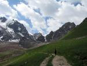](https://www.tkg.org.ua/node/16098)  

Как в таких местах не ходить в горы?

ну как там может не развиваться туризм.

Опыт начал приходить сразу после нашей встречи. Поднявшись к горнолыжной базе "Чимбулак" Александр предложил не привлекать внимание яркой палаткой, тем более что для Памира были соответствующие спальники, в результате, поднявшись на 100 метров выше базы, устроились на ночь под открытым и звёздным небом. Красиво, незабываемо, впечатляет.

## Тянь-Шань

Хозяин достал, "горняшка" мне не  
нравится оставляю Вас на едине.

Твой организм.

В процессе акклиматизации планировали подняться на пик Абая. На леднике Богдановича по договорённости встретится с группой. Сомнения закрались когда присланные группой координаты лагеря не совпали на GPS, разница была всего-то в хребет. Поняли что будем сами.

После прихода на ледник Богдановича было решено сходить на пер.Пионер и пер.Комсомола. Цели две. Александру акклиматизироваться и напомнить организму что такое высота, у него предыдущий опыт 5200. Мне надо вообще с высотой познакомится. Выше 2000 метров до этого я не подымался.

Сразу стало понятно одно, рекомендации физически работать после выхода на новую высоту составляли не просто так. В день выхода на ледник мы опрометчиво после обеда решили полежать минут двадцать. Всё продлилось до вечера, а после ужина и до утра.

Утром стало легче. Решили без завтрака подыматься на пер.Пионер 3800м. Погода относится к нам благосклонно. Довольно быстро вышли на перевал, попили чаю и сбежали вниз.

[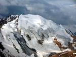](https://www.tkg.org.ua/node/16104)  

Вид с перевала Пионер

К этому времени рядом стоящая группа из Томска только проснулась и начала собираться через пер.Учитель начинать свой маршрут.

Хочется заметить начали они прекрасно, слажено и технично, разумно двигаясь. Но, подойдя под скалы, и к зияющей трещине развязали связки, и по одному без перил проходили траверс над трещиной. Но как сказал Юрий Левитанский "Каждый выбирает для себя..."

[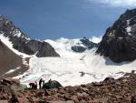](https://www.tkg.org.ua/node/16105)  

Ледник Богдановича и группа из Томска

После обеда было решено завершать акклиматизацию подъёмом на пер.Комсомола 4000м. Лёгкий путь по леднику быстро вывел нас на перевал. Тут то и пришёл аппетит. Время ещё есть и я заметил уже знакомый мне по Уралу взгляд Александра когда он с перевала посмотрел в сторону пика Комсомола, нынче пик Назарбаева 4300.

[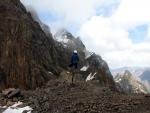](https://www.tkg.org.ua/node/16106)  

Я знаю о чём Александр сейчас думает.

Быстро было решено идём, пять минут на снимание кошек и набор высоты. Тут начинаю понимать, что как для первого опыта перебор. Поднимались час, зато какой длинный час. Пока что все перепробованные методы движения и дыхания не давали нужный результат. В конце концов GPS показывает нужную высоту. Сидим, наслаждаемся видом.

[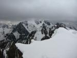](https://www.tkg.org.ua/node/16107)  

Тянь-Шань

Спуск в низ был хоть и быстрый но очень тяжёлый, организм пожелал удачи и удалился в неизвестном направлении. В памяти остался только процесс снимания кошек на камнях около палатки и рисовый суп на ужин, который вначале мой желудок подозрительно легко принял. Это было только вначале...

## "Акклиматизация" в Алма-Ате

\- Вы из Кемерово? А группа где?  
\- Кушать пошла?  
\- А с нами встретится? Почему Вы опоздали?  
\- Вас искали, не нашли, вот покушать пошли.

К утру стало ясно, к этой высоте привык, аппетит бешеный, силы есть. Можно спускаться в Алма-Ату и встречаться с группой. Как назло именно в этот день не работали подъёмники с Чимбулака, ну значит бегом вниз, наверху уже снег, внизу - дождь, у нас непонятно что. В автобусе в голову приходят глупые мысли: а зачем, если 3500 так плохо что на 7100 будет? Слава богу их быстро развеяли объяснив что я впервые выше 2000, все естественно.

На альпбазе нас ожидал неприятный сюрприз, группы нету. Не приехали, спутниковый телефон выключен. Возможно, к вечеру приедут. А пока надо продолжать начатое в горах, точнее подготовку, посещение бани и поедание на лавочке парка дыни разрезанной ключами от квартиры изрядно подняло настроение и придало какого-то внутреннего спокойствия, словом явно способствовало акклиматизации. Но группа к вечеру и даже к утру так и не появилась. Начали планировать самостоятельный доезд до Оша, а оттуда на Луковую. Ну а там разберёмся. Продукты и снаряжение всё с собой, документы в Оше можно и самим забрать, можем работать в паре и автономно. Но тут, ближе к обеду на базу зашли двое ребят с эмблемами на одежде явно нашей группы. После короткого знакомства поняли что они решили не идти на Богдановича для встречи с нами и пробыли в горах на сутки больше. Выезд будет сегодня. Всё, приходит понимание что путь назад становится невозможным, надо брать себя в руки и вспоминать о чём мечтал последний год. Приезжает группа. Действительно участников девять, из транспорта Нива и УАЗик "Буханка", значит будем ехать с комфортом. Небольшие закупки в Алма-Ате, заезд на СТО и всё, едем на Памир.

[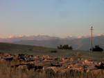](https://www.tkg.org.ua/node/16108)  

Казахстан

## Киргизия

\- С Вас 10 долларов экологического збора  
\- За что? Вы же из ГАИ?  
\- Ну так просто дайте денег.

К сожалению, в первый день заехать далеко не удалось, сразу за Ама-атой произошло замыкание в УАЗе, соответственно остались без света. Как только стемнело, пришлось ночевать посреди поля. Зато пораньше утром выехали в дорогу. Заметили своеобразную специфику данных дорог.

Останавливают все работники ГАИ, даже просто так. Но если в Казахстане ищут повод взять деньги, то в Киргизии все заканчивалось только проверкой. Перед таможней был произведён заезд на СТО с целью ремонта проводки УАЗа.

При прохождении таможни в будущем можно рекомендовать закладывать для этого не менее 2-х часов. Даже пересекая её в обратную сторону в час ночи, эта процедура заняла полтора часа. Дальнейшая дорога до г. Ош проходит по государственной платной трасе, для иностранных авто плата за проезд составляла 10 долларов.

[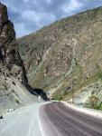](https://www.tkg.org.ua/node/16109)  

Чудесная дорога

Зато после уплаты на будущие 612км. можно ни о чём не волноваться, только следует учитывать отсутствие обменных пунктов. Так что финансовые вопросы надо решать до въезда на трасу. Дорога до Оша проходит через пер.Ала-Бель 3400м., и пер.\_\_\_\_\_\_\_3100м. Долина между этими перевалами потрясающей красоты.

[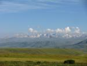](https://www.tkg.org.ua/node/16110)  

Чудная долина

Ночёвки удобно устраивать в любом придорожном кафе. Устроиться можно после закрытия прямо на дастархане. Стоимость символическая, впрочем как и стоимость питания в этих же кафе. Любое блюдо не дороже 20-ти гривен, обязательным элементом есть баранина, и одного блюда вполне достаточно чтоб удовлетворить голод. Единственное неудобство, так это то что проехав всю киргизию в обе стороны нам так и не удалось найти обычный суп.

[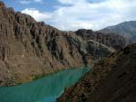](https://www.tkg.org.ua/node/16088)  

Водохранилище в Киргизии

В Оше за пару часов были закуплены продукты на восхождение и забраны пропуска в погранзону. Документы и питание в Базовом лагере и в лагере 1 организовывала фирма "Фортуна тур" Её услуги оказались самыми дешёвыми и минимальными, так как нам нужны были реально только документы. В результате минимальный пакет включил документы и ежедневный ужин на каждого. Так как большинство времени мы были выше лагеря 1, то мы получали полноценное питание в фирме за счёт пропущенных ужинов.

[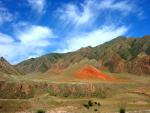](https://www.tkg.org.ua/node/16089)  

Краски Киргизии

Вторая ночь в Киргизии запомнилась всем оригинальностью. Сразу после спуска с пер.Чийчирик 2402м., нам посоветовали остановится на ночь на базе отдыха. Оказалось что у них 2бассейна которые наполняются водой из термального источника, там же и баня. Стоимость на одного 10 гривен. Но с 23 до 6 оставляют открытым только один бассейн и баню, вход и время не контролируются. Естественно там же мы и остановились на обратном пути.

Дорога до пос. Сары-Таш рога значительно хуже, летом проводился ремонт и смена покрытия. Особенно тяжело машинам выезжать на пер.Талдык, всё же 3615м. Но Панорама открывающаяся с перевала стоит всех усилий мотора.

[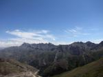](https://www.tkg.org.ua/node/16090)  

Вид с перевала Талдык

К вечеру приехали на поляну Ачик-Таш. Всю дорогу от посёлка Сары-Таш поражались габаритами монстров которые возвышались над Заалайским хребтом. Приходит понимание того что долина и так на высоте 3000м., а тут ещё на вершины нельзя не смотреть не подымая голову.

[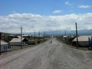](https://www.tkg.org.ua/node/16091)  

Алайская долина с пос.Сары-Таш

По приезду оказалось что на дороге, из-за открытия багажника УАЗа, осталась часть ковриков и продуктов, особенно чай. Ну что же, ковриков Мы брали с двойным запасом, чтоб не носится, прийдётся носить. Ну а чай к щастью смогли взять у Красноярской группы.

## Пик Ленина 7134м

.

\- Вы только жене не рассказывайте, я же ей  
обещал выше 4400 не подниматься  
(Слова руководителя на спуске с вершины)

За ужином, в день приезда, было решено не придерживаться используемого всеми графика восхождения. Всё же группа оказалась сильная, да и в дороге после Тянь-Шаня организм восстановился прекрасно. В результате решили делать линейный подъём с 3500 до 5400, спускаться до 4400, и затем линейно подниматься на вершину. Причём если организм будет работать нормально, после спуска на 4400 максимально вытягивать выше 5400. Также решено было разделится на 2 группы которые будут работать с разрывом в сутки, чтоб можно было организовать эффективную подстраховку группы которая находиться выше.

Из лагеря вышли не рано, в 10:00.

[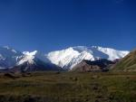](https://www.tkg.org.ua/node/16092)  

Пик Ленина манит к себе

Вместе не спеша поднялись на пер.Путешественников, подъем не сложный и приятный. Правда некий дискомфорт составляет наличие разбитого лошадниками болота на тропе. С перевала пошли уже каждый со своей скоростью, длинный траверс без набора высоты сопровождался ветром и снегом. Брод через ручей также не составляет проблем, используя палки можно легко и безопасно перепрыгнуть. К 16:00 все с разрывом в 10 минут пришли в лагерь 1 4400м. Вечер был посвящён распределению груза, продуктов и просто отдыху.

[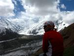](https://www.tkg.org.ua/node/16093)  

На пер.Путешественников

Подъём в 4 :30 утра, идёт снег, собираем вещи, в лагере остаются Александр и Лиза ждать руководителя Игоря и Анну. На акклиматизационный выход идут два Андрея, Стас, Я и Света. За 15 минут подойдя под начало подъёма одеваем кошки, организовываем связки и постепенно двигаемся.

[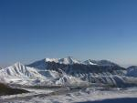](https://www.tkg.org.ua/node/16094)  

Лагерь 1

Начинает ощущаться новая высота. Разрыв между связками существенный, пока из-за неопытности часто отдыхаем и быстро устаём, это уже на следующем выходе научимся идти медленно, но стабильно, и дышать с одинаковым периодом. А пока чётко на склоне выделяем какая группа идёт впервые, а какая после отдыха.

Довольно скоро появляются первые трещины, проходятся они без проблем.

[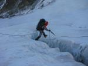](https://www.tkg.org.ua/node/16095)  

Первые трещины

\- Вы кто?  
\- Мы гастарбайтеры из Узбекистана.

\- А здесь что делаете?  
\- Портерами работаем.

Света Антимонова как журналист достаёт камеру и начинает узнавать расценки.

\- 3500-4400 1 евро за килограмм,4400-5400 - 7 евро/кг, 5400-6400 - 14евро/кг,6400-7134 - 28евро/кг. Ну общем если захотите на вершину занести 1 кг гречки прийдётся "выложить" 50 евро. Турфирме у которой проживаем и питаемся отдаем 10%, и должны принимать участие во всех спасработах. Вот вчера снимали двух американцев, перед лагерем 2 оба улетели в трещину, один насмерть, у второго - перелом ключицы.

Попрощавшись удивляемся как быстро и легко они пошли наверх будучи солидно гружёнными.

До "сковородки" подъем довольно скучный и утомительный. Но на неё мы всё же вышли в 13:00. Первая мысль: и ничего страшного пугали трещинами, ну не маленькие, но пройти можно.

[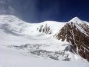](https://www.tkg.org.ua/node/16096)  

"Страшная" "Сковородка"

За пару переходов пересекаем "сковородку", на ней встречаю двух мужчин из Киева, получаю задание передать привет людям в Винницу, говорю что они сейчас должны быть рядом на пике Коммунизма. К 14:00 попадаем в лагерь 2, довольно много палаток и людей, расчищаем место на окраине лагеря, чтоб не топтаться в этом мусоре. Весь вечер посвящён питью и общению на окологорные темы. К утру самочувствие у всех нормальное, закрепляем палатку и за 2 часа спускаемся вниз, там обед, карты и прогулки по морене. Хорошо,4400м., а как дома. Знал бы что будет позже.

[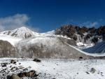](https://www.tkg.org.ua/node/16097)  

Во время прогулки

За ужином решаем не тратить время, организм не бастует, погода устоялась, можно идти выше. Поэтому на следующее утро опять ранний подъём, загрузка очередной палатки в рюкзаки и уже знакомый путь по леднику в лагерь 2,5400м.

[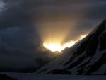](https://www.tkg.org.ua/node/16099)  

Солнце показывает куда идти

Подымаемся обеими группами почти в 2 раза быстрее, обед, чай, распределения снаряжения, первая группа уходит выше, очень легко и не спеша. Палатку окапываем на высоте 5800м., перед началом подъёма на в.Раздельная.

[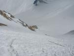](https://www.tkg.org.ua/node/16100)  

Лагерь 2 с пика 50 лет Узбекистана

Ночуется прекрасно, главное нету мусора и толп народу. Удивляюсь своему организму. На утро запланированный подъем на 4 утра. Знаем что час потеряем на завтрак и термосы, поверили советам и взяли не очень хорошую посуду, теряем много времени.

[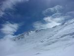](https://www.tkg.org.ua/node/16101)  

Где то там вершина

Утро морозное и немного ветреное. Стас жалуется на холод и посинение рук, советуемся, в результате остаёмся вчетвером, Стас из-за проблем с сердцем уходит вниз. Остальные постепенно начинают подыматся на Раздельную.

[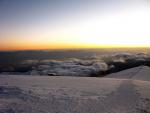](https://www.tkg.org.ua/node/16102)  

Рассвет на 5800

Идётся очень трудно, за ночь насыпало по колено снега, ступени не хотят держать. За 2 часа набираем всего 300 метров высоты и очень сильно устаём. У меня мёрзнут ноги, ожидал этого, не справляются ботинки.

На вершине очередной промежуточный лагерь, тут хоть почище, и людей меньше, но нам выше, радует что ноги отошли. Продолжая двигаться со своим темпом, солидно растягиваемся. Труднее всего Андрею Колмогорову, он сильно отстал. После небольшого сброса высоты начинаем длинный подъём по ребру на 6400. Какой же это длинный подъём. Вокруг красивейшая и безоблачная панорама Памира, но надо переставлять ноги. К 16:00 довольно вымотанные мы приходим на 6400, решаемся тут ставить палатку. Копать тяжело, ставить палатку тяжело, ходить тяжело. Куда делись силы? Окапывание палатки занимает полтора часа. К этому времени приходит отставший Андрей. Уложившись начинаем обсуждать день, самочувствие у всех нормальное. Решаем опять вставать в 4 утра и потихоньку, не спеша, но на вершину. Пару сеансов связи с руководителем и спать, много спать.

Утро морозное и прохладное, заливаем термосы и с разрывом в час выходим. Тут никакой спешки, тихо и в рамках своих сил. Людей ещё нету, солнце не вышло, дует сильный ветер. Видимость прекрасная. Перед "ножом" вижу что Андрей Кирюхин развернулся, подходит, спрашиваю в чём дело, оказывается замёрз в ноги, как позже выяснилось приморозил палец. Жалко конечно, но правильно. Ведь человек как турист состоится тогда, когда впервые отвернётся от вершины. Желаю удачи, сам подхожу под перила, пока достаю ледоруб, вперёд проскакивают две девушки с Польши. Как я об этом потом пожалел, и так в ноги холодно, а одна из них ещё и начала кричать что боится, вошла в ступор и ели двигалась. Тут то я серьезно заволновался про свои ноги. С огромной злобой на полячку всё же похожу последние метры перил и понимаю что перепад высоты закончен, теперь потихоньку, но наверх. Каждый час сеанс связи, жалуюсь что в ноги холодно, жутко холодно, в ответ слышу "подбадривающее" работай. Но чувствую, и это главное, значит можно идти, GPS показывает 7000, счастья полно, с трудом снимаю варежки и делаю пару снимков, пик Коммунизма, Корженевского, Революции как на ладони, но руки мёрзнут, просят вернуть варежки.

Впереди маячит фигура Светы Антимоновой. Наступает некое состояние спокойствия и умиротворения. Ещё полтора часа и всё, отметился, пора вниз, ноги болят.

[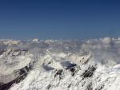](https://www.tkg.org.ua/node/16103)  

Зачем мы ходим в горы?... Мы это знаем...

Быстро, очень быстро спускаюсь, Усталость приходит только при подходе к палатке. В ней сидит Андрей Колмогоров.

Оказывается, не хватило сил, остался в палатке, завтра с другой группой попробует, Андрей Кирюхин ушёл на 5400. Время обеденное, пол часа на растирание ног, убедившись что всё нормально, ухожу на 5400. Тут-то силы начали уходить и организм расслабляться. Взять себя в руки пришлось на спуске до Раздельной когда зацепился кошкой за кошку, сразу пришло ощущения того что и где происходит. Вниз, вниз, вниз. Куча народу ползут вверх, слышу искренние поздравления, при спуске с Раздельной встречаю Александра, на вершину он не надеется, организм не пускает, сил нету, планирует выйти на Раздельную и вернутся на 5400. Немного ниже Игорь руководитель, поздравляет, командует Андрею и Свете спускать палатку до 6100. Уже перед спуском с 50 лет Узбекистана, во время отдыха приходит гордость и понимание объемов проделанной работы. Внимание отвлекает севшая на снег бабочка, высота 5700, а тут бабочка.

Медленно дошёл до палатки, Андрей кипятит чай, устраиваемся отдыхать.

Теперь главное не сильно расслабиться, нам с ним здесь сидеть на подстраховке руководителя. Остальные постепенно сходят вниз.

Сутки безделья на 5400 и через день пришёл Игорь. Собираем палатку и вниз. Идём быстро. Через пару часов и мы в лагере 1, ну гулять так гулять, обедаем и быстренько сбегаем в базовый лагерь, в результате у Игоря 2600 а у нас с Андреем 1900 метров сброса высоты за 5 часов.

Ну внизу как у всех: арбузы, ужин, отдых, обсуждение. Весь процесс восхождения со спуском в лагерь двумя группами занял 9 дней, из 9-ти человек выше 7000 побывали трое. Кажется результат приличный.
