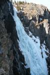
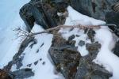
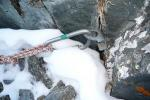
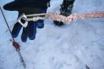
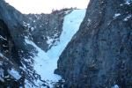

Поскольку материалы разбора данного НС рекомендуются для ознакомления всем туристам - мы сочли нужным поместить их на сайте. Не претендуя на авторские права Красноярской МКК, я попытался скомпиллировать материал в более наглядный для восприятия вид и позволил себе выделить прописными наиболее важные детали, связанные с трагедией. Безусловно, все рекомендации МКК верные. Но мне хотелось бы, чтобы каждый из читавших материал, попытался оказаться в роли того или иного персонажа и понять мотивы, заставившие поступить так, а не иначе. Умереть, оказывается, очень легко. И тем легче – чем меньше мы это допускаем...  
Вывод простой: допускайте, что вы можете умереть. Принимайте ВСЕ меры, чтоб этого не случилось...

[Олег Янчевский](https://www.tkg.org.ua/user/329)

* * *

**Справка о разборе несчастного случая в спортивном туристском походе в группе Попова В.Н.**

Дата разбора: 21.02.2007  
Место разбора: г. Красноярск

Разбор несчастного случая проведен Красноярской краевой маршрутно-квалификационной комиссией.

Присутствующие:  
Пашкевич В.М., председатель КМКК,  
МС Кучерявый В.О., руководитель комиссии горного туризма, член КМКК  
Кожанов Ю.А., КМС, руководитель комиссии ТМ, член КМКК  
Кожанова Е.А., КМС, руководитель т/к "Ирбис", член КМКК, член комиссии лыжного туризма  
Гуляев Т.А., член КМКК, член комиссии горного туризма  
Грудинова Л.А., МС, член КМКК, председатель кадровой комиссии, член комиссии лыжного туризма  
Артемьева М.А., секретарь КМКК, секретарь президиума краевой федерации СТ.  
Аронова Т., член комиссии пешеходного туризма  
Шведов Е.Г. - участник группы  
Михайлов А.Ю. - участник группы

1.  Дата и время несчастного случая: 11 февраля 2007 г., между 8.00 и 9.00 утра.
2.  Место происшествия НС: замерзший водопад на ручье, соединяющем оз. Улуг-Холь и оз. Пазарым (без названия). Высота водопада согласно карте - 25 м. По оценке участников - приблизительно 50 м, с вертикальными участками, после небольшого выполаживания, еще один - 8 - 10 м. По оценке спасателей - 80 м. Согласно таб.2 "Оценка категорированного препятствия" методики категорирования лыжных маршрутов - 1Б.
3.  Вид туризма, категория сложности: лыжный, 3 к.с.
4.  Маршрут группы:

Планируемый:  
т/б "Снежный барс" - руч. Стоктыш - в. Кохош, 2524 - р. Курукуль - р. Она - р. Каратош - оз. Пазарым - верх. р. Пазарым - пер. Пограничный, 2234, н/к - оз. Кара-Холь - р. Манагы - устье р. Хайрлигмес - р. Манагы - р. Колаш - пер. на оз. Улуг-Холь - оз. Пазарым - пер. Кызыл-Оюк, 2259, н/к - р. Кызыл-Кызыксу - рад. г. Каракош, 2930, 1А - р. Кызыл-Кызыксу - р. Ср. Арых - р. Она - р. Сараткол - пер. 2337 - траверс - т/б "Снежный барс".

Реально пройденный: т/б "Снежный барс" - руч. Стоктыш - в. Кохош, 2524 - р. Курукуль - р. Она - р. Каратош - оз. Пазарым - верх. р. Пазарым - пер. Пограничный, 2234, н/к - оз. Кара-Холь - р. Манагы - устье р. Хайрлигмес - р. Манагы - р. Колаш - пер. на оз. Улуг-Холь.

7.  Заявленное количество участников в группе: 10 человек. Реально пошло 7 человек. МКК о сокращении группы поставлена в известность.
8.  Фамилии, имена, отчества фактических участников группы: Есипенко Антон Евгеньевич, Булгаков Сергей Валерьевич, Санжиева Аюна Пирангалаевна, Шведов Евгений Геннадьевич, Михайлов Александр Юрьевич, Беляк Александр Алексеевич.
9.  Фамилия, имя, отчество руководителя группы: Попов Вячеслав Николаевич
10.  Полное наименование организации проводящей спортивный поход: группа сборная.
11.  Номер маршрутной книжки: 01-07 л
12.  Полное наименование МКК и Ф.И.О. членов МКК, давших положительное заключение на проведение спортивного туристского похода: Красноярская краевая МКК (Васильев А.В., Шнаров С.А., Пашкевич В.М.)
13.  Сведения о пострадавших: Фамилия, имя, отчество, год рождения, место работы, должность, опыт предыдущих походов, исход: травма, летальный (с указанием причин).

Попов Вячеслав Николаевич, 1963 г.р., частный предприниматель, 6 лыжн. уч., 4 лыжн. рук; 6 горн. уч., 4 горн рук; 6 водн.уч, 4 водн рук. (справки не представлены). Исход - летальный, мед. заключение не представлено.  
Есипенко Антон Евгеньевич, 1985 г.р., студент СибГТУ, 5 курс, 2 горн. уч., 4 горн. уч (справки не представлены). Исход - летальный, мед.заключение не представлено.  
Булгаков Сергей Валерьевич, 1983 г.р., ИВМ СО РАН, слесарь-ремонтник, 2 лыжн. уч. (справки не представлены). Исход - летальный, мед. заключение не представлено.  
Санжиева Аюна Пирангалаевна, 1977, "Рок Пилларс", менеджер, 3 горн. уч, 2 горн. рук., 1 лыжн. уч. (справки не представлены). Исход - летальный, мед. заключение не представлено.

1.  Соблюдение утвержденного маршрута: маршрут до места происшествия полностью совпадает с заявленным.
2.  Соблюдение графика движения: отставание от графика на 1 день вызвано невыполнением графика первого дня. Нагонять график не пытались, далее шли по заявленному графику с отставанием в 1 день.

4.  Темп и продолжительность движения в день НС: темп и продолжительность движения в день происшествия - нормальные. Группа успела отойти от места ночевки на 200 м. После происшествия действия группы по времени выяснены только приблизительно.
5.  Подробное описание участка, на котором произошел НС: ледопад на ручье, соединяющем оз. Улуг-Холь с оз. Пазарым. Высота по карте - 25 м. По оценке участников - метров 50. Участники располагались на ледяной полке 6 х 2,5 м, присыпанной рыхлым снегом. Навеска сделана на скальных крючьях, забитых в замерзшие скалы на берегу ручья. Ниже полки отвесная часть ледопада, снизу - выполаживание, засыпанное глубоким снегом?примерно 1,5 м.
6.  Метеорологические условия к моменту НС: солнечное утро, без ветра, Температура около ?10оС.

**_Объяснительная_**  
**_От Беляк Александра Александровича_**_._

_Вечером 10 февраля, накануне трагедии Вячеслав Попов и Антон Есипенко прошли по ручью от места последней ночевки до водопада. С целью оценить обстановку вокруг ледопада. Вернувшись в лагерь, Слава сообщил, что высота льда не 20 метров как было заявлено ранее, а 40. Но спуск все равно состоится. Не помню кто точно предложил обойти лед, но ВЯЧЕСЛАВ ОТВЕРГ ЭТО ПРЕДЛОЖЕНИЕ Т.К. ЛЕД БЫЛ ЗАНЕСЕН В МАРШРУТ. Со всех собрал имеющиеся репики чтобы сделать "самосброс" для бура. Сказал, что утром сразу одеваем обвязки и в них идем до самого льда. Непосредственно возле льда одеваем кошки. СПУСК ВЯЧЕСЛАВ СПЛАНИРОВАЛ В ТАКОМ ПОРЯДКЕ: СНАЧАЛА ПЕРВЫМ ИДЕТ ОН, ДАЛЕЕ В ЛЮБОМ ПОРЯДКЕ КТО КАК ХОЧЕТ, А ПОСЛЕДНИМИ ДОЛЖНЫ БЫЛИ СПУСТИТЬСЯ Я И АНТОН, КАК БОЛЕЕ ОПЫТНЫЕ._  
_Утром 11 свернули лагерь, собрали рюкзаки.  
Одев обвязки пошли вниз по ручью. Первым ушел Антон. Я вместе с Сергеем догнали его возле водопада. Примерно в 8-10 метрах от ледяной полки сели одевать кошки.  
Антон был уже в кошках. Пока я одевался, он забил крюк. Как он его забивал я не видел. Потихоньку подошли и все остальные. Я перешел ручей и подошел к Антону.  
Увидев, что он бьет крюк, как оказалось второй, я спросил: "Сколько бьешь крючьев на базу?". Он ответил что два. С удивлением я спросил почему два, на Антон ответил: "А больше нет"._ (Со слов Беляка, у Славы было еще 3 ледобура)_. В этот момент подошел СЛАВА, СПРОСИЛ ЗАБИЛИ КРЮЧЬЯ ИЛИ НЕТ.  
АНТОН ОТВЕТИЛ ДА. СЛАВА СПРОСИЛ - ОБА "ЗВЕНЯТ"? Антон ответил что да. Слава дал мне репик сложенный в несколько раз и сказал, чтоб я вязал базу. Я взял РЕПИК, ПРОДЕЛ ЧЕРЕЗ КРЮЧЬЯ, хотел завязать ВСТРЕЧНУЮ ВОСЬМЕРКУ. СЛАВА ЗАБРАЛ У МЕНЯ ИЗ РУК РЕПИК, ОБЪЯСНИВ, ЧТО Я ДОЛГО ВОЖУСЬ, И ЗАВЯЗАЛ САМ "ПЧЕЛКУ", мотивируя это тем, что она проще развязывается после использования. Отправил меня за репиками, сказал что они ему понадобятся. Пока я их отвязывал от рюкзака, Слава навесил перильную веревку. Сказал что мы все слишком долго возимся и НУЖНО ТОРОПИТЬСЯ. Я отвязал лыжи от рюкзака, отдал Славе репик бросив ему в руки.  
Какое-то время провозился возле рюкзака. Выйдя на полку, увидел Славу, встегнутого "восьмеркой" в веревку. ОН ПОВТОРИЛ, ЧТО ПОСЛЕ НЕГО СПУСКАЮТСЯ, КТО КАК ХОЧЕТ, ПОСЛЕДНИМИ Я И АНТОН. На полке стояли все, кто где именно затрудняюсь ответить. Но точно помню что Антон справа от веревки, а я слева. Еще левее, чуть позади меня стоял Женька и, по-моему, Михайлов Саня._

_Слава нагрузил веревку откинувшись за перегиб. В этот момент я услышал звон и получил удар в правое плечо. В эту же секунду Антон, Аюна и Сергей попытались схватить осаживающегося в пропасть Вячеслава, сделав шаг в его сторону. Но больше половины корпуса Славы было уже за перегибом. И он по инерции стащил за собой всех троих. С полки ничего не было видно. Я попытался оббежать с левой стороны по скалам,чтоб увидеть то, что происходит внизу. Но ничего не было видно. На мой крик - "как вы там?" - снизу услышал ответ - "Плохо". За мной так же побежали Женька Шведов и Михайлов Саня.  
Женька спросил: "Нам за тобой?". Я ответил, что здесь не спуститься и надо оббегать и спускаться по правой стороне каньона. Женька побежал первым, Саня взял аптеку и побежал за ним. Я достал из рюкзака свою маленькую аптеку и тоже побежал.(Беляк)_

1.  Действия и положение участников в момент НС: руководитель Попов В.Н. готовится осуществлять спуск по перильной веревке при помощи спускового устройства. Есипенко А.Е. находится рядом с ним, сидя на корточках снимает фотоаппаратом спуск. Булгаков С.В. находится рядом с ним, сидит на полке, снимает фотоаппаратом спуск. Санжиева сидит рядом с Булгаковым на корточках. Михайлов стоит слева от всех ближе к скалам.  
    Шведов стоит по центру полки у скал лицом к спускающимся. Беляк ушел к рюкзакам за вспомогательным репшнуром.
2.  Действия пострадавших в момент НС: После того как Попов нагрузил перильную веревку, один из крючьев, на которых она закреплена, вылетел из скалы, перильная веревка сошла с навески. Есипенко, Булгаков и Санжиева, находившиеся рядом с веревкой, инстинктивно схватились за нее, пытаясь задержать падение Попова, и упали вместе с ним.

_Беляк: Женька спустился первым и подбежал к Славе. Я спустился вторым. Ближе к ледопаду лежала Аюна. Я пощупал пульс и понял, что она умерла, т.к. под ее головой было пятно крови и пульса не было, она лежала в неестественной позе. Чуть ниже были Слава и Сергей. Ниже всех находился Антон, подбежав к нему, увидел рану на левой кисти. Перебинтовав спросил что у него болит. По его словам понял что у него шок. Он лег на снег, я подложил под него жилетку. Он пожаловался на боль в руке. Разрезав рукав я ничего там не обнаружил. Вколол ему ампулу кетанова и новокаина. Осмотрев и общупав, понял, что есть повреждения в районе таза. Поднялся чуть выше по склону и увидел, что Женька перебинтовывает голову Вячеславу. На вопросы где у него болит Слава не отвечал, только мычал. Я вколол ему кетанов и новокаин. Осмотрел грудь, руки, ребра.  
Повреждений не было видно. Слава то пытался сесть, то лечь. Сергею тоже вколол обезболивающее. Парни подложили под него рюкзак. Славу посадили возле Сергея, но он старался лечь на снег. Я отправил Женю наверх чтоб он сбросил рюкзаки. Он убежал, после чего сбросил их вниз. Вытряхивая содержимое рюкзаков на снег, достал палатку, коврики и спальники. Так как из-за большого наклона склона не было_

_возможности поставить палатку, лопатой в склоне сделали полки ступеньками и воткнули лыжи, чтоб пострадавшие не скатывались друг на друга. Уложили коврики, положили на них Славу и Антона. Сергей уже лежал на рюкзаке, ему под ноги положили половину коврика. Палатку натянули сверху шатром. В вещах нашли баралгин. Я вколол каждому по ампуле. Пострадавшие жаловались, что мерзнут. Их растирали финалгоном. Мерзли только конечности. Антона снизу подняли наверх и уложили на коврик под палатку. Всех троих накрыли спальниками. У Славы сломана нога. Я ее зафиксировал, примотав лыжную палку._  
_После этого Женька, Саня и я стали решать, кто побежит вниз за помощью. Я сказал, что бежать нужно вдвоем. Женька сказал, что не умеет ставить уколы. Я сказал - тогда бегите вместе с Саней, возьмите рюкзак, еды, спальник. Сам остался наверху._  
_Сергей и Антон были в сознании, Слава же мычал в бреду. Я вколол всем троим остатки ампул обезболивающего. Нашел таблетки тоже обезболивающие и дал выпить с теплым чаем. По очереди всем троим растирал руки и ноги, так как они мерзли._  
_Первым умер Вячеслав Попов. Антон терял сознание, я приводил его в чувство. Дал ему и Сергею по столовой ложке коньяка, чтоб разогреть кровь. Но это не очень помогало. Антон сказал, что у него мерзнет нога. Хотя до этого он на нее не жаловался. Я снял ботинок и понял, что у него перелом в районе голеностопа, так как шла кровь и видно было деформацию.  
Я перевязал ногу бинтом и одел ему теплый носок. Растирал то одного, то другого. Вторым умер Антон. Я делал ему массаж сердца и искусственное дыхание, но это ни к чему не привело. Сергей держался дольше всех, но ему трудно было дышать.  
Он стал задыхаться и отключился. Пульса не было, я сделал массаж сердца. Смог запустить сердце, он зашевелился, но не смог вдохнуть. Как я понимаю, легкие были наполнены кровью, так как при искусственном дыхании раздавался характерный звук. Больше я сделать ничего не смог._  
_Наступали сумерки, пришлось чуть ниже по склону под скалой выкопать в снегу убежище, в котором и прожил до 15-го. Утром 15 спустился по ручью до озера Пазарым, где и встретил спасателей._  
_14.03.2007_  
**_Беляк_**  
_ОБЪЯСНИТЕЛЬНАЯ_  
_Шведов Е.Г._

_До дня трагедии группа прошла большую часть маршрута. К моменту происшествия физическое и моральное состояние участников группы было рабочим, между участниками конфликтов не возникало. За день до трагедии на ночевку встали в 17.30. На разведку ходили Попов и Есипенко. С вечера Попов собрал у всей группы репшнуры, вероятно, для самосброса. В день трагедии выход был примерно в 8-9 часов утра. На протяжении всего похода я нес котлы, а Михайлов палатку, поэтому из лагеря обычно уходили последними. В этот день я, Михайлов и Санжиева вышли из лагеря последними. Когда подошли к ледопаду, Есипенко готовил перила. Чем конкретно занимались Попов, Булгаков и Беляк, сказать не могу, так как помню смутно. ПОПОВ ПОРУЧИЛ БЕЛЯКУ ПРОВЕРИТЬ у остальных участников, как сблокированы обвязки. Я перевязал САНЖИЕВОЙ БЛОКИРОВКУ, У НЕЕ БЫЛ ЗАВЯЗАН ПРЯМОЙ УЗЕЛ, я перевязал на встречный._

_Со слов Беляка, крючья вбивал Есипенко, а базу для спуска вязал Попов.  
БАЗА БЫЛА СДЕЛАНА ИЗ СДВОЕННОГО РЕПШНУРА НА ДВУХ СКАЛЬНЫХ КРЮЧЬЯХ, ВБИТЫХ_  
_В СКАЛЫ НАД ЛЕДОВОЙ ПОЛКОЙ ПРИМЕРНО ПОСЕРЕДИНЕ. НЕМНОГО НИЖЕ, НА САМОЙ ПОЛКЕ ВКРУЧЕН ЛЕДОБУР ДЛЯ ОРГАНИЗАЦИИ САМОСБРОСА (ЕГО ДОЛЖЕН БЫЛ ОРГАНИЗОВАТЬ ПОСЛЕДНИЙ). На всех участниках были одеты кошки. К месту спуска мы подошли по ручью. Навеска была организована на ледовой полке 2,5__x6 метров.  
Полка была засыпана рыхлым снегом толщиной 5-10см. КРАЙ ПОЛКИ - ЛЕД. Ледопад сверху отвесный, внизу выполаживается, там глубокий снег. Кто как стоял в момент спуска Славы, сказать не могу, не помню. Точно помню, что я стоял спиной к скале, в которую были вбиты крючья, и смотрел на Славу. В момент спуска на Славе был его рюкзак, в который были вставлены лыжи. С собой у него была петля из веревки 10мм и несколько петель из репшнура. Было ли у него с собой что-то еще из снаряжения, не помню._

Из опроса:  
\- Как прочно закреплена веревка проверяли?  
Шведов: Нет. Заранее веревку не дергали. По крайней мере, я этого не видел.

_Как только Слава встегнул спусковое и сделал шаг, нагрузив перила, я услышал хлесткий удар и в мгновение Слава скрылся из виду. Помню, что он закричал не громко. Так же помню, что за ним скатились Антон, Сергей и Аюна. Аюна скатилась последней. В первое мгновение после этого, я даже не понял, кто точно из группы сорвался.  
Понял это только после того, как оставшиеся наверху Михайлов, Беляк и я побежали к сорвавшимся . Мы начали обходить ледопад слева. Первым шел Беляк, затем Михайлов. Немного спустившись, Беляк остановился и сказал нам подождать наверху, не спускаться к нему. Он крикнул два раза: "Как вы?". Кто-то ответил: "Плохо". Я взял рюкзак, а Саша Михайлов взял аптечку и мы побежали с другой стороны. ТАМ ДОВОЛЬНО ЛЕГКИЙ СПУСК. Я спустился первым. Аюна лежала лицом вниз, в крови, рядом Славина лыжа. Неподалеку от нее Слава, на нем рюкзак. Потом Сергей. Антон дальше всех. Беляк сказал: "Спасаем тех, кто подает признаки жизни". Он подходил к Аюне, проверил пульс, пульса не было. Слава стонал, Антон кричал что-то. Сергей потом разговаривал, говорил, что ноги мерзнут. Я начал растирать ему ноги. Михайлов побежал к Славе, Беляк к Антону. Беляк вколол всем новокаин. Пытались определить какие травмы у Славы. Он говорить не мог и я попросил его язык высовывать в знак согласия. Так выяснили, что руки и ноги не болят, а болит грудная клетка. Ему было тяжело дышать, и он все время пытался сесть, а потом заваливался набок. Я занимался Сергеем. Он часто говорил, что ему тяжело дышать и время от времени сплевывал кровь. Явного кровотечения у него не было, но мышцы на ногах были как кисель. Спустя некоторое время Беляк сказал мне лезть наверх и сбрасывать все вещи вниз. После этого я полез наверх за вещами, залез наверх и начал сбрасывать все вещи вниз. Сбросил все вещи, после чего спустился к пострадавшим. За время моего отсутствия Беляк и Михайлов уложили Славу. Потом я с Беляком пошли к Антону. Ему было больно левую руку и ногу. Я взял его на руки, мне Михайлов с Беляком помогали. В три приема его перенесли. Немного понесем, он просит опустить - больно. Всех положили на карематы в несколько слоев, в спальники, укрыли всем что было. Воткнули лыжи, чтоб не скатывались, т.к. участок наклонный. Сколько ушло на это времени не могу сказать - время не засекали. На ходу, пока мы все это делали, обсуждали ситуацию, что надо идти за помощью. Беляк спросил: "Ты сможешь один остаться?" Я ответил: "Ты что. Я ничего не смогу с ними сделать, не смогу ничего им вколоть. Надо остаться тебе. Ты сможешь им ставить обезболивающее, а я только смогу их растирать". Беляк сказал: "Тогда я останусь. Вы пойдете вдвоем. Берите все, что вам надо, только оставьте термос и один котел"._  
_Я начал собираться. Взял фонарик, компас, карту, стал собирать продукты.  
Парни в это время шатер натянули. Кроме этого я решил взять 2 рюкзака. Беляк убедил нас взять его пуховый спальник и 2 каремата, объясняя это тем, что нам в любом случае придется ночевать. Хотя МЫ РАССЧИТЫВАЛИ ДОЙТИ ЗА ОДИН ДЕНЬ. У нас было две карты, мы обе взяли с собой. Шли в кошках, без лыж. Там везде наледь или плотный снег. Потом стемнело. Мы шли по следам охотников, и они увели нас в сторону. МЫ ШЛИ БЕЗ КОМПАСА. Ночью сели отдохнуть, развели костер, сварили суп, поели. Сразу после перекуса достали компасы, увидели, что идем на юго-запад, после чего выбрали направление северо-восток и пошли четко по компасу. Мы стали траверсировать склон, немного теряя высоту. Светало. Спустя какое-то время упали на ручей. Это оказался приток основного ручья, как мы думали тогда, приток Курукуля. Мы тогда решили, что просто не дошли до перевала, а забрались на хребет. После чего пошли по правому берегу основного ручья (как мы тогда думали, по р.Курукуль). Спустя какое-то время, вышли к цирку, увидели явное понижение - неизвестный нам перевал. С этого места взяли азимут, направление оказалось северо-восток. Решили, что за перевалом дорога. Перевалили и вышли на неизвестный нам ручей, дороги не было. После этого стали склоняться ко мнению, что ночью ошибочно свернули не на р.Курукуль, а на р.Она. Утолили жажду и пошли обратно по своим следам к слиянию р.Она и р.Курукуль. Перевалили через перевал, прошли примерно 5 километров. Михайлов постоянно отставал. Я ему сказал, что сегодня нужно дойти до Кохоша либо до места, с которого явно не собьешься с пути, чтобы ночью можно было идти и не сомневаться, что собьешься с курса. Михайлов сказал, что сегодня дойти не сможет, после чего МЫ РЕШИЛИ РАЗДЕЛИТЬСЯ. Я ему оставил спальник, рюкзак, 2 каремата, котел, топор, немного гречки и овсянки. У него были также спички и сухое горючее. Себе я взял пуховку и пошел. Еще до темноты я вышел на слияние р.Она и р.Курукуль, где увидел следы нашей группы и пошел по ним. Ночью несколько раз разводил костер - ноги мерзли. Все остальное время шел постоянно.  
Вышел на базу 13 февраля около 16 часов._  
_Из-за чего могла произойти трагедия сказать не могу, так как петлю после срыва не видел и не изучал.(Шведов)_

1.  Описание личного специального снаряжения погибших:  
    Попов В.Н.: кошки Climbing, обвязка (фирму участники назвать затрудняются), карабины 4 шт, ФСУ. Есипенко А.Е.: кошки Camp, обвязка Аскан, карабины 4 шт, ФСУ.  
    Булгаков С.В.: кошки ВЦСПС, обвязка Аскан, карабины 4 шт, ФСУ.  
    Санжиева А.П.: кошки Simond, обвязка Аскан, карабины 4 шт, ФСУ.
2.  Непосредственная причина НС: Технические ошибки в организации навески. Ошибки в страховке и самостраховке.  
    Точные (технические) причины схода перильной веревки с навески выяснить нет возможности.  
    Фотографии, сделанные спасателями на месте трагедии, картины не проясняют.

    Участники группы, не пострадавшие во время НС, стояли далеко от веревки (поэтому и не схватились за нее, как погибшие) и точно сказать что произошло не могут.

    После разговора с участниками можно предположить следующие варианты:  
    \- перильная веревка была вщелкнута карабином не в узел, завязанный посредине, а непосредственно в базу и поэтому соскользнула с веревки после выхода крюка.  
    \- маловероятно, но могло произойти разрушение карабина, вщелкнутого в узел.

3.  Организация и проведение группой поисково-спасательных и транспортировочных работ:  
    В связи с большим количеством пострадавших и тяжестью полученных ими травм оставшаяся часть группы не могла самостоятельно осуществить транспортировку. Уложив пострадавших и оказав им первую помощь, двое участников группы Шведов Е.Г. и Михайлов А.Ю. отправились за помощью. Беляк А.А. остался с пострадавшими.
4.  Действия других групп и местного населения, находившихся в районе НС:  
    непосредственно в районе НС не было других групп и местного населения. После того как Шведов Е.Г. вышел на турбазу ему была предоставлена рация для связи с МЧС, руководством базы были выделены снегоходы и проводники для спасотряда.

**Решение Красноярской краевой маршрутно-квалификационной комисии от "26" марта 2007 г. по разбору несчастного случая со смертельным исходом, произошедшего 11 февраля 2007 г. в спортивном туристском походе в группе под руководством Попова В.Н. (г. Красноярск)**

Заслушав рассказ Шведова Е.Г. и Михайлова А.Ю., ознакомившись с объяснительной Беляка А.А., рассмотрев имеющиеся материалы, фотографии с места происшествия, сделанные спасателями и специальной экспедицией на место НС, краевая маршрутно-квалификационная комиссия пришла к следующим выводам:  
1\. Непосредственной причиной НС явился выход крюка из скалы, сход перильной веревки с базы и попытка участников, находящихся рядом с Поповым, задержать его падение. Причины схода перильной веревки с навески: После разговора с участниками выяснилось, что перильная веревка была вщелкнута карабином непосредственно в базу за все ветви веревки и поэтому соскользнула с веревки после выхода крюка.  
2\. Из тактических ошибок, допущенных при организации и проведении похода следует отметить:  
\- недооценку сложности и опасности препятствия;  
\- включение в лыжный маршрут 3 к.с., препятствия, превышающего сложность препятствий для этой категории;  
\- невыполнение рекомендации члена МКК, рассматривавшего маршрутные документы, об обходе ледопада по правому берегу;  
\- прохождение ледопада не указанного в маршрутной книжке;  
\- отсутствие достаточного количества снаряжения;  
\- отсутствие полноценно произведенной предварительной разведки предстоящего препятствия;  
\- с группой не обсуждалась тактика прохождения ледопада;  
\- выход всех участников на опасный участок.  
3\. Технические ошибки, допущенные руководителем и группой:  
\- станция организована на скальных крючьях, вбитых в замерзшие разрушающиеся скалы, а не на ледобурах.  
\- станция закреплена на двух, а не на трех точках.  
\- станция не закольцована.  
\- плохо забитый крюк;  
\- не проверена надежность станции;  
\- неправильное закрепление перильной веревки на базе, что привело к сходу перильной веревки с базы после вырывания одного крюка.  
4\. Ошибки в организации страховки и самостраховки:  
\- спуск первого (руководителя) с рюкзаком и без страховки;  
\- отсутствие самостраховки у членов группы, находившихся на ледяной полке.  
5\. Ошибки, допущенные участниками группы при организации и проведении спасательных работ:  
\- отправившиеся за помощью не организовали достаточно комфортные условия для пострадавших, оставив организацию лагеря на одного Беляка (_а на кого еще, если разделение посланных за помощью тоже ошибка?- Олег Янч_).  
\- они же забыли сверить свой путь не только с картой, но и с компасом, что привело к тому, что они заблудились и потеряли время.  
\- Шведову и Михайлову нельзя было разделяться, по крайней мере, до тех пор, пока они точно не вышли на верный путь. Плохое самочувствие Михайлова и разъединение со Шведовым могли привести к более тяжелым последствиям.

Учитывая вышеизложенное, Красноярская КМКК приняла решение: Так как непосредственной причиной несчастного случая стали тактические и технические ошибки при организации страховки и самостраховки, допущенные погибшим руководителем группы Поповым В.Н., к непострадавшим участникам группы (Беляк А.А., Шведов Е.Г., Михайлов А.Ю.) взысканий не применять.

В качестве мер по предотвращению несчастных случаев на спортивных маршрутах МКК считает необходимым: 1. Довести результаты разбора до сведения низовых МКК;  
2\. Рекомендовать членам МКК при рассмотрении маршрутных документов требовать более полного описания локальных препятствий и способов их прохождения;  
3\. Рекомендовать членам МКК назначать проверку на местности для несхоженных групп;  
4\. При рассмотрении маршрутных документов обязывать руководителей и участников строго соблюдать "Правила...".

Председатель КММК Пашкевич В.М.
