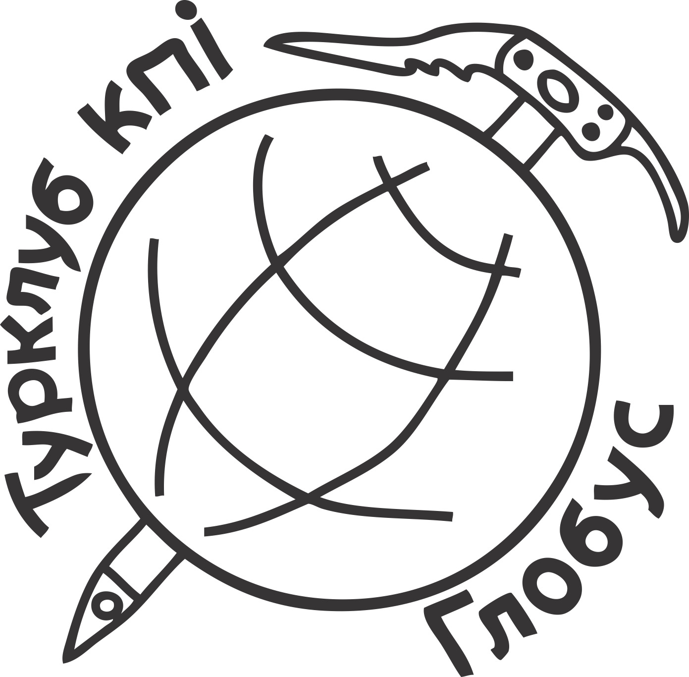

## Звіт діяльності табору “Глобус” НТУУ “КПІ” у 2020 році

У серпні 2020 силами турклубу “Глобус” було проведено 56й сезон туристичного табору “Глобус”. Це був четвертий самостійний сезон, до організації якого були долучені учасники клубу.

Під час сезону було організовано 9 походів для 135 учасників, з них 73 людини пішли в похід вперше. Крім літнього сезону, табір організував декілька осінніх походів вихідного дня. Цьогоріч було втілено завчасне планування маршрутів. На вибір учасників була можливість піти у три- або шестиденний похід, що дало змогу бажаючим самостійно обирати складність маршруту відповідно до їх досвіду та підготовки. Також була надана можливість обирати регіон походу: Горгани, Памір, Чорногора. Всі маршрути було перевірено та випущено маршрутно-кваліфікаційною комісією т/к “Глобус”, як спортивні некатегорійні походи, згідно з правилами Федерації спортивного туризму України.

Оскільки цьогоріч турбаза “Глобус” була зачинена на реконструкцію, походи з табором стартували та фінішували одразу з потягів з можливістю перетинатися на маршруті групам з однієї зміни.

Через зачинену базу, організація табору була ускладнена відсутністю необхідного групового бівуачного та особистого спорядження. Перемовини з адміністрацією КПІ та директором бази щодо використання спорядження зазнала невдач. На допомогу у вирішенні цього питання прийшли учасники клубу та безпосередньо інструктори сезону, також часткове забезпечення наметами було вирішено завдяки Профкому КПІ.

Продаж путівок було організовано відповідно до вимог законодавства зі сплатою відповідних податків. Учасники табору забезпечувалися повним раціоном харчування відповідно до очікуваних спортивних навантажень. Всім учасникам походів було оформлено відповідне страхування. Відвідування заповідних карпатських зон також було сплачено всіма походними групами. На щастя, випадків надзвичайних подій під час сезону не було і з цієї точки зору сезон проведено вдало. Після завершення походів, учасники табору мали можливість залишити анонімний фідбек щодо організації сезону. В результаті чого було зібрано сімдесят анкет і за отриманими даними нашою діяльністю задоволені на 9,2 з 10 балів. Отримані відгуки організатори табору проаналізували для проведення майбутніх сезонів і почали втілювати їх в життя.

  
До проведення походів були залучені інструктори табору минулих років та керівники клубу. Також до сезону було залучено одного стажера - випускника школи інструкторів 2020. Керівники походів також мали змогу заповнити анкету зворотного зв’язку для врахування нюансів у поточній підготовці і для покращення їх у наступних сезонах.

Цьогоріч табору вперше вдалося стати фінансово незалежним. Інструкторам сезону була запропонована ринкова заробітна плата і виділений грошовий фонд для компенсації їх логістики; також була змога профінансувати путівку стажера. Крім цього, вперше було виділено зарплатний фонд для організаторів табору.

По завершенню сезону, була виділена частина коштів на купівлю спорядження для майбутніх сезонів (пальники, сокири, пили, казани), а також заплановані витрати для подальших закупок аптек, палива та інших витрат для підготовки сезону 2021.

З іншого, було сплачено бек-енд організації табору (оновлення та проплата лендінгу, а також хостингу на найближчі кілька років).

Завдяки відпрацьованій у 2019 році схемі організації, сезон 2020 вдалося провести без критичних форс-мажорів.

Після проведення сезону походів, учасники табору були запрошені на Вечір набору новачків у т/к “Глобус”, з можливістю долучитися до новоутворених команд клубу.

В результаті вечора було набрано Школу Інструкторів 2020-2021 років навчання, яка буде залучена до організації сезону 2021 табору “Глобус”.

Наразі відбувається активна підготовка літнього сезону 2021. Маємо надію, що п'ятий сезон проведений силами турклубу буде ще більш вдалим в історії останніх років. А в усій багаторічній історії існування табору стане ще одним роком розвитку та становлення спортивного туризму в Україні. Літній сезон в цифрах:

<table><tbody><tr><td>
Кількість групи: 9 груп&nbsp;
</td><td><ul><li aria-level="1">6 груп на 3-денні походи</li><li aria-level="1">3 групи на 6-денні походи</li></ul></td></tr><tr><td>
Кількість учасників: 135 учасників (з них 73 людини вперше у горах)
</td><td><ul><li aria-level="1">дівчат: 71 учасниця</li><li aria-level="1">хлопців: 64 учасників</li></ul></td></tr><tr><td>
Задіяні керівники (12 інструкторів + 1 стажер):
</td><td>
Інструктори:
<ul><li aria-level="1">Максимчук Павло</li><li aria-level="1">Гнідець Анна</li><li aria-level="1">Євдокимов Денис</li><li aria-level="1">Пилипенко Катерина</li><li aria-level="1">Мостова Ілона</li><li aria-level="1">Лебедєв Олексій</li><li aria-level="1">Старов Дмитро</li><li aria-level="1">Богун Тетяна</li><li aria-level="1">Маршавін Олег</li><li aria-level="1">Козлик Олександр</li><li aria-level="1">Лисенко Едуард</li><li aria-level="1">Буднік Олексій</li></ul>
Стажер Зенченко Роман
</td></tr><tr><td>
Задіяні в організації (8 осіб):
</td><td><ul><li aria-level="1">Гаркушина Анна</li><li aria-level="1">Мартинець Надія</li><li aria-level="1">Келін Олексій</li><li aria-level="1">Чуднівець Олександра</li><li aria-level="1">Мостова Ілона</li><li aria-level="1">Кулик Анастасія</li><li aria-level="1">Маліновська Катерина</li><li aria-level="1">Гресько Олексій</li></ul></td></tr></tbody></table>

Маршрути:

Було організовано 3-денні походи за трьома маршрутами:

1\. Горгани:

Стара Гута — р.Лопушна — пер.Боревка — г.Лопушна — г.Сивулі — пол.Рущина — р.Бистриця Солотвинська — Стара Гута

2\. Чорногора:

Бистрець — Степанський — пол.Чуфрова — г.Піп-Іван Чорногірський (зі старою обсерваторією) — оз.Марічейка — пол.Шешорська — г.Вухатий Камінь — Дземброня

3\. Чорногора:

р.Прут — Маришевські — пол.Маришевська — Шпиці — г.Гутин Томнатик (опціонально) — оз.Несамовите — г.Говерла — Заросляк

Було організовано 6-денні походи за трьома маршрутами:

1\. Горгани:

Стара Гута — р.Бистриця Солотвинська — пол.Рущина — Лопушна — Сивулі — пер.Боревка — Ігровець\\Висока (рад.) — ур.Лопушна — Різарня — р.Петрос — Коретвина — Попадя — Мала Попадя — Паренки — пол. Плісце — Грофа (рад.) — Осмолода

2\. Памір:

Шепіт — пер. Семенчук — Томнатик (Памір) — р.Сарата — Перкалаба — пол.Прелучний — Василькова — пол. Веснарка — Палениця — Скали Баби — пер.Лостунський — Чивчин (рад.) - Боршутин — Стіг - Вихід — ПІЧ — оз.Марічейка — Шибене

3\. Чорногора:

пол.Шумнєска — Шешул (опціонально) — Петрос — Говерла — оз.Несамовите — оз.Бребенескул — г.Піп-Іван Чорногірський — оз.Марічейка — пол.Шешорська — г.Вухатий Камінь (рад.) — пол. Чуфрова — Бистрець або Дземброня

Всі маршрути було перевірено і випущено МКК т/к “Глобус”, як спортивні походи.

**Фінанси:**

Загальний прихід за сезон: 217,1 тис

Сумарна витрата за сезон: 193,2 тис

Залишок по сезону: 23,9 тис

Витрата по категоріям:

<table><colgroup><col><col></colgroup><tbody><tr><td>
податки
</td><td>
7,7 тис
</td></tr><tr><td>
зарплатний фонд (інструктори, стажер, організатори)
</td><td>
82,0 тис
</td></tr><tr><td>
страхування
</td><td>
7,2 тис
</td></tr><tr><td>
харчування
</td><td>
63,4 тис
</td></tr><tr><td>
спорядження (ремонт, оренда, закупка на майбутні сезони)
</td><td>
7,8 тис
</td></tr><tr><td>
накладні витрати (в тч проїзд інструкторів)
</td><td>
18,0 тис
</td></tr><tr><td>
рекламні оголошення та листівки
</td><td>
1,2 тис
</td></tr><tr><td>
сувенірна продукція
</td><td>
2,6 тис
</td></tr><tr><td>
сайт + хостінг
</td><td>
3,3 тис
</td></tr><tr><td>
залишок на організацію майбутнього сезону
</td><td>
23,9 тис
</td></tr></tbody></table>
