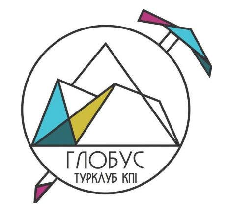

Звіт діяльності табору “Глобус” НТУУ “КПІ” у 2021 році

У 2021 році відбувся 57й сезон туристичного табору “Глобус”. Вже п’ятий рік поспіль організацією літнього відпочинку для молоді займаються безпосередньо учасники клубу. Зокрема цьогоріч значний вклад в організацію сезону зробила Школа Інструкторів 2021 року випуску (ШІ-21).

У рамках діяльності табору було проведено 10 літніх та 2 осінні походи. Загалом табір зводив у гори 116 учасників, з них 65% людей пішли в гори уперше.

На відміну від минулого року, цьогоріч нам вдалося провести сезон використовуючи базу табору “Глобус”, як місце зустрічі всіх туристичних груп однієї зміни для розширення аутдор-ком’юніті кожного з учасників сезону. Оскільки сама база табору закрита на реконструкцію, з адміністрацією НТУУ “КПІ” вдалося домовитися про облаштування кемпінгу на території бази.

У якості району проведення всіх літніх походів було обрана Чорногора, оскільки це був найбільш вдалий вибір з точки зору логістики (потяг-маршрут-табір-потяг). Спираючись на досвід минулого року, цього року так само завчасно було прописані маршрути на 3, 4 та 6 днів походу, аби потенційні учасники могли обирати похід відповідно до своєї фізичної підготовки та досвіду. Відповідно до правил Федерації спортивного туризму України, всі маршрути були перевірені та випущені маршрутно-кваліфікаційною комісією т/к “Глобус”, як спортивні некатегорійні походи.

Оскільки власне матеріально-технічне забезпечення табору не в стані забезпечити проведення сезону, питання зі спорядженням частково допоміг вирішити Профком, забезпечивши частиною наметів. Ще частину наметів було орендовано безпосередньо у КПІ. Також суттєву допомогу зі спорядженням надали інструктори груп та учасники турклубу загалом.

Вагомим внеском у організацію сезону 2021 в питанні спорядження була закупівля спорядження по факту проведення сезону 2020. Цього літа табір мав можливість використовувати власні пальники, котли, сокири, пили і особливо важливо, медичні аптечки.

Вартість путівок до табору була сформована з урахуванням найважливіших витрат у ході організації сезону:

\- повний раціон харчування учасників та інструкторів - проживання на території кемпінгу;  
\- оформлення страхових полісів відповідно до виду діяльності;  
\- внесок у заповідні фонди Карпат - покриття витрат на логістику, харчування, проживання інструкторів походу;  
\- зарплатний фонд інструкторів та організаторів табору;  
\- сплата відповідних податків відповідно до вимог чинного законодавства України.

На щастя, з точки зору надзвичайних подій, цей сезон також було відпрацьовано вдало. З походів учасники повернулися живі й щасливі. Для отримання об’єктивної оцінки по сезону, було проведено анонімне опитування учасників табору, яке показало, що діяльністю табору наші учасники задоволені на 9,1 з 10 балів. Отримані відгуки будуть проаналізовані при підготовці до сезону 2022.

Безпосередньо до проведення походів було запрошені керівники турклубу та випускники школи інструкторів різних років, які вже мали досвід проведення походів. Окрім цього, третина керівників - це інструктори 2020-2021 років навчання у школі. Випускники ШІ-21, які не знайшли в собі впевненості бути інструкторами цього сезону, вдало пройшли стажування у більш досвідчених керівників минулих років випуску і вже готові поповнити ряди інструкторів на майбутні сезони. Спираючись на досвід минулого року, були зібрані відгуки не лише від учасників походу, але й від керівників. Оскільки їх бачення вдалих та невдалих рішень по сезону є не менш важливим для кращої організації наступних сезонів.

З фінансової точки зору, цей сезон також можна вважати вдалим, оскільки була можливість не лише проплатити витрати на інструкторів, а й виділити зарплатний фонд як для керівників походів, так і для команди організаторів. Окрім цього, на організацію сезону 2022 також залишився певний фонд.

Завдяки напрацюванням минулих років, сезон 2021 зробив ще один крок вперед в питаннях якості організації. Серед суттєвих змін в менеджменті табору, було розширено команду організаторів. Її ряди поповнили випускники ШІ-21. За рахунок чого вдалося розподілити різні зони відповідальності за різними людьми, що підвищило якість та швидкість вирішення деяких організаційних питань. Для більш вдалого менеджменту сезону у тестовому режимі було запущено scrum методологію ведення проекту, яка має певний потенціал для вдалої організації табору. Крім цього, було впроваджено CRM-систему для спілкування з потенційними учасниками походу, що допомогло вивести комунікацію з людьми на більш якісний рівень.

Традиційно, щоосені туристичний клуб “Глобус” запрошує новачків приєднатися до клубу. Осінь 2021 не стала винятком: турклубом було проведений фестиваль “Драйвова осінь” та “Вечір набору новачків” й ряди Школи Інструкторів поповнились новими учасниками клубу, а отже, й потенційними керівниками наступних сезонів табору. Наразі ведеться активна підготовка школи інструкторів до їх майбутніх керівництв походів та організації сезону в таборі. Сподіваємось, що ШІ-22 вдасться внести свій вагомий внесок у розвиток спортивного туризму в Україні.

Табір “Глобус” в цифрах:

<table><tbody><tr><td>
Кількість груп: 12 груп&nbsp;
</td><td><ul><li aria-level="1">8 груп на 3-денні походи</li><li aria-level="1">3 групи на 4-денні походи</li><li aria-level="1">1 група на 6-денний&nbsp;похід</li></ul></td></tr><tr><td>
Кількість учасників: 116&nbsp;учасників (з них 74&nbsp;людини вперше у горах)
</td><td><ul><li aria-level="1">дівчат: 54&nbsp;учасниця</li><li aria-level="1">хлопців: 62&nbsp;учасників</li></ul></td></tr><tr><td>
Задіяні керівники (9&nbsp;інструкторів + 1 стажер):
</td><td>
Інструктори:
<ul><li aria-level="1">Кошова Дарья</li><li aria-level="1">Лисенко Едуард</li><li aria-level="1">Іванов Олексій</li><li aria-level="1">Зенченко Роман</li><li aria-level="1">Пилипенко Катерина</li><li aria-level="1">Книш Богдана</li><li aria-level="1">Гресько Олексій</li><li aria-level="1">Мнацаканян Тигран</li></ul>
Стажер Алам Леся
</td></tr><tr><td>
Задіяні в організації (9&nbsp;осіб):
</td><td><ul><li aria-level="1">Гаркушина Анна</li><li aria-level="1">Мартинець Надія</li><li aria-level="1">Келін Олексій</li><li aria-level="1">Чуднівець Олександра</li><li aria-level="1">Дяковський Кирило</li><li aria-level="1">Алам Леся</li><li aria-level="1">Маліновська Катерина</li><li aria-level="1">Гресько Олексій</li><li aria-level="1">Мнацаканян Тигран</li><li aria-level="1">Книш Богдана</li></ul></td></tr></tbody></table>

Літні маршрути Чорногори:

Було організовано 3-денні походи за маршрутами:

Ясиня - пол.Шаса - г.Петрос - г.Говерла - т/б “Глобус” Кваси - пол.Шешул - г.Петрос - г.Говерла - т/б “Глобус” т/б “Глобус” - пол.Маришевська - г.Шпиці - Кізли - оз.Несамовите - т/б “Глобус” Бистрець - пол.Гаджина - г.Шпиці - Кізли - оз.Несамовите - т/б “Глобус”

Було організовано 4-денні походи за маршрутом:

Шибене - оз.Марічейка - г.Піп-Іван - оз.Бребенескул - оз.Несамовите - т/б “Глобус”

Було організовано 6-денні походи за маршрутом:

Дземброня - г.Вухатий Камінь - Піп-Іван - Кізі - пол.Гаджина - г.Шпиці - г.Ребра - оз.Бребенескул - г.Гутин-Томнатик - Кізли - оз.Несамовите - г.Туркул - г.Говерла - т/б “Глобус”

Всі маршрути було перевірено і випущено МКК т/к “Глобус”, як спортивні походи.

**Фінанси:**

Загальний прихід за сезон: 206,8 тис

Сумарні витрати за сезон: 184,2 тис

Залишок по сезону: 22,6 тис

Витрати по категоріям:

<table><tbody><tr><td>
податки
</td><td>
7,6&nbsp;тис
</td></tr><tr><td>
зарплатний фонд (інструктори, стажер, організатори)
</td><td>
73,8&nbsp;тис
</td></tr><tr><td>
страхування
</td><td>
7,3&nbsp;тис
</td></tr><tr><td>
харчування
</td><td>
56,8&nbsp;тис
</td></tr><tr><td>
проживання й спорядження (ремонт, оренда, закупка на майбутні сезони)
</td><td>
12,6&nbsp;тис
</td></tr><tr><td>
накладні витрати (в тч проїзд інструкторів)
</td><td>
23,6&nbsp;тис
</td></tr><tr><td>
сайт, хостінг, CRM, реклама
</td><td>
2,5&nbsp;тис
</td></tr><tr><td>
залишок на організацію майбутнього сезону
</td><td>
22,6&nbsp;тис
</td></tr></tbody></table>
