[Турклуб НТУУ "КПИ" "Глобус"](http://www.tkg.org.ua/)

**Звіт**

про експериментальний гірський туристський

спортивний похід другої категорії складності Кримом

Що був здійснений з 24.12.2011 по 5.01 2012 р.

Маршрутна книжка - 43ГЕ/2011

Керівник групи Данилейко А.А.

Адреса керівника: deftez(at)gmail.com

Центральна маршрутно-кваліфікаційна комісія розглянула звіт і вважає, що похід може бути зарахований усім учасникам та керівникові як похід другої категорії складності.

Звіт використовувати в бібліотеці ЦМКК, бібліотеці ТК ?Глобус?, на сайті [tkg.org.ua](http://www.tkg.org.ua/)

* * *

## Зміст

1\. Довідкові дані про туристський спортивний похід

> 1.1. Параметри походу  
> 1.2. Докладна нитка маршруту  
> 1.3. Дані про досвід учасників  
> 1.4. Характеристика районів проведення походу

2\. Організація туристського спортивного походу

> 2.1. Загальна ідея походу  
>
> 2.2. Варіанти під?їзду та від?їзду. Обґрунтування вибору точок початку та кінця маршруту  
> 2.3. Аварійні виходи з маршруту та його запасні варіанти  
>
> 2.4. Зміни маршруту та їх причини  
>
> 2.5. Інформація про проходження маршруту кожним учасником

3\. Графік руху та технічний опис проходження маршруту

> 3.1. Графік руху  
>
> 3.2. Технічний опис проходження маршруту  
>
> 3.3. Картографічний матеріал

4\. Висновки та рекомендації щодо проходження маршруту

5\. Використані джерела інформації

* * *

## 1\. Довідкові дані про туристський спортивний похід.

### 1.1. Параметри походу

<table><tbody><tr><td rowspan="2">Вид туризму</td><td rowspan="2">Категорія складності</td><td rowspan="2">Довжина маршруту, км</td><td colspan="2">Тривалість</td><td rowspan="2">Термін проведення</td></tr><tr><td>Загальна</td><td>Ходових днів</td></tr><tr><td>Гірський</td><td>друга</td><td>134,1 км</td><td>13</td><td>13</td><td>
24.12.2011- 5.01 2012
</td></tr></tbody></table>

### 1.2. Докладна нитка маршруту

с. Виноградний - т/с Гірське озеро - г.Куш-Кая (н/к 1339) - Бабуган-Яйла - [кул.Узень-Баш (1А)](https://www.tkg.org.ua/node/22221) - вдп.Головкінського - с.Розовий - дж.Саурга - [кул.Еклізі-Бурун Південно-Східний-II (1Б) + в.Еклізі-Бурун ( н/к, 1527м) + кул.Кам'яний Нижній (1А) (сумарно 1Б)](https://www.tkg.org.ua/node/22332) - пер.Ангарський (н/к) - [кул.Хаос (1А)](https://www.tkg.org.ua/node/27701) - т/с Джурла - [ущ.Джурла (1Б)](https://www.tkg.org.ua/node/27702) - с.Генеральське - т/с Ай-Алексій - прохід ?2-ий спуск? (н/к) - Карабі-яйла - Великі ворота - Малі Ворота - пер. Алакат-Богаз (н/к) - т/с Нижній Кок-Асан - т/с Верхній Кок-Асан - пер.В.Шелен (н/к) - пер.Н.Шелен (н/к) - т/с Ворон - т/с Маски - т/с Ай-Сарез - хр.Орта-Сирт ?с.Міжріччя

### 1.3. Дані про досвід учасників

<table><tbody><tr><td>П.І.П.</td><td>Рік народження</td><td>Обов?язки в поході</td><td>Туристський досвід</td></tr><tr><td>Данилейко Андрій Андрійович</td><td>1990</td><td>Керівник</td><td>3ГУ 1ГР</td></tr><tr><td>Капустін Ілля Вадимович</td><td>1990</td><td>завснар</td><td>1ГУ</td></tr><tr><td>Кісліцина Людмила Григорівна</td><td>1986</td><td>завхарч</td><td>1ГУ, 2ПУ</td></tr><tr><td>Коваленко Олена Павлівна</td><td>1988</td><td>&gt;медик</td><td>1ГУ</td></tr><tr><td>Лисенко Лілія Миколаївна</td><td>1988</td><td>фотограф</td><td>1ГУ</td></tr><tr><td>Сущук Віталій Іванович</td><td>1987</td><td>казначей</td><td>1ГУ, 1ПК, 2ПУ</td></tr><tr><td>Ульянов Олександр Вікторович</td><td>1980</td><td>фотограф</td><td>1ГУ, 2ПУ з ел.2Г (1Б)</td></tr></tbody></table>

### 1.4. Характеристика району проведення походу

Гірський Крим - це ліси та гори, печери та грандіозні скали, неповторні каньйони і живописні водопади. Це природний музей, де на невеликій площі знаходяться різноманітні ландшафти та унікальні пам'ятники природи.

Район невеликий і тому вибір хорошої нитки маршруту являє собою цікаву задачу в умовах порівняно невеликої кількості варіантів.

Якщо при плануванні маршрутів в Криму відходити від стандартних маршрутів та затоптаних стежок то можна знайти в ньому чудові можливості для набуття досвіду пересування осипними, сніжними та трав'янистими схилами, скельної підготовки.

На кожну яйлу (гірський хребет в Криму) ведуть не лише дороги та набиті стежки. Фактично на хребет можна піднятися у будь-якому розумному місці, лишається лише питання логічності кожного конкретного шляху сходження. Це у значній мірі перетинається з ідеологією альпінізму та сучасного гірського туризму - коли в поході ставиться приваблива по своєму естетичному і спортивному значеннях ціль, хоча вона і не вкладається в рамки ?пройти від - і - до? . Кожен такий шлях на яйлу чи найвищу точку хребта може мати свою назву і свою привабливість. Як правило такі шляхи проходять: по альпіністським та скелелазним маршрутам, по гребням - відрогам переважно південних схилів кримських плато, та кулуарами цих плато. Часто ці кулуари заповнені снігом чи льодом, що дає досвід пересування по крутим сніжно- льодовим схилам. Так само часто зустрічаються осипні схили, проходження яких також дає туристам навички, необхідні у великих горах. При уважній підготовці нитки маршруту подорожі, перепади висот між перешкодами можуть складати до 700м, що відповідає середньому перепаду в походах на Західному Кавказі - улюбленому місці туристів початківців з Росії та усього колишнього СРСР. Але на відміну від великих гірських районів, в Криму в поході початкових категорій складності можливо пройти по найвищим точкам та зібрати ?ласощі? даного району, а не побачити гори ?знизу? як в походах1к.с., наприклад на Центральному Кавказі чи Алтаї. Але оскільки сніг та нестійку погоду з великим перепадом температур (характерним для великих гір) в Криму можна зустріти тільки в міжсезоння , фактично більшість гірських походів здійснюється взимку. Це накладає свій відбиток на вимоги при підготовці учасників. Клімат останніх років досить нестабільний і давати впевнені рекомендації марна справа.

Сніг зазвичай у достатніх кількостях буває в період з середини січня до середини березня. Але часто достатня кількість снігу буває вже в районі Нового року. При підготовці до зимових походів в Криму варто бути готовими до умов від плюсової температури з дощем до морозів 15-20 градусів із сніговими завірюхами. Досить характерна ситуація що група просуваючись по маршруту і міняючи висоту часто перетинає ?зону нуля? - потрібно бути готовими до такої ситуації.

При побудові нитки маршруту з найбільшим перепадом висот намагаються використовувати найбільш розподілені масиви Центрального Криму - Бабуган, Чатир- Даг, Демерджі, Карабі яйли. Для того щоб побудувати маршрути з значним перепадом висот на гребні Бабуган, Ялтинської та Айпетрінської яйл - доведеться багаторазово перетинати один і той же масив в різних напрямках - що ускладнює похід та псує логіку його побудови. При побудові маршруту слід враховувати, що південні схили як правило круті і складаються з скель та з цієї сторони зазвичай проходять скельні та осипові маршрути. Ці шляхи цікавіше йти вгору, так як менше камененебезпечність та більша концентрація у учасників ніж при русі вниз. І навпаки - більшість північних західних та східних кулуарів легше йти по снігу на спуск, через менші затрати сил на тропіння снігу.

Ночівлі на яйлі можуть бути ускладнені через сильний вітер.

Бабуган-яйла досить слабко освоєна спортивними туристами. Причиною цьому слугує режим Кримського природного заповідника. Тут же хотілося б відмітити своєрідне явище ?кримський лісник? яке відноситься до всього гірського Крима, але в зимовий період ситуація сильно спрощується.

Чатир-Даг відкрита для північних вітрів яйла, витягнута в напрямку Пн?Пд. Тому на цьому масиві завжди нестабільна погода. Як правило великий вітер та погана видимість. З півдня на вершину ведуть зручна тропа через Букову галявину та декілька кулуарів в західній частині схилу. Кулуари як правило сн?ск чи ск-ос. Та виводять на вершину Еклізі-Бурун. Східна частина верхнього плато Чатир-Дага називається Ангарською стінкою, за назвою вершини в верх. частині плато Ангар-Бурун. На самій стінці проходять альпіністські скельні маршрути 2А-5Б к.с. Також вона розрізана снігово-льодовими (взимку) кулуарами які можуть мати 1А-2Ак.с. При сильних снігопадах кулуари можуть бути лавинонебезпечними та мати в верхній частині карнизи, що перекривають весь кулуар при падінні. Західні схили Чатир-Дага менш привабливі через те що вони входять до заповідника який серйозно охороняється.

Демерджі яйла цікава тим, що її південні схили зазвичай майже не вкриті снігом і навіть в сніговий період року можна проходити осипні схили. Слід також враховувати камененебезпечність цих схилів. Західна частина Демерджі яйли мало освоєна через свій рельєф. Східна - це як правило скелі з ділянками лісу. Між південною та Північною Демерджі знаходиться прохідний перевал, який є ключем майже до всіх точок району Демерджі, окрім північної частини, яка відділена глибокої ущелиною Хап-хал від масиву Тирке. Ця ущелина характеризується великою крутизною схилів та відповідно лавинонебезпечністю та вимогам до техніки подолання.

Карабі яйла так само як і Чатир-Даг відкрита з півночі та має таку ж нестабільну погоду. Але оскільки плато витягнуто в напрямку зах. - сх. Південні схили мають більш теплий та стабільний клімат, який зберігається боковими хребтами. Тому навіть якщо на плато Карабі завірюха, наприклад в урочищі Чигинітра може бути досить комфортно. На Карабі з півдня є досить багато цікавих скельних, осипних та сніжних шляхів підйому, а з північно-східної частини на спуску можна пройти досить дикі каньйони. Але слід враховувати, що там взимку багато снігу.

Усі ці масиви Центральної частини Кримських гір як найкраще підходять для побудови цікавих маршрутів та знайомства з гірською стихією. Але слід враховувати, що необхідно не перебільшити складність для успішного та безпечного проходження маршруту. Багато перешкод можуть бути не слабші за їх аналоги у великих горах, що може призвести до переоцінки групою своїх сил.

Гірський Крим залишається найкращим полігоном для проведення масового відпочинку та навчання туристів у країні без високогірних районів - Україні. Не варто недооцінювати Кримські гори в цьому та з іншого боку не варто переоцінювати їх створенням надуманих маршрутів більш високої категорії складності.

## 2\. Організація туристського спортивного походу

### 2.1 Загальна ідея походу

Основною ідеєю походу була підготовка до більш складних походів за межами України. Тренувальними цілями були відпрацювання командної перильної роботи, рух по сніжним, осипним та трав?янистим схилам, покращення туристичних навичок з позиції зимових походів.

Так як район походу для учасників, в загальному, досить знайомий, в тому числі зимовими категорійними походами, то естетичні та пізнавальні цілі задовольнялися підбором технічних перешкод.

Основними об'єктам майбутнього маршруту були:  
  
1\. Кулуар Узень-Баш зі спуском до мальовничого каскаду водопадів Головкінського. Ця перешкода нечасто відвідується спортивними туристами в зимовий період. Хотілось розвідати новий варіант спуску ?через кулуар? для обходу скельного скиду на ?класичному варіантові?  
  
2\. технічні перешкоди Чатирдага. А саме кулуари Еклізі-Бурун південно-східний ІІ і Холодний кулуар, які дозволяли б групі технічно попрацювати.  
  
3\. спуск по долині річки Джурла (вона ж Алака або Сотера). Він представляє собою каскад водоспадних скидів (до 30м) які потребують використання перил для спуску. В деяких місцях спуск відбувається в повному відвисі.  
  
4\. Відвідання чотирьох яйл гірського Криму: Бабуган, Чатир-Даг, Демерджі, Карабі. З логіки планування маршруту витікала можливість, а подекуди і необхідність ночівлі на них, чим ми й скористалися підбираючи хороші місця для бівуака. За ясної погоди такі стоянки можуть принести неабияке естетичне задоволення.  
  
5\. Відвідання хребта Орта-Сирт який має певну своєрідність у ландшафтах.

Маршрут має лінійну побудову. Він витягнутий із заходу на схід паралельно південному узбережжю Криму.

Оскільки маршрут проходив через Ангарський перевал через який ми заїжджали до початкової точки, то це дозволяло легко організувати продуктову заброску, практично без втрат часу. Ми скористалися цією можливістю. Адже вона давала можливість проходити першу, більш технічно напружену, половину маршруту з легшими рюкзаками.

### 2.2 Варіанти під?їзду та від?їзду. Обґрунтування вибору точок початку та кінця походу.

До Сімферополя із Києва курсують потяги із зручним розкладом руху.

Початковою точкою маршруту є с.Виноградний. Воно має зручне розташування відносно З Сімферополя можна дістатися тролейбусом (маршрут ?Сімферополь-Ялта?) або маршрутними таксобусами, які менш зручні і коштують дорожче, але швидші. Кінцеві зупинки і тролейбусів, і маршрутних таксобусів, знаходяться на відстані 150м від залізничного вокзалу м.Сімферополь.

Інтервал курсування тролейбусів - 20-30хв, квитки можна придбати у касах, що розташовані на кінцевій зупинці, або у водія. При використанні кримських таксобусів варто завжди за можливості купляти вантажний квиток.

Кінцевою точкою маршруту було обрано с.Веселе т.я. з нього можна легко дістатися Судака. Але варто уточнювати розклад руху маршрутного транспорту. Також за потреби можна скористатися послугами таксі.

З Судака регулярно курсують таксобуси до Сімферополя.

Можливо також виходити на північ до траси Сімферополь-Керч, по якій постійно курсують маршрутні таксобуси та рейсові автобуси з Керчі, Судака та Феодосії до Сімферополя. Від?їзд звідси не складає будь-яких проблем - треба дістатися траси та зачекати, доки не зупиниться один з рейсових автобусів, що прямують на Сімферополь. Але такий варіант не був прийнятний, адже двоє учасників планували приєднатися до альпіністських зборів та здійснити сходження на г.Сокіл.

При заїзді в с.Виноградне двоє учасників вийшли на Ангарському перевалі та залишили заброску у наглядача метеостанції (10 грн/день). 066 960-03-75 Володимир.

Для підвищення безпеки маршрут був зареєстрований контрольно-рятувальній службі Криму з використанням on-line заявки (http://www.kss.crimea.ua/reg.php). Також були оформлені страхові поліси з підвищеним коефіцієнтом ризику (СК Альфа Страхування).

### 2.3 Аварійні виходи з маршруту та його запасні варіанти

Заявлена нитка маршруту:  
  
с.Виноградне - кул. Куш-Кая Східний (1A) - кул. Узень-Баш(1Б) сумарно 1Б - вдп.Головкінського - р.Улу-Узень-дж.Саурга-пер.Корбек(1А) - в.Еклізі-Бурун-Холодний кулуар(1Б)сумарно 1Б-пер.Ангарський-дж.Версі-пер.Хаос(1А)-т/с Джурла-спуск по ущ. р. Сотера(1Б)-т/с Ай-Алексій-овр.Тирхалу-Дере- дж.Павло-Чокрак-т/с Маски - с.Веселе

Запасні варіанти:  
  
1) Пер.Діпла 1А замість проходження кулуару Куш-Кая Сх(1А).- кул.Узень-Баш(1Б)  
  
При ускладнених погодних умовах  
  
2) кулуар Еклізі-Бурун Південно-Східний-II (1Б)?замість кул.Корбек (1А)  
  
При зміщенні графіку походу. При ночівлі в районі дж.Саурга.  
  
3) Кул.Кам?яний Нижній(1А) замість Холодного кулуару(1Б)  
  
При складних погодних умовах.  
  
4) Обхід пер.Хаос н/к шляхом  
  
5) Відмова від проходження каньйону р.Алака  
  
При недостаткові часу або при поганих умовах.  
  
6)Хапхал - пер.Тирке Ц. - т/с Східний Суат  
  
При відмові від проходження каньйону р.Алака та при наявності сприятливих умов.  
  
7) т/с Ай-Алексій ?т/с Чигінітра - р.Танасу  
  
За несприятливих умов для підняття на Карабі-яйлу  
  
8) с.Веселе-с.Новий-Світ-КСС  
  
За наявності часу та бажання.

Аварійні виходи з маршруту:  
  
Аварійний вихід з маршруту не становить великої складності. З маршруту можливо вийти в наступні пункти: с.Виноградний, с.Розовий, пер.Ангарський,  
с.Лучисте, с.Генеральське, метеостанция ?Карабі-яйла?, с.Зеленогір'я, с.Громівка, с.Ворон, с.Міжріччя, с.Веселе, м.Судак.

### 2.4 Зміни маршруту та їх причини

Були використані запасні варіанти ?2 та ?3. Таким чином було пройдено ділянку маршруту кулуар Еклізі-Бурун Південно-Східний-II (1Б) - в.Еклізі-Бурун - кул.Кам'яний Нижній (1А). Точкою завершення маршруту було с.Міжріччя т.я. до нього вела зручна дорога.

### 2.5 Інформація про проходження маршруту кожним учасником

Учасник Ульянков О.В. зійшов з маршруту в с.Розове через необхідність повернення до Києва (був викликаний з відпустки на роботу).

Учасник Сущук В.І. зійшов з маршруту в с.Генеральське через необхідність повернення до Києва (був викликаний з відпустки на роботу).

## 3\. Графік руху та технічний опис проходження маршруту

### 3.1. Графік руху

<table><tbody><tr><td><b>Дата, День походу</b></td><td><b>? ділянки маршруту</b></td><td><b>Назва ділянки</b></td><td><b>Час проходження</b></td><td><b>Відстань та перепад висот</b></td><td><b>Метеоумови</b></td><td><b>Опис ділянки</b></td></tr><tr><td>24.12 1 день</td><td>1.1</td><td>с.Виноградний - галявина під ск.Подпоричел</td><td>16.17-16:40 16:50-17-23 17:35-18:17</td><td>3,5км +200м</td><td>Хмарно</td><td>Від зупинки північно-західний підйом до межі села та лінії ЛЕП. Від ЛЕП правим траверсом на поясі 600м до галявини під ск. Подпоричел.</td></tr><tr><td colspan="3"><b>Всього</b></td><td><b>1год 38хв</b></td><td><b>3,5км +200м</b></td></tr><tr><td rowspan="2">25.12 2 день</td><td>2.1</td><td>м/н - оз.Горне - Бабуган-Яйла - г.Куш-Кая</td><td>7:15-7:40 9:00-11:00 11:32-12:33</td><td>6,1км +800м</td><td>Хмарно, туман</td><td>Грунтовою дорогою повз хр.Урага до роздоріжжя на пагорбі. Від роздоріжжя гр.дорогою на південь повз скельні виступи Бабуган-Яйли. Після видимого закінчення скельних виступів підйом по лісі в напрямку Бабуган-Яйли.</td></tr><tr><td>2.2</td><td>г.Куш-Кая - ложбина на Бабуган-яйлі</td><td>13:20-13:30 13:50-14:39</td><td>2,1км +50м -50м</td><td>Хмарно</td><td>Від г.Куш-Кая - в напрямку пер.Узень-Баш до м/н в ложбині.</td></tr><tr><td colspan="3"><b>Всього</b></td><td><b>4год 25хв</b></td><td><b>8,2км +850м -50м</b></td></tr><tr><td>26.12 3 день</td><td>3.1</td><td>м/н - пер.Узень-Баш - вдсп.Головкінського</td><td>7:05-7:25 8:00-8:43 8:50-9:25 11:20-11:43 12:00-12:42 13:02-13:40 13:55-15:01</td><td>3км -800м</td><td>Ясно, після обіду хмарно з проясненнями</td><td>Від м/н по яйлах до пер.Узень-Баш по азимуту. Засніжений заліснений схил 100м 20-25°. Понад скельною стінкою по кам?янисто-осипному схилу 25-35°. Перила по кулуару 15м 30-45°. Середньоосипний схил 25° Без стежки по лісу вниз до водопаду. Конгломератні схили.</td></tr><tr><td colspan="3"><b>Всього</b></td><td><b>4 год 27хв</b></td><td><b>3 км -800м</b></td></tr><tr><td rowspan="2">27.12 4 день</td><td>4.1</td><td>м/н - р.Улу-Узень - Кордон Узень-Баш</td><td>9:45-10:53 11:12-11:30 11:45-11:59 12:15-12:41 12:54-13:10</td><td>5,8км -370м</td><td>Хмарно</td><td>Стежкою по лівому березі 500м. Вихід на правий берег р.Улу-Узень. Натоптана стежка, яка траверсує схили пр.берегу і виводить до грунтової дороги. По грунтовій дорозі спуск до с.Розове</td></tr><tr><td>4.2</td><td>Кордон Узень-Баш - с.Розовий - дж.Саурган</td><td>13:40-14:35 14:50-15:45 16:01-16:16 16:36-17:15</td><td>6,6км +650м</td><td>Хмарно з проясненнями</td><td>Асфальтною дорогою підйом по селищу до бетонної дороги направо. Дорога виводить на низку галявин і переходить в грунтову.</td></tr><tr><td colspan="3"><b>Всього</b></td><td><b>5год 06хв</b></td><td><b>12,4км -380м +650м</b></td></tr><tr><td>28.12 5 день</td><td>5.1</td><td>м/н - г.Кузу-Кая - пер.Еклізі Південний - плато Чатирдаг</td><td>10:40-10:56 11:16-12:02 13:18-13:40 15:31-18:40</td><td>3км +580м</td><td>Туман, вітряно.</td><td>Гр.дорогою що переходить в стежку повз рівчак рух в напрямку г.Кузу-Кая. Від вершини по стежці правим траверсом до підйому на хр.Чатирдаг. Перила 110м Рух по плато до м/н в ложбинці.</td></tr><tr><td colspan="3"><b>Всього</b></td><td><b>4год 33хв</b></td><td><b>3 км +580м</b></td></tr><tr><td rowspan="2">29.12 6 день</td><td>6.1</td><td>м/н - г.Еклізі-Бурун - пер.Кам?яний Нижній</td><td>8:20-8:55 9:20-9:49 11:30-12:25 12:35-12:48</td><td>2,9км +100 -150м</td><td>Мороз, погана видимість.</td><td>Радіальний вихід на г.Еклізі-Бурун. Рух по хр.Чатир-Даг в напрямку г.Ангар-Бурун. Від зруйнованої канатної дороги 500м на Південь вздовж схилу та виходів скель до пер. Кам?яний Нижній.</td></tr><tr><td>6.2</td><td>пер.Кам?яний Нижній - т/б Ангарський перевал</td><td>13:42-15:56 16:20-17:30</td><td>2,7км -600м</td><td>Туман, знизу дощ</td><td>Спуск по осипному схилу до входу в ліс. Рух лісом в напрямку початку крісельної дороги(лівіша лощина). Гр.дорогою до т/с Шкільна поляна.</td></tr><tr><td colspan="3"><b>Всього</b></td><td><b>5год 36хв</b></td><td><b>5,6км -750м</b></td></tr><tr><td rowspan="3">30.12 7 день</td><td>7.1</td><td>пер.Ангарський - хр.Ельх-Кая</td><td>9:09-11:15</td><td>4,3км +300м</td><td>Дощ, хмарно</td><td>Через трасу Сімферопіль-Алушта по гр.дорозі північно-західним напрямком на хр.Ельх-Кая.</td></tr><tr><td>7.2</td><td>хр.Ельх-Кая - пер.Хаос</td><td>11.40-12:15 12:30-13:01 13:14-14:00</td><td>4,2км -200м</td><td>Хмарно</td><td>Перед г.Пахкал-Кая на роздоріжжі південно-східною гр.дорогою скидаючи висоту до пол.Ман. Повз рівчак в напрямку укріплення Фуна до пер.Хаос.</td></tr><tr><td>7.3</td><td>пер.Хаос - Демерджи-Яйла</td><td>14:45-16.58 17:10-17:35 17:50-18:15</td><td>1,3км +450м</td><td>Опади снігу</td><td>По кулуару під скельними виступами зліва на пер.Хаос.</td></tr><tr><td colspan="3"><b>Всього</b></td><td><b>7год 01хв</b></td><td><b>9,8 км +750м -200м</b></td></tr><tr><td rowspan="2">31.12 8 день</td><td>8.1</td><td>м/н - г.Пд.Демерджі - вдсп.Джурла</td><td>7:45-8-50</td><td>3,8км +50м -320м</td><td>Хмарно з проясненнями</td><td>Від г.Північна Димерджи гр.дорогою в північно-західному напрямку до вдсп.Джурла.</td></tr><tr><td>8.2</td><td>вдп.Джурла - каскади р.Алака</td><td>10:00-12:00 12:30-15:00 15:30-16:00</td><td>1,3км -360м</td><td>Хмарно з проясненнями</td><td>Спуск через водопадні скиди. 5 мотузок. Після розширення каньйону, лівим траверсом а згодом і вниз по схилу по неявній стежці до річки.</td></tr><tr><td colspan="3"><b>Всього</b></td><td><b>6год 05хв</b></td><td><b>5,2км +50м -680м</b></td></tr><tr><td rowspan="2">1.01 9 день</td><td>9.1</td><td>м/н - с.Генеральське</td><td>7:45-8-50</td><td>3,8км +50м -320м</td><td>Хмарно з проясненнями</td><td>Спуск по стежці вздовж р.Алаки. Не доходячи вершини в.517 поворот наліво по ложбині вверх повз місця для стоянок. Від підніжжя г.Сан-Кая по гр.дорозі до с.Генеральське</td></tr><tr><td>9.2</td><td>с.Генеральське - вдсп.Джур-Джур</td><td>15:40-16:45</td><td>2,4км +250м</td><td>--/--/--</td><td>По щ.дорозі до водного господарства. Стежкою в обхід вдсп.Джур-Джур на тур.стоянку Джур-Джур</td></tr><tr><td colspan="3"><b>Всього</b></td><td><b>4год 45хв</b></td><td><b>10,1 км -350м +250м</b></td></tr><tr><td rowspan="2">2.01 10 день</td><td>10.1</td><td>Від вдп.Джур-Джур до т/с Ай-Алексій</td><td>8.25-8.55 9.10-9.30 9.37-9.54 10.00-10.15 10.20-10.30 10.37-11.15 Всього: 2:10</td><td>6,5 км +350м</td><td>Ясно,безвітрянно, -3°С</td><td>Ґрунтова дорога</td></tr><tr><td>10.2</td><td>т/с Ай-Алексій - Карабі-яйла</td><td>11.25-12.00 12.15-12.40 12.48-12.55 13.40-14.00 14.05-14.45 15.00-15.28 15.33-15.57 16.00-16.40 Всього: 3:39</td><td>10,5 км +300м -100</td><td>--/--/--</td><td>Ґрунтова дорога до початку підйому Підйом засніженим схилом крутизною 20-30° Засніжена ґрунтова дорога</td></tr><tr><td colspan="3"><b>Всього</b></td><td><b>5 год 49 хв</b></td><td><b>17 км +650м -100м</b></td></tr><tr><td rowspan="3">3.01 11 день</td><td>11.1</td><td>Від м/н до Малих воріт</td><td>8.20-9.00 9.12-9.35 9.40-10.40 Всього: 2:03</td><td>5,8 км +50 -300</td><td>Ясно -3°С</td><td>Засніжена ґрунтова дорога Стежка через по гребеню через скальники, місцями сніговий покрив</td></tr><tr><td>11.2</td><td>Від Малих воріт до т/с Нижній Кок-Асан</td><td>11.00-11.45 12.00-12.50 13.50-14.40 14.40-15.15 Всього: 3:00</td><td>9,1 км +100м -450м</td><td>--/--/--</td><td>Стежка, місцями зникає; ґрунтова дорога</td></tr><tr><td>11.3</td><td>Від т/с Нижній Кок-Асан до т/с Верхній Кок-Асан</td><td>15.25-16.05 16.10-16.43 Всього 1:13</td><td>4,7 км +250м</td><td>--/--/--</td><td>Асфальтна дорога (з ожеледицею); ґрунтова дорога.</td></tr><tr><td colspan="3"><b>Всього</b></td><td><b>6 год 16 хв</b></td><td><b>19,6км +400м -750м</b></td></tr><tr><td rowspan="2">4.01 12 день</td><td>12.1</td><td>Від т/с Верхній Кок-Асан до пер. В.Шелен</td><td>8.50-9.20 9.27-9.57 10.14-10.46 11.04-11.57 12.08-12.20 Всього: 2:37</td><td>7 км +350м -150м</td><td>Сонячно, ясно 0..+3°С</td><td>Ґрунтова дорога розбита автолюбителями на джипах. Рух ускладнений якістю дороги</td></tr><tr><td>12.2</td><td>Від пер.В.Шелен до т/с Ворон</td><td>12.25-12.55 13.15-13.55 14.55-15.46 15.55-16.30 Всього: 2:36</td><td>8 км +50м -250м</td><td>Погіршена видимість, мряка</td><td>Грунтова дорога. Стежка.до т/с Ворон</td></tr><tr><td colspan="3"><b>Всього</b></td><td><b>5 год 13 хв</b></td><td><b>15 км +400м -400м</b></td></tr><tr><td rowspan="4">5.01 13 день</td><td>13.1</td><td>Від т/с Ворон до пер. Маски</td><td>6.50-7.30 7.44-8.14 8.30-9.04 9.05-9.35 9.50-10.10 Всього: 2:34</td><td>5,4 км +150м -150м</td><td>Ясно, вітряно +1..+3°С</td><td>Ґрунтова дорога</td></tr><tr><td>13.2</td><td>Від т/с Маски до г. Лялел-Оба</td><td>10.30-10.40 10.40-11.14 11.30-12.07 Всього: 1:21</td><td>5,3 км +150м -100м</td><td>--/--/--</td><td>--/--/--</td></tr><tr><td>13.3</td><td>Від г.Лялел-Оба до г. Юхари-Таркез</td><td>12.48-13.43 Всього: 0:55</td><td>4,5 км +100м -50м</td><td>--/--/--</td><td>Стежка вздовж гребеня хребта зі скельними сходинками</td></tr><tr><td>13.4</td><td>Від г. Юхари-Таркез до с. Веселе</td><td>13.53-14.48 Всього: 0:55</td><td>6,5 км -550м</td><td>--/--/--</td><td>Ґрунтова дорога</td></tr><tr><td colspan="3"><b>Всього</b></td><td><b>5 год 45 хв</b></td><td><b>21,7 км +200м -700м</b></td></tr><tr><td colspan="3"><b>Всього за похід</b></td><td></td><td><b>134,1км +4980м -5160м</b></td></tr></tbody></table>

### 3.2. Технічний опис проходження маршруту

_\* ?право? ?ліво? мається на увазі в орографічному сенсі, якщо не вказано інше._

**День 1 24.12.2011**

До Сімферополя група дісталась на потязі.

До місця старту, в с.Виноградний, доїжджали на тролейбусі Сімферополь-Ялта. Два чоловіки вийшли на Ангарському перевалі та залишивши заброску з?єдналися з основною групою в с.Виноградне.

Від зупинки тролейбуса (Ф1) піднімаємось через село . Вище села розташовані виноградники, а ще вище з Пн-Сх на Пд-Зх тягнеться ЛЕП.

Від ЛЕП по лісовій стежці піднімаємось до траверсуючої грунтової дороги і по ній рухаємося в Пд-Зх напрямку в розрахунку вийти по ній до оз.Гірське. В даному районі досить багато лісових доріг і співставити карту із місцевістю є нетривіальною задачею. Вибрана нами дорога проходила вище озера тому на ночівлю стали вище по долині ніж озеро(Ф2).

Фото 1  
С.Виноградне

[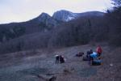](https://www.tkg.org.ua/node/27570)  
  

Фото 2  
Місце ночівлі

**День 2 25.12.2011**

Від місця ночівлі вийшли до т/с Гірське озеро і зорієнтувавшись на потрібну дорогу почали підйом на Пн-Зх лівим берегом долини в напрямку в.Чамни-Бурун.

Т.я доріг та розвилок значно більше ніж позначено на карті потрібно надавати перевагу в орієнтуванні напрямку дороги (її ?азимуту?)

Майже через 2 км підйому дорога виводить на виположення на якому від дороги відгалуджуєтся траверсуюча вліво дорога. Звертаємо на неї. Дорога веде на захід, потім повертає на північ та йде паралельно краю Бабуган яйли.

Натоптаних стежок в районі підніжжя в.Куш-Кая, а також її східного та західного кулуарів, вірогідно немає. Проте ліс тут переважно листяний і майже без підліска - рухатися ним доволі просто, а відсутність листя за ясної погоди спрощує орієнтування.

Приблизно зорієнтувавшись по в.Куш-Кая (вона у сприятливу погоду добре проглядається через зимовий ліс) сходимо з дороги з розрахунком вийти західніше вершини під кулуар(Ф3). Але через туман в лісі який не дозволяв бачити вершину та остерігаючись вийти під скельну стінку вершини виходимо дещо західніше та піднімаємося на плато некатегорійним шляхом(Ф4). В лісі лежить тонкий шар снігу. Крутизна до 25°, тільки перед виходом на плато зустрічаються короткі ділянки до 30°. Рух з трекінговими палицями.

Піднявшись на плато рухаємося на в.Куш-Кая, проходячи її західний кулуар(Ф5) та в 13:30 піднімаємося на неї(Ф6).

Від Куш-Каї рухаємося на Пн-Зх та в 15:15 стаємо на ночівлю в ложбині за 500м від сідловини Узень-Баша.

З вечора зробили розвідку перешкоди.

[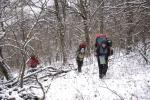](https://www.tkg.org.ua/node/27571)  
  

Фото 3

[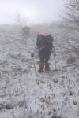](https://www.tkg.org.ua/node/27572)  
  

Фото 4

[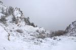](https://www.tkg.org.ua/node/27573)  
  

Фото 5  
вид на кулуар Куш-Кая західний

[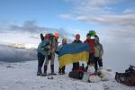](https://www.tkg.org.ua/node/27574)  
  

Фото 6  
На в.Куш-Кая

[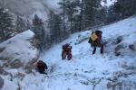](https://www.tkg.org.ua/node/22221)  

[Перевал Узень-Баш (1А, 1450м)](https://www.tkg.org.ua/node/22221)

[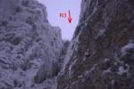](https://www.tkg.org.ua/node/22332)  

[Кулуари Еклізі-Бурун Південно-Східний ІІ та Кам?яний Нижній (сумарно 1Б)](https://www.tkg.org.ua/node/22332)

**День 7 30.12.2011**

Від місця ночівлі на Ангарському перевалі, переходимо шосе та починаємо підйом по грунтовці. Проходимо пам?ятник будівникам дороги(Ф28).

У лісі густа мережа доріг і практично відсутнє маркування, тому ми піднялись до поляни МАН (Ф29), а вже звідти пішли на ПдСх в напрямку т/с Демерджі.

Не доходячи 700м до т/с Демерджі дорога перетинає бродом лівий витік р.Демерджі.

Звідси починаємо підйом до кул.Хаоса

[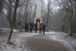](https://www.tkg.org.ua/node/27596)  
  

Фото 28  
Біля пам?ятника будівникам дороги

[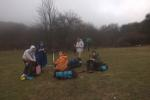](https://www.tkg.org.ua/node/27597)  
  

Фото 29  
Поляна МАН

[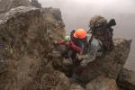](https://www.tkg.org.ua/node/27701)  
  

[Перевал Хаос (1А)](https://www.tkg.org.ua/node/27701)

**День 8. 31.12.2011**

Від місця ночівлі на яйлі піднімаємось на в.Пд.Демерджі (Ф33) та переваливши через неї по дорозі спускаємось до т/с Джурла.

Далі по стежці спускаємось до т/с Нижня Джурла і вдп.Джурла (Ф34).

Звідси починаємо технічно цікавий спуск по ущелині Джурли

[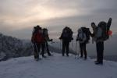](https://www.tkg.org.ua/node/27601)  
  

Фото 33  
На Південній Демерджі

[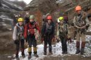](https://www.tkg.org.ua/node/27602)  
  

Фото 34  
Біля вдп.Джурла

[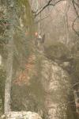](https://www.tkg.org.ua/node/27702)  
  

[Спуск ущелиною р. Алака (1Б)](https://www.tkg.org.ua/node/27702)

**День 9. 1.01.2012**

Від місця ночівлі в дол.р.Алака спускаємося вздовж річки по неявній стежці.

Через 350м виходимо до стоянки (N44,762537 E34,443696) - з цього місця відходять декілька стежок в різних напрямках.

Далі рухаючись на схід виходимо на ще одну галявину (N44,761938 E34,449287). Продовжуючи рухатись в східному напрями по стежці виходимо на грунтову дорогу що проходить на пд-сх від в.Шан-Кая.

В подальшому рухаємося по грунтовій дорозі в напрямку с.Генеральське. Але не доходячи балки Ай-Андріт звертамо на лісову стежку на пн-зх. По цій стежці вздовж водогонної труби виходимо до дж.Ай-Ендріт де і стали на обід (Ф40).

Від джерела спустились в с.Генеральске, а звідти піднялись в напрямку вдп.Джур-Джур (Ф41). Після входу через КПП одразу ж повернули на північ та через 350м стали на ночівлю.

[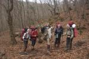](https://www.tkg.org.ua/node/27608)  
  

Фото 40  
Джерело Ай-Ендріт

[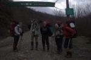](https://www.tkg.org.ua/node/27609)  
  

Фото 41  
Вивіска "Джур-Джур"

**День 10. 2.01.2012**

В 6:00 підйом групи. В 8:25 вийшли зі стоянки біля вдп. Джур-джур в північному напрямку, ґрунтовою дорогою(маршрут ?138) в напрямку т/с Ай-Алексій.

В цьому районі досить густа сітка доріг та практично відсутнє маркування. Дорога постійно міняє свій напрям, але не суттєво. В районі г.Арамну розпочинається район вирубки лісу, з?являється велика кількість доріг від лісорубів, суттєвих орієнтирів не має, тому група продовжує рухатися в північному напрямку. Маркери були помічені вже біля самої стоянки (за 700-800м), тому розраховувати на них не варто.

За 300-400 м до т/с від дороги відгалужується стежка на яку і вказує маркер. Піднімаючись по ній виходимо на т/с Ай-Алексій (Ф42).

Від т\\с Ай-Алексій ідемо східним напрямом дорогою (маршрут ?166) в напрямку т\\с Чигінітра.

Після того як дорога виходить з лісу з неї відкриваються чудові обзорні види, в т.ч. на масив Карабі. Звідси добре видно простий шлях підйому на плато який називається ?прохід 2-й спуск?.

Цей шлях представляє собою крутий трав?янистий схил, вкритий снігом.

Від дороги до місця підйому веде стежка яка проходить через острівець лісу. В нижній частині підйому явна натоптана стежка зникає тому далі рухаємося по засніженому схилу вверх серпантинами (Ф43).

Після підйому на плато рухаємося в напрямку в.1113 , притримуючись напрямку ?по азимуту?. Натропленої стежки тут немає. Хоч шар снігу невеликий (до 15-20 см), проте він сильно зменшує швидкість руху. В районі в.Кенгеч-Оба вийшли на колію від авто яка спростила рух.

Ночуємо в добре захищеною від вітру воронці недалеко від основної дороги (Ф44).

[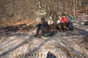](https://www.tkg.org.ua/node/27610)  
  

Фото 42  
Ай-Алексій

[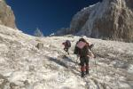](https://www.tkg.org.ua/node/27611)  
  

Фото 43  
Прохід 2-й спуск

[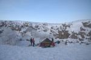](https://www.tkg.org.ua/node/27612)  
  

Фото 44  
Ночівля на Карабі

**День 11. 3.01.12**

В 6:00 підйом. В 8:20 вихід.

Від місця ночівлі повертаємось на дорогу з колією та продовжуємо рух вздовж краю яйли в східному напрямку до Великих воріт. Перед спуском до перевалу дорога робить невелику петлю (Ф45). По дорозі спускаємось на пер.Великі ворота. Звідси по засніженій стежці рухаємося вздовж гребеня в напрямку Малих воріт. На явному сідлі гребеня необхідно спуститись на північ - стежка яка йде вздовж балки виводить на Малі ворота.

Від малих воріт рухаємося по стежці в Пн-Сх напрямку. Невдовзі після того як стежка перевалює через гряду вона зникає - під шаром снігу в рідкому лісі вона важко читається.

Попри відсутність маркерів там де вони мали б бути нам вдалося вийти на ?верхню? стежку якою і вийшли на пер.Алакат-Богаз. Як не дивно але на цій стежині були старі сині маркери, хоча GPS і визначав не марковану стежку.

З пер.Алакат-Богаз спускаємось до Нижнього Кок-Асана (Ф46) по лісовій дорозі. Тут ще одна колізія: табличка із зовсім не зрозумілим номером маршруту висить ?десь не там?

Від до т\\с Нижній Кок-Асан рухаємось асфальтною дорогою до пер.Кок-Асан, від перевалу в північно-східному напрямку відходить грунтова дорога до т\\с Верхній Кок-Асан. Орієнтиром даної стоянки є пам?ятник партизанам.

[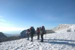](https://www.tkg.org.ua/node/27613)  
  

Фото 45  
Біля Великих воріт

[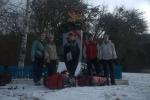](https://www.tkg.org.ua/node/27614)  
  

Фото 46  
Нижній Кок-Асан

**День 12. 4.01.12**

В 6:00 підйом. 8:20 вихід.

Рухаємось ґрунтовою дорогою (?188). Через 600м руху на північ перед виходом на більш відкриту ділянку потрібно уходить вліво-вверх по стежці - маркер на повороті слабопомітний.

Стежка, яка починає набирати висоту до г. Сорі. Рухаємося на схід по хребту до г.Ак-Ярлар (Ф47). Перед розвилкою на хребті зустрічається пам?ятник партизанам. Періодично хребет вкритий глибоким снігом, який ховає стежки, а маркерів тут немає?

На розвилці повертаємо на північ і через 3км виходимо на пер.Верхній Шелен (Ф48).

Від пер.В.Шелен до пер.Н.Шелен доходимо по грунтовій розкислій дорозі

До т/с Ворон, місця ночівлі, доходимо 188 маршрутом по грунтовці та натоптаній стежці.

[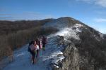](https://www.tkg.org.ua/node/27615)  
  

Фото 47

[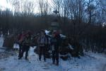](https://www.tkg.org.ua/node/27616)  
  

Фото 48  
пер. Верхній Шелен

**День 13. 5.01.12**

В 5:00 підйом. В 6:50 виходимо у напрямку пер. Маски. Рух ґрунтовою дорогою в східному напрямку. Орієнтиром, що вийшли саме на пер.Маски, служить ржавий дощомір з написом ?перевал Маски?:).

Щоб з т\\с Ай-Серез вийти на Орта-Сирт зовсім не обов?язково йти так як позначено на карті, через вершину Лялель-Оба. Натоптана стежка в обхід траверсує східний схил гори.

Після підйому на хребет рухаємося по ньому по стежці до г.Юхари-Таркез. На в.Юхари-Таркез встановлений тріангулятор.

Приспустившись з г.Юхари-Таркез розвилка грунтових доріг: на пд-зх відходить дорога до с.Міжріччня, на схід, не позначена на карті стежка на т/с Карагач.

Спускаємось по дорозі на Пд-Зх в с.Міжріччя(Ф50). Активна частина походу на цьому завершена.

З Міжріччя на найнятому мікроавтобусі доїжджаємо до Судака - тут група розділяється. Частина групи прямує до Сімферополя, інша залишається скелелазити та відпочивати у Судаку

[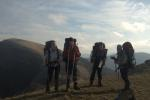](https://www.tkg.org.ua/node/27617)  
  

Фото 49  
Орта-Сирт

[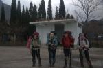](https://www.tkg.org.ua/node/27618)  
  

Фото 50  
с.Міжріччя

### 3.3. Картографічний матеріал

[Карта (2Mb)](https://www.tkg.org.ua/files/2crm12ad_map.jpg)

### 4\. Висновки та рекомендації щодо проходження маршруту

Загалом були виконані всі цілі походу. Група збагатила досвід пересування cкельними, осипними, сніжними та трав'янистими схилами. Було відпрацьовано прийоми страховки та руху по перилам в реальних умовах. Також учасники отримали досвід роботи при ускладнених погодних умовах.

Готуючись до зимових походів в Криму варто бути готовим і до ситуації коли в нижніх точках маршруту може бути плюсова температура із дощем, натомість зверху мороз. За таких умов група часто за один день може вимокнувши під дощем надвечір піднятися вище, до морозу.

Орієнтування в зимовий період може завдати значних труднощів. На маршруті можливі часті денні тумани, які й ускладнили нам проходження технічно цікавої частини маршруту. Стежки під снігом, особливо в рідкому лісі, читаються важко, а маркування через його низьку якість не допомагає.

Окремо хочеться сказати про маркування та картографічний матеріалам. Маркування зазвичай виконане неякісно і ?для галочки? в тих місцях де воно і не потрібно (наприклад вздовж дороги, набитої тропи). Звичайними є ситуації коли буквально підряд стоять декілька маркерів у явному місці, натомість на протязі наступних кілометрів з неявною тропкою під снігом шукати їх марно :(

В поході використовувалися карти ?По гірському Криму? видавництва ?Союзкарта? які мають репутацію найбільш якісних. На нанесена координатна сітка WGS-84 (а у виданні 2011р. також є координати корисних для туриста об'єктів). Ці карти перевидаються кожного року (ми мали з собою зразки 2009 та 2011 років). Але і на цих картах потрібно обережно відноситься до таких елементів як стежки, грунтові дороги та марковані шляхи. Нами відмічались дивні моменти, наприклад, плутаниця з номерами маршрутів, давно існуюча і натоптана тропа ніяк не відзначена і т.д.

Дуже корисним в поході був GPS приймач.

Аналізуючи похід можна сказати що маршрут в цілому вийшов досить вдалим, був цікавим та корисним як для учасників так і для керівника. Проте є і зауваження:  
  
\- ділянка маршруту від Джурли відчувався дещо ?нуднішим? на фоні насиченої технічної частини, можливо варто спробувати його урізноманітнити та збалансувати маршрут.  
  
\- маршрут логічніше завершать в Судаку. При незначному збільшенні відстані значно спрощується логістика. Від гори Юхари-Таркез на Пд.-Сх. відходить непозначена на карті набита стежка яка виводить через т/с Карагач до Судака.

Пройдені в поході визначальні перешкоди були досить вдалими і корисними для учасників.

Кулуар Узень-Баш. Був розвіданий та пройдений альтернативний варіант в обхід скельного виходу. Керівник походу мав досвід проходження перешкоди в зворотньому напрямку по класичному варіантові тому підсумовуючи досвід не можна однозначно оцінити цю перешкоду т.я. альтернативний варіант безпечний для проходження тільки в певному діапазоні умов, до того ж він вимагає впевненого руху по крутим осипним схилам. Тому варто оцінити цю перешкоду як 1А\*-1Б але ніяк не менше.

Кулуар Еклізі-Бурун Пд.-Сх. ІІ - цікава технічна перешкода, яка може бути оцінена як 1Б к.т.

Спуск по ущелині Джурли досить своєрідна і цікава перешкода. Для її подолання група має мати стійкі навички руху по перилах, адже доводиться спускатися подекуди в повному відвисі (без контакту з рельєфом). Також має важливе значення тактика проходження перешкоди. Перешкода виражено одностороння.

### 5\. Використані джерела інформації

\[1\] Закалдаев Н.В. перевалы Горного Крыма (перечень). Изд. Симферополь 2005 г - [http://www.tkg.org.ua/node/2802](https://www.tkg.org.ua/node/2802)

\[2\] Звіт про гірський похід першої категорії складності Кримом, НР 2009/2010р, керівник Наконечний А.О. - [http://www.tkg.org.ua/node/16644](https://www.tkg.org.ua/node/16644)

\[3\] Отчет о горном походе 2 к.с. по Крыму, январь 2010 г., рук. Макаренко Е.Н. - [http://www.tkg.org.ua/node/16909](https://www.tkg.org.ua/node/16909)

\[4\] Звіт про гірський похід I категорії складності гірським Кримом, зима 2011р, Керівник групи Задорожний М.В. - [http://www.tkg.org.ua/node/22084](https://www.tkg.org.ua/node/22084)

\[5\] Звіт про гірський похід 1 к.с. Кримом, січень 2011р., Керівник групи Грабець Б.Б.

\[6\] Звіт про гірський похід 1 к.с. Центральним Кримом, НР 2007/2008, Керівник групи Лисак Олександр Володимирович - [http://www.tkg.org.ua/node/8787](https://www.tkg.org.ua/node/8787)

\[7\]Звіт про гірський похід 1 категорії складності гірським Кримом, НР 2008/2009, керівник Саприкін Є.Ю. - [http://www.tkg.org.ua/node/11999](https://www.tkg.org.ua/node/11999)

\[8\]Звіт про туристський гірський похід 2 к.с. Кримом, НР 2009/2010р, керівник Саприкін Є.Ю. - [http://www.tkg.org.ua/node/17337](https://www.tkg.org.ua/node/17337)

\[9\]Звіт про гірський похід другої категорії складності Кримом, січень 2010р., Керівник групи: Новак Олексій Миколайович - [http://www.tkg.org.ua/node/16477](https://www.tkg.org.ua/node/16477)

\[10\]Паспорт перевалу Холодний Кулуар, 2005р., Керівник Соколов М.А. -[http://www.tkg.org.ua/node/2706](https://www.tkg.org.ua/node/2706)

\[11\]Паспорт Перевалу Узень-баш, 2006р, керівник Олександр Щербатій - [http://www.tkg.org.ua/node/4833](https://www.tkg.org.ua/node/4833)

\[12\]Отчет о зимнем горном экспериментальном походе первой категории сложности в Крыму, 2006г, Руководитель: Моянская Т.В. - [http://www.tkg.org.ua/node/2577](https://www.tkg.org.ua/node/2577)

\[13\]Звіт про гірський похід 1 к.с. Кримом, 2010р. Керівник групи Куконеску Р. М. - [http://www.tkg.org.ua/node/17206](https://www.tkg.org.ua/node/17206)

\[14\]Перевал Кулуар Куш-Кая Восточный, 2006г., керівник Олександр Щербатій - [http://www.tkg.org.ua/node/4827](https://www.tkg.org.ua/node/4827)

\[15\]Опис спуску по ущ.Джурла 2006р. Смілянец Н., Соколов. А., Багаєв Д. - [http://www.tkg.org.ua/node/2995](https://www.tkg.org.ua/node/2995)
