Звіт  
про **некатегорійний** гірський похід з елементами **2 к.с.**  
горами **острова Корсика** (Франція)  
з 23 квітня по 4 травня 2011 року

Керівник: [Артем Соколов](https://www.tkg.org.ua/user/3).

* * *

## Зміст

Загальний опис району

> Grandes Randonnées en France  
> Корсика, її Природній Парк та GR20  
> Технічна складність та безпека  
> Під'їзди ти від'їзди  
> Мапи

Маршрут  
Проходження маршруту  
Висновок

* * *

  

## Загальний опис району

### Grandes Randonnées en France

Франція щільно вкрита мережею маршрутів для багатоденних пішохідних походів GR (grande randonnée), чисельність яких перевищує дві сотні, а загальна протяжність -- 50 тисяч кілометрів. Маршрути проходять по важливих природних та/або історичних місцях країни і відомі кожному французу, навіть якщо він ніколи ними не ходив. Складність та різноманітність -- від прогулянок лісовими дорогами, пагорбами у сільській місцевості та узбережжями до маршрутів сніжниками та хребтами у горах вище зони лісу.

Встановити дату народження багатьох маршрутів складно, бо часто вони є, наприклад, ремейками середньовічних паломницьких маршрутів, на кшталт трансєвропейського шляху до Сантьяго-де-Кампостела з його численими притоками, _стежок митників_ протоптаних вздовж морських берегів у 18-19 століттях прикордонниками для виглядання човнів з контрабандою, або тисячолітніх шляхів перегону худоби на літні пасовища у гори.

Маршрути регулюються органом, назву якого можна умовно перекласти як "Федерація Пішохідного Туризму", а знакування GR-маршрутів проводиться і підтримується волонтерами. Маркування продовжується та вплітається з аналогічними мережами у всіх сусідніх з Францією країнах. Окрім мережі GR існує багато менш знаменитих варіантів, як-то локально-краєзнавчі по певному району, велосипедні, кінні, лижні, снігоступні тощо. Монструозним продовженням GR-ідеї є марковані _Європейські Довгі Маршрути_, які інколи перетинають більше десятка країн і об'єднують різні краї Європи.

### Корсика, її Природній Парк та GR20

Корсиканські муфлони -- безрогі самки та їх діти. Самці живуть окремо і поодинці, тому їх набагато складніше побачити.

[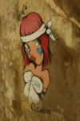](https://www.tkg.org.ua/node/21919)  

Зараз у Франції острів величають не інакше як _Острів Краси_. Але в кінці першого століття до нашої ери життя на Корсиці було "нужденне, тому що земля там -- саме каміння, і острів здебільшого цілком непрохідний, так що мешканці гір живуть розбоєм і лютіші за диких звірів ... Є там лише декілька місць, які з натяжкою придатні для проживання..."  
(Страбон, "Географія").

З опису Корсики грецького географа Страбона одне досі залишається незмінним, -- корсиканці "не виносять життя в неволі". У новітній історії Корсика постійно бореться за незалежність від будь-якої колонізації, -- будь то Тоскана, Генуя, Італія чи Франція, яка врешті погодилася на особливу автономію. Але окрім захисту свобод, зразковим є дбання корсиканців про свою природну спадщину. Полювання на острові було заборонено аж у 1956 році, а зі зміною стилю життя й високогірне випасання овець також поступово згасло. У 1972 році було утворено Природній Парк Корсики, який зараз займає майже 40% острову і захищає представників місцевої флори та фауни. Через відокремленість від континенту серед них надзвичайно велика частка ендемічних (12% всіх корсиканських рослин) -- більше ніде на Землі такі не ростуть. Ендемічних тварин вже менше, бо багато зникли з початку міграції людини на острів у мезоліті.

Проте емблематичною твариною острова став, на диво, неендемічний круторогий корсиканський муфлон. На острів їх почали завозити як домашню тварину неолітичні переселенці з 6-го тисячоліття до нашої ери. З плином часу на континенті муфлон був знищений людиною, а острівна худоба поступово тікала на волю та дичавіла, завдяки чому і вижила. Тому наразі проводяться спроби зворотнього заселення корсиканським муфлоном Альп, Піренеїв тощо. Не дивлячись на заборону полювання, популяція цих гірських овець зросла незначно і нараховує всього близько 500 голів.

У 1970 році виникла ідея прокласти туристський маршрут поверх та вздовж найвищих хребтів, і у тому ж році розпочалося знакування. Утворення Природного Парку прискорило цей процес будуванням прихистків. Так на Корсиці з'явився один з GR-маршрутів -- GR20. Маршрут [перетинає острів](https://www.tkg.org.ua/node/21911) від північного заходу (село Калензана) до південного сходу (село Конка), покриваючи відстань у майже 200 км, відвідуючи найвищі райони Корсики. Зазвичай розраховується на 14-15 днів у сезон (середина червня - вересень). Вздовж усього маршруту в кінці кожного етапу побудовані прихистки (refuge).

GR20 повністю знаходиться на території Парку, відповідно пересування поза стежками, будь-яке бівакування та кемпінґ на території парку заборонені. Ночувати можна лише у прихистках або у наметі біля них. Вартість ночівлі у прихистку 9-11 євро, у наметі біля прихистку - 5-6 євро. У першому варіанті, окрім власне ночівлі, у вартість ще включені газ та дрова. У багатьох прихистках є можливість харчуватися за додаткову плату або просто купити харчі. У пік сезону ночівлі рекомендується бронювати, -- кожен прихисток має обмежену кількість місць, встановлену з міркувань пожежної безпеки (в залежності від розміру будівлі -- від 14 до 36).

Починаючи орієнтовно з 15 травня, у кожному refuge живе охоронець, що керує його життям. Поза сезоном охоронця немає, але всі прихистки, які належать парку (тобто всі, що на маршруті GR20 і позначені абревіатурою "P.N.R.C.") відкриті та забезпечені дровами, газом і посудом. Освітлення є завдяки сонячним батареям та акумуляторам, тому джерела змінного струму 220V немає. За ночівлі, навіть за відсутності охоронця, пропонується платити, для чого стоять скриньки з проріззю. Під час походу ми зустрічали як туристів, які платять, так і тих, хто не платив. Самі ми платили, якщо використовували "невідновлювані" ресурси прихистку, наприклад, дрова. Якщо наша присутність обмежувалася лише спанням на нарах, то ні. Всі прихистки у гарному стані і чисті завдяки прибиранню кожною групою перед звільненням. Окрім refuge d'Asco Stagnu, яка чи то в стані вічного ремонту, чи то її так легка досяжність будь-яким бажаючим автодорогою псує.

[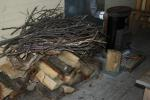](https://www.tkg.org.ua/node/21950)  

Охоронець перед зимовим сезоном має заготовити хмиз, порубані двора та мати справну піч для обігріву прихистку.

[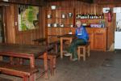](https://www.tkg.org.ua/node/22047)  

Типовий вигляд кухні у прихистку. Пляшки порожні.

[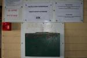](https://www.tkg.org.ua/node/21913)  

Скринька для оплати ночівлі за відсутності охоронця. Під фарбою можна побачити, що інфляція не минає і туризм. Багато скриньок також мають сліди цінників у франках.

### Технічна складність та безпека

Часто, перебільшуючи, GR20 приписується звання найскладнішого у Франції. І хоча у Альпах є як мінімум одна складніша GR-нитка, він залишається одним з найвибагливіших до технічної та, особливо, фізичної підготовки туристів. А імовірні грози, тумани та сніг з дощем додають складності.

Влітку за набором перешкод GR20 приблизно відповідає гірському походу 2-ї категорії складності, проте він довший, ніж стандартні 130 км. На початку сезону для його проходження рекомендується мати кішки, льодоруб і коротку мотузку.

Взимку найвища 7-етапна частина GR20 ходиться скі-туристами під назвою Alta Strada -- знову ж таки, один зі складних і вибагливих лижних маршрутів Франції. Ми не раз дивувалися, проходячи чергову скельну ділянку, крутий сніжник, або гостру ділянку хребта: "як вони тут ще й на лижах примудряються пролізти?" Вартість гіда для тижневого походу по Альта Страді - від 1200 євро з учасника, причому учасники мають бути вже досвіченими скі-туристами.

Навесні, до початку літнього сезону, в залежності від кількості снігу, маршрут міститиме як мінімум 2 перешкоди, категорія яких може легко досягти 2А, -- це Пролом Капітелло та траверс Цирку Самотності. У квітні, на початку травня для пішохідно-гірського проходження маршруту рекомендується користуватися варіантом Alta Strada, який у деяких місцях відрізняється від GR20 через лавинну небезпеку та крутизну схилів (зокрема для двох згаданих вище перешкод). В цей період можна рекомендувати починати маршрут з півдня на північ, таким чином технічно-складна частина припаде на кінець маршруту. До того часу рюкзаки стануть легші, погода краще і трохи менше снігу.

У зв'язку з спеціальним режимом заповідника **планування гірських маршрутів** сильно відмінних від нитки GR20 влітку і в кінці весни дуже складне. Лише у горах північної Корсики, на кордоні зони вегетації (верхів'ях цирків озер Мело та Капітелло; по дузі від верхів'їв р. Ґоло біля прихистку Ciuttulu di i Mori до г. Монте Сінто -- біля прихистків Tighiettu та Erco) можливі цікаві варіанти альтернативних перевалів, які не належать GR20 і в той же час не сильно від нього ухиляються, використовуючи прихистки для ночівель у відповідності до правил Парку. Взимку можливостей ускладнити собі маршрут набагато більше без шкоди навколишньому середовищу.

[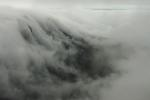](https://www.tkg.org.ua/node/21909)

[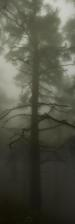](https://www.tkg.org.ua/node/21910)

**Погодні умови** до середини травня у корсиканських горах нестабільні. Середземне Море, випаровуючись з усіх боків острову, піднімається у гори, і, охолонувши, випадає у другій половині дня у різноманітних іпостасях -- від мрячки до граду. Але найулюбленіше його заняття -- це повиснути з висоти 1500 метрів і до ночі густим туманом.

Кількість снігу сильно залежить від сніжності зими та початку весни -- різниця в один і той самий час в різні роки може бути в півметра-метр. Стан снігу у кінці квітня та початку травня вже дозволяє не брати снігоступи. Навпаки, через часті дощі в цей сезон він настільки налигає, що зранку змерзається без кірки на значну глибину. Через це в північній Корсиці часто потрібні кішки (як правило, до обіду). В той же час в південній частині маршруту (Віззавона - Конка) ранкове змерзання снігу майже відсутнє.

На маршруті варто (якщо є вихід в інтернет або SMS-зв'язківець на Батьківщині) кожен день перевіряти прогноз, хоча локальна погода у горах буде гіршою, ніж прогноз по найближчому місту. За нашим досвідом, дуже точний для континентальних гір прогноз від Snow-Forecast постійно помилявся. Незамінне джерело інформації про лавинну обстановку -- [лавинний бюлетень від Meteo France](http://france.meteofrance.com/france/montagne?71606.path=montagnebulletinneige%252FCORSE).

**Виклик рятувальників**, як і по всій Європі, за телефоном 112. Рятування, в тому числі послуги гвинтокрилу, у Франції безкоштовне. Як завжди у горах, не звідусіль буде можливість їх викликати. Оператор Orange, схоже, має краще покриття у гірський місцевості ніж, наприклад, Bouygues Telecom (для екстреного виклику це не має значення -- безкоштовно з будь-якого мобільного телефону в будь-якій мережі).

### Під'їзди ти від'їзди

[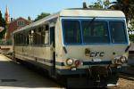](https://www.tkg.org.ua/node/21922)  

"Баланський трамвай" або, як його лагідно тут називають, _u Trinighellu_ (потяжок), ходить вздовж пісчаних пляжів і вперто не модернізується. Роблячи зупинки біля кожного куща, кожної кози, що вирішила попастися на колії, чи пляжником, який постелився прямо перед рейками, він має середню швидкість у 26 км/год і є швидше фото-потягом, ніж засобом пересування.

[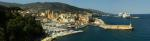](https://www.tkg.org.ua/node/21921)  

Пароми з'єднують всі великі міста узбережжя острову з континентом. Оскільки найбільші (висотою з 4-поверховий будинок) човни вміщають до 2000 пасажирів і декілька сотень автомашин (в т.ч. вантажних), то пароми є еквівалентом материкових автотрас, і ними перевозиться все, чого потребує економіка острова.

У квітні 2011 року найзручнішим і найдешевшим способом дістатися Корсики з Києва була зв'язка літака Alitalia Київ-Піза та парома Corsica-Ferries Ліворно-Бастіа. Від Пізи до Ліворно всього 17 км і широкий вибір автобусів та потягів. Якщо не зволікати з купівлею квитків, що маршрут туди-назад Київ-Бастіа-Київ обходився у 180 EUR (літак) + 60 EUR (паром).

Міжміського транспорту по Корсиці не багато. Наприклад, є всього 2 автобуси Бастіа - Порто-Веччіо на день, проте працює автостоп. Актуальним джерелом розкладів залізничного та автобусного сполучення є сайт [Корсіка Бюс](http://www.corsicabus.org/).

Північний кінець маршруту GR20 -- село Колензана, з липня до вересня зв'язане автобусним маршрутом з містом Калві (13 км). Поза цього періоду - таксі, автостоп або пішки. З Калві до Бастії ходить залізничний ретро-трамвай із мальовничим відтинком шляху вздовж моря до Іль-Рус.

З південного кінця GR20 -- села Конка, в літній сезон ходить човник до села Санте-Люсія-де-Порто-Вечіо (7 км). Можна пропустити перший етап Conca - Refuge de Paliri, під'їхавши 30 км до перевалу Бавелла від с. Солензара автобусом на Зонзу або автостопом. Солензара та Санте-Люсія-де-Порто-Вечіо знаходяться на трасі Бастії - Порто-Веччіо.

**Аварійні сходи** з маршруту можливі на кожному етапі. Автомобільні дороги перетинають GR20 у 3 місцях - перевал Бавелла, перевал де-Верде та перевал Вергіо. Також автомобільні дороги підходять до refuge d'Asco Stagnu і refuge de Capanelle, але машин там дуже мало. З багатьох сідловин, у відповідності до карт, є можливість зійти в долини (але не з усіх -- каньйони!), звідки через 5-20 км можна дістатися цивілізації.

Дешево переночувати на заходах та відходах з маршруту можна у кемпінґах. Середня вартість намету 2.5-3.5 EUR, людина - 3-5 EUR.

Бастіа:  
\- кемпінґ Les Sables Rouges (на березі, на південь ~5 км від порту за містом)  
\- якщо потрібно бути дуже рано в порту, то найдешевший готель у Бастії -- це Posta Vecchio (45 EUR 2-місний номер, є один секретний номер за 40 EUR без душу)

Калензана:  
\- кемпінґ/gîte d'etape (на виїзді з міста в сторону Калві - повернути праворуч біля заправки по вказівнику). Є спільна кухня.

Калві:  
\- кемпінґів дуже багато і всі прямо в місті. Один з дешевих - це 1-зірковий Les Cles des Champs. Кухні немає.

Віззавона (середина маршруту GR20):  
\- кемпінґ біля вокзалу Віззавона (3 км від самого перевалу)

Піза:  
\- кемпінґ Torre Pendente у 700 метрах від Пізанської Вежі. Поруч з супермаркетом.

### Мапи

[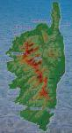](https://www.tkg.org.ua/node/21911)  

Сучасна нитка маршруту GR20 на тлі острову. Як видно, маршрут перетинає острів строго найвищими ділянками гір.

Для загальної орієнтації на маршруті та туризму після походу достатньо кілометрівок IGN серії TOP100 - мапи 175 Bastia, Corte (північна частина GR20) та 176 Ajaccio, Bonifacio (південна частина GR20).

Ідеальними картами для технічних перешкод та прецесійного орієнтування є 250-метрові карти IGN серії TOP25. Щоб покрити увесь GR20 знадобиться 5 карт. Якщо мапи з таким мірилом не треба для всього маршруту, то потрібні ділянки можна роздрукувати з [ГеоПорталу](http://www.geoportail.fr/), де доступні всі згадані карти.

## Маршрут

Словник для читання маршруту:  
col (фр.), bocca (корс.) - перевал  
pointe (фр.), punta (корс.) - пік  
mont (фр.), monte (корс.) - гора  
refuge (фр.) - прихисток  
plateau (фр.) - плато  
cascade (фр.) - водоспад  
lac (фр.) - озеро  
ar?te (фр.) - вузький гребінь  
bergerie (фр.) - овчарня

Маршрут: Col de Bavella (авто., 1218) - refuge de Asinau (1536) - \[col de Monte Incudine (2025) - Monte Incudine (2134)\] (**н/к-1А**) - plateau de Coscione - траверс Arete a Monda (**н/к-1А**) - refuge d'Usciolu (1740) - траверс \[Monte Furmicola (1981) - Punta Bianca - col de Rapari (1614) - Punta di Campitello (1937) - в. 1993\] (**н/к-1А**) - refuge de Prati (1820) - Col de Verde (авто., 1289) - Col de Flasca (н/к, 1420) - refuge de Capanelle (1586) - Col de Vizzavona (авто., 1163) - cascades des Anglais - Bocca Muratello (**1А\***, 2021) - refuge de l'Onda (1431) - траверс \[Bocca d'Oreccia (1427) - Serra di Tenda - Bocca a Meta (н/к, 1890) - Pointe Murace (1921) - Bocca Manganello (1800)\] (**1А**) - refuge de Petra Piana (1850) - [зв'язка \[Col de Muzzella (2206) - Col de Rinoso (2100)\]](https://www.tkg.org.ua/node/21898) (**1Б**) - lac de Melo - bergerie de Grotello - bergerie de Cappellaccia - refuge de Sega (1150) - lac de Nino - Bocca a Reta (н/к, 1883) - Bocca San Pedro (н/к, 1452) - Castellu di Verghio - bergerie de Radule - refuge Ciuttulu di i Mori (1991) - Col des Maures (2A, рад., з невизначальної сторони) - Bocca di Foggiale (**н/к-1А**, 1962) - refuge Tighiettu (1683) - [Col du Vallon](https://www.tkg.org.ua/node/21393) (**1Б\***, 2380) - refuge Asco Stagnu (1422) - зв'язка \[Bocca di Stagnu (2010) - Bocca a Muvrella (2000)\] (**1А**) - refuge de Carrozzu (1270) - col de Ghiallu (н/к, 1912) - col d'Avortoli (н/к, 1989) - refuge de l'Ortu di u Piobbu (1520) - Calezana

## Проходження маршруту

### 23 квітня: col de Bavella - refuge Asinau

Переночувавши у Бастії, сіли під дощем о 8:30 на автобус (зупинка навпроти пошти) у напрямку Порте-Веччіо до Солензари. Проконсультувавшись по приїзді у Офісі Туризму, що автобусів до перевалу Бавелла в цей сезон не буває, і простопивши на трасі годину (дощ доречно зробив паузу на цей час), нарешті їдемо до перевалу. Поки доїхали дощ розпочався знову.

З перевалу, знайшовши біло-червоний маркер, повз статуї Notre Dame des Neiges йдемо стандартним маршрутом до прихистку Asinau. Проходження альпійського варіанту через Голки Бавелли (нагромадження скельних стовпів -- дорослий варіант Долини Привидів у Криму), які у гарну погоду добре видно з перевалу, через туман і погоду втрачає зміст.

Перед підйомом до прихистку проходимо переправу потоку. Ріка від дощу піднялася, тому маркований шлях став небезпечним -- необхідність перестрибування мокрими валунами над бурхливим потоком. Спокійніше місце є трохи вище, де перейшли вбрід по стегно.

У прихистку знайшли п'ятеро чехів, які другий день йшли під сильним дощем з Конки. Планують пройти GR20, зі спорядження -- тільки трекінґові палки. Один з чехів півтора роки працював у Києві, тому намагається демонструвати свою російську. Решта його друзів непогано розуміють українську і так.

### 24 квітня: refuge Asinau - Monte Incudine (н/к-1А) - траверс Ar?te a Monda (н/к-1А) - col de Verde

Зранку дощу немає, але швидко піднімається туман. Набираємо 500 метрів до перевалу, з якого піднімаємося ще 100 метрів на **Monte Incudine (н/к-1A)**. Підйом крутий, у верхній частині треба траверсувати кілька коротких сніжників.

[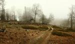](https://www.tkg.org.ua/node/21951)  

Туман на плато Coscione

Спуск від вершини із поваленим бетонним хрестом починається по широкому і простому сніжному ребру у тумані. На середині спуску хребет розширюється, продовження спуску знаходимо тільки з компасом -- сніг позасипав маркери. Спускаємося на зелене хвилясте плато Coscione -- унікальне для Корсики утворення, що віддалено нагадує кримські яйли.

[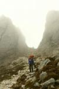](https://www.tkg.org.ua/node/21949)  

Один з числених проломів хребту Arete a Monda

Після перетину плато кінець дня до прихистку Usciolu йдемо вузьким хребтом **Arete a Monda (н/к-1А)**. Стежка закладає зигзаги по скельних щілинах і кулуарчиках, обходячи жандарми. Дощу немає, інакше б це сильно заважало -- часто треба перетинати слизькі плити.

У прихистку вже сушилася німецька група з 6 чоловіків. У них похід на шість днів, увесь GR20 йти не збираються. Екіпіровані всім, несуть і мотузку. В попередній день вони через дощ зійшли з GR20 і ночували, схоже, біля зачиненого прихистку Matalza на маршруті Mare a Mare Centre.

### 25 квітня: refuge d'Usciolu - траверс до Punta Della Cappella (н/к-1А) - col de Verde

З самого ранку дощ і сильний вітер, виходимо перші. Початок підйому на Monte Formicola простий і пологий. Після вершини налетів туман.

Від вершини до перевалу de Lapato траверс в стилі вчорашнього дня -- обходи, облази і проходи крізь скельні провали. В одному місці натрапили на спуск з провалу по крутому сніжнику кудись у туман. Подумали, що може варто почекати німців з їх мотузкою, проте потім пройшли з льодорубом косим траверсом на камені, які стало видно у розриві туману.

На привалі у першому лісочку німці нас наздоганяють, бажають нам "Have fun!" і після цього більше ми їх не бачили. Імовірно, вони зійшли знову в бік, бо погода тільки погіршувалася -- дощ посилився, а туман закрив усе далі 30 метрів.

Від перевалу Rapari (1614) до вершини Punta di Campitello (1937) найнеприємніша ділянка сьогоднішнього траверсу -- сильний вітер, дощ, стежка по скелях, якими ллється вода. Оскільки зупинятися холодно, то йдемо без привалів. Перед Punta Della Cappella (2041) стежка починає траверс західного скельно-сніжного-кущового схилу. М'який сніг часто провалюється біля каміння, ідемо з палками. Маркерів майже не видно, зате є старі сліди -- не завжди за маркером. На початку спуску з плеча Punta Della Cappella нарешті хмара пролітає і далеко внизу стає видно refuge Prati.

[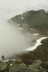](https://www.tkg.org.ua/node/21952)  

Вихід з хмари на спуску з Della Cappella

Не дивлячись, що йшли вже 3 години без привалу, не робимо його і зараз. Тільки через півгодини у прихистку робимо пізній обід (15-та година) і сушку, бо промокли повністю. З черевиків зі шкарпетками набирається по півлітру води.

Після обіду спускаємося вже без дощу на автомобільний перевал di Verde, де знаходимо недобудований прихисток і охоронця, який люб'язно дозволяє безкоштовно переночувати всередині. Невдовзі приходять мокрі чехи, схожі у своїх чорних софтшелах на водолазів у неопрені. Їм трохи більше пощастило -- дощ і туман припинилися, поки вони ще були на гребені, і вони хоч щось бачили навкруги.

### 26 квітня: col de Verde - refuge de Capanelle - col de Vizzavona

З двох варіантів сьогоднішнього етапу -- альпійського через озера Бастані та траверсом по лісу, вибираємо останній, оскільки він дає можливість пройти 2 етапи за один довгий день (26 км), а Monte Renoso і озера все одно в хмарі.

Після підйому і спуску з лісового перевалу Flasca, переправляємося вбрід майже по пояс через вузький rau de Marmano. Набравши 200 метрів стежка стає горизонтальною і веде практично на одній висоті до refuge de Capanelle, де робимо обід. По обіді проходимо ще етап і о 19-ій годині спускаємося на перевал Віззавона.

Ми не знали, що варто було спускатися до села Віззавона, де біля вокзалу розташований кемпінґ, і що на перевалі ночувати заборонено (і прихисток, і готель ще закриті), то починаємо йти 3 км вниз до вокзалу. Дорогою зустрічаємо відгалуження стежки ліворуч до річки, де у кущах у 10-ти метрах від траси і майже біля села, знаходимо рівне місце і ночуємо просто у наметі. Намет поставили після сутінок і вранці зібрали до сходу сонця.

### 27 квітня: Vizzavona - перевал Muratello (1А\*) - refuge de l'Onda

[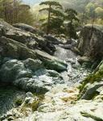](https://www.tkg.org.ua/node/21932)  

Серія Водоспадів Англійців

Сьогодні має бути набір 1100 метрів на перевал перед перевалом **Muratello (2141, 1А\*)**. Сонячним ранком проходимо повз місцевий мотузяний парк і виходимо на стежку через гарні каскади Водоспадів Англійців. Продовжуємо підйом у шматках туману, що періодично пролітають, по баранячих лобах до початку снігу, потім траверсом по сніжниках виходимо на вузький скельний перевал.

[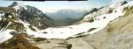](https://www.tkg.org.ua/node/21938)  

Вид на південь з перевалу Muratello

[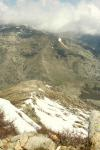](https://www.tkg.org.ua/node/21937)  

Вид на північ з перевалу Muratello (видно початок підйому на Serra di Tenda і урочище Onda)

[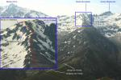](https://www.tkg.org.ua/node/21936)  

Маршрут спуску з перевалу Muratello. Сфотографовано зі схилу Capu a Meta

З перевалу спуск проходить по північному ребру вершини Muratello. За наявності снігу (як у нас) треба спускатися вздовж краю ребра по залишках сніжного надуву (для виходу на нього доводиться продертися по кущах). Літня ж маркована стежка траверсує надто крутий кулуар шириною 50-60 метрів і потім все одно виходить на ребро.

Не доходячи до перевалу Bocca d'Oreccia (1427), робимо обід. За водою треба спускатися до refuge de l'Onda і далі 200 метрів до струмка у лісі. Після обіду звично налітає туман і вирішуємо залишитися тут на ночівлю, хоча по карті до наступного прихистку всього 4 км траверсом ребра Serra di Tenda.

Пару годин згодом з долини до прихистку виходить французька пара, які роблять дводенну прогулянку. Чехи до кінця дня так і не з'являються, можливо вирішили відпочити день.

### 28 квітня: refuge de l'Onda - траверс Serra di Tende (1А) - refuge Pietra Piana

Зранку очевидно, що погода довго не протримається. Швидко піднімаємося на Serra di Tende і рухаємося далі по гарній стежці. Перед вершиною 1957 зненацька хребет стає схожим на гребінець -- суцільні відколи та жандарми.

[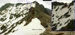](https://www.tkg.org.ua/node/21941)  

Проходження складної частини **траверсу Serra di Tenda (1А)** до виходу на перевал Bocca a Meta

Маркер пірнає вниз по схилу для обходу. Але зараз це 30-градусний фірновий схил з незручним виходом на нього та перепадом у 30 метрів. Потім ще стільки ж по менш крутому схилу, а потім баранячі лоби кудись вниз. Беремо льодоруб і, користуючись тимчасовою відсутністю туману, в три такти півгодини спускаємося і траверсуємо схил, намагаючись переходити від каменів до каменів, до виходу на Bocca a Meta. Важко уявляємо, як тут пройдуть чехи тільки з палками і відставанням на півдня.

З Bocca a Meta підйом на Pointe de Pinzi Corbini потребує 5-7-метрого простого лазіння з рюкзаком, після чого стежка знову проявляється. Виходимо на вершину вже в тумані. Надалі стежка проста (широченний хребет), але її добряча доля ще під сніжними надувами. Після траверсу Punte Murace і виходу на перевал Manganello стежка траверсує скелі на константній висоті, для того щоб вийти на прихисток Petra Piana. Остання ділянка не складна, тим не менше на неї витрачається багато часу, оскільки вона проходить крихкими скелями, руслами струмків і поваленими зимовим снігом великими кущами. Крім того, починається дощ.

Заходимо в прихисток вже під сильним дощем. Через годину розійшлася сильна гроза з градом. Чехам зараз непереливки на перевалі Мурателло, а далі вони б не встигли пройти. Блискавки і град продовжуються до ночі.

### 29 квітня: refuge Pietra Piana - Bocca di Muzzella - Col de Rinoso - lac de Melo - refuge de Sega

Зранку виявляється, що випало 7 см граду, який добряче змерзся. Від прихистку треба вийти на хребет, звідки продовжити підйом на перевал Музелла (або перевал Високого Шляху). Опис проходження перевалів **Muzzella та Rinoso (1Б)** див. у паспорті:

[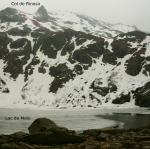](https://www.tkg.org.ua/node/21898)  

[Перевали \[Bocca di Muzzella (2206) та Col de Rinoso (2160)\]](https://www.tkg.org.ua/node/21898)  
(**1Б**)

Від озера Мело стежка з трьома прольотами сталевих сходів спускається на паркінг. Звідти спускаємося 4 км дорогою до другого мосту. Перейшовши міст ліворуч починається помаранчевий маркер, який, роблячи великі петлі, піднімається 600 метрів по ребру до овчарні Сappellaccia на перевалі, яка ніби висить над горами. Від перевалу той самий маркер спускається 200 метрів до прихистку Сеґа на березі красивого каньйону з озером і водоспадом. Прихисток знаходиться не під юрисдикцією Парку, тому охоронець на місці. Ночуємо у наметі по 6 євро з людини.

[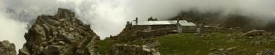](https://www.tkg.org.ua/node/21926)  

Овчарня Cappellaccia на шляху до refuge a Sega

[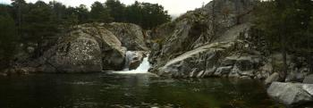](https://www.tkg.org.ua/node/21927)  

Початок каньону з водоспадом і озером біля refuge de Sega

### 30 квітня: refuge de Sega - lac de Nino - bergerie de Radule

Туман з самого ранку довгого дня підйому до льодовикового озера Ніно. По мірі підйому до озера пейзажі навкруги поступово стають приполярними -- туман, вітер, мряка, плями снігу, низькі рослинність та температура. Приполярного враження додає те, що десь в тумані над усім цим має нависати гора з майже арктичною назвою Punta Artica.

[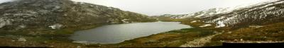](https://www.tkg.org.ua/node/21935)  

Льодовикове озеро Ніно

Швидко обідаємо на озері. Lac de Nino має глибину 11 метрів і лише 6-7 місяців на рік знаходиться не під кригою. Судячи з погоди біля озера, ми мабуть застали перший з таких місяців.

Від озера останній підйом на простий траверс у тумані схилу гори Capu a u Tozzu і довгий спуск на перевал di Verghio. На перевалі знаходимо непрацюючий готель біля лижної станції.

Йдемо далі (від виходу на дорогу треба пройти нею вгору метрів 400 за поворот і заново відшукати марковану стежку). Досягнувши живописних жовтих скель біля водоспаду, на яких притулилася овчарня Radule, ночуємо у недобудованому туристському притулку, де поки що є тільки нари.

### 1 травня: bergerie de Radule - refuge Ciuttulu di i Mori - Col des Maures (2А, рад.) - Bocca di Foggiale (н/к-1А) - refuge de Tighjettu

[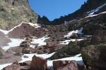](https://www.tkg.org.ua/node/21933)  

Перевальний злет перевалу Col des Maures з невизначальної сторони. Видно цікаве геологічне утворення у скелі - дірку Trou de Tanufatu

[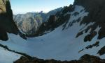](https://www.tkg.org.ua/node/21934)  

Вид на початок спуску з перевалу Маврів

Перед прихистком стежка робить оглядовий тур по верху кілометрових обривів у сторону ущелини Lonca. Видно море і села на узбережжі.

Від прихистку робимо радіальний вихід на перевал Маврів (**Col des Maures, 2А**) -- скельно-сніжний, 100 метрів простого підйому по сипусі під снігом від прихистку. Останні метри виходу на скельну вузьку сідловину доводиться допомагати собі руками. На північну сторону перевал обривається крутим сніжним 45-50° схилом на ~2 мотузки по 50 метрів у снігову чашу. Продовження спуску у тісну долину затулено троговими сходинками, але знизу очікує кілометровий каньйон з 100 метрами дюльферу або лазіння вниз. Північний перевальний схил знаходиться в тіні навіть після обіду. Від перевалу веде простий (1Б, мотузка не треба) маршрут на Paglia Orba.

[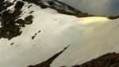](https://www.tkg.org.ua/node/21930)  

Карниз на перевалі Bocca Foggiali

[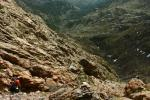](https://www.tkg.org.ua/node/21929)  

Спуск по камінню лівим бортом струмка Foggiali

Від прихистку майже не втрачаючи висоти виходимо на перевал **Bocca di Foggiale (н/к-1А)**. На перевалі досить великий карниз. Обходимо його виходом на скелі ліворуч і відшукуємо маркер. Маркер спускається по дуже неприємній стежці з каміння на крихких скелях аж до самого заходу в ліс.

[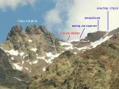](https://www.tkg.org.ua/node/21942)  

Вид на перевал Придолинку від початку долини Stranciacone

У лісі стежка повертає в долину Stranciacone, по якій виводить до прихистку Tighjettu. З долини видно завтрашній перевал Придолинку (Col du Vallon), на який вирішили замінити GR-ий Цирк Самотності. Він вищий на 200 метрів, має бути пологішим, і використовується скі-туристами як зимова альтернатива Цирку Самотності.

### 2 травня: refuge de Tighiettu - Col du Vallon (1Б\*) - refuge d'Asco Stagnu

Опис проходження перевалу Col du Vallon див. у паспорті перевалу:

[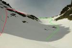](https://www.tkg.org.ua/node/21393)  

[Col du Vallon (перевал Придолинку)](https://www.tkg.org.ua/node/21393)  
(**1Б\***)

Дощ почався за 200 метрів від прихистку і вже не припинявся до ночі. Прихисток Ascu Stagnu великий, але у поганому стані -- брудний і обшарпаний. Додатково до звичайних газу, дров та води є розетки 220V. На стінах розвішані цікаві інформаційно-агітаційні матеріали з перенаселення Землі і проти народження дітей.

### 3 травня: refuge d'Asco Stagnu - \[пп. Bocca di Stagnu та Bocca a Muvrella\] (1А) - refuge de Carrozzu

[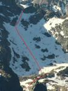](https://www.tkg.org.ua/node/21920)  

Спуск з перевалу Bocca a Muvrella. Сфотографовано зі схилу Capu Landocellu (передостанній етап GR20).

[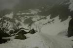](https://www.tkg.org.ua/node/21939)  

Вид на спуск з перевалу Muvrella і озеро

[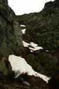](https://www.tkg.org.ua/node/21928)  

Підйомний кулуар на перевал Bocca di Stagnu. Перші сніжники

Через сильний вчорашній дощ туман починає клубочитися з вже 7-ї ранку.

Прямо з одного з пожежних виходів прихистку стежка піднімається по лісу на перевал Bocca di Stagnu. Вище зони лісу стежка дереться широком скельним кулуаром з двома-трьома недовгими паралельними директрисі сніжниками. Після сніжників маркер виходить на правий борт кулуару і обходить його круту ділянку по скелях (іноді доводиться допомагати собі руками). На обході зустрічається рівне місце для стоянки (води поруч у недощову погоду імовірно не буде). Від стоянки підйом продовжується до виходу на скельно-трав'яну сідловину.

З туманної сідловини традиційно нічого не видно. Коротко траверсуємо трав'янисто-скельною стежкою на перевал Bocca a Muvrella, де знаходимо його північний схил повністю під товстим шаром снігу від самої сідловини. Початок спуску (а далі в тумані не видно) надто крутий для руху з палками. Поки замінюємо їх на льодоруб встигаємо у тумані побачити озеро під перевалом, що дає змогу зорієнтуватися у масштабі перевального злету та намітити шлях спуску.

Від сідловини з самостраховкою льодорубом спускаємося мокрим снігом на 30 метрів у снігову яму під скелею правого за напрямом руху борту. З ями ще метрів 60 по антиградієнту прямо до берега озера. Схил однорідний, без каміння і кущів, від сідловини до самого озера, тому може бути лавинонебезпечним навіть в цей період.

[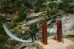](https://www.tkg.org.ua/node/21940)  

Підвісний міст Passerelle de Spasimata. Прославився (як і увесь GR20) зйомками у популярній комедії _Les Randonneurs_.

[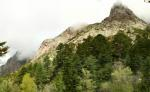](https://www.tkg.org.ua/node/21931)  

Гора Capu Micciciagniu над прихистком Carrozzu

Від озера, перелізши камінний бугор з туріками, входимо вже по маркеру у красивий каньон, що є частиною однієї з корсиканських родзинок -- Цирку Боніфату, свідка бурхливої льодовикової історії острова.

Пройшовши останні страхувальні ланцюги перед підвісним мостом і сам міст, повертаємо у сусідню долину і через 500 метрів виходимо до прихистку Карроззу. Порівняно з майже безлюдними попередніми ночівлями тут справжній прохідний двір -- знизу піднімаються люди на денні прогулянки.

### 4 травня: refuge de Carrozzu - refuge de l'Ortu di u Piobbu - Colenzana

Зранку з перевалу під вершиною Ghialla гарна погода вперше радує видами від моря до засніженого масиву Monte Cinto. Видно в т.ч. початки спусків з перевалів [Col du Vallon](https://www.tkg.org.ua/node/21890) та [Bocca a Muvrella](https://www.tkg.org.ua/node/21920). Спускаючись у Калензану, своїм спорядженням на зовнішній підвісці рюкзаків лякаємо туристів, які тільки починають GR20. Кожен з надією почути негативну відповідь перепитує, чи дійсно ми використовували льодоруб, кішки та каски. Руйнуючи сподівання на шару, все ж таки підбадьоруємо, що сніг дуже швидко тане, і з кожним днем маршрут наближається до свого літнього вигляду.

У Калензані, впевнившись, що агенція Les Beaux Voyages ще не почала сезонні рейси, поселяємося у кемпінґу на виході з села. Зранку швидко ловиться попутка з місцевим жителем, що переїхав сюди з Континенту на пенсію, яка довозить до Калві.

[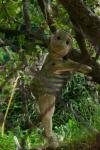](https://www.tkg.org.ua/node/21914)  

Суворі корсиканські ляльки з Калензани. Такі могли загартувати хлопчика Набуліоне Буонапарте так, що він став Імператором. Наполеон у юності сильно захоплювався Паскалем Паолі -- лідером визвольного руху Корсики проти влади Генуї та, пізніше, її керівником, секретарем якого, до речі, працював батько майбутнього Імператора. Але отримавши владу у Франції розчарувався у ньому і вже сам розчавив спроби відновити незалежність.

[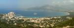](https://www.tkg.org.ua/node/22046)  

Вид на залив Калві, місто, фортецю і неперервний пляж берегом заливу з нескінченним мілким морем. Вітрильник у заливі більше ніж доречний, бо місто є одним з найвірогідніших місць народження Христофора Колумба, на честь якого тут намагаються назвати як умога більше готелів, ресторанів та вулиць. Ще у Калві відчувається велика присутність військ НАТО на Корсиці -- у фортеці розташований будинок офіцерів 2-го Парашутного Полку Іноземного Легіону, тому прогулянка цитаделлю супроводжується швендянням військових льогковушек, які шкрябають середньовічні арки довгими антенами автомобільних рацій.

## Висновок

Цікавий район з галопуючою низкою перехоплюючих дихання видів, незруйнованою природою, гірськими перешкодами від некатегорійних до 2А (без врахування скельних альпмаршрутів), теплим морем і потужною культурною спадщиною. Одна з цих причин вже варта поїздки, але на Корсиці в будь-якому разі отримаєш все одночасно. З додаткових плюсів -- порівняно низка вартість потрапляння на острів (з України - біля 250 євро), цілковита відсутність адміністративних проблем та "національних особливостей" відвідання гір у постсовкових сусідах, швидка і безкоштовна система рятування, а також можливість зробити необов'язковий, але цікавий і малобюджетний транзит через, на вибір, Пізу, Флоренцію, Лукку або Ніццу, Монте-Карло, Марсель, або Сардинію.
