**Звіт**

про гірський туристський

спортивний похід 1 категоріїї складності

Кримом

Що був здійснений з 29.12 2012 р. по 06.01 2013 р.

Маршрутна книжка - 49-ГЕ/12 ЦМКК

Керівник групи Грабець Богдан Богданович

Контакти керівника: grabets1{a}yandex.ru

Маршрутно-кваліфікаційна комісія ЦМКК ФСТУ розглянула звіт і вважає, що похід може бути зарахований усім учасникам та керівникові як похід 1(першої) категорії складності.

Звіт використовувати в бібліотеці т.к. "Глобус" на сайті [http://tkg.org.ua/](http://tkg.org.ua/)

Штамп МКК

## Зміст

1\. Довідкові дані про туристський спортивний похід

1.1. Параметри походу

1.2. Характеристика районів проведення походу

1.3. Докладна нитка маршруту

1.4. Дані про досвід учасників

2\. Організація туристського спортивного походу

2.1. Загальна ідея походу

2.2. Варіанти під?їзду та від?їзду. Обґрунтування вибору точок початку та кінця маршруту

2.3. Аварійні виходи з маршруту та його запасні варіанти

2.4. Зміни маршруту та їх причини

2.5. Інформація про проходження маршруту кожним учасником

3\. Графік руху та технічний опис проходження маршруту

3.1. Графік руху

3.2. Висотний профіль маршруту

3.3. Технічний опис проходження маршруту

3.4. Технічні перешкоди

3.5. Картографічний матеріал

4\. Висновки та рекомендації щодо проходження маршруту

### 1\. Довідкові дані про туристський спортивний похід.

### 1.1. Параметри походу

<table><tbody><tr><td rowspan="2"><b>Вид туризму</b></td><td rowspan="2"><b>Категорія складності</b></td><td rowspan="2"><b>Довжина маршруту, км</b></td><td colspan="2"><b>Тривалість</b></td><td rowspan="2"><b>Термін проведення</b></td></tr><tr><td><b>Загальна</b></td><td><b>Ходових днів</b></td></tr><tr><td>гірський</td><td>перша</td><td>112</td><td>9</td><td>9</td><td>29.12.2012-6.01.2013</td></tr></tbody></table>

### 1.2. Характеристика районів проведення походу

Кримські гори (кримськотат. Q?r?m da?lar?, Къырым дагълары) - гірська система, що займає південну та південно-східну частину Кримського півострова.

Гірська система утворена трьома гірськими грядами, що простягаються від мису Айя в околицях Балаклави на заході до мису св. Іллі у Феодосії на сході. Довжина Кримських гір становить біля 160 км, ширина біля 50 км. Зовнішня гряда представляє собою ряд куест, що поступово піднімаються до висот близько 350 м. Внутрішня гряда досягає висоти 750 м. Найвища точка протяжної вздовж Північного Берега Чорного моря Головної гряди - гора Роман-Кош висотою 1545 м, знаходиться на Бабуган-яйлі.

Сніжна зима в Криму починається з другої половини січня та продовжується до середини березня.

Технічно цікавою частиною кримських гір є так званий ?Центральний Крим? - це район Ангарського перевалу і включає в себе східні відроги Бабуган-яйли, схили Чатир-Дагу, Демерджі, Тирке та Карабі-яйли. На цих схилах зосереджена більшість локальних гірських перешкод, яких достатньо для проходження походів 1-2 категорії складності.

### 1.3. Докладна нитка маршруту

с. Міжгір?я - т/с Бурульча - Курган Слави - [пер. Кизил-Коба (1А)](https://www.tkg.org.ua/node/29562) - т/с Кизил-Коба - с. Перевальне - т/с Курлюк-Баш - Демерджі-яйла - [пер. 3 сосни (1А)](https://www.tkg.org.ua/node/29563) - ущ. Хапхал - [пер. Тирке Центральний (1А)](https://www.tkg.org.ua/node/29564) - т/с Ай-Алексій - т/с Чігенітра - [пер. Кенгеч (1А)](https://www.tkg.org.ua/node/29565) - пер. Малі Ворота - пер. Горуча - с. Арпат - с. Морське

### 1.4. Дані про досвід учасників

<table><tbody><tr><td></td><td><b>П.І.П.</b></td><td><b>Рік народження</b></td><td><b>Обов?язки в поході</b></td><td><b>Туристський досвід</b></td></tr><tr><td>

</td><td>Грабець Богдан Богданович</td><td>1987</td><td>керівник</td><td>1ГК Крим(з), 1ПК Карпати, 4ГУ Кавказ</td></tr><tr><td>

</td><td>Рябуха Сергій Миколайович</td><td>1989</td><td>пом. керівника, завгосп</td><td>1ГК Крим, 2ГУ Кавказ</td></tr><tr><td>

</td><td>Халімончук Віталій Миколайович</td><td>1990</td><td>завспор</td><td>1ПК Карпати</td></tr><tr><td>

</td><td>Олімпієв Микита Дмитрович</td><td>1990</td><td>літописець</td><td>1ПУ Карпати, н/к К Крим</td></tr><tr><td>

</td><td>Кудряшов Богдан Юрійович</td><td>1989</td><td>ремонтник</td><td>н/к Карпати, Крим</td></tr><tr><td>

</td><td>Гончаров Дмитро Олексійович</td><td>1989</td><td>еколог</td><td>1ПК Карпати, 1ПУ Крим</td></tr><tr><td>

</td><td>Чечуга Роман Миколайович</td><td>1984</td><td>учасник</td><td>н/к Карпати, Крим</td></tr><tr><td>

</td><td>Козлик Олександр Вікторович</td><td>1992</td><td>фотограф</td><td>н/к Карпати</td></tr><tr><td>

</td><td>Мельник Ярослав Сергійович</td><td>1983</td><td>логіст</td><td>н/к Карпати, Крим</td></tr><tr><td>

</td><td>Рубан Марина Леонідівна</td><td>1993</td><td>участник</td><td>1ГУ Карпати</td></tr><tr><td>

</td><td>Бєлова Ганна Олександрівна</td><td>1971</td><td>учасник</td><td>н/к Кавказ з ел. 3 к. с.</td></tr><tr><td>

</td><td>Романова Сабіна Миколаївна</td><td>1983</td><td>учасник</td><td>2ПУ Карпати</td></tr><tr><td>

</td><td>Селезньова Поліна Олександрівна</td><td>1983</td><td>медик</td><td>н/к Кавказ</td></tr><tr><td>

</td><td>Леонтьєва Катерина Сергіївна</td><td>1993</td><td>фінансист</td><td>н/к Крим, Карпати</td></tr><tr><td>

</td><td>Міщенко Іван Валерійович</td><td>1988</td><td>учасник</td><td>н/к Карпати(з)</td></tr></tbody></table>

### 2\. Організація туристського спортивного походу

### 2.1. Загальна ідея походу

Метою даного походу була підготовка до більш серйозних походів, набуття вмінь, навичок ведення та організації життєдіяльності в зимових гірських умовах, набуття учасниками індивідуальної техніки пересування різними видами рельєфу - осипами різної величини, снігу.

Район Південно-Східного Криму був вибраний у зв?язку з наявністю переважної кількості перевалів 1А категорії складності, представлених в гірському Криму, що дозволяють пройти похід першої категорії складності в Україні в відносно сприятливих кліматичних умовах.

Основною ідеєю даного походу було розширення географії категорійних перевалів, включення яких в нитку маршруту дозволило б перенести основну технічну роботу, а також і фізичну напруженість, в середину походу. Оскільки на даний момент освоєні перевали розташовуються таким чином, що проходження їх ділить маршрут на дві чітко розділені частини походів: технічну та пішохідний добір кілометрів. Також задумкою походу був його якомога більш наближений графік набору висоти до великих гір.

Для більшості учасників похід був першим подібним досвідом і тому мав забезпечити естетичне задоволення від краєвидів, помірні фізичні навантаження і комфортний відпочинок, формування команди і переконань, притаманних спортивному туризму, ведення здорового способу життя.

### 2.2. Варіанти під?їзду та від?їзду. Обґрунтування вибору точок початку та кінця походу.

Точки початку та закінчення маршруту вибирались за принципом зручності та без проблемності під?їзду та від?їзду чисельної групи. Підходящим для цього є населені пункти з добре налагодженим сполученням з Сімферополем, будь то рейсовий або комерційний транспорт. Початок маршруту в с. Міжгір?я був вибраний в зв?язку з його невеликої віддаленості від траси Сімферополь - Керчь, а також для забезпечення основної цілі походу: поступового набору висоти та кілометражу. На нашу думку закінчення походу в Криму є тільки одне - на морі?, так як спуск до моря в кінці походу несе в собі не тільки потужну мотиваційну роль, але й чисто практичні цілі - проведення останньої ночівлі в комфортних умовах з гарячою водою, для приведення групи в належний стан.

До с. Міжгір?я курсує рейсовий транспорт з Сімферополя, але ми скористувалися послугами приватних перевізників. Від м. Судак регулярно, через кожні 20-30 хвилин, курсує рейсовий транспорт до Сімферополя.

### 2.3. Аварійні виходи з маршруту та його запасні варіанти

**Заявлена нитка маршруту:**  
  
с. Міжгір?я - т/с Бурульча - Курган Слави - пер. Кизил-Коба (н/к - 1А) - т/с Кизил-Коба - с. Перевальне - т/с Курлюк-Баш - Демерджі-яйла - пер. 3 сосни (1А) - ущ. Хапхал - пер. Тирке Центральний (1А) - т/с Ай- Алексій - т/с Чігенітра - пер. Кенгеч (1А) - пер. Малі ворота - пер. Горуча - с. Арпат - с. Морське

**Запасні варіанти:**

1\. В обхід пер. Кизил-Коба спуск з яйли по стежці правіше кулуару до т/с Кизил-Коба.

2\. В обхід пер. 3 сосни спуск в ур. Хапхал по стежці від в. 1244.

3\. В обхід пер. Тирке Центральний рух по маршруту 138 до т/с Ай-Алексій.

4\. В обхід пер. Кенгеч рух по р. Фул.

**Аварійні виходи з маршруту:**

До найближчих сіл та Ангарського перевалу.

### 2.4. Зміни маршруту та їх причини

Маршрут пройдено по основному варіанту.

### 2.5. Інформація про проходження маршруту кожним учасником

Маршрут пройдено всіма учасниками в повному обсязі.

### 3\. Графік руху та технічний опис проходження маршруту

### 3.1. Графік руху

<table><tbody><tr><td><b>Дата День походу</b></td><td><b>? ділянки маршруту</b></td><td><b>Назва ділянки</b></td><td><b>Час проходження</b></td><td><b>Відстань та перепад висот, м</b></td><td><b>Метеоумови</b></td><td><b>Опис ділянки</b></td><td><b>Примітки</b></td></tr><tr><td>1</td><td>2</td><td>3</td><td>4</td><td>5</td><td>6</td><td>7</td><td>8</td></tr><tr><td>
29.12

1 день
</td><td>1.1</td><td>С. Міжгір?я - дорога над р. Бурульча</td><td>
11:30 - 12:15
</td><td>
3,7 км

+110 м/

-25 м
</td><td>Хмарно, легкий туман, бізвітряно</td><td>Ґрунтова дорога, місцями залишки снігу та калюжі</td><td></td></tr><tr><td></td><td>1.2</td><td>Дорога над р. Бурульча - пам?ятник ?Книжка?</td><td>
12:30 - 12:50
</td><td>
1,6 км

+35 м/

-50 м
</td><td>Хмарно, легкий туман, бізвітряно</td><td>Ґрунтова дорога, місцями залишки снігу</td><td></td></tr><tr><td></td><td>1.3</td><td>Пам?ятник ?Книжка? - дорога біля р. Бурульча</td><td>
12:55 - 13:15
</td><td>
1,6 км

+55 м/

-15 м
</td><td>Хмарно, легкий туман, бізвітряно</td><td>Ґрунтова кам'яниста дорога, місцями залишки снігу, переходи через річку</td><td></td></tr><tr><td></td><td>1.4</td><td>Дорога біля р. Бурульча - т/с Бурульча</td><td>
13:30 - 14:10
</td><td>
2,1 км

+85 м/

-30 м
</td><td>Хмарно, легкий туман, бізвітряно</td><td>Ґрунтова кам'яниста дорога, місцями залишки снігу</td><td></td></tr><tr><td></td><td></td><td><b>Всього</b></td><td><b>2 год 05 хв</b></td><td>
<b>9 км,</b>

<b>+285 м/</b>

<b>-120 м</b>
</td><td></td><td></td><td></td></tr><tr><td>
30.12

2 день
</td><td>2.1</td><td>т/с Бурульча - ст. ?Островки?</td><td>7:40 - 8:20</td><td>
1,9 км,

+95 м/

-30 м
</td><td>Легка хмарність, безвітряно</td><td>Малопомітна кам'яниста стежка вздовж річки, частково вкрита листям</td><td></td></tr><tr><td></td><td>2.2</td><td>ст. ?Островки? - дорога по 151 марш.</td><td>8:35 - 9:05</td><td>
0,95 км,

+160 м/

-5 м
</td><td>Ясно, безвітряно</td><td>Крута стежка нагору, частково вкрита листям</td><td></td></tr><tr><td></td><td>2.3</td><td>Дорога по 151 марш. - Курган Слави</td><td>9:20 - 10:05</td><td>
2,35 км,

+95 м/

-20 м
</td><td>Легка хмарність, легкий вітер</td><td>Ґрунтова дорога через ліс та галявини на яйлі</td><td></td></tr><tr><td></td><td>2.4</td><td>Курган Слави - пер. Кизил-Коба</td><td>10:10 - 11:00</td><td>
4,8 км,

+30 м/

-120 м
</td><td>Ясно, легкий вітер</td><td>Трав'яниста поверхня яйли, іноді ґрунтова дорога</td><td></td></tr><tr><td></td><td>2.5</td><td>Спуск перевалом Кизил-Коба до розкриття каньйону</td><td>12:30 - 12:55</td><td>
1 км,

-170 м
</td><td>Ясно, помірний вітер</td><td>Малопомітна трав'яниста стежка з виходами скель, по правому берегу кулуару, місцями негустий чагарник</td><td></td></tr><tr><td></td><td>2.6</td><td>Спуск руслом до стінки</td><td>13:40 - 14:20</td><td>
0,48 км,

-260 м
</td><td>Ясно, помірний вітер</td><td>Скельно-трав'янистий схил з чагарником, по правому берегу каньону</td><td></td></tr><tr><td></td><td>2.7</td><td>Дюльфер</td><td>14.20-15.20</td><td>
-10 м
</td><td>Ясно, помірний вітер</td><td>Майже вертикальна скеля висотою до 10 м</td><td></td></tr><tr><td></td><td>2.8</td><td>Місце дюльфера - т/с Кизил-Коба</td><td>15:20 - 16:00</td><td>
1,1 км,

-80 м
</td><td>Легка хварність, безвітряно</td><td>Ґрунтова кам'яниста дорога вздовж річки, кілька разів її перетинає</td><td></td></tr><tr><td></td><td></td><td><b>Всього</b></td><td><b>4 год 30 хв</b></td><td>
<b>12,6 км,</b>

<b>+380 м/</b>

<b>-700 м</b>
</td><td></td><td></td><td></td></tr><tr><td>
31.12

3 день
</td><td>3.1</td><td>т/с Кизил-Коба - дорога біля військового містечка</td><td>7:45 - 8:30</td><td>
3,5 км,

+60 м/

-40 м
</td><td>Ясно, помірний вітер</td><td>Рівна ґрунтова дорога між невеликими будівлями, далі старий асфальт</td><td></td></tr><tr><td></td><td>3.2</td><td>Дорога біля військового містечка - ґрунтова дорога в лісі</td><td>8:45 - 9:30</td><td>
3 км,

+90 м/

-30 м
</td><td>Сонячно, легкий вітер</td><td>Після села - стежка в лісі, котра далі губиться</td><td></td></tr><tr><td></td><td>3.3</td><td>Ґрунтова дорога в лісі - початок підйому на Курлюк-Баш</td><td>9:45 - 10:40</td><td>
2,3 км,

+45 м/

-60 м
</td><td>Ясно, легкий вітер</td><td>Схил у лісі, вкритий листям, далі узбіччя траси</td><td></td></tr><tr><td></td><td>3.4</td><td>Початок підйому - вогнище і вказівник на річці</td><td>10:40 - 11:00</td><td>
0,36 км,

+40 м
</td><td>Ясно, безвітряно</td><td>Широка кам'яниста стежка в лісі вздовж річки</td><td></td></tr><tr><td></td><td>3.5</td><td>Вогнище - стежка в лісі над річкою</td><td>13:05 - 13:45</td><td>
1,9 км,

+120 м
</td><td>Ясно, безвітряно</td><td>Широка кам'яниста стежка, після будинку на правому березі річки - невелика ґрунтова стежка, вкрита листям</td><td></td></tr><tr><td></td><td>3.6</td><td>Стежка - підйом від ріки</td><td>14:00 - 14:45</td><td>
1,4 км,

+110 м/

-60 м
</td><td>Ясно, безвітряно</td><td>Слизька ґрунтова стежка над річкою</td><td></td></tr><tr><td></td><td>3.7</td><td>Підйом від ріки - початок великої галявини</td><td>15:05 - 15:45</td><td>
2 км,

+190 м
</td><td>Сонячно, безвітряно</td><td>Крута ґрунтова стежка вгору, далі ґрунтова дорога в лісі високо вздовж річки</td><td></td></tr><tr><td></td><td>3.8</td><td>Початок галявини - т/с Курлюк-Баш</td><td>15:45 - 16:00</td><td>
0,5 км,

+25 м/

-15 м
</td><td>Ясно, безвітряно</td><td>Ґрунтова дорога по правому берегу річки, в кінці галявини - великі ділянки з примерзлим снігом</td><td></td></tr><tr><td></td><td></td><td><b>Всього</b></td><td><b>5 год</b></td><td>
<b>15 км,</b>

<b>+680 м/</b>

<b>-200 м</b>
</td><td></td><td></td><td></td></tr><tr><td>
1.01

4 день
</td><td>4.1</td><td>т/с Курлюк-Баш - ґрунтова дорога</td><td>8:30 - 8:45</td><td>
0,6 км,

+120 м
</td><td>Ясно, легкий вітер</td><td>Ґрунтова дорога вгору, вкрита неглибоким примерзлим снігом.</td><td></td></tr><tr><td></td><td>4.2</td><td>Ґрунтова дорога - край яйли</td><td>8:50 - 9:05</td><td>
0,85 км,

+130 м
</td><td>Ясно, легкий вітер</td><td>Ґрунтова дорога вгору, вкрита неглибоким примерзлим снігом.</td><td></td></tr><tr><td></td><td>4.3</td><td>Край яйли - перемичка з Тирке-яйлою</td><td>9:20 - 9:55</td><td>
2 км,

+45 м/

-20 м
</td><td>Сонячно, помірний вітер</td><td>Ґрунтова дорога по трав'янистій поверхні яйли, місцями вкрита неглибоким примерзлим снігом</td><td></td></tr><tr><td></td><td>4.4</td><td>Перемичка - пн.-сх. край яйли</td><td>9:55 - 10:10</td><td>
1,15 км,

+15 м/

-45 м
</td><td>Сонячно, помірний вітер</td><td>Ґрунтова дорога по трав'янистій поверхні яйли, місцями виходи скель</td><td></td></tr><tr><td></td><td>4.5</td><td>Пн.-сх. край яйли - сх. край в районі початку спуску</td><td>10:20 - 10:55</td><td>
1,8 км,

+70 м/

-40 м
</td><td>Сонячно, помірний вітер</td><td>Ґрунтова дорога по трав'янистій поверхні яйли, місцями виходи скель</td><td></td></tr><tr><td></td><td>4.6</td><td>Сх. край яйли - початок спуску</td><td>11:05 - 11:17</td><td>
0,35 км,

+10 м/

-10 м
</td><td>Сонячно, помірний вітер</td><td>Ґрунтова дорога по трав'янистій поверхні яйли</td><td></td></tr><tr><td></td><td>4.7</td><td>Початок спуску - русло річки</td><td>12:15 - 14:00</td><td>
2,3 км,

+20 м/

-640 м
</td><td>Ясно, безвітряно</td><td>Ліс, камені середнього розміру, вкриті сухим листям, нижче - виходи грунту. Трапляються повалені дерева. В кінці заросле чагарником русло струмка.</td><td></td></tr><tr><td></td><td>4.8</td><td>Русло річки - край каньона</td><td>14:10 - 14:45</td><td>
0,95 км,

+25 м/

-90 м
</td><td>Ясно, безвітряно</td><td>Малопомітна стежка по схилу, вкритому невисоким лісом та чагарником</td><td></td></tr><tr><td></td><td>4.9</td><td>Край каньона - р. Улу-Узень</td><td>14:45 - 15:20</td><td>
0,5 км,

+15 м/

-130 м
</td><td>Ясно, безвітряно</td><td>Малопомітна стежка по схилу, вкритому невисоким лісом та чагарником</td><td></td></tr><tr><td></td><td>4.10</td><td>р. Улу-Узень - дорога вище вдсп. Джур-Джур</td><td>15:30 - 15:40</td><td>
0,12 км,

+20 м
</td><td>Ясно, безвітряно</td><td>Крутий підйом грунтовою стежкою</td><td></td></tr><tr><td></td><td>4.11</td><td>Дорога - стоянка вище вдсп.</td><td>16:05 - 16:35</td><td>
0,65 км,

+90 м/

-20 м
</td><td>Ясно, безвітряно</td><td>Широка стежка вздовж річки, в одному місці близько 15 метрів похилої скельної стіни прямо над річкою</td><td></td></tr><tr><td></td><td></td><td><b>Всього</b></td><td><b>5 год 50 хв</b></td><td>
<b>11,3 км,</b>

<b>+560 м/</b>

<b>-995 м</b>
</td><td></td><td></td><td></td></tr><tr><td>
2.01

5 день
</td><td>5.1</td><td>Стоянка - початок струмка</td><td>7:55 - 8:05</td><td>
0,85 км,

+150 м
</td><td>Ясно, безвітряно</td><td>Широка стежка вздовж річки</td><td></td></tr><tr><td></td><td>5.2</td><td>Початок струмка - хребет між струмками</td><td>8:05 - 8:45</td><td>
0,95 км,

+280 м
</td><td>Сонячно, безвітряно</td><td>Малопомітна стежка лісом вгору, трапляються виходи скель</td><td></td></tr><tr><td></td><td>5.3</td><td>Хребет між струмками - вихід на полицю</td><td>9:00 - 9:45</td><td>
1,1 км,

+450 м
</td><td>Сонячно, безвітряно</td><td>Малопомітна стежка лісом вгору, трапляються виходи скель</td><td></td></tr><tr><td></td><td>5.4</td><td>Початок перевалу - вузьке місце каньйону</td><td>10:00 - 10:30</td><td>
0,3 км,

+100 м
</td><td>Сонячно, легкий вітер</td><td>Трав'янисто-скельна стежка вздовж русла кулуару, трапляється низький чагарник</td><td></td></tr><tr><td></td><td>5.5</td><td>Вузьке місце каньйону - яйла</td><td>10:30 - 10:45</td><td>
0,3 км,

+60 м
</td><td>Сонячно, легкий вітер</td><td>Трав'янисто-скельна стежка вздовж русла кулуару, трапляється низький чагарник та невеликі осипи</td><td></td></tr><tr><td></td><td>5.6</td><td>Яйла - східний край яйли</td><td>12:40 - 13:05</td><td>
1,4 км,

+100 м/

-60 м
</td><td>Сонячно, вітер</td><td>Ґрунтова дорога трав'янистою поверхнею яйли</td><td></td></tr><tr><td></td><td>5.7</td><td>Східний край яйли - дж. Сулух-Оба</td><td>13:05 - 13:15</td><td>
1,2 км,

-150 м
</td><td>Ясно, безвітряно</td><td>Ґрунтова дорога в лісі з залишками снігу</td><td></td></tr><tr><td></td><td>5.8</td><td>Дж. Сулух-Оба - т/с Сх. Суат</td><td>13:20 - 13:50</td><td>
2,6 км,

+20 м/

-160 м
</td><td>Ясно, безвітряно</td><td>Ґрунтова дорога в лісі</td><td></td></tr><tr><td></td><td>5.9</td><td>т/с Сх. Суат - т/с Ай-Алексій</td><td>14:10 - 14:55</td><td>
3,2 км,

+80 м/

-220 м
</td><td>Ясно, безвітряно</td><td>Ґрунтова дорога в лісі</td><td></td></tr><tr><td></td><td></td><td><b>Всього</b></td><td><b>4 год 10 хв</b></td><td>
<b>12 км,</b>

<b>+1240 м/</b>

<b>-590 м</b>
</td><td></td><td></td><td></td></tr><tr><td>
3.01

6 день
</td><td>6.1</td><td>т/с Ай-Алексій - ґрунтова дорога під Карабі-яйлою</td><td>7:40 - 8:50</td><td>
4,5 км,

+230 м/

-240 м
</td><td>Ясно, безвітряно, часом туман</td><td>Ґрунтова дорога в лісі, далі ґрунтова дорога під схилами Карабі-яйли</td><td></td></tr><tr><td></td><td>6.2</td><td>Ґрунтова дорога - р. Хун</td><td>9:05 - 10:25</td><td>
6 км,

+110 м/

-330 м
</td><td>Сонячно, легкий вітер</td><td>Ґрунтова дорога, добре видна стежка через чагарник і невисокий хвойний ліс</td><td></td></tr><tr><td></td><td>6.3</td><td>Р. Хун - стоянка в районі т/с Чігенітра</td><td>11:00 - 11:10</td><td>
0,25 км,

+40 м
</td><td>Сонячно, помірний вітер</td><td>Крутий підйом широкою кам'янисто-грунтовою дорогою</td><td></td></tr><tr><td></td><td></td><td><b>Всього</b></td><td><b>2 год 40 хв</b></td><td>
<b>10,75 км,</b>

<b>+380 м/</b>

<b>-570 м</b>
</td><td></td><td></td><td></td></tr><tr><td>
4.01

7 день
</td><td>7.1</td><td>Стоянка - вхід в кулуар</td><td>7:20 - 8:05</td><td>
1,1 км,

+270 м/

-40 м
</td><td>Легка хмарність, легкий вітер</td><td>Підйом стежкою через чагарник, трапляються середні осипи</td><td></td></tr><tr><td></td><td>7.2</td><td>Привал - початок скель</td><td>8:10 - 8:40</td><td>
0,35 км,

+150 м
</td><td>Легка хмарність, легкий вітер</td><td>Підйом стежкою через чагарник, трапляються середні осипи</td><td></td></tr><tr><td></td><td>7.3</td><td>Розвідка</td><td>8:40 - 9:15</td><td>-</td><td>Легка хмарність, легкий вітер</td><td>Середні осипи серед великих валунів, суха трава та листя, трапляються зарості невисоких дерев</td><td></td></tr><tr><td></td><td>7.4</td><td>Обхід</td><td>9:20 - 10:10</td><td>
0,55 км,

+170 м/

-50 м
</td><td>Легка хмарність, легкий вітер</td><td>Середні осипи серед великих валунів, суха трава та листя, трапляються зарості невисоких дерев</td><td></td></tr><tr><td></td><td>7.5</td><td>Середина підйому скелями - яйла</td><td>10:25 - 10:55</td><td>
0,55 км,

+200 м
</td><td>Легка хмарність, легкий вітер</td><td>Виходи скель та середні осипи, групи невисоких дерев, в кінці низький чагарник</td><td></td></tr><tr><td></td><td>7.6</td><td>Яйла - обід нижче пер. Великі Ворота</td><td>11:20 - 12:30</td><td>
6 км,

+130 м/

-230 м
</td><td>Помірна хварність, вітер</td><td>Кам'яниста стежка</td><td></td></tr><tr><td></td><td>7.7</td><td>Обід нижче пер. Великі Ворота - пер. Малі Ворота</td><td>13:35 - 14:00</td><td>
1,7 км,

+15 м/

-150 м
</td><td>Помірна хварність, легкий вітер</td><td>Кам'яниста стежка, ґрунтова стежка в лісі</td><td></td></tr><tr><td></td><td>7.8</td><td>Пер. Малі Ворота - пер. Калістон</td><td>14:00 - 14:50</td><td>
2,5 км,

+160 м/

-130 м
</td><td>Помірна хварність, легкий вітер</td><td>Кам'яниста стежка</td><td></td></tr><tr><td></td><td>7.9</td><td>Пер. Калістон - стоянка на дж. Вересь-Чокрак</td><td>15:00 - 15:35</td><td>
1,7 км,

+60 м/

-220 м
</td><td>Помірна хварність, безвітряно</td><td>Ґрунтова дорога в лісі</td><td></td></tr><tr><td></td><td></td><td><b>Всього</b></td><td><b>6 год 20 хв</b></td><td>
<b>14,5 км,</b>

<b>+1150 м/</b>

<b>-820 м</b>
</td><td></td><td></td><td></td></tr><tr><td>
5.01

8 день
</td><td>8.1</td><td>Дж. Вересь-Чокрак - привал</td><td>7:35 - 8:30</td><td>
2,4 км,

+200 м/

-60 м
</td><td>Хмарно, легкий сніг</td><td>Ґрунтова дорога в лісі, шар снігу в 1-2 см</td><td></td></tr><tr><td></td><td>8.2</td><td>Привал - пер. Кок-Асан</td><td>8:40 - 9:25</td><td>
2,8 км,

+20 м/

-330 м
</td><td>Хмарно, помірний вітер</td><td>Ґрунтова дорога, шар снігу в 1-2 см</td><td></td></tr><tr><td></td><td>8.3</td><td>Пер. Кок-Асан - пер. Горуча</td><td>9:45 - 11:00</td><td>
5,2 км,

+200 м/

-100 м
</td><td>Хмарно, легкий вітер</td><td>Ґрунтова дорога, шар снігу в 1-2 см</td><td></td></tr><tr><td></td><td>8.4</td><td>Пер. Горуча - привал у долині</td><td>12:00 - 12:50</td><td>
2,5 км,

-360 м
</td><td>Помірна хмарність, легкий вітер</td><td>Кам'яниста стежка вниз уздовж струмка, місцямі металеві драбини та поручні</td><td></td></tr><tr><td></td><td>8.5</td><td>Привал у долині - стоянка над с. Арпат</td><td>13:25 - 13:50</td><td>
1,1 км,

+25 м/

-50 м
</td><td>Помірна хмарність, легкий вітер</td><td>Скельна стежка вздовж річки, далі ґрунтова дорога</td><td></td></tr><tr><td></td><td></td><td><b>Всього</b></td><td><b>4 год 10 хв</b></td><td>
<b>14 км,</b>

<b>+445 м/</b>

<b>-900 м</b>
</td><td></td><td></td><td></td></tr><tr><td>
6.01

9 день
</td><td>9.1</td><td>Стоянка - гребля між полів</td><td>8:00 - 8:40</td><td>
3,2 км,

+130 м/

-75 м
</td><td>Помірна хмарність, легкий вітер</td><td>Ґрунтова дорога селом, після села - дорога вгору на невисокий хребет і за нього</td><td></td></tr><tr><td></td><td>9.2</td><td>Гребля - перевал між долинами</td><td>9:00 - 9:35</td><td>
3,8 км,

+70 м/

-170 м
</td><td>Легка хмарність, легкий вітер</td><td>Ґрунтова дорога між полів, дорога на наступний хребет</td><td></td></tr><tr><td></td><td>9.3</td><td>Перевал - межа с. Морське</td><td>9:55 - 10:35</td><td>
4,3 км,

+20 м/

-180 м
</td><td>Легка хмарність, легкий вітер</td><td>Ґрунтова дорога по сусідній долині</td><td></td></tr><tr><td></td><td>9.4</td><td>Межа с. Морське - центр</td><td>10:35 - 10:50</td><td>
1,7 км,

-50 м
</td><td>Легка хмарність, легкий вітер</td><td>Ґрунтова та асфальтна дорога селом</td><td></td></tr><tr><td></td><td></td><td><b>Всього</b></td><td><b>2 год 10 хв</b></td><td>
<b>13 км,</b>

<b>+220 м/</b>

<b>-475 м</b>
</td><td></td><td></td><td></td></tr><tr><td colspan="3"><b>Всього за похід:</b></td><td><b>36 год 55 хв</b></td><td>
<b>112 км,</b>

<b>+5340 м/</b>

<b>-5370 м</b>
</td><td></td><td></td><td></td></tr></tbody></table>

### 3.2. Висотний профіль маршруту

[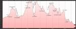](https://www.tkg.org.ua/node/29724)

Висотний профіль маршруту

### 3.3. Технічний опис проходження маршруту

#### День 1. 29.12.2012.

Група прибула до Сімферополя о 9:30 і одразу завантажилась до спеціально найнятого мікроавтобуса. Приблизно об 11:00 вже була в с. Міжгір?я, біля моста через роздвоєну річку на південному кінці села. Рух почала об 11:30 по грунтовій дорозі на південь, вверх по течії р. Бурульча (фото 1). Дорога місцями вкрита снігом та замерзлими калюжами. Через 45 хв руху - привал в межі лісу (фото 2). Ще через 20 хв руху вийшли до пам?ятнику ?Книжка? (фото 3).

[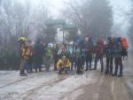](https://www.tkg.org.ua/node/29725)  
  

Фото 1. Група починає маршрут із с. Міжгір?я.

[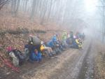](https://www.tkg.org.ua/node/29726)  
  

Фото 2. Привал на лісовій дорозі.

[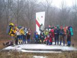](https://www.tkg.org.ua/node/29727)  
  

Фото 3. Група біля пам?ятника ?Книжка?.

За 20 хв - привал на тій же дорозі в лісі. Дорога неодноразово перетинає річку, доводилось переходити воду по камінні (фото 4). Після останнього переходу в 40 хв група вийшла до т/с Бурульча, яку можна впізнати по дерев?яних спорудах у вигляді столу з навісом (фото 5). Табір розбили трохи далі на галявині, перейшовши річку ще раз.

[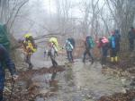](https://www.tkg.org.ua/node/29728)  
  

Фото 4. Перехід через річку по камінні.

[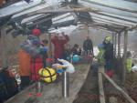](https://www.tkg.org.ua/node/29729)  
  

Фото 5. Обід на т/с Бурульча.

#### День 2. 30.12.2012.

Старт руху о 7:40 (фото 6) - 40 хв по лісовій стежці вздовж річки (здебільшого по лівому її берегу) до т/с ?Островки?, тут привал для орієнтування. 30 хв підйому по крутій стежці вздовж одного зі струмків на лівому березі річки, о 9:05 вийшли на грунтову дорогу 151-го маршруту. Через 45 хвилин руху, о 10:05, пройшовши кілька галявин (фото 7), група зі сходу вийшла на Курган Слави (фото 8). Після оглядин околиць та фотографування група попрямувала по Долгоруківській яйлі на захід, забираючи трохи на південь (фото 9). Частково користувались грунтовими дорогами, частково йшли трав?янистою поверхнею яйли з невеликими виходами скель (фото 10). До початку перевалу над печерою Кизил-Коба вийшли об 11:00.

[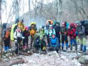](https://www.tkg.org.ua/node/29730)  
  

Фото 6. Старт з т/с Бурульча.

[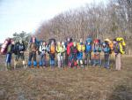](https://www.tkg.org.ua/node/29731)  
  

Фото 7. Група на одній із галявин Долгоруківської яйли.

[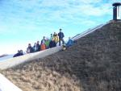](https://www.tkg.org.ua/node/29732)  
  

Фото 8. Курган Слави.

[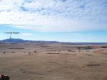](https://www.tkg.org.ua/node/29733)  
  

Фото 9. Рух групи по яйлі.

[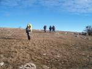](https://www.tkg.org.ua/node/29734)  
  

Фото 10. Поверхня яйли.

Пообідавши над перевалом, група почала спуск руслом кулуару (фото 11). Рухались правим берегом через меншу рослинність (фото 12), користуючись трекінговими палицями (фото 13). Через 25 хв руху група вийшла до розкриття каньйону і зупинилася на скельній ділянці для розвідки подальшого маршруту (фото 14). З цього місця досить важко знайти безпечний шлях спуску через скельні обриви. Група перейшла русло каньйону і по зарослій невисоким лісом ділянці скинула кілька десятків метрів висоти, після чого знову перейшла русло і по правому березі продовжила спуск. В деяких місцях доводилось долати високі кам?яні сходи (фото 15). Перед черговим обривом довелося витком серпантину забрати до 100 м на захід і повернутися на стільки ж на схід (фото 16). Тут о 14:20 група вийшла на скельну стінку висотою близько 10 м, яку долала по вертикальним поручням із використанням гальмівних пристроїв типу ?вісімка? (фото 17). Це зайняло годину, після чого за 40 хвилин по широкій грунтово-кам?янистій дорозі в лісі здійснили перехід до місця ночівлі, там де дорога виходить на велику галявину з невеликими будівлями. Звідси можна було оглянути перевал знизу (фото 18). Табором стали о 16:00 біля дерев?яних столів над річкою.

[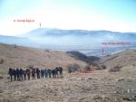](https://www.tkg.org.ua/node/29774)  
  

Фото 11. Група над початком перевалу Кизил-Коба.

[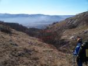](https://www.tkg.org.ua/node/29735)  
  

Фото 12. Рух групи правим берегом кулуару.

[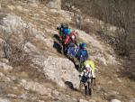](https://www.tkg.org.ua/node/29736)  
  

Фото 13. Пересування групи з використанням трекінгових палиць.

[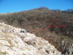](https://www.tkg.org.ua/node/29775)  
  

Фото 14. Розкриття каньйону і початок обривів.

[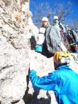](https://www.tkg.org.ua/node/29737)  
  

Фото 15. Подолання кам?яних сходів.

[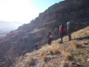](https://www.tkg.org.ua/node/29738)  
  

Фото 16. Рух останнім витком серпантину.

[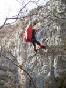](https://www.tkg.org.ua/node/29739)  
  

Фото 17. Подолання кам?яної стінки по вертикальних поручнях.

[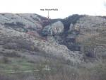](https://www.tkg.org.ua/node/29740)  
  

Фото 18. Вигляд перевалу Кизил-Коба з долини.

#### День 3. 31.12.2012.

Група почала рух о 7:45 по ґрунтовій дорозі (фото 19) - кількадесят метрів вниз по річці, а після броду і містка - на південь через танковий полігон. Перед військовим містечком, приблизно через 30 хвилин, звернули вліво на асфальтову дорогу на південний схід. Дорога проходить через житловий масив с. Чайковське, звертає на садибні ділянки на пвідні села і через 30 хвилин переходить у лісову стежку, котра траверсує схили г. Кизил-Кая в південному напрямі. По ній група подолала близько кілометра, де після русла одного зі струмків стежка почала губитися. Ще через півкілометра, на схилах г. Бал-Кая, група спустилась на трасу Сімферополь-Ялта і пройшла по ній близько кілометра до будівлі і трансформаторної будки ліворуч, де починається підйом до т/с Курлюк-Баш. Обідали на дорозі біля джерела Юке-Тепе-2 (фото 20). О 10:40 почали підйом широкою кам?янистою стежкою вздовж річки Курлюк-Су (фото 21). Через 20 хвилин пройшли повз будинок на правому березі річки поряд із невеликими греблями. В цьому місця стежки розділяються: одна стежка йде по руслу річки, ми ж піднялися дещо по ближньому борту струмка, перейшли його, і набрали кількадесят метрів висоти, після чого по стежці 135-го маршруту траверсували схили г. Замана. Пройшовши по стежці годину, після однієї зі стоянок на річці, так як стежка почала губитися, група вирішила піднятися вгору на широку ґрунтову дорогу, що йде траверсом вище по схилу, та продовжила рух по ній. Через 20-30 хвилин дорога вийшла на широку галявину (фото 22), і ще через 15 хвилин група вийшла на місце ночівлі - т/с Курлюк-Баш, розбивши табір о 16:00 (фото 23).

[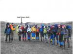](https://www.tkg.org.ua/node/29741)  
  

Фото 19. Група перед початком руху.

[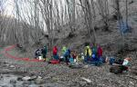](https://www.tkg.org.ua/node/29742)  
  

Фото 20. Місце обіду біля дж. Юке-Тепе-2.

[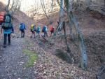](https://www.tkg.org.ua/node/29743)  
  

Фото 21. 135-ий маршрут вздовж р. Курлюк-Су.

[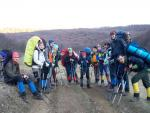](https://www.tkg.org.ua/node/29744)  
  

Фото 22. Початок галявини перед т/с Курлюк-Баш.

[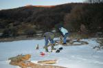](https://www.tkg.org.ua/node/29745)  
  

Фото 23. Табір на т/с Курлюк-Баш.

#### День 4. 1.01.2013.

Рух з т/с Курлюк-Баш розпочали о 8:30 (фото 24) по ґрунтовій дорозі, що відходить від галявини на південь. Після 30 хвилин досить крутого підйому дорога виходить на Демерджі-яйлу, звідки видно галявину з попередньою стоянкою (фото 25). Звідси група о 9:20 рушила по краю яйли на північний схід, до перемички з Тирке-яйлою (фото 26). Рух частково ґрунтовими дорогами, частково трав?янистою поверхнею яйли. Далі - по східному краю яйли стежкою до початку перевалу ?Три сосни? (фото 27). Над перевалом група вдягла системи, каски і змінила трекпалиці на льодоруби (фото 28), о 12:15 почала спуск. Спуск являє собою кулуар, зарослий деревами, крутизною до 35°. Рухаючись по кулуару, через 300 метрів перейшли в сусудній зліва ширший кулуар за 50 м до їхнього злиття. Спускаючись осипами малого розміру крутизною до 25°, час від часу долаємо повалені дерева. Поступово кулуар виположується та зливається з руслом Кара-Узеньчика, заваленим сухим листя. Пройшовши трохи по ньому, з висоти 500 м над р. м. стали траверсувати водороздільний хребет в напрямку р. Улу-Узень. Схил з боку Кара-Узеньчика порослий чагарником та невисокими деревами. Вийшовши за 35 хвилин на хребет, спустилися протилежним схилом крутизною до 30° до річки Улу-Узень. Перестрибнути чи перейти її по каменях не було можливості, тому використовували колоди для організації містка (фото 29). О 15:30 вся група перейшла річку і вийшла на ґрунтову дорогу над лівим берегом річки на 200 м вище водоспада Джур-Джур. Радіально сходивши до водоспаду (фото 30), о 16:05 почали підніматися вздовж річки до місця ночівлі. Хвилин через 15 на шляху трапився скельний похилий прижим протяжністю до 10 м, який подолати нескладним лазанням (фото 31). О 16:35 через 100 м стали табором на стоянці.

[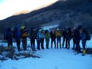](https://www.tkg.org.ua/node/29746)  
  

Фото 24. Група стартує з т/с Курлюк-Баш.

[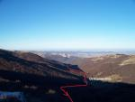](https://www.tkg.org.ua/node/29747)  
  

Фото 25. Шлях підйому групи на Демерджі-яйлу.

[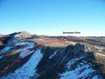](https://www.tkg.org.ua/node/29748)  
  

Фото 26. Шлях руху групи до перемички з Тирке-яйлою.

[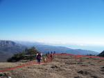](https://www.tkg.org.ua/node/29749)  
  

Фото 27. Рух групи по східному краю Демерджі-яйли.

[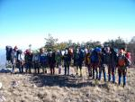](https://www.tkg.org.ua/node/29750)  
  

Фото 28. Група перед початком спуску перевалом ?Три сосни?.

[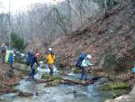](https://www.tkg.org.ua/node/29751)  
  

Фото 29. Перехід через р. Улу-Узень.

[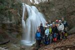](https://www.tkg.org.ua/node/29752)  
  

Фото 30. Група біля водоспаду Джур-Джур.

[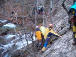](https://www.tkg.org.ua/node/29753)  
  

Фото 31. Долання скельного притиску.

#### День 5. 2.01.2013.

Стартували з місця ночівлі о 7:55, пройшли 10 хвилин по основній річці, після чого стали підніматися руслом одного зі струмків на лівому її березі. Через 40 хвилин підйому вийшли на місце з?єднання двох струмків, перейшли один із них і продовжили підйом між ними. Забираючи з цього моменту вліво, підійшли до перевального кулуару під Тирке-Центральним, де зустріли групу Жердочкіна, котра надалі підіймалася перевалом за нами. О 9:45 вийшли з лісу на скельну полицю лівіше по ходу руху від кулуару (фото 32). Тут група одягла системи, каски та поміняла палиці на льодоруби. Рух вгору почали о 10:00, рухаючись по стежці правим орографічним бортом кулуару. За 30 хвилин підійшли до найвужчого місця каньйону, за котрим зробили привал і розвідку в печеру. Рух ускладнює низькорослий хвойний чагарник та малі осипи. Ще через 15 хвилин руху група вийшла на край яйли (фото 33). Пообідавши, о 12:40 вирушили південним краєм яйли на схід (фото 34) і о 13:05 почали спуск з яйли між г. Довгою і г. Стол-гора ґрунтовою дорогою, котра заходить у ліс. Через 10 хвилин підійшли до джерела Сулух-Оба. Ще через 30 хвилин руху хребтом Таш-Хабах, о 13:50 вийшли на т/с Східний Суат (фото 35). Після галявини зі стоянкою повернули направо і по маркерах вийшли на 164-ий маршрут. Останній перехід ґрунтовою лісовою дорогою - 45 хвилин і о 14:55 ми на т/с Ай-Алексій (фото 36).

[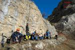](https://www.tkg.org.ua/node/29792)  
  

Фото 32. Скельна полиця лівіше кулуару.

[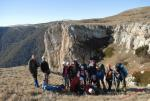](https://www.tkg.org.ua/node/29797)  
  

Фото 33. Група вийшла на Тирке-яйлу.

[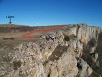](https://www.tkg.org.ua/node/29754)  
  

Фото 34. Шлях групи по Тирке-яйлі.

[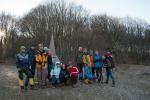](https://www.tkg.org.ua/node/29755)  
  

Фото 35. Т/с Східний Суат.

[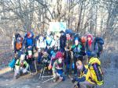](https://www.tkg.org.ua/node/29756)  
  

Фото 36. Т/с Ай-Алексій.

#### День 6. 3.01.2013.

Група почала рух з т/с Ай-Алексій о 7:40 по грунтовій лісовій дорозі - маршруту 166 у східному напрямку. Зранку часом налітав туман, але згодом він лишився тільки в долинах нижче дороги (фото 37). Пройшли не звертаючи з дороги близько 4 км до джерела Нефань-Узень, і через 500 метрів після нього повернули вліво на стежку в невисокому лісі, котра зрізає велику петлю дороги. Наступні 4 км ішли нею, рухаючись через чагарник та хвойний ліс (фото 38), після чого повернулися на грунтівку. О 10:25 прийшли на річку Хун, перейшли її та зупинились для зйомки завтрашнього перевалу Кенгеч та вибору місця для ночівлі. Об 11:00 пройшли 200 м підйому далі по дорозі і поставили табір у хвойному лісі (вид зверху наступного дня - фото 39). Ближче до вечора здійнявся сильний вітер, але до наступного ранку знову вгамувався.

[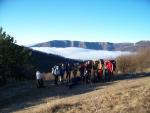](https://www.tkg.org.ua/node/29757)  
  

Фото 37. На пер. Лікон.

[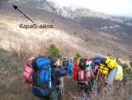](https://www.tkg.org.ua/node/29758)  
  

Фото 38. Характер місцевості в районі стежки під Карабі-яйлою.

[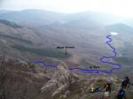](https://www.tkg.org.ua/node/29759)  
  

Фото 39. Місце ночівлі, вид згори.

#### День 7. 4.01.2013.

Старт з місця ночівлі - о 7:20 (фото 40). Системи та каски надягли одразу, але спочатку користувались трекпалицями. Спустилися назад до річки, знову її перейшли і одразу звернули з дороги вправо, почавши підйом на північ по не дуже густому чагарнику. Часто траплялися мілкі осипи, поверхня поросла сухою травою (фото 41). О 8:40 підійшли до початку скель, де керівник розвідав подальший шлях, а група змінила палиці на льодоруби. За даними розвідки змістилися на 100 м вліво і продовжила підйом по інший бік від кам?яного гребня, на захід від нього. Рухались щільною групою і слідкували за камінням, котре могло зірватися й зачепити учасників. Місцями шлях вкритий низькорослими хвойним чагарником (фото 42). Через 150 м підйому група знову перейшла гребень і зі східного боку вздовж нього вийшла на яйлу о 10:55 (фото 43). Об 11:20 рушили по південному краю Карабі-яйли на схід, пройшли через верхів?я річки Хун і о 12:30 обідали в лісі, спустившись трохи на північний схід з проходу Великі Ворота (Балабан-Капу). Рухаючись грунтовою дорогою в лісі на схід, а згодом кам?янистою дорогою, за 25 хвилин дійшли до проходу Малі Ворота (Тирхалу-Богаз) (фото 44). Далі рухались дещо південніше від гребня хребта вздовж нього по стежці (175-ий маршрут) і за 50 хвилин, о 14:50 вийшли на перевал Калістон. Звідси 177-им маршрутом пройшли північніше від хребта і лісовою дорогою з крутизною до 30° дійшли до джерела Вересь-Чокрак, де розбили табір на грунтовій дорозі на правому борту долини.

[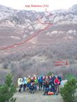](https://www.tkg.org.ua/node/29800)  
  

Фото 40. Група на стоянці під перевалом Кенгеч.

[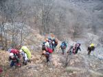](https://www.tkg.org.ua/node/29801)  
  

Фото 41. Початок підйому на перевал.

[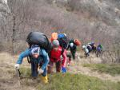](https://www.tkg.org.ua/node/29760)  
  

Фото 42. Рослинність у верхній частині підйому.

[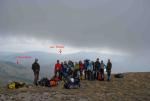](https://www.tkg.org.ua/node/29806)  
  

Фото 43. Група вийшла на перевал Кенгеч.

[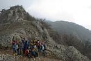](https://www.tkg.org.ua/node/29761)  
  

Фото 44. Група на проході Малі Ворота.

#### День 8. 5.01.2013.

Група розпочала рух з місця ночівлі біля джерела Вересь-Чокрак о 7:35 (фото 45), спустившись у долину на північний схід від нього і піднявшись грунтовою дорогою на північний захід до перевалу Алакат-Богаз, вийшовши таким чином на 179-ий маршрут. Через сніг та сильний вітер рухались повільніше ніж зазвичай, на одному з привалів у лісі надягнули бахіли, оскільки листяний покрив був вкритий сантиметровим шаром мокрого снігу. Слідували маршрутом 179 через ліс до перевалу Кок-Асан-Богаз, де перетнули асфальтову дорогу о 9:25. Тією ж ґрунтовкою по маршруту 181 оминули г. Кокасан-Тепе з півночі і не доходячи до джерела Павло-Чокрак повернули вправо, на південний схід, вийшовши на перевал Горуча об 11:00 (вид з перевалу - фото 46). Нижче його пообідали, зняли бахіли і рушили спуском о 12:00. Спуск представляє собою грунтову стежку крутизною до 40°, котра поступово виположується з підходом до річки Пананьян-Узень (фото 47). В долині річки спочатку зустрічаються кам?яні сходинки, місцями металеві поручні в скелях, а чим далі тим частіше металеві містки та драбини (фото 48). Після півгодинного привалу у долині водоспадів (фото 49) група рушали спуском далі і по грунтовій дорозі о 13:50 вийшла на галявину біля греблі над селом Зеленогір?я (Арпат), де і розбила табір (фото 50).

[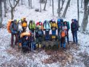](https://www.tkg.org.ua/node/29762)  
  

Фото 45. Старт з джерела Вересь-Чокрак.

[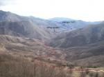](https://www.tkg.org.ua/node/29763)  
  

Фото 46. Вид на шлях групи з перевалу Горуча.

[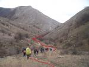](https://www.tkg.org.ua/node/29764)  
  

Фото 47. Шлях групи після спуску до річки Пананьян-Узень.

[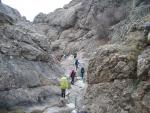](https://www.tkg.org.ua/node/29765)  
  

Фото 48. Драбини та поручні в каньйоні річки.

[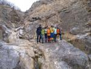](https://www.tkg.org.ua/node/29766)  
  

Фото 49. Група в долині водоспадів.

  
  

Фото 50. Постановка табору над селом Зеленогір?я (Арпат).

#### День 9. 6.01.2013.

Вийшли на маршрут о 8:00 (фото 51) - спустилися пагорбом до головної дороги через село (на лівому березі річки) і по ній пройшли через усе село. Через 350 м після останніх будівель зліва, там де до дороги примикає поле, звернули вліво на грунтову дорогу (190-ий маршрут) і піднялися по ній на невеликий перевал між г. Балг-Агач та г. Чок-Сари-Кая і о 8:40 спустилися на інший бік до греблі на озері. Звідси рушили дорогою на південний схід і пройшли по ній 2 км, після чого знову звернули на грунтову дорогу вліво, пройшли перевалом між г. Даз-Тепе та г. Куба-Бурун і спустилися в сусідню долину. Тут вийшли на дорогу, котра веде до села Морське, межу якого перетнули о 10:35 (фото 52). Ще через 15 хвилин група була в центрі села, звідки направилась до житла, а потім - до автостанції (фото 53) та узбережжя (фото 54).

  
  

Фото 51. Старт з галявини над селом Зеленогір?я (Арпат).

  
  

Фото 52. Група входить у село Морське.

  
  

Фото 53. На автостанції села Морське.

  
  

Фото 54. Група на морському узбережжі.

### 3.4. Технічні перешкоди

<table><tbody><tr><td><b>Вид та назва перешкоди</b></td><td><b>Категорія складності</b></td><td><b>Паспорт перешкоди</b></td><td><b>Шлях подолання</b></td></tr><tr><td>пер. Кизил-Коба</td><td>1А</td><td><a href="https://www.tkg.org.ua/node/29562">Пер. Кизил-Коба (1А, 794 м)</a></td><td>р. Бурульча - т/с Кизил-Коба</td></tr><tr><td>пер. 3 сосни</td><td>1А</td><td><a href="https://www.tkg.org.ua/node/29563">Пер. 3 сосни (1А, 1224 м)</a></td><td>т/с Курлюк-Баш - ущ. Хапхал</td></tr><tr><td>пер. Тирке Центральний</td><td>1А</td><td><a href="https://www.tkg.org.ua/node/29564">Пер. Тирке Центральний (1А, 1245 м)</a></td><td>ущ. Хапхал - т/с Ай-Алексій</td></tr><tr><td>пер. Кенгеч</td><td>1А</td><td><a href="https://www.tkg.org.ua/node/29565">Пер. Кенгеч (1А, 1100 м)</a></td><td>р. Хун - овр. Тирхалу-Дере</td></tr></tbody></table>

### 3.5. Картографічний матеріал

  
  

Картографічний матеріал

### 4\. Висновки та рекомендації щодо проходження маршруту

За своєю напруженістю та локальними технічними перешкодами пройдений маршрут відповідає гірському походу першої категорії складності. Загальна ідея та цілі походу були виконані, в результаті був сформований колектив, учасники якого здобули навички пересування різними формами рельєфу та схилами різної крутизни, необхідні для походів більш високої категорії складності.

При підготовці походу група розраховувала на достатню кількість снігу як на локальних перешкодах, так і між ними, тому в зв?язку з невеликою кількістю снігу при проходженні маршруту був надлишок часу, який дозволяв поряд з помірним фізичним навантаження отримувати неабияке єстетичне насолодження від проходження маршруту в теплому зимньому Криму. Витрати ходовго часу розраховувались по формулі Лебедєва, і для кожного дня складали близько 6 годин (8 переходів по 45 хвилин). Як видно з графіку руху маршрут був пройдений з випередженням. Відсутність постійного снігового покриву не дала змогу відпрацювати техніку пересування сніговими схилами, що з надлишком компенсувалось мілкоосипним та трав?янистим рельєфом, який характерний для походів початкової категорії складності. Але поряд з цим цілком вдалося здобути досвід організації бівуаку при від?ємних температурах.

В зимових умовах, на нашу думку, слід ставати на бівуак не пізніше 16:00, щоб встигнути розпалити багаття, та організувати дозвілля групи, так як в сутінках час на виконання тих самих дій з організації табору збільшується вдвічі. У зв?язку з відсутністю атмосферних опадів та снігу на час проходження маршруту деякі струмки були зневоднені, що слід враховувати при плануванні маршруту в даний час, при наявності снігу таких проблем в минулих походах не виникало.

Загальною ідеєю маршруту було також проходження та опис некласичних перешкод, які дозволять розширити географію та нададуть змогу планувати більш фізично збалансовані походи, в яких проходження технічних перешкод чергується з переходами по долинам річок, хребтам, яйлам. Маршрут походу, як бачите, лінійний з закінченням біля моря в кінці походу. Саме такий маршрут, на нашу думку, і є найраціональнішим в Криму, бо море є непоганим стимулом проходження, а також за помірну ціну там можна привести себе до ладу, та підготувати себе до цивілізації.

Підготовка до походу включала в себе основи техніки пересування різними формами рельєфу та схилами різної крутизни, як з самостраховкою так і з використанням мотузок, також особливу увагу було приділено фізичній підготовці учасників.

В поході пройдено наступні перешкоди:

1\. **пер. Кизил-Коба (1А)** - перешкода з чітко вираженою визначальною частиною. При проходженні був вибраний технічно складний варіант спуску, який при відсутності снігу є більш безпечний. Спускатися даним варіантом рекомендується тільки при наявності мотузки та страхувальних засобів для перильної роботи, а також технічних навичок використання мотузки та організації станції. При підйомі рекомендується проходити кулуаром, який починається над печерою.

2\. **пер. 3 сосни (1А)** - даний перевал був пройдений на спуск. Верхня частина має відносно крутий мілкоосипний рельєф, проходження якого рекомендується тільки з льодорубами та компактною групою. При наявності снігу необхідно притримуватись гребня, який розділяє кулуари, аби уникати можливу лавинонебезпечність кулуарів, особливо основного. При підйомі на даний перевал слід орієнтуватись на просіку, яка від русла Кара-Узенчика виводить до підйомного кулуару.

3\. **пер. Тирке Центральний (1А)** - перевал в проходженні якого найбільш яскраво виражені елементи фізичного навантаження та технічної складності. В підйомний кулуар необхідно заходити по скельній полці, розташованій зліва при підйомі на перевал. На злеті рухатись щільною групою, при обледенінні скельних сходинок можливе використання мотузок, також на проходженні вниз в групі можливе використання перильної страховки, для забезпечення психологічного комфорту в групі новачків. Даний перевал, на нашу думку, є класикою для проходження в поході 1 к. с.

4\. **пер. Кенгеч (1А)** - фізично виснажливий перевал з елементами легкого скельного лазіння, цікавий в плані різноманітності рельєфу при проходженні та своїми краєвидами. Сідловина перевалу складно ідентифікується при проходженні на спуск, слід при собі мати навігатор та орієнтуватись на т/с Чегенітра, а також на русло р. Хун.

Слід зважати на те, що при наявності глибокого снігу на даних перевалах затрати часу на їх проходження суттєво збільшуються, і тому слід планувати проходження даних перешкод з ранку. На всіх перешкодах як знизу, так і зверху можна ставати на ночівлі, однак не рекомендуємо ночувати на плато, в зв?язку з низькою вітрозахищеністю та відсутністю води.

Виходячи з великої чисельності групи при проходженні перевалів була обрана така тактика: керівник йде спереду, розвідуючи та вибираючи шлях групи, далі особи чарівної статі, чергуючись із хлопцями, в кінці помічник керівника та найсильніший учасник.

Для проходження даного маршруту при наявності снігового покрову слід на етапі підготовки приділяти особливу увагу фізичній підготовці учасників.

В результаті пройдено 112 км та 4 перешкоди складністю 1А з сумарним набором висоти 5340 м, що характерно для гірських походів першої категорії складності.
