**Киевский туристический клуб ?Гряда?**

**Отчет**

о пешеходном туристском

спортивном походе 2й категории сложности

по КАМЧАТКЕ

совершенном с 21 августа по 06 сентября 2012 г.

Маршрутная книжка - 23/2012

  

Руководитель группы Шестак Дмитрий Викторович

Адрес руководителя: Киев, ул Милославская 23, кв. 291, тел (044) 532-43-04, dmt.shestak \[AT\] google.com

  

Маршрутно-квалификационная комиссия рассмотрела отчет и считает, что поход может быть засчитан всем участникам и руководителю как поход ВТОРОЙ категории сложности.

  

* * *

Оглавление

1\. Справочные данные про туристский спортивный поход.

> 1.1. Параметры похода
>
> 1.2. Характеристика района
>
> 1.3. Подробная нитка маршрута
>
> 1.4. Данные про опыт участников

2\. Организация туристского спортивного похода

> 2.1. Общая идея похода
>
> 2.2. Варианты подъезда и отъезда. Обоснование выбора точек начала и конца похода.
>
> 2.3. Аварийные выходы с маршрута и его запасные варианты
>
> > 2.3.1. Заявленная нитка похода
> >
> > 2.3.2. Пройденная нитка похода
> >
> > 2.3.3. Запасные варианты
> >
> > 2.3.4. Аварийные выходы из маршрута
>
> 2.4. Изменения маршрута и его причины.
>
> 2.5. Сведения о прохождении маршрута каждым участником

3\. График движения и технический отчет

> 3.1. Техническое описание прохождения маршрута
>
> 3.2. График движения
>
> 3.3. Расчёт категории сложности похода
>
> 3.4. Оценка категории сложности маршрута:

4\. Выводы и рекомендации по прохождению маршрута

5\. Приложения

> 5.1. Перечень специального личного снаряжения
>
> 5.2. Перечень общественного и специального общественного снаряжения
>
> 5.3. Состав ремонтного набора
>
> 5.4. Состав аптечки
>
> 5.5. Продуктовая раскладка
>
> 5.6. Координаты точек маршрута
>
> 5.7. Смета затрат на поход
>
> 5.8. Расписание движения транспорта, время работы отделений связи и др.
>
> 5.9. Список литературы, туристических отчетов и других источников информации
>
> 5.10. Благодарности

6\. Факультативная программа по посещению Южно-Камчатского природного парка на вулканы Мутновский и Горелый.

  

1\. Справочные данные про туристский спортивный поход.

1.1. Параметры похода

  

<table><tbody><tr><td rowspan="2">
Вид туризма
</td><td rowspan="2">
Категория сложности
</td><td rowspan="2">
Протяженность активной части похода, км
</td><td colspan="2">
Продолжительность
</td><td rowspan="2">
Сроки проведени
</td></tr><tr><td>
Общая
</td><td>
Ходових дней
</td></tr><tr><td>
пешеходный
</td><td>
вторая
</td><td>
205
</td><td>
17
</td><td>
15
</td><td>
21.08.12 - 06.09.12
</td></tr></tbody></table>

  
  

1.2. Характеристика районов проведения похода

  

Камчатка - полуостров, примыкающий к материку в своей северной и северо-западной части и граничит с Чукотским автономным округом и Магаданской областью. В состав Камчатской области так же входят о. Карагинский и Командорские острова на востоке.

Является звеном Курило-Камчатской огненной дуги, которая берёт своё начало от берегов Японии и является зоной активного вулканизма. Всего на полуострове насчитывается более 400 вулканов (действующих - 29).

Территория Камчатской области составляет 472,3 тыс. кв. км. Южная точка Камчатки, мыс Лопатка, лежит на 51° с. ш., на широте Киева в месте слияния бассейнов Охотского моря и Тихого океана. Северные границы области пролегают у 65° с. ш., почти у полярного круга, что соответствует широте Архангельска. Камчатская область простирается с юго-запада на северо-восток на 1200 км. Максимальная ширина полуострова в его центральной части - 450 км.

Центральную часть полуострова пересекают два параллельных хребта - [Срединный хребет](http://ru.wikipedia.org/wiki/%D0%A1%D1%80%D0%B5%D0%B4%D0%B8%D0%BD%D0%BD%D1%8B%D0%B9_%D1%85%D1%80%D0%B5%D0%B1%D0%B5%D1%82) и [Восточный хребет](http://ru.wikipedia.org/wiki/%D0%92%D0%BE%D1%81%D1%82%D0%BE%D1%87%D0%BD%D1%8B%D0%B9_%D1%85%D1%80%D0%B5%D0%B1%D0%B5%D1%82), между ними находится Центральнокамчатская низменность, по которой протекает [река Камчатка](http://ru.wikipedia.org/wiki/%D0%9A%D0%B0%D0%BC%D1%87%D0%B0%D1%82%D0%BA%D0%B0_\(%D1%80%D0%B5%D0%BA%D0%B0\)).

  

1.3. Подробная нитка маршрута

б\\в ?Ленинградская? - Северные прорывы БТТИ (рад) - влк. Плоский Толбачик (рад., 1А, 3056) - пер. Толуд (н\\к, 1291,4) - пер. Гамми (н\\к, 1920) - безымянный первал между в. 1925,5 и в. 1842,6 (1А, 1740) - влк. Безымянный (рад., до кромки старого кратера, 1А, 2755) - пер. Безымянный (н\\к, 1500,8) - кратер Марс (рад) - кратер Юпитер (рад) - ледн. Богдановича - плато Малая Антарктида - ледн. Эрмана - ледн. Средний - оз. Державина - соп. Домашняя - пос. Ключи

  

1.4. Данные об участниках

  

<table><tbody><tr><td>
Ф.И.О.
</td><td>
Год рождения
</td><td>
Должность в походе
</td><td>
Туристский опыт
</td><td>
Фото
</td></tr><tr><td>
Шестак Дмитрий Викторович
</td><td>
1984
</td><td>
Руководитель
</td><td>
2ГУ Тянь-Шань, 1ПР Хибины
</td><td></td></tr><tr><td>
Дмитруха Александр Викторович
</td><td>
1987
</td><td>
Ремонтник
</td><td>
1ПУ Хибины
</td><td></td></tr><tr><td>
Дунаева Наталия Викторовна
</td><td>
1984
</td><td>
Логистик
</td><td>
3ПУ Румынские Карпаты
</td><td></td></tr><tr><td>
Гожан Катерина Вячеславовна
</td><td>
1988
</td><td>
Медик
</td><td>
3ГУ Кавказ
</td><td></td></tr><tr><td>
Ищенко Александр Андреевич
</td><td>
1987
</td><td>
Фотограф
</td><td>
1ГУ Кавказ
</td><td></td></tr><tr><td>
Стахов Иван Юрьевич
</td><td>
1992
</td><td>
Зав. снаряжением
</td><td>
ПВД*
</td><td></td></tr><tr><td>
Безвербный Дмитрий Николаевич
</td><td>
1981
</td><td>
Завхоз
</td><td>
ПВД
</td><td></td></tr><tr><td>
Вронская Юлия Алексеевна
</td><td>
1985
</td><td>
Финансист
</td><td>
ПВД
</td><td></td></tr></tbody></table>

  

\*- на момент выпуска группы в поход, параллельно шла защита горного похода по Карпатам 2 к.с. Фактически участник имел опыт 2ГУ Карпаты, но справки пока на руках не было. Информация про справку: \[Карпаты. Горный поход 2 к.с. Марш.книжка ?9\\12. Киевская областная маршрутно-квалификационная комиссия 110-00-4354300. Рук. Грибан А.П.\]

  

2\. Организация туристского спортивного похода

2.1 Общая идея похода

Выбор р-на Ключевской группы вулканов обусловлен желанием посетить самую высокую, и, на наш взгляд, самую интересную часть полуострова. Вулканы возвышаются на сравнительно компактной территории до 4850м, есть возможность планирования маршрута в самом сердце раена для групп разной технической подготовки без ущерба визуальному удовлетворению от видов исполинов. Не отрицая привлекательности южных и северных территорий, последние характеризуются меньшей высотой (вулканы, редко превышающие 2500 м), трудность маршрута зачастую обусловлена локальными препятствиями в виде бродов и бескрайнего кедрового стланика. Группа же мечтала увидеть сердце Камчатки, безжизненную территорию огня и льда.

  

2.2 Варианты подъезда и отъезда. Обоснование выбора точек начала и конца похода.

Сухопутных дорог соединяющих полуостров с остальной частью материка нет. На сегодняшний день самый доступный путь попадания на Камчатку - авиа.

Формирование группы проходило на протяжении двух месяцев, билеты покупались по мере появления акций у авиакомпаний. Команда добиралась частями, разными авиаперевозчиками, Аэрофлотом, Трансаэро и авиакомпанией Сибирь, с пересадками в Москве, Ростове-на-Дону, Новосибирске, Хабаровске и Владивостоке.

Варианты перелёта основывались на выборе самых дешевых авиарейсов, так как за одним исключением, группа не была привязана к срокам пребывания на полуострове и руководствовалась принципом ?Чем дольше, тем лучше?. В каждом конкретном случае, участник данного мероприятия провёл на Дальнем Востоке от одного до трёх месяцев.

Единственная транспортная артерия по полуострову, проходимая для малогабаритных автомашин - трасса г. Петропавсловск-Камчатский - г. Усть-Камчатск (а также развилки с этой трассы на Мильково, Эссо). Остальное - зимники, трафик не регулярный, необходима предварительная договорённость о заброске.

Что касается нашего маршрута, из г. Петропавловск-Камчатский, с автостанции ?10й километр?, ходят ежедневные рейсовые автобусы ?Петропавловск-Камчатский - Козыревск?, ?Петропавловск-Камчатский - Усть-Камчатск?. Отправление в 08:00, прибытие в п. Козыревск в 16:45.

Возможен вариант автобуса ?Петропавловск-Камчатский - Эссо?, необходимо выйти на развилке в пос. Эссо. В 100 метрах от неё находится придорожное кафе, у которого есть шанс договориться о попутной машине в пос. Козыревск, он расположен 70 км севернее. На Камчатке хороший автостоп, но для большой группы это может составить некоторые трудности, что логично.

С пос. Козыревск на б\\в ?Ленинградская? можно доехать на машине высокой проходимости, о которой нужно договариваться заблаговременно. В пути около трёх часов на расстояние 80 км.

  

Маршрут предполагался как можно более линейный, в таком случае самой логичной точкой финиша являлся пос. Ключи Усть-Камчатского р-на.

По информации из интернета, посёлок носит закрытый характер из-за расположенного под ним действующего военного полигона и для посещение его требуется разрешение ФСБ. О данном разрешении группа побеспокоилась заранее, в чём помогла Камчатская туристическая компания ?Полюс-М?. Через данную компанию так же были заблаговременно куплены билеты на рейсовый автобус ?Петропавловск-Камчатский - Козыревск?.

**2.3. Аварийные выходы с маршрута и его запасные варианты**

**2.3.1. Заявленная нитка похода:**  
б\\в ?Ленинградская? - Северные прорывы БТТИ (рад) - влк. Плоский Толбачик (рад., 1А, 3056) - пер. Толуд (н\\к, 1291,4) - пер. Гамми (н\\к, 1920) - безымянный первал между в. 1925,5 и в. 1842,6 (1А, 1740) - влк. Безымянный (рад., до кромки старого кратера, 1А, 2755) - пер. Безымянный (н\\к, 1500,8) - кратер Марс (рад) - кратер Юпитер (рад) - ледн. Богдановича - плато Малая Антарктида - ледн. Эрмана - ледн. Средний - оз. Державина - соп. Домашняя - пос. Ключи

  

**2.3.2. Пройденная нитка похода:** б\\в ?Ленинградская? - Северные прорывы БТТИ (рад) - влк. Плоский Толбачик (рад., 3056) - пер. Толуд (н\\к, 1291,4) - пер. Гамми (1А 1920) - безымянный первал между в. 1925,5 и в. 1842,6 (1А, 1740) - пер. Плотина (н\\к, 1500,5) - кратер Марс - кратер Юпитер - пер. Плотина (н\\к, 1500,5) - влк. Безымянный (рад., до кромки старого кратера, 1А, 2755) - пер. Безымянный (н\\к, 1500,8) - ледн. Богдановича - плато Малая Антарктида - ледн. Эрмана - пер. Средний (н\\к, 2677) - оз. Державина - пос. Ключи

  

**2.3.3. Запасные варианты:**

Запасных вариантов прохождения маршрута заявлено не было

  

**2.3.4. Аварийные выходы из маршрута:**

а) Северные прорывы БТТИ, влк. Плоский Толбачик, пер. Толуд, до пер. Гамми - выход на б\\в ?Ленинградская?  
б) пер. Гамми, безымянный перевал между в. 1925,5 и 1842,6, р. Сухая Тополевая - выход на б/в ?Аппохончич? (восточные склоны влк. Ключевская Сопка)  
в) влк. Безымянный, пер. Безымянный - выход на б\\в ?Плотина?  
г) ледник Богдановича - выход по долине р. Студёная в сторону пос. Козыревск на б\\в ?Копыто?  
д) плато Малая Антарктида, ледник Эрмана - выход в пос. Ключи

  

2.4. Изменения маршрута и его причины.

а) Совершая радиальный выход на влк. Плоский Толбачик, группа поднялась по варианту ?н\\к? вместо ожидаемого 1А. В данном конкретном случае, вариант 1А необходимо было искать продолжая движение от конуса 1941г правее, в сторону пер. Толуд, что увеличило бы суммарно дневной километраж на 10 км. Исходя из того, что и в этом случае, в конечном итоге, он составил 29 км), большой перепад высот и нестабильные метеоусловия на полуострове, было принято решение подниматься слева от конуса 1941 г., где по нашим впечатлениям 1А не оказалось.

б) На перевал Гамми группа поднялась по варианту 1А вместо ожидаемого ?н\\к?. Сложности добавил тающий снежник на гребне, который к и без того живым камням добавил селевые грязевые потоки под ними. Путь подъема проходил по склону из живых камней среднего размера 30?-35? в его нижней части и местами до 40? в верхней. Уже сверху было видно, что более простой путь подъема проходит орографически левее, ближе к массиву Зимины.

в) Из-за сложных погодных условий группа спускалась в Ключи не по самому леднику Средний, а между ледниками Средний и Эрмана.

г) Выходить в Ключи планировалось мимо сопки Домашняя. Уже на Камчатке группа узнала, что как раз в этом месте начинается действующий военный полигон. Несмотря на официальное разрешение на выход в Ключи, группа на полигоне с военными видеться не желала, потому после спуска в зелёную зону взяли правее, преследуя цель обойти полигон по каньонам рек.

  

2.5. Сведения о прохождении маршрута каждым участником.

Маршрут пройден полностью всей группой. Все участники показали себя готовыми к походу, как физически, технически, так и морально

  

3\. График движения и технический отчет

3.1 . Техническое описание прохождения маршрута

**День 1.**

Выход в 8:00. По грунтовой дороге движемся в сторону БТТИ. Дорога хорошо читаемая, возможно передвигаться даже в полный туман. Через пару километров, перед поворотом срезаем шлаковое поле по азимуту 192? в направлении сопки Конус ?3. Движемся лавовым полем по азимуту, в направлении соп. Горшкова. Изредка в шлаке встречаются пустоты, что влечёт за собой неприятные полёты в неизвестность. Под Конусом ?3 снова выходим на дорогу и движемся по ней в сторону мемориального камня установленного в память погибшим вулканологам, от которого уходит хорошо набитая тропа между сопками Горшкова и Конус ?2.

За 35 мин. поднимаемся на соп. Конус ?2. На вершине наблюдаем активность прорывов. Земля и воздух ощутимо прогреты, что особенно чувствуется в прохладную погоду. Развлекаем себя подкладыванием спичек и принесённых кем-то кусочков кедрача в трещины, через некоторое время древесина начинает самовоспламеняться. Развлечения закончились, когда со стороны, где мы бросили рюкзачки, повалил густой дым. Всё обошлось, вещи остались целы :) Активность наблюдаем и на сопке Горшкова, визуально она на порядок слабая, ограничивается лишь паром исходящим с земли.

Спустившись вниз движемся по дороге на Юг на поиски лавовой пещеры. Огибаем сопку Высокая, оставляя с левой стороны сопку Лагерную и сходим с дороги в мёртвый лес следуя за теряющимися следами. К обеду подходим к кратеру Звезда. Вход в пещеру находится внутри кратера. Времени хватает лишь на беглый осмотр, по информации протяжённость её около 70 м. Рекомендуется брать каски и рукавицы.

В 15:00 выходим в обратный путь и к вечеру возвращаемся на б\\в "Ленинградкая". На протяжении дневного перехода, родников, кроме как на Ленинградке, не обнаружено.

Б\\в "Ленинградская" находится в р-не соп. Клешня. На территории есть несколько домиков вулканологов (в том числе и бесплатных) и дом инспектора парка, который проверил у нас заранее оплаченную квитанцию разрешающую посещение Ключевского заповедника.

Ночевали в палатках, во время радиальных выходов, снаряжение оставляли в тамбурах. На станции было много народу, диких животных которые могут уничтожить продукты не боялись, правда в палатках соседних групп немножко похозяйничала местная собака, потому продукты лучше прятать в рюкзаки.

[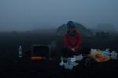](https://www.tkg.org.ua/node/27895)  

Фото 01.01. Лагерь

[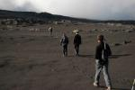](https://www.tkg.org.ua/node/27896)  

Фото 01.02. Движение шлаковым полем

[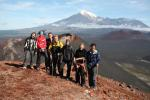](https://www.tkg.org.ua/node/27897)  

Фото 01.03. Группа на сопке Конус ?2

[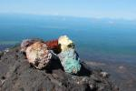](https://www.tkg.org.ua/node/27898)  

Фото 01.04. Камни на сопке Горшкова

[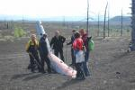](https://www.tkg.org.ua/node/27899)  

Фото 01.05. Авиакатастрофа 60х

[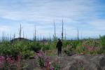](https://www.tkg.org.ua/node/27900)  

Фото 01.06. Поиски пещеры Звезда

[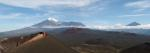](https://www.tkg.org.ua/node/27901)  

Фото 01.07. Панорама с сопки Горшкова

**День 2.**

Выход в 8:00.

От б\\в "Ленинградская" движемся по азимуту 45? шлаковым полем в сторону прорыва 1941г. По сути, держась этого азимута, с небольшими отклонениями +\\- 5? идёт тропа к самому кратеру, делая резкий поворот в право лишь на предвершинном взлёте. Изначально планировалось подниматься на влк. Плоский Толбачик по варианту 1А, который начинается примерно через 7 км. на пути к перевалу Толуд. На месте спланированный маршрут оказался в нашем случае нелогичен, километраж был бы увеличен минимум на 10 км. Учитывая большой перепад высот и нестабильные метеоусловия на Камчатке, было принято решение подниматься по юго-восточному гребню, чтобы вернуться в лагерь засветло. Сложность этого варианта можно расценить как н\\к.

От конуса прорыва 1941 г. через 2,7 километра выходим к ручью Сухая Промоина (на карте генштаба, в точке с высотой 1838 м), вдоль которого, почти к самому кратеру идёт хорошая тропа маркированная турами. В 15.00 выходим к кромке кратера. Преодолев свободным лазаньем 20-метровый участок несложных скал, выходим на ледник Толбачинский. Вершина вулкана представляет собой ледяное плато, в нашем случае основательно подтаявшее и покрытое мелким шлаком.

В туре, обнаруженном на высоте 3040 метров, контрольной записки не обнаружили. Выходим на северную сторону кратера, других туров не обнаружено.

Спуск в обратную сторону по пути подъема.

При подъёме на вулкан есть много мест под палатки, вплоть до пред вершинного взлёта и условных ручьев, что важно для групп, закладывающих на вулкан два дня, если планировать траверс вершины в сторону соп. Звезда Толбачика или восхождение на влк. Острый Толбачик с толбачинского плато. Условных ручьёв потому, что здесь и далее (весь отчёт) полноводность ручьев и рек зависит от времени суток и погоды. Там где можно набрать воду до обеда, к вечеру всё может быть пересохшее (или наоборот). Этот фактор относится ко всем без исключения источникам, какой бы жирной линией они не значились на карте генштаба.

[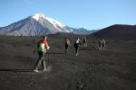](https://www.tkg.org.ua/node/27902)  

Фото 02.01. Движение в сторону конуса 1941г

[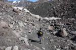](https://www.tkg.org.ua/node/27903)  

Фото 02.02. Путь на вулкан Плоский Толбачик

[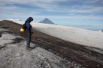](https://www.tkg.org.ua/node/27904)  

Фото 02.03. Толбачинское плато

[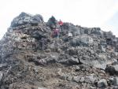](https://www.tkg.org.ua/node/27905)  

Фото 02.04. Участок несложных скал

[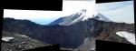](https://www.tkg.org.ua/node/27906)  

Фото 02.05. Панорама кратера Плоский Толбачик. На заднем фоне вулкан Острый Толбачик

**День 3.**

Выход в 9:00.

Выходим в сторону конуса 1941 г не по вчерашнему пути шлаковым полем, а по грунтовой дороге, которая ведёт к тому же конусу с небольшим крюком. Через три километра пути, не доходя до конуса километр, поворачиваем на восток, держась азимута 82? в сторону пер. Толуд. Монотонное движение по однообразному шлаковому полю пересечённому оврагами, ручьи пересохшие, постепенно начинают попадаться труднопроходимые заросли черники и жимолости. На ночёвку становимся в более-менее полноводном месте, хотя ходового времени было достаточно. Поиски родника результата не дали, в реке же вода грязная, отстаиваем в 5 литровой баклажке, которую брали на этот случай, и процеживаем через марлю.

Б\\в "Толуд" находится ровно в месте слияния р. Сухая Речка и р. Толуд. В домике с комфортом на койках могут разместиться до 8 чел. (на чердаке до 25+ ), есть печка, беседка с кострищем и заросли стланика, в которых можно наломать сухих веток. В целом приют выглядит довольно мрачно. Если это не межсезонье, с огромным желанием просушится, рекомендуется, не теряя высоты продолжать движение в сторону Зимины. Наш спуск обусловлен плановым местом ночёвки и отсутствием воды. До самого выхода на маршрут, о существовании этого строения группа не подозревала, и он был из разряда сюрприза.

Перед закатом, недалеко от лагеря заметили первого медведя уминающего ягоды.

[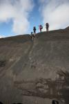](https://www.tkg.org.ua/node/27907)  

Фото 03.01. Преодоление очередного баранкосса

[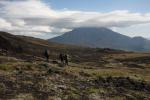](https://www.tkg.org.ua/node/27908)  

Фото 03.02.

[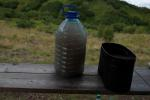](https://www.tkg.org.ua/node/27909)  

Фото 03.03. С водой дела обстоят вот так))

[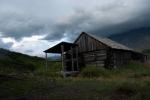](https://www.tkg.org.ua/node/27910)  

Фото 03.04. бв Толуд

[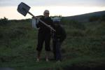](https://www.tkg.org.ua/node/27911)  

Фото 03.05.

**День 4.**

От б\\в "Толуд" движемся по тропе вверх 1,7 км вдоль ручья, после чего берём азимут 60? на пер. Толуд.

Через 3 часа и 4 медведя группа "взошла" на перевал. Правда где там перевал мы так и не поняли. По сути это плато между вулканами Плоский Толбачик и Большая Удина. Продолжаем движение в направлении влк. Овальная Зимина по правому борту речки Солнечный Правый, минуя распадки с пересохшими ручьями. Появляется подозрение, что ужин и завтрак будет состоять из сухпайка, так как на протяжении всего дневного перехода пополнить запасы не удалось. В 15:30 выходим к небольшому пруду. Бросив рюкзаки, и сходив 3 км вперёд на безрезультатную разведку, по возвращению ставим лагерь. Учитывая ранние стоянки последних двух дней, принимаю решение отказаться от запланированной днёвки.

[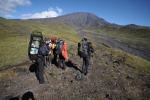](https://www.tkg.org.ua/node/27912)  

Фото 04.01.

[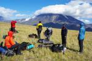](https://www.tkg.org.ua/node/27913)  

Фото 04.02. Группа на перевале Толуд

[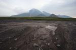](https://www.tkg.org.ua/node/27914)  

Фото 04.03. Пересохшие реки

[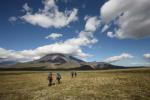](https://www.tkg.org.ua/node/27915)  

Фото 04.04. По ходу движения вулканы Овальная Зимина и Острая Зимина

[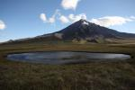](https://www.tkg.org.ua/node/27916)  

Фото 04.05. Пруд на фоне вулкана Большая Удина

[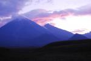](https://www.tkg.org.ua/node/27917)  

Фото 04.06. Вулканы Камень и Ключевская Сопка на закате

**День 5.**

Утром каждый участник набирает по три 1,5 л. бутылки воды с расчётом на 2,5 дня, чтобы больше к ней не привязываться.

Продолжаем движение по азимуту в 72 - направлении влк. Острая Зимина. На пути встретили медведицу с медвежатами, которые метались туда-сюда по горизонту ныряя в овраги и не желающие уступить дорогу. Движемся осторожно, медленно, но громко и весело, вспоминая по пути много песен, от Бременских музыкантов до Гражданской Обороны.

13:30 подходим под пер. Гамми. Во время обеда в 30 метрах от нас заметили трёх медведей, пока мы бросились прятать продукты, они убегая успели почти подняться немного правее г. Горный Зуб.

14:15 начинаем подъём на седловину держась правее к Горному Зубу. 2\\3 подъёма проходит по осыпи мелкого и среднего размеров (30?), индивидуальная страховка. Склон постепенно становится круче, местами до 40? . Путь усложнил тающий снежник на гребне, который к и без того живым камням добавил селевые грязевые потоки под ними. Для спуска валуна вниз стало достаточно просто до него дотронуться. Выстраиваемся цепочкой и траверсируем склон с набором высоты в сторону массива Зимины. Вариант нашего пути подъёма - 1А. Перевал официально не категорирован, визуально сверху было видно, что поднимаясь ближе к массиву Зимины, путь был бы на порядок легче.

Во время подъема на перевал, с влк. Острая Зимина в цирк сошел мощный продолжительный камнепад. При установке лагеря под крутыми склонами учитывайте такую особенность на Камчатке как тающие ледники в связке с повышенной сейсмической активностью.

16:00 Группа на пер. Гамми. В перевальном туре записки не обнаружено. Куда идти под вопросом, путь спуска до самого перевала в тумане. С последним участником поднявшемся на перевал туман чудесным образом уходит и в 17:20 мы уже у истоков р. Сухая Тополевая, где выровняв места под палатки ставим лагерь. В случае тумана, спуск с перевала следует начинать прямо от тура, по условному распадку, держась левее.

[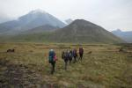](https://www.tkg.org.ua/node/27918)  

Фото 05.01. Движение в направлении массива Зимины

[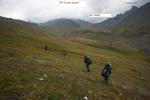](https://www.tkg.org.ua/node/27919)  

Фото 05.02.

[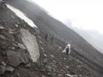](https://www.tkg.org.ua/node/27920)  

Фото 05.03. Подьём на перевал Гамми

[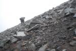](https://www.tkg.org.ua/node/27921)  

Фото 05.04. Подьём на перевал Гамми

[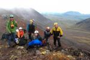](https://www.tkg.org.ua/node/27922)  

Фото 05.05. Группа на перевале Гамми

[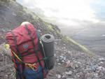](https://www.tkg.org.ua/node/27923)  

Фото 05.06. Спуск с перевала Гамми

[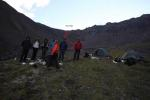](https://www.tkg.org.ua/node/27924)  

Фото 05.07.

[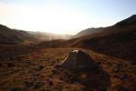](https://www.tkg.org.ua/node/27925)  

Фото 05.08. Завтрашнее начало пути

**День 6.**

Один 1,5 перехода спускаемся вниз по р. Сухая Тополевая. Первый же визуально логичный вариант перевалить водораздельный отрог ручьев Сухая Тополевая и Поднебесный, оказывается и самым удобным. Подъём 20? -25? , спуск по травяному склону 35? в сторону руч. Поднебесный. В 12:00 подходим под перевал. Движение начинаем в 12:20 траверсом склона в сторону ярко выраженного травяного участка в форме пирамиды. Далее забираем вправо и двигаясь цепочкой по осыпи мелкого и среднего размеров выходим на перевал в 15:30. Пв изуальным впечатлениям, если от травяного участка в виде пирамиды взять левее, вариант подъёма будет легче.

Сверху перевал представляет собой широкое плато. Тура не обнаружено. Отобедав сооружаем свой, и в 16:00 начинаем спуск в сторону долины р. Сухая Хапица по слежавшейся осыпи среднего размера уклоном 30? . Путь спуска с перевала - по первому распадку от влк. Овальная Зимина, вдоль ручья, вытекающего со снежника.

На средине спуска берём курс на огромный геодезический знак под перевалом.

Брод р. Родниковый Ключ в сухую погоду трудности не составил, перешли в первом попавшемся разливе по рукавам. Вода для питья не пригодна, из-за большой концентрации серы.

Дальнейший путь проходит по ровному высохшему разливу жёлтого цвета, из-за большого количества серных вод стекающих во время паводка с ледника Жёлтого, затем по широкой, серой от пепла долине, держась левого берега по ходу движения вдоль каньона. Вдалеке, справа от нас на возвышении блестело нечто, что мы приняли за дом. Как выяснилось позже, это была местная достопримечательность, камень Амбон. В седые времена эту огромную квадратную глыбу из своих недр выбросил при извержении вулкан Камень. В 22:00 подходим к б\\в "Плотина", с которой начинается восхождение на влк. Безымянный.

[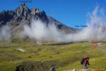](https://www.tkg.org.ua/node/27926)  

Фото 06.01.

[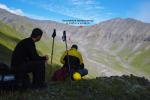](https://www.tkg.org.ua/node/27927)  

Фото 06.02.

[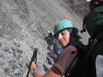](https://www.tkg.org.ua/node/27928)  

Фото 06.03. Подтем на безымянный перевал (1А)

[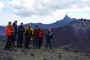](https://www.tkg.org.ua/node/27929)  

Фото 06.04. Группа на бузымянном перевале

[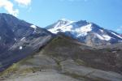](https://www.tkg.org.ua/node/27930)  

Фото 06.05. Перевальное плато

[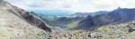](https://www.tkg.org.ua/node/27931)  

Фото 06.06. Панорама с перевала в сторону ручья Поднебесный

[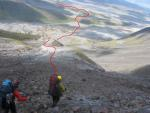](https://www.tkg.org.ua/node/27932)  

Фото 06.07. Cпуск с перевала в долину р. Сухая Хапица

**День 7.**

Днёвка.

Поляна возле б\\в "Плотина" усеяна палатками, сам домик занят группой туристов. Состоит из двух комнат, с комфортом в нём могут разместиться 10 человек. Есть камин.

Ближайшие родники в 100 и 500 м от б\\в. По информации, их наличие год на год не приходится.

День проходит в полном релаксе и умилении от ручных евражек, которых бегает здесь немеряно.

[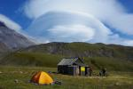](https://www.tkg.org.ua/node/27933)  

Фото 07.01. бв Плона

[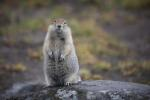](https://www.tkg.org.ua/node/27934)  

Фото 07.02.

[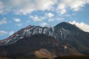](https://www.tkg.org.ua/node/27935)  

Фото 07.03. Путь подьема на кромку старого кратера влк. Безымянный

[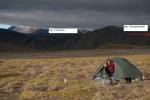](https://www.tkg.org.ua/node/27936)  

Фото 07.04. Начало циклона

[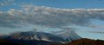](https://www.tkg.org.ua/node/27937)  

Фото 07.05.

**День 8.**

Циклон. Тратим один из трёх резервных дней на непогоду. Видимость 50-100 метров. Ближе к обеду началось прояснение, но через час зарядило с новой силой.

  

**День 9.**

Циклон. Картинка за тамбуром аналогична предыдущему дню. Принимаю решение поменять местами ходовые дни и вместо восхождения на вулкан Безымянный, сделать радиальный выход на кратеры Марс и Юпитер. К 11:00 относительно первого дня распогодилось, ливень периодами сменяется обильной моросью. Видимость постепенно улучшается. Изначально планировалось идти в радиальный выход уже после пер. Безымянный, но раз будет необходимо возвращаться к подножью влк. Безымянный, включаю в маршрут пер. Плотина (1479м, н\\к). Месторасположение перевала - первое седло справа от массива Зимины.

Кратеры Марс и Юпитер - боковые потухшие прорывы влк. Плоский Толбачик образовавшиеся в доисторические времена. Являются аналогами БТТИ Северных и Южных прорывов.

12:00 Выходим с лагеря, за один переход подходим под перевал и по хорошей тропе поднимаемся на него. Продолжая движение по тропе спускаемся на огромное поле изрезанное впечатляющим лавовым лабиринтом. Только пройдя 3 км после спуска, в момент прояснения видим, что кратер Марс остался далеко позади. Дело в том, что на километровке генштаба указан только кратер Юпитер, надпись же "кратер Марс" занимает весь квадрат, но без точки. Тропа по которой мы спускались с пер. Плотина траверсировала северный склон кратера Марс.

Поворачиваем на Юпитер, к перевальному туру выходим через 1 час ходового времени. Делаем кольцо вокруг кратера следуя поверью, что тем самым накрутим хорошую погоду. Как показало недалёкое будущее, кольцо нужно было сделать против часовой стрелки.

Между пер. Плотина и пер. Безымянный находится памятник природы, г. Поленница, представляющая собой нагромождение продолговатых шестигранных камней сложенных в виде дров.

На обратной дороге поднимаемся на кратер Марс, он находится совсем рядом с пер. Плотина, на одной высоте и является продолжением стенки соединяющего вулканы Зимина и Безымянный. Минуя небольшой распадок через 700 метров выходим на перевал и по знакомой дороге возвращаемся в лагерь. Под перевалом на километровке генштаба значится озеро, в нашем случае оно было высохшее, в другие годы нужно закладывать несколько больше времени на основательную заболоченность.

[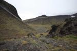](https://www.tkg.org.ua/node/27938)  

Фото 09.01. перевал Плотина. Вид в долину р. Сухая Хапица

[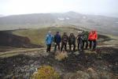](https://www.tkg.org.ua/node/27939)  

Фото 09.02. Кратер Юпитер

[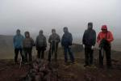](https://www.tkg.org.ua/node/27940)  

Фото 09.03. Кратер Марс

**День 10.**

Низкая облачность и лёгкая морось. Держим путь на влк. Безымянный. Пока собрались, дождь закончился, и где-то над Толбачиком пробились лучи солнца.

Движение начали в 10:00 по тропе в сторону жандарма в ярко выраженной форме дивана. Тропу потеряли через пару километров, поднимались в лоб, где снова выходим на одну из троп. На высоте 1760м попадаем в плотную облачность, в которой шли до самой вершины, тропу же давно потеряли, склон покрыт свежим снегом. Поднявшись на жандарм начинаем движение "в лоб" по намеченному ещё в ясную погоду пути. Крутизна склона 30-35?, много живых камней. Индивидуальная самостраховка. На высоте 2600 м. пробиваем облачность и при ясной погоде поднимаемся на кромку старого кратера. Перед глазами виды просто фантастические, во всех деталях видны массивы Толбачика и Зимины, вулканы Большая Удина и южный склон Камня, просматривается влк. Ключевская сопка.

влк. Безымянный один из самых активных вулканов Камчатки. До 60х гг. неприметная сопка не имела даже названия. В 1955 г. вулкан начал проявлять активность и вулканологи стали пророчить довольно сильное извержение не заставившее себя долго ждать. 30 марта 1956 г случилась одна из самых ярких вулканических катастроф.

Внутренний конус жив, активно фумаролит, слышны камнепады. Возвращаемся по пути подъёма. В туман спускающиеся группы представляют особую опасность для тех, кто поднимается, путь один, много живых валунов, которые лежат на честном слове.

Спустившись ниже уровня снега вновь выходим на теряющуюся тропу. Ныряем в удобный на первый взгляд каньон справа по ходу движения. Лучше этого не делать, а искать тропу. Спуск не сложный, но увиденные снизу нависающие глыбы вызывали желание убраться. Район сейсмически активный, подобные склоны лучше избегать.

[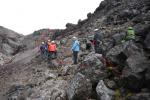](https://www.tkg.org.ua/node/27941)  

Фото 10.01.

[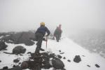](https://www.tkg.org.ua/node/27942)  

Фото 10.02. Входим в плотную облачность

[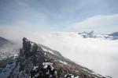](https://www.tkg.org.ua/node/27943)  

Фото 10.03. Кромка старого кратера

[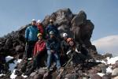](https://www.tkg.org.ua/node/27944)  

Фото 10.04.

  

Фото 10.05. вулканы Камень и Ключевская Сопка

  

Фото 10.06. вулкан Овальная Зимина

**День 11.**

За 1 переход поднимаемся с лагеря на пер. Безымянный и спускаемся в долину р. Студёная.

Берём азимут в направлении ледника Богдановича. По ходу движения преодолеваем с два десятка распадков и за 1,5 перехода подходим к руч. Средний Размывочный. Из-за обильных осадков в предыдущие дни ручей полноводен больше чем полностью, стоит грохот от валунов которые перекатывает стремительный поток. Спускаемся 1,5 км вниз и не без труда найдя подходящее место, переправляемся на противоположный берег.

Изначально планировалось бродить р. Студёную на противоположный берег и по маркированной турами тропе траверсировать по моренам склоны влк. Ушковский чтобы в верховьях выйти на ледник Богдановича. Учитывая полноводность рек, ни о каком быстром броде в верховьях Студёной не может быть и речи, она слишком широка, сбрасывать высоту и искать рукава не вариант. Принимаю решение идти траверсом склонов влк. Камень, чтобы при первом удобном случае вверху выйти на ледник.

Во второй половине дня опускается туман, видимость падает. Траверсируем крутые склоны и при первом удобном случае ставим лагерь.

Пока налаживали свой быт и вспахивали ледорубами места под палатки, заметили как в пару десятков метров от нас неспеша прошел огромных размеров бурый медведь.

  

Фото 11.01. пер. Безымянный (1500, нк)

  

Фото 11.02. Очередной овраг, которых там немеряно

  

Фото 11.03. руч. Верхний Размывочный

  

Фото 11.04. Полноводные притоки р. Студёная

**День 12.**

Продолжаем дальше, набирая высоту идти в сторону Камня. На высоте 2000 м. обнаружены ещё удобные места под палатки у всё те же условные ручьи. Весь день ураганный ветер в лицо. В 16:30 выходим к северо-западному подножию влк. Камень. Временами, полностью ясная погода сменяется плотным туманом. В верхней части под Камнем ледник открыт, но разорван. По информации из отчётов, удобное место ночёвки находится на кратере Перевальный, где когда-то находилась метеостанция, на стыке ледника Богдановича и плато Малая Антарктида и идти до него примерно 4-6 км. Учитывая сюрпризы с туманом, есть шанс, сбившись с пути заночевать на леднике, а выглядел он с площадки как для ночёвки довольно удручающе. Ставим лагерь на отрогах Камня, основательно укрепив палатки, чтобы не проснутся на Ключевском. Начинает дуть такое, что камни не вложили разве что в спальник.

  

Фото 12.01. Ночные гости в лагере

  

Фото 12.02. Движение по моренам ледника Богдановича

  

Фото 12.03.

  

Фото 12.04. С места стоянки на моренах ледн. Богдановича. Вулканы Ушковский и Крестовский

  

Фото 12.05. Лагерь. На заднем плане влк. Ключевская Сопка

**День 13.**

Утром проснулись от криков дежурных: "Вулкан извергается!!! Что делать??" Всю ночь был такой ветер, что каждая сторона палатки была подветренная, даже снизу, потому на такие шутки даже не хотелось реагировать. Но когда эта же фраза была прочно подкреплена крепким словцом, пришлось открыть тамбур и увидеть незабываемое зрелище. Как потом узнали от вулканологов, утром 2 сентября в 7:00 влк. Безымянный сделал три пепловых выброса на высоту 13 км, шлейф пепла унесло на 40 км на юго-восток в противоположную сторону от нас.

Выдержав паузу, продолжили готовку и сбор лагеря. Вышли в 11:00, за 30 мин. спустились по довольно крутому, местами обледенелому склону 40-45? на ледник, одели кошки. Движемся осторожно применяя индивидуальную страховку, в связках нужды нет, ледник полностью открыт. Оставив позади трещины, снимаем кошки и продолжаем движение по лабиринтам ледяных увалов ледника Богдановича, выйдя на 1,5 западнее севернее кратера Перевальный на плато Малая Антарктида. На границе плато и ледника вновь выходим в лабиринт размытых водными потоками трещин. Само плато подтаявшее, покрытое мелким шлаком. Погода ясная, идти между четырёх исполинов просто приятно. Движемся строго на север, по азимуту 17? в направлении пер. Средний, который соединяет верховья ледника Эрмана и ледник Средний. В верхней части ледника Эрмана встречаются трещины.. На ночёвку становимся на пер. Средний.

  

Фото 13.01. Извержение вулкана Безымянный

  

Фото 13.02. Спуск на ледник Богдановича

  

Фото 13.03. Путь спуска на ледник Богдановича

  

Фото 13.04. ледник Богдановича

  

Фото 13.05. ледник Богдановича

  

Фото 13.06. плато Малая Антарктида

  

Фото 13.07. плато Малая Антарктида

  

Фото 13.08. группа на пер. Средний

**День 14.**

Утром сюрприз. Видимость трудно определить, но соседнюю палатку видно. Снега навалило 30 см, в оврагах, где не было ветра - до метра, и продолжает обильно посыпать. Траверсируем склон влк. Средний в сторону оз. Державина. Первые два километра сплошные лововые овраги, которых не видно под толщей снега, что ведёт за собой постоянные полёты в неизвестность. Выходим на ровный, но обледенелый под снегом склон 20? -25?, одеваем кошки. Весь дневной переход идём "по приборам". Ландшафт более-менее определяется по чёрным, выступающим из под снега камням, диктующим характер склона, который благодаря этому всё же сопоставим с картой. Главное держаться между ледниками Средний и Эрмана срезая склоны сопок в направлении оз. Державина. Лагерь ставим за 2 часа до заката, убедившись в своём точном месторасположении и сравнительной безопасности от лавиноопасных склонов. Снег продолжает идти не переставая так же всю ночь, ночью приходится очищать палатки от снега, который большим грузом давит на них.

  

Фото 14.01.

  

Фото 14.02.

  

Фото 14.03.

  

Фото 14.04.

  

Фото 14.05.

**День 15.**

Утром видимость лучше. Сильный ветер, поземка. Продолжаем движение в сторону оз. Державина стараясь держаться вершин вытянутых сопок минуя любые распадки. С головой уйти в сугроб не позволяют разве что рюкзаки, выполняющие функции поплавков. У западной части оз. Державина, на стыке с ледником Эрмана увидели здание, предположительно домик вулканологов. Решаем продолжать движение, хотя погода начинает портится, впереди на горизонте формируется циклон. Обходя оз. Державина слева выходим на ещё одно строение, оказавшееся туристическим приютом, где всё же из соображений безопасности решаем остановится на ночь. До зелёнки остаётся пол дневного перехода, но без снегоступов при назревающей пурге, сколько на это может уйти времени не известно.

Приют Мацеевского. Основательно отстроенное шестигранное здание из камня и бетона. Внутри двухъярусные нары на которых может комфортно разместиться до 10 человек. Есть печка, которую топить собственно нечем и в нашем случае особо незачем. Ненадолго спасает количество личного мусора накопившегося за две недели похода.

  

Фото 15.01.

  

Фото 15.02. Справа ледник Эрмана

  

Фото 15.03.

  

Фото 15.04.

  

Фото 15.05.

  

Фото 15.06. приют Мацеевского

  

Фото 15.07.

  

Фото 15.08.

**День 16.**

Выход в 9:00. Поземка. Спускаемся к озеру, продолжаем движение держась левее к леднику Эрмана. Через 1 км. преодолеваем склон 40? и через 2 перехода спускаемся на луга.

Изначально планировалось выйти в пос. Ключи через соп. Домашнюю, но между Ключевской группой и Ключами находится военный полигон, и самый логичный путь нередко приводит группы в руки военных. Несмотря на полученное заранее, ещё в Киеве разрешение на выход в посёлок, ходить по полигону желания не было. Решаем огибая подножье влк. Ключевская Сопка продолжать движение до б\\в "Подкова", тем самым решая проблему с пополнениями запасов воды которая в достаточных количествах должна выходить с ледников. От б\\в "Подкова" идёт прямая наезженная дорога, по которой через 16 км. можно быстро выйти на трассу Усть-Камчатск - Ключи.

Спустившись ниже уровня снега берём путь правее, ныряя в пересохший каньон. По нему выходим к р. Сухая в удобном для брода месте. Поток грязный, времени отстаивать нет, запасы воды не пополняем в уверенности найти более чистую. И это было ошибкой, до места ночёвки шли с полулитровой бутылкой на группу.

Через час понимаем, что драться через стланник и пересекать овраги мы будем долго, ныряем в первый попавшийся визуально удобный каньон с песчаным дном. Это оказался приток р. Сухая, который проходит левее кратера Туило. Через пол перехода мы уже дерёмся через джунгли, что довольно контрастно по сравнению с утром. Под ногами в кустах постоянно встречаются узкие щели глубиной до метра. Практически весь дневной переход в зелёной части проходит по каньонам заросшим стлаником и труднопроходимым высокотравьем.

Вечером выходим к широкому руслу р. Сухая. Разлив шириной 70 метров, посреди реки течёт скудный ручеёк глубиной 20 см. Судя по влажной почве, полноводность реки зависит больше от времени суток, а не времени года во время паводков. Лагерь ставим на высоком травянистом берегу.

  

Фото 16.01. влк. Ключевская Сопка

  

Фото 16.02.

  

Фото 16.03. Спуск в Ключи. На заднем плане вулкан Шивелуч

  

Фото 16.04. Притоки р. Сухая

  

Фото 16.05. р. Сухая

  

Фото 16.06. Участки высокотравья

  

Фото 16.07. Ольховник

**День 17.**

Выход в 07:45. Движемся по руслу р. Сухая, оставляя по бокам труднопроходимые заросли. Постепенно русло превращается в каньон, преодолеваем по верхам два не пропуска. Во время третьего не пропуска поднимаемся левым по ходу движение крутому склону 45?, местами до 60? и выходим на тропу, по которой движемся 6-7 км, пока она не потерялась в разливе на стыке р. Сухая и руч. Столбовой. Выходим снова на русло реки, где через 4 км встречаем автомобильный след, по которому выходим в пос. Ключи.

  

Фото 17.01. каньоны р. Сухая

  

Фото 17.02. 17.01. каньоны р. Сухая

  

Фото 17.03. р. Сухая. Преодоление непропуска

  

Фото 17.04. р. Сухая в нескольких километрах от п. Ключи

  

Фото 17.05. Финиш. пос. Ключи

3.2. График движения

<table><tbody><tr><td>День похода</td><td>- отрезка маршрута</td><td>Название отрезка</td><td>Время прохождения</td><td>Расстояние, перепад высот</td><td>Описание отрезка</td><td>Метеоусловия (утро\обед\вечер)</td></tr><tr><td>1</td><td>2</td><td>3</td><td>4</td><td>5</td><td>6</td><td>7</td></tr><tr><td>21 августа 2012 г.</td><td>1.1.</td><td>б\в "Ленинрадская" - мемориальный камень</td><td>08:00 - 08:50</td><td></td><td>грунтовая колея, вулканический шлак</td><td>+10, туман</td></tr><tr><td>1 день</td><td></td><td></td><td>09:00 - 09:50</td><td>7,6</td><td></td><td>+19, ясно</td></tr><tr><td></td><td></td><td></td><td>10:00 - 10:30</td><td></td><td></td><td>+7, ясно</td></tr><tr><td></td><td>1.2.</td><td>мемориальный камень - соп. Конус ?2</td><td>10:45 - 11:20</td><td>1,3</td><td>тропа, склоны ~30?</td><td></td></tr><tr><td></td><td>1.3.</td><td>соп. Конус ?2 - соп. Горшкова</td><td>11:45 - 12:15</td><td>1,1</td><td>тропа, склоны ~30?</td><td></td></tr><tr><td></td><td>1.4.</td><td>соп. Горшкова - мемориальный камень</td><td>12:30 - 12:50</td><td>0,9</td><td>тропа, склоны ~30?</td><td></td></tr><tr><td></td><td>1.5.</td><td>мемориальный камень - пещера Звезда</td><td>13:00 - 13:50</td><td>6,8</td><td>грунтовая колея, шлак</td><td></td></tr><tr><td></td><td></td><td></td><td>14:00 - 14:35</td><td></td><td></td><td></td></tr><tr><td></td><td>1.6.</td><td>переща Звезда - б\в "Ленинградская"</td><td>15:00 - 15:50</td><td>14,2</td><td>грунтовая колея, вулканический шлак</td><td></td></tr><tr><td></td><td></td><td></td><td>16:00 - 16:50</td><td></td><td></td><td></td></tr><tr><td></td><td></td><td></td><td>17:00 - 18:20</td><td></td><td></td><td></td></tr><tr><td></td><td></td><td></td><td>18:30 - 19:30</td><td></td><td></td><td></td></tr><tr><td></td><td></td><td></td><td></td><td>Перепад высот (+ 1496 \ - 1496)</td><td></td><td></td></tr><tr><td></td><td></td><td></td><td>ЧХВ: 9ч 35м</td><td>31,97 км</td><td></td><td></td></tr><tr><td>22 августа 2012 г.</td><td>2.1.</td><td>б\В "Ленинрадская" - конус 1941 г.</td><td>08:00 - 08:50</td><td>3,8</td><td>вулканический шлак</td><td>+12, ясно</td></tr><tr><td>2 день</td><td></td><td></td><td>09:00 - 09:25</td><td></td><td></td><td>+25, ясно</td></tr><tr><td></td><td>2.2.</td><td>конус 1941 г - руч. Сухая Промоина</td><td>09:40 - 10:40</td><td>2,7</td><td>тропа</td><td>+20, ясно</td></tr><tr><td></td><td>2.3.</td><td>руч. Сухая Промоина - кратер Толбачика</td><td>10:50 - 11:30</td><td>6,3</td><td>тропа</td><td></td></tr><tr><td></td><td></td><td></td><td>11:40 - 12:30</td><td></td><td></td><td></td></tr><tr><td></td><td></td><td></td><td>12:45 - 13:30</td><td></td><td></td><td></td></tr><tr><td></td><td></td><td></td><td>13:45 - 14:40</td><td></td><td></td><td></td></tr><tr><td></td><td>2.4.</td><td>кратер Толбачика - Толбачинское плато</td><td>15:40 - 16:00</td><td>1,7</td><td colspan="2">участок несложных скал, плато</td></tr><tr><td></td><td>2.5.</td><td>Толбачинское плато - б\в "Ленинградская"</td><td>16:30 - 17:20</td><td>13,5</td><td colspan="2">тропа, вулканический шлак</td></tr><tr><td></td><td></td><td></td><td>17:30 - 18:20</td><td></td><td></td><td></td></tr><tr><td></td><td></td><td></td><td>18:30 - 19:20</td><td></td><td></td><td></td></tr><tr><td></td><td></td><td></td><td>19:30 - 20:45</td><td></td><td></td><td></td></tr><tr><td></td><td></td><td></td><td>21:00 - 21:45</td><td></td><td></td><td></td></tr><tr><td></td><td></td><td></td><td></td><td>Перепад высот (+ 1838 \ - 1838)</td><td></td><td></td></tr><tr><td></td><td></td><td></td><td>ЧХВ: 10ч 20м</td><td>28,03 км</td><td></td><td></td></tr><tr><td>23 августа 2012 г.</td><td>3.1.</td><td>б\в "Ленинрадская" - конус 1941 г</td><td>09:00 - 09:20</td><td></td><td>вулканический шлак</td><td>+15, ясно</td></tr><tr><td>3 день</td><td></td><td></td><td>09:30 - 10:10</td><td>3,1</td><td></td><td>+23, ясно</td></tr><tr><td></td><td></td><td></td><td>10:20 - 11:10</td><td></td><td></td><td>+13, гроза</td></tr><tr><td></td><td>3.2.</td><td>конус 1941 г - б\в "Толуд"</td><td>11:30 - 12:15</td><td>9</td><td>долина пересечённая оврагами</td><td></td></tr><tr><td></td><td></td><td></td><td>12:30 - 13:15</td><td></td><td></td><td></td></tr><tr><td></td><td></td><td></td><td>14:20 - 15:10</td><td></td><td></td><td></td></tr><tr><td></td><td></td><td></td><td>15:40 - 16:10</td><td></td><td></td><td></td></tr><tr><td></td><td></td><td></td><td></td><td>Перепад высот (+ 457 \ - 210)</td><td></td><td></td></tr><tr><td></td><td></td><td></td><td>ЧХВ: 4ч. 35</td><td>12,1 км</td><td></td><td></td></tr><tr><td>24 августа 2012 г.</td><td>4.1.</td><td>б\в "Толуд" - пер. Толуд</td><td>09:30 - 10:00</td><td>8,6</td><td>долина пересечённая оврагами</td><td>+7, ясно</td></tr><tr><td></td><td></td><td></td><td>10:20 - 11:00</td><td></td><td></td><td>+13, ясно</td></tr><tr><td></td><td></td><td></td><td>11:15 - 12:05</td><td></td><td></td><td>+6, ясно</td></tr><tr><td></td><td></td><td></td><td>12:10 - 12:30</td><td></td><td></td><td></td></tr><tr><td>4 день</td><td>4.2.</td><td>пер. Толуд - пруд</td><td>14:00 - 14:45</td><td>4,14</td><td>пересохшее русло реки</td><td></td></tr><tr><td></td><td></td><td></td><td>15:00 - 15:30</td><td></td><td></td><td></td></tr><tr><td></td><td></td><td></td><td></td><td>Перепад высот (+ 780 \ -212)</td><td></td><td></td></tr><tr><td></td><td></td><td></td><td>ЧХВ: 3ч. 30м.</td><td>12,74 км</td><td></td><td></td></tr><tr><td>25 августа 2012 г.</td><td>5.1.</td><td>пруд - пер. Гамми (под перевал)</td><td>08:15 - 09:00</td><td>12,8</td><td>долина. Подьем на пер. по осыпному склону 30?-40?</td><td>+8, ясно</td></tr><tr><td>5 день</td><td></td><td></td><td>09:35 - 10:45</td><td></td><td></td><td>+15, облачно, морось</td></tr><tr><td></td><td></td><td></td><td>10:55 - 11:40</td><td></td><td></td><td>+5, ясно</td></tr><tr><td></td><td></td><td></td><td>11:55 - 12:40</td><td></td><td></td><td></td></tr><tr><td></td><td></td><td></td><td>12:50 - 13:30</td><td></td><td></td><td></td></tr><tr><td></td><td>5.2.</td><td>пер. Гамми - верховья руч. Сухая Тополевая</td><td>14:13 - 16:00</td><td>1,74</td><td colspan="2">спуск по осыпному склону 30?</td></tr><tr><td></td><td></td><td></td><td>16:30 - 17:30</td><td></td><td></td><td></td></tr><tr><td></td><td></td><td></td><td></td><td>Перепад высот (+ 980 \ -262)</td><td></td><td></td></tr><tr><td></td><td></td><td></td><td>ЧХВ: 5ч. 50м.</td><td>14,54 км</td><td></td><td></td></tr><tr><td>26 августа 2012 г.</td><td>6.1.</td><td>верховья руч. Сухая Тополевая - верховья руч. Поднебесный</td><td>09:00 - 09:45</td><td>6,1</td><td>русло реки, травянистый отрог 20? на подъем, 35? на спуск</td><td>+13, ясно</td></tr><tr><td>6 день</td><td></td><td></td><td>10:00 - 10:50</td><td></td><td></td><td>+19, ясно</td></tr><tr><td></td><td></td><td></td><td>11:00 - 12:05</td><td></td><td></td><td>+10, ясно</td></tr><tr><td></td><td>6.2.</td><td>верховья руч. Поднебесный - безымянный перевал между вершинами 1925,5 и 1846,2</td><td>12:20 - 13:20</td><td>0,9</td><td>осыпной склон 35?</td><td></td></tr><tr><td></td><td>6.3.</td><td>безымянный перевал между вершинами 1925,5 и 1846,2 - руч. Родниковый Ключ</td><td>14:30 - 15:40</td><td>3,5</td><td>склон 25?-35?</td><td></td></tr><tr><td></td><td>6.4.</td><td>руч. Родниковый Ключ - б\в "Плотина"</td><td>16:00 - 16:45</td><td>11,8</td><td>шлаковые поля</td><td></td></tr><tr><td></td><td></td><td></td><td>17:00 - 17:45</td><td></td><td></td><td></td></tr><tr><td></td><td></td><td></td><td>18:00 - 18:45</td><td></td><td></td><td></td></tr><tr><td></td><td></td><td></td><td>19:00 - 19:50</td><td></td><td></td><td></td></tr><tr><td></td><td></td><td></td><td>20:05 - 21:00</td><td></td><td></td><td></td></tr><tr><td></td><td></td><td></td><td>21:10 - 21:45</td><td></td><td></td><td></td></tr><tr><td></td><td></td><td></td><td></td><td>Перепад высот (+ 1293 \ -670)</td><td></td><td></td></tr><tr><td></td><td></td><td></td><td>ЧХВ: 9ч 25м</td><td>22,3 км</td><td></td><td></td></tr><tr><td>27 августа 2012 г.</td><td>7.1.</td><td>Днёвка</td><td>0</td><td>0</td><td></td><td>ясно</td></tr><tr><td>7 день</td><td></td><td></td><td>0</td><td>0</td><td></td><td></td></tr><tr><td>28 августа 2012 г.</td><td>8.1.</td><td>Вынужденная отсидка по погодным</td><td>0</td><td>0</td><td></td><td>дождь, видимость 50-100м</td></tr><tr><td>8 день</td><td></td><td>условиям</td><td>0</td><td>0</td><td></td><td></td></tr><tr><td>29 августа 2012 г.</td><td>9.1.</td><td>б\в "Плотина" - пер. Плотина</td><td>12:00 - 13:10</td><td>3,6</td><td>долина, подьем на перевал 30? по хорошей тропе.</td><td>+8, дождь</td></tr><tr><td>9 день</td><td>9.2.</td><td>пер. Плотина - кратер Юпитер</td><td>13:20 - 14:00</td><td>5,7</td><td>спуск с перевала по тропе, после - долина изрезанная оврагами вулканического происхождения</td><td>+12, дождь</td></tr><tr><td></td><td></td><td></td><td>14:15 - 15:00</td><td></td><td></td><td>+5, мокрый снег</td></tr><tr><td></td><td>9.3.</td><td>кратер Юпитер - кратер Марс</td><td>15:30 - 16:10</td><td>2,6</td><td>тропа</td><td></td></tr><tr><td></td><td>9.4.</td><td>кратер Марс - б\в "Плотина"</td><td>16:25 - 17:10</td><td>4,3</td><td colspan="2">тропа, пересохшая долина</td></tr><tr><td></td><td></td><td></td><td>17:20 - 18:05</td><td></td><td></td><td></td></tr><tr><td></td><td></td><td></td><td></td><td>Перепад высот (+ 802 \ -802)</td><td></td><td></td></tr><tr><td></td><td></td><td></td><td>ЧХВ: 4ч. 45м.</td><td>16,27 км</td><td></td><td></td></tr><tr><td>30 августа 2012 г.</td><td>10.1.</td><td>б\в "Плотина" - влк. Безымянный</td><td>10:00 - 10:50</td><td>5,85</td><td>тропа до жандарма, участки осыпного склона до 45?, потом по склону 30-35? до кромкии кратера, снег.</td><td>+6, дождь, видимость до 100м</td></tr><tr><td>10 день</td><td></td><td></td><td>11:05 - 11:40</td><td></td><td></td><td>+10, переменная обл.</td></tr><tr><td></td><td></td><td></td><td>11:55 - 12:45</td><td></td><td></td><td>+5, ясно, сильный ветер</td></tr><tr><td></td><td></td><td></td><td>13:00 - 13:50</td><td></td><td></td><td></td></tr><tr><td></td><td>10.2.</td><td>влк. Безымянный - б\в "Плотина"</td><td>15:10 - 16:10</td><td>5,85</td><td></td><td></td></tr><tr><td></td><td></td><td></td><td>16:20 - 17:00</td><td></td><td></td><td></td></tr><tr><td></td><td></td><td></td><td>17:00 - 18:10</td><td></td><td></td><td></td></tr><tr><td></td><td></td><td></td><td>18:25 - 19:05</td><td></td><td></td><td></td></tr><tr><td></td><td></td><td></td><td></td><td>Перепад высот (+ 1561 \ -1561)</td><td></td><td></td></tr><tr><td></td><td></td><td></td><td>ЧХВ: 6ч. 30м.</td><td>11,7 км</td><td></td><td></td></tr><tr><td>31 августа 2012 г.</td><td>11.1.</td><td>б\в "Плотина" - пер. Безымянный</td><td>09:00 - 09:50</td><td>2,2</td><td>долина, подьем на перевал по тропе 25?</td><td>+14, пасмурно</td></tr><tr><td>11 день</td><td>11.2.</td><td>пер. Безымянный - р. Студёная</td><td>10:20 - 11:05</td><td>13</td><td>долина изрезанная баранкоссами</td><td>+10, морось, дождь</td></tr><tr><td></td><td></td><td></td><td>11:20 - 12:00</td><td></td><td></td><td>+8, морось</td></tr><tr><td></td><td></td><td></td><td>12:15 - 13:10</td><td></td><td></td><td></td></tr><tr><td></td><td></td><td></td><td>14:30 - 15:10</td><td></td><td></td><td></td></tr><tr><td></td><td></td><td></td><td>15:25 - 16:00</td><td></td><td></td><td></td></tr><tr><td></td><td></td><td></td><td>16:15 - 17:00</td><td></td><td></td><td></td></tr><tr><td></td><td></td><td></td><td></td><td>Перепад высот (+ 796 \ -140)</td><td></td><td></td></tr><tr><td></td><td></td><td></td><td>ЧХВ: 5ч. 10м.</td><td>15,2 км</td><td></td><td></td></tr><tr><td>1 сентября 2012 г.</td><td>12.1.</td><td>р. Студёная - склоны Камня - м.н.</td><td>09:30 - 10:15</td><td>9,9</td><td>траверс подножья влк. Камень по осыпным склонам 25?-35?</td><td>+10, переменная обл.</td></tr><tr><td>12 день</td><td></td><td></td><td>10:30 - 11:05</td><td></td><td></td><td>+8, ясно, сильный ветер</td></tr><tr><td></td><td></td><td></td><td>11:25 - 12:10</td><td></td><td></td><td>+1, ясно</td></tr><tr><td></td><td></td><td></td><td>12:25 - 13:15</td><td></td><td></td><td></td></tr><tr><td></td><td></td><td></td><td>14:30 - 15:15</td><td></td><td></td><td></td></tr><tr><td></td><td></td><td></td><td>15:30 - 16:25</td><td></td><td></td><td></td></tr><tr><td></td><td></td><td></td><td></td><td>Перепад высот (+ 902 \ -62)</td><td></td><td></td></tr><tr><td></td><td></td><td></td><td>ЧХВ: 4ч. 30м.</td><td>9,9 км</td><td></td><td></td></tr><tr><td>2 сентября 2012 г.</td><td>13.1.</td><td>лдн. Богдановича - плато Малая Антарктида</td><td>11:00 - 12:00</td><td>2,8</td><td>открытый ледник</td><td>-2, ясно</td></tr><tr><td>13 день</td><td>13.2.</td><td>плато Малая Антарктида - лдн. Эрмана</td><td>12:15 - 13:00</td><td>4,5</td><td>ледяное плато</td><td>+6, ясно</td></tr><tr><td></td><td></td><td></td><td>13:20 - 14:10</td><td></td><td></td><td>-5, ясно</td></tr><tr><td></td><td></td><td></td><td>14:25 - 15:15</td><td></td><td></td><td></td></tr><tr><td></td><td>13.3.</td><td>лдн. Эрамана - пер. Средний</td><td>16:20 - 17:10</td><td>3,4</td><td>открытый ледник</td><td></td></tr><tr><td></td><td></td><td></td><td>17:25 - 18:20</td><td></td><td></td><td></td></tr><tr><td></td><td></td><td></td><td>18:35 - 19:20</td><td></td><td></td><td></td></tr><tr><td></td><td></td><td></td><td></td><td>Перепад высот (+ 230 \ -86)</td><td></td><td></td></tr><tr><td></td><td></td><td></td><td>ЧХВ: 5ч. 50м.</td><td>10,7 км</td><td></td><td></td></tr><tr><td>3 сентября 2012 г.</td><td>14.1.</td><td>пер. Средний - морена лдн. Средний</td><td>10:00 - 10:30</td><td>7,7</td><td>"закрытые" щели, овраги. Обледенелые склоны до 25?</td><td>-3, снег, низкая видимость</td></tr><tr><td>14 день</td><td></td><td></td><td>11:00 - 11:50</td><td></td><td></td><td>-5, снег, низкая видимость</td></tr><tr><td></td><td></td><td></td><td>12:10 - 13:10</td><td></td><td></td><td>-8, снег, низкая видимость</td></tr><tr><td></td><td></td><td></td><td>14:00 - 15:00</td><td></td><td></td><td></td></tr><tr><td></td><td></td><td></td><td>15:15 - 16:10</td><td></td><td></td><td></td></tr><tr><td></td><td></td><td></td><td>16:25 - 17:05</td><td></td><td></td><td></td></tr><tr><td></td><td></td><td></td><td></td><td>Перепад высот(+ 120 \ -697)</td><td></td><td></td></tr><tr><td></td><td></td><td></td><td>ЧХВ: 4ч. 50м.</td><td>7,7 км</td><td></td><td></td></tr><tr><td>4 сентября 2012 г.</td><td>15.1.</td><td>морена лдн. Средний - приют Мацеевского</td><td>09:30 - 10:20</td><td>4,9</td><td>траврс склонов сопок со сбросом высоты</td><td>-5, снег, сильный ветер</td></tr><tr><td>15 день</td><td></td><td></td><td>10:30 - 11:30</td><td></td><td></td><td>-3, снег, сильный ветер</td></tr><tr><td></td><td></td><td></td><td>11:45 - 12:35</td><td></td><td></td><td>-9, ясно, на севере формировнаие циклона</td></tr><tr><td></td><td></td><td></td><td>12:45 - 13:40</td><td></td><td></td><td></td></tr><tr><td></td><td></td><td></td><td>13:55 - 14:30</td><td></td><td></td><td></td></tr><tr><td></td><td></td><td></td><td></td><td>Перепад высот (+ 52 \ -315)</td><td></td><td></td></tr><tr><td></td><td></td><td></td><td>ЧХВ: 4ч. 10м.</td><td>4,9 км</td><td></td><td></td></tr><tr><td>5 сентября 2012 г.</td><td>16.1.</td><td>приют Мацеевского - кратер Козловского</td><td>09:00 - 10:15</td><td>2,2</td><td>траврс склонов сопок со сбросом высоты</td><td>-5, ясно</td></tr><tr><td>16 день</td><td>16.2.</td><td>кратер Козловского - каньены притоков р. Сухая</td><td>10:30 - 11:20</td><td>6,1</td><td>склоны сопок</td><td>+10, ясно</td></tr><tr><td></td><td></td><td></td><td>11:30 - 12:20</td><td></td><td>луг</td><td>+15, ясно</td></tr><tr><td></td><td></td><td></td><td>12:35 - 13:15</td><td></td><td>луг</td><td></td></tr><tr><td></td><td>16.3.</td><td>каньоны притокоы р. Сухая - р. Сухая (м.н.)</td><td>14:30 - 15:10</td><td>12,4</td><td>ровный каньен с пещаним дном в верхней части, и заросший высокотравьем (временами стланником) на остальных 2\3 пути</td><td></td></tr><tr><td></td><td></td><td></td><td>15:25 - 16:10</td><td></td><td></td><td></td></tr><tr><td></td><td></td><td></td><td>16:25 - 17:00</td><td></td><td></td><td></td></tr><tr><td></td><td></td><td></td><td>17:15 - 18:00</td><td></td><td></td><td></td></tr><tr><td></td><td></td><td></td><td>18:15 - 19:00</td><td></td><td></td><td></td></tr><tr><td></td><td></td><td></td><td>19:15 - 19:40</td><td></td><td></td><td></td></tr><tr><td></td><td></td><td></td><td>20:00 - 20:40</td><td></td><td></td><td></td></tr><tr><td></td><td></td><td></td><td></td><td>Перепад высот (+ 215 \ -1196)</td><td></td><td></td></tr><tr><td></td><td></td><td></td><td>ЧХВ: 7ч. 40м.</td><td>20,7 км</td><td></td><td></td></tr><tr><td>6 сентября 2012 г.</td><td>17.1.</td><td>р. Сухая - пос. Ключи</td><td>07:45 - 08:50</td><td>21,4</td><td>каньен, непропуски. Со средины пути полузаросшая тропа по лесу, выход в Ключи по пересохшим разливам р. Сухая</td><td>+10, ясно</td></tr><tr><td>17 день</td><td></td><td></td><td>09:00 - 09:50</td><td></td><td></td><td>+18, ясно</td></tr><tr><td></td><td></td><td></td><td>10:00 - 11:00</td><td></td><td></td><td>+15, дождь</td></tr><tr><td></td><td></td><td></td><td>11:15 - 12:00</td><td></td><td></td><td></td></tr><tr><td></td><td></td><td></td><td>12:15 - 13:10</td><td></td><td></td><td></td></tr><tr><td></td><td></td><td></td><td>14:25 - 15:45</td><td></td><td></td><td></td></tr><tr><td></td><td></td><td></td><td>16:00 - 17:00</td><td></td><td></td><td></td></tr><tr><td></td><td></td><td></td><td></td><td>Перепад высот (+ 102 \ -551)</td><td></td><td></td></tr><tr><td></td><td></td><td></td><td>ЧХВ: 5ч. 50м.</td><td>21,4 км</td><td></td><td></td></tr><tr><td>ИТОГО (ЧХВ)</td><td>92ч. 30.мин</td><td></td><td></td><td></td><td></td><td></td></tr><tr><td>ИТОГО (км)</td><td>240,9 км</td><td></td><td></td><td></td><td></td><td></td></tr><tr><td>Средняя скорость: 2,6 км\час</td><td></td><td></td><td></td><td></td><td></td><td></td></tr></tbody></table>

  

3.3. Расчёт категории сложности похода

<table><tbody><tr><td>
Показатель маршрута
</td><td>
Норматив
</td><td>
Результат похода
</td></tr><tr><td>
Продолжительность маршрута (t), дней (не менее)
</td><td>
8
</td><td>
17 (из них 2 днёвки)
</td></tr><tr><td>
Протяженность маршрута (l), км (не менее)
</td><td>
160
</td><td>
240,9 (в зачёт 205,1)
</td></tr><tr><td>
Максимально допустимое количество баллов за локальные препятствия (ЛПmax)
</td><td>
30
</td><td>
40
</td></tr><tr><td>
Баллы за локальные препятствия (ЛП), идущие в зачет (не более)
</td><td>
6
</td><td>
40 (в зачёт 6)
</td></tr><tr><td>
Баллы за протяженные препятствия (ПП), идущие в зачет (не более)
</td><td>
20
</td><td>
46,3 (в зачёт 20)
</td></tr><tr><td>
Географический показатель (Г)
</td><td></td><td>
15
</td></tr><tr><td>
Автономность (А)
</td><td></td><td>
1
</td></tr><tr><td>
Коэффициент перепада высот (К)
</td><td></td><td>
1,7
</td></tr><tr><td>
Общее количество баллов, набранных категорируемым маршрутом (КС)
</td><td>
26 - 59
</td><td>
51,5
</td></tr></tbody></table>

  

**Баллы за локальные препятствия (ЛП):**

  

**Переправы**

<table><tbody><tr><td>
Категория
</td><td>
Кол-во\баллы
</td><td>
Название
</td><td>
Балы
</td></tr><tr><td>
н\к
</td><td>
4\2
</td><td>
руч. Поднебесный
</td><td rowspan="7">
8
</td></tr><tr><td></td><td></td><td>
руч. Родниковый Ключ
</td></tr><tr><td></td><td></td><td>
руч. Высокогорный
</td></tr><tr><td></td><td></td><td>
руч. Нижний Размывочный
</td></tr><tr><td></td><td></td><td>
р. Сухая Хапица
</td></tr><tr><td></td><td></td><td>
приток р. Студёная
</td></tr><tr><td></td><td></td><td>
р. Сухая (2)
</td></tr><tr><td>
1А
</td><td>
3\3
</td><td>
руч. Верхний Размывочный
</td><td>
1
</td></tr><tr><td colspan="3">
ВСЕГО
</td><td>
9
</td></tr></tbody></table>

  

**Перевалы**

<table><tbody><tr><td>
Категория
</td><td>
Кол-во\баллы
</td><td>
Название
</td><td>
Балы
</td></tr><tr><td>
н\к
</td><td>
1\2
</td><td>
пер. Толуд
</td><td rowspan="4">
8
</td></tr><tr><td></td><td></td><td>
пер. Плотина
</td></tr><tr><td></td><td></td><td>
пер. Безымянный
</td></tr><tr><td></td><td></td><td>
пер. Средний
</td></tr><tr><td>
1А
</td><td>
1\4
</td><td>
пер. Гамми
</td><td></td></tr><tr><td></td><td></td><td>
безымянный пер. между в.1925,5 и в. 1842,6
</td><td>
12
</td></tr><tr><td></td><td></td><td colspan="2">
влк. Безымянный (до кромки старого кратера)*
</td></tr><tr><td colspan="3">
ВСЕГО
</td><td>
20
</td></tr></tbody></table>

Так как в пешеходном походе, согласно методике не разрешается вершина категории 1А, кромка старого кратера влк. Безымянный рассматривается как препятствие в виде перевала

  

**Вершины**

<table><tbody><tr><td>
Категория
</td><td>
Кол-во\баллы
</td><td>
Название
</td><td>
Балы
</td></tr><tr><td>
н\к
</td><td>
1\4
</td><td>
соп. Горшкова
</td><td rowspan="2">
8
</td></tr><tr><td></td><td></td><td>
влк. Плоский Толбачик
</td></tr><tr><td colspan="3">
ВСЕГО
</td><td>
8
</td></tr></tbody></table>

  

**Каньоны**

<table><tbody><tr><td>
Категория
</td><td>
Кол-во\баллы
</td><td>
Название
</td><td>
Балы
</td></tr><tr><td>
н\к
</td><td>
3\2
</td><td>
руч. Верхний Размывочный
</td><td rowspan="2">
2
</td></tr><tr><td></td><td></td><td>
приток р. Сухая (2)
</td></tr><tr><td>
1А
</td><td>
2\2
</td><td>
р. Сухая
</td><td>
1
</td></tr><tr><td colspan="3">
ВСЕГО
</td><td>
3
</td></tr></tbody></table>

  

**ВСЕГО: 40**

**В ЗАЧЁТ: 6**

**Баллы за протяженные препятствия (ПП):**

  

**Растительное покрытие**

<table><tbody><tr><td>
Категория
</td><td>
Прот.\баллы
</td><td>
Название
</td><td>
Протяж.
</td><td>
Баллы
</td></tr><tr><td>
н\к
</td><td>
50\10
</td><td>
участок на выходе в пос. Ключи
</td><td>
8
</td><td rowspan="2">
2
</td></tr><tr><td></td><td></td><td>
участки под б\в "Толуд"
</td><td>
2
</td></tr><tr><td>
1А
</td><td>
12\5
</td><td>
лес и стланник в притоках р. Сухая, участки обхода непропусков в каньенах р. Сухая
</td><td>
8,5
</td><td>
3,5
</td></tr><tr><td colspan="4">
ВСЕГО
</td><td>
5,5
</td></tr></tbody></table>

  

**Осыпи, морены**

<table><tbody><tr><td>
Категория
</td><td>
Прот.\баллы
</td><td>
Название
</td><td>
Протяж.
</td><td>
Баллы
</td></tr><tr><td>
н\к
</td><td>
20\10
</td><td>
морена ледника Богдановича
</td><td>
10,2
</td><td rowspan="2">
7,2
</td></tr><tr><td></td><td></td><td>
траверс склонов и отрогов г. Средняя
</td><td>
4,2
</td></tr><tr><td colspan="4">
ВСЕГО
</td><td>
7,2
</td></tr></tbody></table>

  

**Пески**

<table><tbody><tr><td>
Категория
</td><td>
Прот.\баллы
</td><td>
Название
</td><td>
Протяж.
</td><td>
Баллы
</td></tr><tr><td>
н\к
</td><td>
40\20
</td><td>
влк. шлак от б\в "Ленинградская" на Северные БТТИ
</td><td>
18,2
</td><td rowspan="4">
15,3
</td></tr><tr><td></td><td></td><td>
влк. Пески от соп. Высокая до пещеры Звезда
</td><td>
4
</td></tr><tr><td></td><td></td><td>
влк. шлак от б\в "Ленинградская" на конус 1941 г.
</td><td>
6
</td></tr><tr><td></td><td></td><td>
влк. Шлак от конуса 1941 г в сторону пер. Толуд
</td><td>
2,5
</td></tr><tr><td colspan="4">
ВСЕГО
</td><td>
15,3
</td></tr></tbody></table>

  

**Снежные участки**

<table><tbody><tr><td>
Категория
</td><td>
Прот.\баллы
</td><td>
Название
</td><td>
Протяж.
</td><td>
Баллы
</td></tr><tr><td>
н\к
</td><td>
30\15
</td><td>
от оз. Державина в сторону истоков р. Сухая
</td><td>
3,5
</td><td>
1,7
</td></tr><tr><td>
1А
</td><td>
2\4
</td><td>
от пер. Средний в сторону оз. Державина
</td><td>
8,3
</td><td>
16,6
</td></tr><tr><td colspan="4">
ВСЕГО
</td><td>
18,3
</td></tr></tbody></table>

  

**ВСЕГО: 46,3**

**В ЗАЧЁТ: 20**

  

**3.4. Оценка категории сложности маршрута:**

1\. Определение коэффициента перепада высот (К):

K = 1 + DH \\ 30

где DН - суммарный перепад высот (включая подъемы и спуски) на активной части маршрута (в километрах)

К = 1 + 21,1 \\ 30 = 1,7

2\. По формуле КС = ЛП + ПП + (Г \* А \* К) на основании полученных оценок отдельных параметров категорируемого маршрута подсчитываем общее количество набранных баллов (КС):

где ЛП и ПП - баллы соответственно за локальные и протяженные препятствия

Г - географический показатель района похода

А - коэффициент автономности

КС = 6 + 20 + (15 \* 1 \* 1,7) = 51,5

3\. Общий километраж маршрута составил 240,96 км, из них 71,7 радиально.

240,9 - (71,7\\2) = 205,11 км

В зачёт 205,11 км

Баллы набранные в походе: 51,5

Согласно методике категорирования пешехоных походов, поход соответсвует входит в нормативные рамки 26-59 балов и соответсвет пешеходному походу 2 к.с.

  

4\. Выводы и рекомендации по прохождению маршрута

1.  При планировании маршрутов начиная с 2013 г. Рекомендуется учитывать факт извержения вулкана Плоский Толбачик, которое длиться почти месяц, с 29 ноября 2012 г. По информации Института вулканологии и сейсмологии ДВО РАН, извержение 2012 года на данный момент в несколько раз превосходит трещинные извержения 75-76 гг ХХ столетия. База вулканологов ?Ленинградская? и сейсмостанция ?Водопадная? уничтожены. Возможно, изменился ландшафт окрестных территорий и классические варианты восхождения на вулкан.
2.  Золотая осень на Центральной Камчатке, в частности Ключевской группе вулканов - это лирика. Группам рекомендуется иметь опыт зимних походов, устройства бивуаков зимой, а так же быть готовыми к резкой смене погодных условий в сторону более суровых.
3.  Перед выходом на маршрут, ознакомится с прогнозами и текущей активностью вулканов на сайте Камчатской группы реагирования на вулканические извержения (KVERT - Kamchatkan Volcanic Eruption Response Team). Таблица динамично обновляется: [http://www.kscnet.ru/ivs/kvert/van/](http://www.kscnet.ru/ivs/kvert/van/)
4.  Мобильная связь на маршруте присутствовала в двух местах: небольшой холм на уничтоженной б\\в ?Ленинградская? (оператор МТС), и на кромке старого кратера, во время радиального восхождения на вулкан Безымянный (оператор МТС). Ничего о себе не сообщили МКК, так как контактные номера остались внизу, а сеть ловили скорее на удачу.
5.  При планировании маршрута особое внимание обратить на пополнение водных запасов. Всё без исключения питание рек в районе - ледниковое. Наличие в них воды зависит от погодных условий, солнца и времени суток. Возможно, в нашем случае сказалось аномально сухое лето.
6.  Спустя время, свой маршрут мы бы начали не с б\\в ?Ленинградская?, а с б\\в ?Стол?, откуда можно сделать радиальный выход на впечатляющий каньон р. Сухая, а затем, траверсируя западный склон вулкана Толбачик, выйти к б\\в ?Ленинградская?, по пути посмотрев памятник природы Каменные изваяния, представляющие собой застывшую лаву причудливых форм.
7.  Практически весь маршрут был пройден на бензине Калоша. Возможность костра была только два раза, на б\\в ?Толуд? и в долине р. Сухая перед выходом в пос. Ключи. Учитывая неприятный опыт предыдущего похода в Хибины, когда примус отказал работать на средине маршрута, на Камчатку брали запасной.
8.  Упрощает жизнь наличие тента, который можно натянуть между двумя палатками в виде коридора, прижать камнями и с особым комфортом налаживать бивачный быт не обращая внимания на любую погоду за бортом.
9.  В Ключах пропуска никто не проверял, но с ФСБ лучше не шутить и сделать себе официальный пропуск.
10.  Под направлением азимута в отчёте, следует понимать магнитный азимут, а не истинный.

  

5\. Приложения

5.1. Перечень специального личного снаряжения

1.  Треккинговые палки
2.  Каска
3.  Нижняя обвязка
4.  Ледоруб
5.  Кошки
6.  Прусик
7.  Карабин (2 шт)

  

5.2. Перечень общественного и специального общественного снаряжения

1.  Палатка (3 шт)
2.  Тент
3.  Мультитопливный примус (2 шт)
4.  Котёл (2 шт)
5.  GPS
6.  Верёвка (50м - 2 шт, 30м - 1 шт)
7.  Бензин Калоша (15 л)
8.  Баклажка для отстаивая загрязнённой воды и марля (1 шт)

  

5.3. Состав ремонтного набора:

1.  Шило
2.  Иголки (?циганская? и обычная)
3.  Нитки (капроновая и обычная)
4.  Клей.
5.  Фастексы (3 шт)
6.  Скотч
7.  Латки
8.  Запасное колено для дуги палаток.

  

5.4 Состав аптечки

<table><tbody><tr><td colspan="5">
<b>ГРУПОВАЯ АПТЕЧКА</b>
</td></tr><tr><td colspan="5"></td></tr><tr><td>
<b>Класс</b>
</td><td>
<b>Название препарата</b>
</td><td>
<b>Колличество</b>
</td><td>
<b>Показания</b>
</td><td>
<b>Примечание</b>
</td></tr><tr><td>
<b><i>Болеутоляющее</i></b>
</td><td>
Кетанов
</td><td>
20 таб
</td><td>
Болеутоляющее широкого спектра действия (болевой синдром при вывихах, переломах и повреждениях мягких тканей, зубная боль)
</td><td>
10 мг каждые 4-6 ч. При сильных болях дозу можно увеличить до 20 мг 3-4 раза/сут
</td></tr><tr><td rowspan="2"></td><td>
Целекоксиб
</td><td>
20 таб
</td><td>
Растяжение, вывихи, боль в суставах
</td><td>
2 кап. в сутки
</td></tr><tr><td>
Диклофенак
</td><td>
4 ампулы
</td><td>
При растяжении (в особых случаях!) Побочные действия, слабость, тошнота
</td><td>
укол в зад на ночь глядя
</td></tr><tr><td>
<b><i>Жаропонижающее</i></b>
</td><td>
Парацетамол
</td><td>
48 таб.
</td><td>
Головная боль, зубная боль, болевой синдром (слабой и умеренной выраженности), высокая температура
</td><td>
0,35-0,5 г 3-4 раза в сутки. максимальная разовая доза для взрослых 1,5 г, максимальная суточная доза 3-4 г. Препарат следует принимать после приема пищи, запивая большим количеством воды.
</td></tr><tr><td>
<b><i>Простуда</i></b>
</td><td>
Амизон
</td><td>
40 таб.
</td><td>
анальгетик с противовоспалительными, жаропонижающими, интерфероногенными и иммуномодулирующими свойствами
</td><td>
Макс. разовая доза - 1 г, суточная - 2 г. Если нет других рекомендаций, с лечебной целью взрослым обычно назначают по 0,25?0,5 г (1-2 таблетки) 2-4 раза в день, до 2 г в сутки в течение 5-7 дней
</td></tr><tr><td></td><td>
Септефрил
</td><td>
12 таб.
</td><td></td><td>
12 таб. хватит на 1 человека. Иметь в личной аптечке.
</td></tr><tr><td>
<b><i>Антибитики</i></b>
</td><td>
Азитромицин
</td><td>
18 таб.
</td><td>
Интоксикация оргамизма с подозрением на пневмонию. Заболеание дыхательных путей
</td><td>
1 таб. в день, но не больше 5ти дней.
</td></tr><tr><td></td><td>
Ципрофлоксацин
</td><td>
40 таб.
</td><td>
Кишечная инфекция, почки, при бронхо лёгочных заболеваниях (если закончился Азитромицин
</td><td>
1 таб. два раза в день
</td></tr><tr><td></td><td>
Агуметин
</td><td>
8 шт
</td><td>
Посыпать рану, которая за 2-3 дня не заживает и гноится
</td><td>
В баночках для иньекций
</td></tr><tr><td>
<b><i>Желудочное</i></b>
</td><td>
Ношпа
</td><td>
40 таб.
</td><td>
Кишечная, почечная боли
</td><td>
120 -240 мг в сутки за 2-3 приёма
</td></tr><tr><td></td><td>
Сенадекс
</td><td>
12 таб.
</td><td>
Запор
</td><td>
по 1 таблетці на нічабо вранці натще. При необхідності дозу можна збільшити до 2?3 таблеток на один прийом.
</td></tr><tr><td></td><td>
Лоперамид
</td><td>
24 кап.
</td><td>
Диарея. (НИ в коем случае не давать при кишечной инфекции!!!)
</td><td>
при острой диарее первая доза - 4 мг, затем - по 2 мг после каждого акта дефекации в случае жидкого стула
</td></tr><tr><td></td><td>
Панкреатин
</td><td>
50 таб.
</td><td>
Диарея, Кишечная инфекция (Диарея + сильная интоксикация организма с ознобом, тепрераторуй и т.д.)
</td><td>
Препарат застосовують дорослим у дозі 1- 4 таблетки (що відповідає 8000 - 32000 ОД F.I.P. за ліпазою) з кожним прийомом їжі. Призначають таблетки внутрішньо перед або під час їди, не розжовуючи, запиваючи великою кількістю рідини, бажано не лужної: вода, фруктові соки. Добова доза для дорослих становить 48000 - 150000 ОД F.I.P. (6 -18 таблеток)
</td></tr><tr><td>
<b><i>Аллергия</i></b>
</td><td>
Лоратадин
</td><td>
10 таб.
</td><td>
Алергия на укусы насекомых
</td><td>
1 таб в сутки. Курс 10 дней\10 табл. Алергикам иметь в личной аптечке.
</td></tr><tr><td>
<b><i>Разное</i></b>
</td><td>
Градусник электронный
</td><td>
1 шт
</td><td></td><td></td></tr><tr><td></td><td>
Шприц (2 куб)
</td><td>
6 шт
</td><td></td><td></td></tr><tr><td></td><td>
Салфетка (спиртованая)
</td><td>
26 шт
</td><td></td><td></td></tr><tr><td></td><td>
Зажим
</td><td>
1 шт
</td><td></td><td></td></tr><tr><td></td><td>
Резиновые рукавицы
</td><td>
2 пары
</td><td></td><td></td></tr><tr><td></td><td>
Спирт
</td><td>
0,5 л
</td><td></td><td></td></tr><tr><td></td><td></td><td></td><td></td><td></td></tr><tr><td colspan="5">
<b>ЛИЧНАЯ АПТЕЧКА</b>
</td></tr><tr><td>
<b>Класс</b>
</td><td>
<b>Название препарата</b>
</td><td>
<b>Колличество</b>
</td><td>
<b>Показания</b>
</td><td>
<b>Примечание</b>
</td></tr><tr><td></td><td>
Панкреатин
</td><td></td><td></td><td></td></tr></tbody></table>

  
  

5.5 Продуктовая раскладка

<table><tbody><tr><td>
Дата
</td><td>
День
</td><td>
Завтраки
</td><td>
Обеды
</td><td>
Ужины
</td></tr><tr><td>
20.08
</td><td>
1
</td><td>
консервы
</td><td>
колбаса+сыр+сухари / ирис
</td><td>
мясное рагу (с) /
</td></tr><tr><td>
21.08
</td><td>
2
</td><td>
рис с овощами и мясом
</td><td>
консервы
</td><td>
<b>борщ , сало / печенье</b>
</td></tr><tr><td>
22.08
</td><td>
3
</td><td>
макароны по флотски (ф) /
</td><td>
колбаса+сыр+сухари / ирис
</td><td>
гречка с грибами и мясом (ф) / халва
</td></tr><tr><td>
23.08
</td><td>
4
</td><td>
ячневая с мясом (к)/ сушки сладкие
</td><td>
<b>лагман,</b>
</td><td>
банош (ф) /
</td></tr><tr><td>
24.08
</td><td>
5
</td><td>
мясное рагу (с) / казинаки
</td><td>
сало+сыр+колбаса+сухари / казинаки
</td><td>
кулеш
</td></tr><tr><td>
25.08
</td><td>
6
</td><td>
макароны с сыром/вафли
</td><td>
колбаса+сыр+сухари / ирис
</td><td>
<b>харчо/</b>
</td></tr><tr><td>
26.08
</td><td>
7
</td><td>
гречка с грибами и мясом (ф) / халва
</td><td>
сало+сыр+колбаса+сухари / казинаки
</td><td>
плов (к) /
</td></tr><tr><td>
27.08
</td><td>
8
</td><td>
банош (ф) / печенье
</td><td>
<b>борщ , сало, сухари / печенье</b>
</td><td>
макароны по флотски (ф) /
</td></tr><tr><td>
28.08
</td><td>
9
</td><td>
ячневая с мясом (к)/
</td><td>
сало+сыр+сухари / шоколад
</td><td>
<b>лагман,</b>
</td></tr><tr><td>
29.08
</td><td>
10
</td><td>
чанахи (баклажановый суп с гречневой крупой, томатами и картофелем) с мясом
</td><td>
колбаса+сыр+сухари / казинаки
</td><td>
мясное рагу (с) /
</td></tr><tr><td>
30.08
</td><td>
11
</td><td>
рис с овощами и мясом
</td><td>
сало+сыр+колбаса+сухари / ирис
</td><td>
чанахи (баклажановый суп с гречневой крупой, томатами и картофелем) с мясом
</td></tr><tr><td>
31.08
</td><td>
12
</td><td>
банош (ф) / печенье
</td><td>
<b>лагман,</b>
</td><td>
кулеш / сушки сладкие
</td></tr><tr><td>
1.09
</td><td>
13
</td><td>
гречка с грибами и мясом (ф) / халва
</td><td>
колбаса+сыр+сухари / казинаки
</td><td>
<b>борщ , сало, сухари / печенье</b>
</td></tr><tr><td>
2.09
</td><td>
14
</td><td>
ячневая с мясом (к)/
</td><td>
сало+сыр+колбаса+сухари / ирис
</td><td>
мясное рагу (с) / казинаки
</td></tr><tr><td>
3.09
</td><td>
15
</td><td>
рис с овощами и мясом
</td><td>
колбаса+сыр+сухари / казинаки
</td><td>
чанахи (баклажановый суп с гречневой крупой, томатами и картофелем) с мясом
</td></tr><tr><td>
4.09
</td><td>
16
</td><td>
мясное рагу (с) / казинаки
</td><td>
харчо/пряники
</td><td>
плов (к) / сушки сладкие
</td></tr><tr><td>
5.09
</td><td>
17
</td><td>
макароны с сыром/вафли
</td><td>
сало+сыр+колбаса+сухари / ирис
</td><td>
<b>борщ , сало / печенье</b>
</td></tr></tbody></table>

  

5.6. Координаты точек маршрута

<table><tbody><tr><td></td><td>
Latitude
</td><td>
Longitude
</td></tr><tr><td>
б\в ?Ленинградская?
</td><td>
55.736167
</td><td>
160.279875
</td></tr><tr><td>
Пещера ?Звезда?
</td><td>
55.641527
</td><td>
160.217014
</td></tr><tr><td>
Мемориальный камень
</td><td>
55.683520
</td><td>
160.248324
</td></tr><tr><td>
соп. Конус ?2
</td><td>
55.688225
</td><td>
160.245498
</td></tr><tr><td>
соп. Горшкова
</td><td>
55.681120
</td><td>
160.242306
</td></tr><tr><td>
Кратер Толбачика
</td><td>
55.816727
</td><td>
160.371300
</td></tr><tr><td>
б\в ?Толуд?
</td><td>
55.750476
</td><td>
160.424210
</td></tr><tr><td>
пер. Толуд
</td><td>
55.792771
</td><td>
160.489829
</td></tr><tr><td>
Пруд
</td><td>
55.806617
</td><td>
160.543335
</td></tr><tr><td>
Пруд ?2
</td><td>
55.812871
</td><td>
160.568498
</td></tr><tr><td>
Водопадик с недр Зимины
</td><td>
55.826481
</td><td>
160.650190
</td></tr><tr><td>
пер. Гамми
</td><td>
55.848071
</td><td>
160.660755
</td></tr><tr><td>
пер. без имени
</td><td>
55.879291
</td><td>
160.672427
</td></tr><tr><td>
Геодезический знак на спуске c безымянного перевала
</td><td>
55.893618
</td><td>
160.671495
</td></tr><tr><td>
б\в ?Плотина?
</td><td>
55.930892
</td><td>
160.583750
</td></tr><tr><td>
родник на б\в ?Плотина?
</td><td>
55.930741
</td><td>
160.575985
</td></tr><tr><td>
пер. Плотина
</td><td>
55.911901
</td><td>
160.544738
</td></tr><tr><td>
кратер Юпитер
</td><td>
55.899535
</td><td>
160.510746
</td></tr><tr><td>
кратер Марс
</td><td>
55.908583
</td><td>
160.536635
</td></tr><tr><td>
кратер влк. Безымянный
</td><td>
55.968259
</td><td>
160.586148
</td></tr><tr><td>
пер. Безымянный
</td><td>
55.928116
</td><td>
160.552862
</td></tr><tr><td>
лагерь на морене Богдановича
</td><td>
56.035390
</td><td>
160.538482
</td></tr><tr><td>
пер. Средний
</td><td>
56.110119
</td><td>
160.561700
</td></tr><tr><td>
В километре по правому борту, на кромке ледника Эрмана постройка
</td><td>
56.147273
</td><td>
160.630444
</td></tr><tr><td>
приют Мацеевского
</td><td>
56.163225
</td><td>
160.646564
</td></tr><tr><td>
Тропа
</td><td>
56.243535
</td><td>
160.845284
</td></tr><tr><td>
дом в Ключах
</td><td>
56.317588
</td><td>
160.857103
</td></tr></tbody></table>

  
  

5.7 Смета затрат на поход

В данной таблице не будут учтены затраты на авиабилеты и поезда. Разница в их стоимости не маленькая и составляет от 450 уе до 750 уе. Участики летели с Киева, Москвы и Ростова-на-Дону, соответственно назад возвращались тоже кто как, некоторые через три недели после окончания похода, что вело за собой дополнительные траты. Рассматривается временной отрезок со дня отправления на рейсовом автобусе с Петропавловск-Камчатского в Козыревск и обратно.

Стоит отметить, что не первый год авиакомпания Трансаэро делает распродажи на перелёты с 20х чисел сентября. Обрытный билет с ПК в Борисполь через Домодедово обошелся всего 2100 грн со сборами.

  

<table><tbody><tr><td>
Наименование
</td><td>
На 1 чел.
</td><td>
Всего
</td></tr><tr><td>
Автобус ?ПК - Козыревск?
</td><td>
1350 руб
</td><td>
10800 руб
</td></tr><tr><td>
Доплата за багаж ?ПК - Козыревск?
</td><td>
150 руб
</td><td>
1200 руб
</td></tr><tr><td>
Заброска ?Козыревск - б\в Ленинградская?
</td><td>
2250 руб
</td><td>
18000 руб
</td></tr><tr><td>
Пропуск
</td><td>
800 руб
</td><td>
6400
</td></tr><tr><td>
Услуги туристической фирмы ?Полюс-М?
</td><td>
250 руб
</td><td>
2000 руб
</td></tr><tr><td>
Бензин Калоша (15 л)
</td><td>
206,25 руб
</td><td>
1650 руб
</td></tr><tr><td>
Аптечка, батарейки, ремнабор
</td><td>
150 грн
</td><td>
1200 грн
</td></tr><tr><td>
Гостинница в п. Ключи
</td><td>
100 руб.
</td><td>
800 руб.
</td></tr><tr><td>
Иные расходы
</td><td>
1500 руб
</td><td>
12000 руб
</td></tr><tr><td>
Автобус ?Ключи - развилка на п. Эссо?
</td><td>
250 руб
</td><td>
2000 руб
</td></tr><tr><td>
Автобус ?Эссо - ПК?
</td><td>
1250 руб
</td><td>
10000 руб
</td></tr><tr><td>
Рекреационный сбор парка ?Ключевской?
</td><td>
300 руб
</td><td>
2400 руб
</td></tr><tr><td>
Страховка
</td><td>
350 грн
</td><td>
2800 грн
</td></tr><tr><td>
Продуктовая раскладка
</td><td>
250 грн
</td><td>
2000 грн
</td></tr><tr><td>
ИТОГО (грн)*
</td><td>
2977 грн
</td><td>
23816 грн
</td></tr></tbody></table>

  

По курсу 10 руб = 2,65 грн.

  

5.8 Расписание движения транспорта, время работы отделений связи и др.

**Расписание движения транспорта:**

1\. Автобус ?ПК - Козыревкс?. Ежедневное отправление с автостанции ?10 км? в 8:00

2\. Автобус ?ПК - Эссо?. Ежедневное отправление с автостанции ?10 км? в 8:00

3\. Последний городской автобус с г.П-К в г. Елизово отправляется в 20:00.

4\. Первый городской автобус с П-К. В г. Елизово отправляется в 06:45

5\. Автобус ?Ключи - ПК?. Ежедневное отправление с центра в 8:00

6\. Автобус ?Эссо - ПК? Ежедневное отправление с центра в 8:00

  

**Контактные адреса и телефоны:**

1\. МЧС в г. Петропавловк-Камчатский:

Халактырское шоссе 5. От Рынка (Комсомольская Площадь) автобусы ?14,24,27, ехать до остановки ПСС, пройти от неё выше 150 м.

Тел: 8(914)620-33-42

2\. Гостиница в п. Ключи. От магазина Чиполлино вверх, первый поворот на право. От дома на Партизанской 12 налево огромный коттеджный комплекс с размещением на любой вкус. Для неприхотливых туристов, по желанию, предоставляется чистенькие чердаки без удобств за 100 руб. На территории есть баня.

3\. Поселок Эссо. Гостиницы от 500 руб\\сутки. Мы заночевали в Корякском стойбище Чау-Чив в яранхаг, аутентично на оленьих шкурах, при костре, совершенно без соседей и не пожалели.

  

5.9 Список литературы, туристических отчетов и других источников информации

1\. Перечень классифицированных перевалов Камчатки

[http://www.turizmvnn.ru/cont/show/23213/](http://www.turizmvnn.ru/cont/show/23213/)

2\. Пешеходный поход 4 к.с., под руководством Ивлева В.И.

[http://x-lands.ru/kamchatka2008/kamchatka2008\_report/](http://x-lands.ru/kamchatka2008/kamchatka2008_report/)

3\. Пешеходный поход 5 к.с., под руководством Палиенко С.В.

[http://www.tkg.org.ua/node/24359](http://www.tkg.org.ua/node/24359)

4\. Пешеходный поход 3 к.с., под руководством Снисаренко С.И.

[http://alpklub.narod.ru/otKam04.html](http://alpklub.narod.ru/otKam04.html)

5\. Камчатская группа реагирования на вулканические извержения

[http://www.kscnet.ru/ivs/kvert/van/](http://www.kscnet.ru/ivs/kvert/van/)

6\. Картографический материал

[http://bardjur.fizteh.ru/maps/maps/kluch1km.html](http://bardjur.fizteh.ru/maps/maps/kluch1km.html)

7\. Каталог туристических отчётов

[http://tlib.ru](http://tlib.ru/)

  

5.10 **Благодарности:**

Группа очень признательна за технические советы по маршруту Ивлеву В.И., Палиенко С.В., и Романову М., а так же всем жителям Камчатки, кто помогал долгие недели до и после похода. В частности Елену Власову из туристической фирмы ?Камчатка-Этно? [http://kamchatka-etno.ru/](http://kamchatka-etno.ru/) за неоценимую помощь совершенно незнакомым людям.

  

6\. **Факультативная программа по посещению Южно-Камчатского природного парка на вулканы Мутновский и Горелый.**

<table><tbody><tr><td rowspan="2">
Вид туризма
</td><td rowspan="2">
Категория сложности
</td><td rowspan="2">
Протяженность активной части похода, км
</td><td colspan="2">
Продолжительность
</td><td rowspan="2">
Сроки проведения
</td></tr><tr><td>
Общая
</td><td>
Ходових дней
</td></tr><tr><td>
пешеходный
</td><td>
н\к
</td><td>
50,6
</td><td>
2
</td><td>
2
</td><td>
11.09.12 - 12.09.12
</td></tr></tbody></table>

  

**День 01 \[11.09.2012\]**

Водитель, которого нашли накануне по газете приехал на автостанцию г. Елизово (пригород Петропавловска-Камчатского) в 06:00 утра и уже через 15 минут мы мчались по трассе в сторону поселка Термальный. Дорога до вулкана Горелого заняла 4 часа, из которых только первый час она проходила по хорошей асфальтированной трассе, после - по разбитой дороге усыпанной камнями разных размеров, проходимой только для полноприводного транспорта.

Едем в полном тумане, но надежда умирает последней. Сами вулканологи часто сетуют на плохую погоду в этом р-не, из 10 выездов у некоторых 8 приходится на плотную облачность, решаем рискнуть. И о чудо! Буквально за 15 минут до финиша туман полностью уходит и наступает приятная солнечная погода.

Обычно водители подвозят до стандартной площадки, с которой начинают подъём на вулкан. Мы же сначала съездили посмотреть на огромную пещеру, образовавшуюся в доисторические времена при извержении Горелого. От площадки (точка BASE CAMP GOR) нужно повернуть направо, по шлаковому полю идёт хорошая колея и через 6 км вы на месте.

Вход хорошо заметен, от места, где обычно паркуют машины идут хорошо заметные тропки. Осмотр грота занял не более 30 минут, но оно того стоит, масштабы поразительные. В самой крайней части спустившись по двухметровой вертикальной надели доходим до конца пещеры, который заканчивается тупиком и поворачиваем назад.

Погрузившись в машину, возвращаемся назад к площадке (точка BASE CAMP GOR)

11:50 Начинаем подъём по хорошей тропе возле красной таблички, информирующей общественность, что вулкан находится в активной стадии извержения. Внимания можно не обращать, т.к. он в этой стадии уже не одно десятилетие. Через минут 20 прячем рюкзаки в незаметном с тропы распадке и в 13:10 мы уже на краю первого кратера влк. Горелый. Путь по настолько набитой хорошей тропе, что нельзя заблудиться даже в полный туман. Перепад высот между началом тропы и кромкой кратера - 750 метров.

На вулкане пробыли больше двух часов, сходили посмотреть дальние кратеры, очень красиво, уходить не хотелось.

15:30 начали спуск по пути подъёма к рюкзакам.

Сама кальдера пологая, от рюкзаков планировалось, не спускаясь вниз, взять азимут на вулкан Мутновский, чтобы не делать крюк. Когда на спуске нашла пелена тумана, решено всё же было спуститься вниз и идти по дороге, которая ведёт от площадки под Горелым (точка BASE CAMP GOR) на площадку под Мутновским (точка BASE CAMP MUT). Точек в GPS забито не было, бродить азимутом по шлаковым полям в тумане, означало гарантировано пропустить нужный поворот.

К вечеру подходим на развилку, которая информирует табличной о границе Южно-Камчатского заповедника и просьбой подготовить пропуска. Левее от таблички на холме виднеется дом, который принимаем за одну из хибар, изредка разбросанных в р-не и где вполне можно переночевать, погода портиться. От таблички до дома добрых 2 км, подходим к нему затемно. На хибару не похоже, вполне хорошее состояние, с металлической дверью и пластиковыми стеклопакетами на окнах. Рядом незапертая будка, предположительно для строителей, на шесть человек, чистая уютная, судя по наскальной живописи посещаемая туристами. Заночевали там :)

Результат дня:

Пройдено: 26,19 км

ЧХВ: 06:52

  

**День 02 \[12.09.2012\]**

Утром плотный туман, видимость метров 50. Выходим в 10:00.

В полукилометре от дома выходим на дорогу, двигаясь по которой постоянно держимся на развилках левее. Через 2 часа выходим к кальдере.

Народу полный аншлаг, рюкзаки прятать некуда, ставим просто посреди этого всего, насыпав на каждый рюкзак по горсти шлака, для отпугивания злых духов и по набитой тропе идём смотреть Мутновский. Дорога заняла 1,5 часа средним темпом, остановками на поглазеть.

С туманом нам везло, только поднялись на знаменитые фумарольные поля, солнце пробило облака и стало ясно. Сходили к активной воронке кратера Мутновский. К самому кратеру навешены перила.

Спустившись к рюкзакам, в 16:00 начинаем движение от р. Вулканная на хр. Отходящий в лоб. Через 200 м выходим на маркированную тропу, которая идёт траверсом склона хр. Отходящий в сторону соп. Двугорбая и в конце плавно выходит на некое подобие н\\к перевала. Спустившись с него, идём тракторной дорогой делающей через четыре километра резкий поворот в лево. По ней можно выйти к Мутновской ГеоТЭС с солидным крюком. Дорогу к Мутновской ГеоТЭС мы срезали от этого поворота по речке и парой непонятных сопок. Финиш.

Утром следующего дня в оговоренном месте нас забрала машина.

Результат дня:

Пройдено: 24,41 км

ЧХВ: 06:45

  

**Выводы и рекомендации:**

1.  На Мутновской ГеоТЭС находятся термальные источники и фумарольные поля, которые в народе называют Малой Долиной Гейзеров.
2.  Есть мобильная связь МТС. Beeline не обнаружили.
3.  Есть гостиница издали похожая на церковь. Ценовую политику не помню, но разведка донесла о возможности арендовать койко-места в неких бараках по 600 руб койко-место. По условиям не скажу, ночевали недалеко от источников в палатках.
4.  Машина ?Елизово - влк. Горелый? с договорённостью забрать нас через 2 дня ?Мутновская ГеоТЭС - г. Елизово? обошлась группе в 20000 руб.
5.  Недалеко от начала тропы на влк. Мутновский находится впечатляющий, судя по фотографиям, каньон с огромным водопадом. Мы на него не ходили по причине плотного тумана и желанием засветло дойти до Мутновской ГеоТЭС. Пропускать его не рекомендуется.
6.  Карта района:

[http://www.g151.ru/content/maps/disk9/N-57%20%20%20112%20%eb%20%20%28%d0%d4%20%28%cf%c5%d2%d0%ce%cf%c0%c2%cb%ce%c2%d1%ca-%ca%c0%cc%d7%c0%d2%d1%ca%c8%c9%29%29/N57-125%20%20%20%f1%ee%ef%20%20%cc%d3%d2%cd%ce%c2%d1%ca%c0%df%20%2074-87.jpg](http://www.g151.ru/content/maps/disk9/N-57%20%20%20112%20%eb%20%20%28%d0%d4%20%28%cf%c5%d2%d0%ce%cf%c0%c2%cb%ce%c2%d1%ca-%ca%c0%cc%d7%c0%d2%d1%ca%c8%c9%29%29/N57-125%20%20%20%f1%ee%ef%20%20%cc%d3%d2%cd%ce%c2%d1%ca%c0%df%20%2074-87.jpg)

  

Карта маршрута на вулканы Горелый и Мутновский

  

Пещера

  

Кратер Горелого

  

Кратер Горелого

  

Фумаролы Горелого

  

Движение во шлаковым полям в сторону влк. Мутновский

  

Фумарольные поля Мутновского

  

Группа движется на кромку активного кратера Мутновского

  

Мутновская ГеоТЭС

  

**Координаты Мутновский - Горелый**

<table><tbody><tr><td>
Пещера возле влк Горелый
</td><td>
52.606401
</td><td>
158.002514
</td></tr><tr><td>
СТАРТ. Начало подъема на Горелый (BASE CAMP GOR)
</td><td>
52.574044
</td><td>
158.090473
</td></tr><tr><td>
Кромка кратера влк. Горелый
</td><td>
52.556552
</td><td>
158.047192
</td></tr><tr><td>
Развилка. Стенд границы Южн-Кам. Парка
</td><td>
52.503784
</td><td>
158.116918
</td></tr><tr><td>
Домик
</td><td>
52.502143
</td><td>
158.135216
</td></tr><tr><td>
Подножье влк. Мутновский (BASE CAMP MUT)
</td><td>
52.480223
</td><td>
158.145088
</td></tr><tr><td>
Фумарольные поля влк. Мутновский
</td><td>
52.463241
</td><td>
158.168201
</td></tr><tr><td>
Активная воронка влк. Мутновский
</td><td>
52.460057
</td><td>
158.161629
</td></tr><tr><td>
Перевал на хр. Отходящий
</td><td>
52.499174
</td><td>
158.155450
</td></tr><tr><td>
Фумарольные поля у Мутновской ГеоТЭС
</td><td>
52.530283
</td><td>
158.192068
</td></tr><tr><td>
Мутновская ГеоТЭС
</td><td>
52.531902
</td><td>
158.195177
</td></tr></tbody></table>
